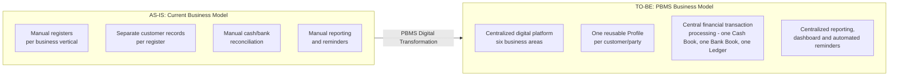
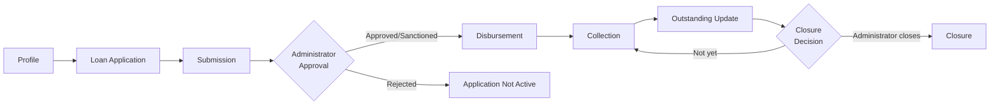
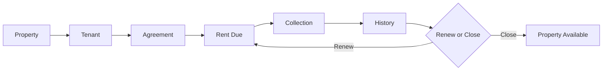
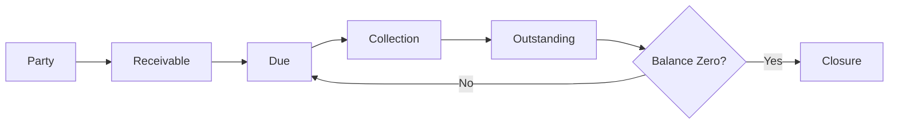
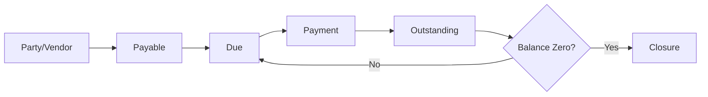

# BUSINESS REQUIREMENTS DOCUMENT
## Personal Business Management System (PBMS)
### Dhavanam Finance
### Florix Technologies Pvt. Ltd.

---

## Table of Contents

1. Document Control
2. Executive Summary
3. Business Background
4. Current State / AS-IS Analysis
5. Business Problems & Pain Points
6. Business Objectives
7. Business Vision & Future State
8. Stakeholder Analysis
9. User & Business Roles
10. Business Scope
11. Business Capability Model
12. Business Requirements (Overview)
13. Finance Business Requirements
14. Chit Fund Business Requirements
15. Rental Business Requirements
16. Expense Business Requirements
17. Investment Business Requirements
18. Receivables & Payables Business Requirements
19. Central Financial Business Requirements
20. Accounted vs. Non-Accounted Business
21. Cross-Module Business Requirements
22. Business Process Workflows
23. Business Rules
24. Business Data Requirements
25. Reporting & Management Information Requirements
26. Notification & Reminder Requirements
27. Security & Governance Requirements
28. Business Reporting & Auditability
29. Non-Functional Business Requirements
30. Business Assumptions
31. Dependencies
32. Business Risks
33. Success Criteria & Business KPIs
34. Scope Traceability Matrix
35. Requirements Priority
36. Open Issues & Business Decisions
37. Business Acceptance
38. Business Requirements Sign-Off

---

## 1. Document Control

| Field | Value |
|---|---|
| Document Title | Business Requirements Document (BRD) — Personal Business Management System (PBMS) |
| Product Name | Personal Business Management System (PBMS) |
| Client | Dhavanam Finance |
| Solution Provider | Florix Technologies Pvt. Ltd. (A Division of Florix Smart Infra Solutions Pvt Ltd) |
| Document Version | 1.0 |
| Document Status | Draft — for business review and approval. Contains flagged TBC / Business Decision Required items (Section 36). |
| Date | 09 September 2026 |
| Confidentiality | Confidential — derived from proprietary Florix Technologies / Dhavanam Finance commercial and requirement documents. |
| Prepared By | Business Analysis function, from consolidated source documentation (see Section 1.3) |
| Approved By | Pending — see Section 38 (Sign-Off) |

### 1.1 Relationship to Other Project Documents

This BRD is the **authoritative business-requirements baseline**. A separate, already-issued **Product Requirements Document (PRD)** exists for PBMS and serves as the **detailed product/technical-requirements baseline**. This BRD deliberately does not repeat the PRD's screen-by-screen UI specification, API-level detail, or data-model schema — it focuses on *why* PBMS is needed, *what business capability* it must deliver, and *what business outcome* defines success. Where a business requirement in this document needs a product-level specification, it is cross-referenced to the PRD rather than restated in technical form.

### 1.2 Revision History

| Version | Date | Author | Change Description |
|---|---|---|---|
| 1.0 | 09 Sep 2026 | Business Analysis | First consolidated BRD, reconciling all source proposal versions (V1, V2, V4), the Developer Build Guide, and the four-part System Architecture set (Layers 1–4) against the V4 proposal as the business-scope baseline. |

### 1.3 Source Documents Consolidated

| # | Document | Role in This BRD |
|---|---|---|
| 1 | PBMS_V4_Proposal_Dhavanam_Finance_2.pdf (17 Aug 2026) | **Primary business-scope baseline** |
| 2 | PBMS_System_Architecture_Layer1.md–Layer4.md | Used to confirm system boundaries and business capabilities (e.g., confirming which business functions are shared vs. module-specific); not used to introduce technical design into this BRD |
| 3 | PBMS_Developer_Build_Guide.md | Used to confirm build sequencing logic and non-negotiable business rules (e.g., approval gates, Profile reuse) that originate from business requirements |
| 4 | PBMS.pdf (earlier proposal) and PBMS-updated.pdf (V2 proposal, FLX/PBMS/2026/025/v2) | Used only for historical context; superseded wherever they conflict with V4 (see Section 36) |
| 5 | PBMS-Price_breakup.pdf (Cost Architecture, 16 Jul 2026) | Used only to gauge relative business-capability complexity; commercial/rate figures are intentionally excluded from this BRD |

### 1.4 Approval / Sign-Off Table

| Organization | Name | Designation | Signature | Date | Approval Status |
|---|---|---|---|---|---|
| Dhavanam Finance | *(TBC)* | *(TBC)* | | | Pending |
| Florix Technologies Pvt. Ltd. | *(TBC)* | *(TBC)* | | | Pending |


## 2. Executive Summary

Dhavanam Finance runs several distinct lines of business — lending, chit funds, rental property, investments, and general business expenses — and is now extending into formal tracking of amounts owed to and by the business (Receivables & Payables). Today, all of this is managed through physical ledgers, separate registers, and spreadsheets, with no shared record of a customer across business lines and no single, reconciled view of cash and bank position.

**Business challenge.** As the business grows, this manual approach becomes progressively harder to sustain: the same customer is re-entered in multiple registers; collections and dues are tracked by hand; cash and bank balances must be reconciled manually across business lines; and management cannot get a current, consolidated picture of the business without compiling registers after the fact.

**Why digital transformation is required.** These are not isolated inconveniences — they compound as transaction volume grows, increasing the risk of missed collections, reconciliation errors, undetected duplicate records, and delayed or incomplete management reporting.

**Proposed solution.** Florix Technologies proposes the Personal Business Management System (PBMS) — a centralized, secure, web-based platform that gives Dhavanam Finance **one login, one customer identity, and one financial core** across all six business areas: Finance Management, Chit Fund Management, Rental Management, Expense Management, Investment Management, and Receivables & Payables.

**Major business areas covered:** lending and collections; chit scheme and installment management; rental property and tenancy; general business expenses; investment tracking; and receivables/payables outside the lending book — all operating on one shared platform for identity, documents, approvals, notifications, calendar, search, reporting, and audit.

**Expected business benefits.**
- A single, reconciled cash and bank position across the entire business, at all times.
- One customer/member/tenant record reused everywhere that person appears, eliminating duplicate data entry and fragmented history.
- Formal, official (Accounted) business activity kept fully separate from off-book (Non-Accounted) activity, without either being lost or merged.
- Controlled approval discipline for financially significant decisions (e.g., loan sanction, closures), with accountability for every entry.
- Consolidated, exportable reporting and a live executive view of the business, replacing manual report compilation.

**Strategic importance.** PBMS is the digital foundation Dhavanam Finance needs to keep growing without a proportional increase in manual administrative effort, reconciliation risk, or loss of financial control. It also establishes a platform that can absorb additional business capability later without rebuilding the financial core each time.

---

## 3. Business Background

**Business context (as supported by the source documents).** Dhavanam Finance is a finance firm operating multiple business verticals under one ownership: lending (Finance Management), chit fund schemes, rental property management, investments, and general business expenses, with Receivables & Payables newly identified as a formal sixth area of the business to be brought onto the same platform (V4 proposal).

**Existing operating model.** The business currently operates each vertical largely independently, using manual record-keeping: physical ledgers, separate registers per vertical, and spreadsheets. There is no single digital system connecting these verticals.

**Business verticals.**
| Vertical | Nature of Business Activity |
|---|---|
| Finance Management | Lending — customer loans, collections, and interest income, both official (Accounted) and non-accounted |
| Chit Fund Management | Running chit schemes/groups — member contributions, auctions, and prize distribution |
| Rental Management | Owning/managing rental properties — tenants, agreements, rent, and maintenance |
| Investment Management | Holding and tracking business investments across platforms/instruments |
| Expense Management | Recording and categorizing general business expenses |
| Receivables & Payables | Tracking amounts owed to and by the business outside the lending book |

**Current record-keeping approach.** Physical ledgers and separate registers per vertical, with no shared identity for a person who appears in more than one vertical (e.g., a loan customer who is also a chit member or tenant), and no centralized cash/bank reconciliation across verticals.

**Operational dependencies.** The business depends on manual diligence to track due dates, collect on time, and reconcile cash/bank positions — there is no automated cross-checking today.

**Growth-related challenges.** As transaction volume and the number of business verticals grow, the manual model becomes slower to reconcile, more error-prone, and increasingly difficult to report on consistently (V4 Proposal, Executive Summary; PBMS.pdf, Executive Summary).

*No further detail about company history, ownership structure, staff headcount, or geographic footprint is available in the source documents; this BRD does not add unsupported information about the company.*

---

## 4. Current State / AS-IS Analysis

### 4.1 Description of Current Business Environment

- **Physical registers / manual ledgers:** each business vertical (loans, chit groups, rental properties, investments, expenses) is recorded in its own physical ledger or register.
- **Separate books:** there is no shared book of accounts across verticals; cash and bank movements from one vertical are not automatically visible against another.
- **Spreadsheets:** used to supplement or partially digitize some registers, but not integrated with each other.
- **Manual collections:** loan repayments, chit installments, and rent are collected and recorded by hand, with dues tracked manually.
- **Manual reporting:** any consolidated view of the business (e.g., total outstanding, total collections this month) must be manually compiled from separate registers.
- **Manual reconciliation:** cash and bank balances are reconciled by hand across the business's activities.
- **Manual reminders:** due dates and overdue accounts are tracked and followed up on manually, with no automated alerting.

### 4.2 AS-IS Process Summary

| Area | Current Process | Problem | Business Impact |
|---|---|---|---|
| Customer/member identity | A person is re-entered separately in each register they appear in (borrower, guarantor, chit member, tenant) | No shared identity across verticals | Duplicate data entry, inconsistent records, incomplete view of a person's total relationship with the business |
| Cash & bank position | Cash and bank balances are reconciled manually across separate registers | No single live balance | Reconciliation is slow and error-prone; risk of undetected discrepancies |
| Accounted / Non-Accounted separation | Managed informally through separate physical records per stream | No systematic, auditable separation | Risk of the two streams becoming blurred or inconsistently tracked as volume grows |
| Loan collections & outstanding | Tracked in physical loan registers; interest calculated manually | Manual interest recalculation and due tracking | Errors in interest calculation; missed or late-detected overdue accounts |
| Chit scheme management | Installments, auctions, and penalties tracked manually per scheme/group | Manual, cycle-dependent calculations (next collection depends on the last auction) | Risk of calculation error; delay in updating member dues after an auction |
| Rental management | Property, tenant, and rent records kept per property, often without a consolidated portfolio view | No roll-up across a multi-unit property | Difficult to see overall occupancy, expected rent, or outstanding at a portfolio level |
| Expense tracking | Recorded in a general register with ad hoc categorization | Inconsistent categorization, no centralized recurring-expense visibility | Harder to analyze spending patterns or anticipate upcoming expenses |
| Investment tracking | Investments recorded per instrument with manual maturity tracking | Manual reminders for renewals/maturities | Risk of missing recurring instalments or maturity/renewal dates |
| Receivables & Payables | Not currently formalized as a distinct tracked business area | No structured due-date or ageing visibility for non-lending amounts owed to/by the business | Amounts owed to or by the business outside lending may go untracked or be tracked inconsistently |
| Reporting | Compiled manually from separate registers when needed | Slow, backward-looking, and labor-intensive | Management decisions are based on delayed or incomplete information |
| Accountability / audit | Manual registers do not reliably show who recorded an entry or whether it was later altered | Weak attributability | Reduced confidence in the integrity of historical records |
| Access control | No formal separation between who can record an entry and who can authorize a financially significant action | No enforced approval discipline | Risk of financially consequential actions occurring without authorization |


## 5. Business Problems & Pain Points

| ID | Problem | Affected Area | Current Impact | Business Risk | Priority |
|---|---|---|---|---|---|
| BP-001 | The same person is recorded separately in multiple registers when they participate in more than one business vertical (e.g., as a borrower, guarantor, chit member, and tenant) | Cross-module (Finance, Chit Fund, Rental, Investment) | Duplicate data entry; inconsistent contact/KYC information across records | Fragmented customer relationship view; wasted staff time; potential compliance/KYC inconsistency | P0 |
| BP-002 | Cash and bank positions are reconciled manually across separate business-vertical registers | Central financial management | Reconciliation is slow and dependent on manual diligence | Undetected discrepancies; delayed awareness of true cash/bank position | P0 |
| BP-003 | Official (Accounted) and off-book (Non-Accounted) business activity are not managed under one consistent, auditable method of separation | Finance, and business-wide | Risk of the two streams becoming inconsistently tracked as volume grows | Loss of a defensible boundary between accounted and non-accounted business; reporting inaccuracy | P0 |
| BP-004 | Loan interest is calculated manually against a fixed EMI-style assumption rather than dynamically against the actual pending principal | Finance Management | Manual recalculation on every collection is time-consuming and error-prone | Incorrect outstanding balances; disputes with customers; revenue leakage | P0 |
| BP-005 | Outstanding loan balances, overdue accounts, and ageing are tracked manually | Finance Management | Missed or late-detected overdue accounts | Increased bad-debt risk; delayed collection action | P0 |
| BP-006 | Chit scheme collection amounts depend on the outcome of the prior cycle's auction, and this dependency is calculated manually | Chit Fund Management | Manual, cycle-dependent recalculation each cycle | Calculation errors; delay in updating member dues; member disputes | P0 |
| BP-007 | Chit installment penalties are applied manually when a member's payment is overdue | Chit Fund Management | Inconsistent or delayed penalty application | Revenue leakage; inconsistent treatment of members | P1 |
| BP-008 | Multi-unit rental properties are not tracked as a consolidated portfolio; property, tenant, and rent records exist at an individual-unit level without roll-up | Rental Management | No single view of overall occupancy, expected rent, or outstanding across a property with multiple units | Slower identification of vacancy trends or portfolio-level rent shortfalls | P1 |
| BP-009 | Business expenses are recorded with inconsistent, ad hoc categorization and no centralized recurring-expense visibility | Expense Management | Difficult to analyze spending patterns; recurring expenses may be missed | Budget/forecasting difficulty; missed recurring payments | P2 |
| BP-010 | Investment maturities and recurring instalments are tracked manually, with reminders dependent on staff diligence | Investment Management | Risk of missing a recurring instalment or a maturity/renewal window | Financial loss from missed instalments; missed reinvestment opportunities | P1 |
| BP-011 | Amounts owed to and by the business outside the lending book (receivables/payables) are not formally tracked as a distinct business area | Receivables & Payables | Amounts may go untracked, be tracked inconsistently, or be discovered late | Uncollected receivables; unmanaged payable obligations; overdue penalties not applied | P0 |
| BP-012 | Producing a consolidated business report (e.g., total outstanding, income vs. expense for a period) requires manually compiling data from multiple separate registers | Reporting / Management Information | Reports are slow to produce and reflect a point in the past by the time they are ready | Delayed or lower-quality management decision-making | P1 |
| BP-013 | Manual registers do not reliably show who recorded an entry, when, or whether an entry was later changed | Governance / Audit | Weak attributability of historical entries | Reduced confidence in record integrity; difficulty investigating discrepancies | P0 |
| BP-014 | There is no enforced separation between who can record a transaction and who can authorize a financially significant action (e.g., sanctioning a loan, closing an account) | Governance / Access Control | No systematic approval discipline today | Risk of financially consequential actions proceeding without proper authorization | P0 |
| BP-015 | Due dates, overdue accounts, and reminders across verticals (loan dues, chit installments, rent, investment maturities) are tracked and followed up manually | Cross-module | Reliance on staff memory/diligence for timely follow-up | Missed collections, missed renewals, member/tenant dissatisfaction | P1 |

---

## 6. Business Objectives

| ID | Objective | Description | Business Reason | Expected Outcome | Priority |
|---|---|---|---|---|---|
| BO-001 | Digitize manual business records | Replace physical ledgers, separate registers, and spreadsheets with a centralized digital platform covering all six business areas | Manual record-keeping does not scale with business growth and is error-prone | All business-vertical records are captured, stored, and retrievable digitally | P0 |
| BO-002 | Centralize operations under one platform | Bring Finance, Chit Fund, Rental, Expense, Investment, and Receivables & Payables onto one login and one shared set of business capabilities | Business verticals currently operate independently with no shared infrastructure | Staff use a single system for all business-vertical activity | P0 |
| BO-003 | Establish a single reusable customer/party identity | Ensure a person is recorded once and reused across every business vertical they participate in | Eliminate duplicate customer records and maintain a unified history | One Profile per person, reused as borrower, guarantor, co-borrower, chit member, or tenant | P0 |
| BO-004 | Improve financial visibility through a centralized transaction process | Route all financial movement — from any business vertical — through one Central Transaction Engine into one Cash Book, one Bank Book (multi-account), and one Central Ledger | Manual, per-vertical cash/bank reconciliation is slow and risks discrepancy | A single, reconciled, always-current cash/bank position across the business | P0 |
| BO-005 | Preserve the Accounted / Non-Accounted business separation | Ensure official and off-book business activity is tracked in parallel, never merged | This distinction is fundamental to how Dhavanam Finance operates and reports | Both streams remain visible and distinct through calculation, collection, ledger, and reporting | P0 |
| BO-006 | Improve collection and outstanding visibility | Track loan, chit installment, and rent dues, outstanding balances, and overdue accounts systematically | Manual due-tracking increases the risk of missed collections | Reduced missed/late collections; earlier visibility of overdue accounts | P0 |
| BO-007 | Improve operational control through approval discipline | Require Administrator authorization for financially significant actions (loan sanction, closures, deletions, master-data changes) created by day-to-day staff | Prevent financially consequential actions from proceeding without oversight | Every significant action passes through a defined create → authorize pattern | P0 |
| BO-008 | Improve auditability and accountability | Maintain an immutable record of who performed each significant action, when, and what changed | Manual registers cannot reliably demonstrate this today | A defensible, permanent audit trail exists for all critical business activity | P0 |
| BO-009 | Improve management reporting and visibility | Provide consolidated, exportable reporting and a live executive view of the business | Manual report compilation is slow and reflects the past by the time it is ready | Management can view current business totals and export standard reports without manual compilation | P1 |
| BO-010 | Reduce duplicate and fragmented customer data | Enforce that a person is searched for and selected — never re-created — wherever they already exist as a Profile | Duplicate records fragment a customer's history and waste staff time | Fewer duplicate Profiles; a person's full cross-vertical history is visible in one place | P0 |
| BO-011 | Support continued business growth without proportional increase in manual effort | Provide a platform architecture where new business capability can be added without rebuilding core financial processing | The current manual model does not scale | The business can grow transaction volume and add capability without re-engineering the financial core each time | P1 |
| BO-012 | Improve accountability for chit fund, rental, investment, and receivables/payables operations specifically | Apply the same identity-reuse, approval, and audit principles used in Finance to the other five business areas | These areas share the same governance needs as lending | Consistent operational control across all six business areas, not just Finance | P1 |

*No numerical performance targets (e.g., "% reduction in reconciliation time") are specified in the source documents; none are invented here. Where a measurable target would normally appear, this BRD states that the target is to be defined by Dhavanam Finance (see Section 33).*


## 7. Business Vision & Future State

### 7.1 Vision Statement
For Dhavanam Finance to operate every business vertical — lending, chit funds, rental, investments, expenses, and receivables/payables — through one centralized platform, where every customer is known once, every rupee is classified and reconciled once, and management can see the true state of the business at any time without manual compilation.

### 7.2 AS-IS → Transformation → TO-BE

| Dimension | AS-IS (Current) | Transformation | TO-BE (Future State) |
|---|---|---|---|
| Customer/party records | Re-entered separately per register/vertical | Introduce a single reusable Profile identity | One Profile ID per person, reused across Finance, Chit Fund, Rental, and Investment |
| Financial record-keeping | Separate manual registers per vertical; manual cash/bank reconciliation | Introduce a Central Transaction Engine, Cash Book, Bank Book (multi-account), and Central Ledger | Every business vertical's financial movement flows into one reconciled financial core |
| Accounted / Non-Accounted business | Managed informally, per physical record | Formal, systematic classification applied to every transaction | Both streams tracked in parallel end-to-end, never merged |
| Approvals | No formal separation between recording and authorizing | Introduce Employee-creates / Administrator-authorizes workflow for significant actions | Financially significant actions cannot proceed without Administrator authorization |
| Reporting | Manual compilation from separate registers | Centralized reporting and an executive dashboard drawing from the Central Ledger | Consolidated, exportable, near-real-time business reporting |
| Reminders & due-date tracking | Manual, staff-dependent | Shared calendar and Telegram-based notification capability | Automated reminders for loan dues, chit installments, rent, and investment maturities |
| Accountability | Manual registers with weak attribution | Immutable, attributable audit trail on critical actions | Every critical action traceable to who performed it, when |

### 7.3 AS-IS → TO-BE Business Model Diagram



---

## 8. Stakeholder Analysis

| Stakeholder | Role | Interest | Responsibilities | Expected Benefit | Key Requirements |
|---|---|---|---|---|---|
| Dhavanam Finance Management / Business Owner | Business decision-maker and ultimate beneficiary | Business control, growth, and risk reduction | Set business priorities; approve scope and sign-off; provide business master data | Consolidated, reliable visibility into the entire business; reduced manual effort; better financial control | Accurate, timely reporting; Accounted/Non-Accounted integrity; approval control over significant actions |
| Administrator (internal operational role) | Governs and configures the platform day to day | Operational control and oversight | Approve/reject/sanction loans and other restricted actions; manage master data and users; perform closures; access audit and reports | Full authority to run the business correctly within the system, with reduced manual review effort | Reliable approval workflows; complete audit visibility; master-data configurability |
| Employees / Operational Staff | Day-to-day users performing business transactions | Efficient, low-friction daily operation | Register customers/profiles; create loan applications; enroll chit members; register tenants/properties; record collections/expenses/investments/receivables-payables; submit for approval where required | Faster, less error-prone data entry; less duplicate work; clear guidance on what requires approval | Simple, reliable data entry; clear approval-submission workflow; access to their operational data and reports |
| Customers / Chit Members / Tenants / Parties (external, not direct system users) | Subjects of the business relationships the system manages | Correct, fair, and timely treatment of their loans, chit participation, tenancy, or receivable/payable position | Provide information/KYC as required; make payments/collections as due | Fewer data-entry errors affecting their records; more consistent due-date/reminder communication | Accurate record-keeping about them; correct application of interest, penalty, and payment history |
| Florix Technologies Implementation Team | Solution provider | Successful delivery within the agreed scope, timeline, and commercial terms | Design, build, test, deploy, train, and support PBMS per the agreed scope baseline | Successful, referenceable delivery | Clear, stable business requirements; timely client feedback and master-data provisioning; a defined scope baseline (V4 Annexure A) |

---

## 9. User & Business Roles

PBMS recognizes exactly two operational roles, consistent across the V4 proposal and the System Architecture documentation: **Administrator** and **Employee**. This BRD describes their business responsibilities only; the detailed technical permission matrix (which screens, which API actions) belongs to the PRD.

### 9.1 Administrator — Business Responsibilities

- **Approval authority:** reviews and approves, rejects, or sanctions loan applications and other actions the business has designated as requiring authorization before taking effect.
- **Configuration authority:** owns and maintains the business's master data — interest types, loan types, payment modes, penalty rules, document types, bank accounts, reminder rules, and similar administrator-defined values that the rest of the business draws on.
- **User management:** manages who has access to the system and in what role.
- **Oversight:** has full access to reports, the executive dashboard, and the audit trail, to oversee the business as a whole.
- **Controlled deletion:** where deletion of a record is permitted at all, it is an Administrator responsibility, consistent with the business principle that historical records are not casually removed.
- **Business administration:** performs closures (e.g., loan closure) and other actions with significant, often irreversible, business consequences.

### 9.2 Employee — Business Responsibilities

- **Customer/profile operations:** registers new customers, chit members, tenants, and other parties as Profiles, or selects an existing Profile rather than re-entering one.
- **Business transactions:** creates loan applications, enrolls chit members, registers rental properties/tenants/agreements, records expenses, registers investments, and raises receivables/payables.
- **Collections:** records collections and payments across the business verticals — loan repayments, chit installments, rent, investment instalments, and receivable/payable settlements.
- **Applications and submissions:** submits loan applications (and other actions requiring authorization) to the Administrator for approval; day-to-day creation does not, by itself, make such actions final.
- **Day-to-day activities:** carries out the operational workload of running the business's six verticals within the system.

*This BRD does not define a technical role-based-access-control (RBAC) matrix; the enforced, screen-by-screen and action-by-action permission model is documented in the PRD (PRD Section 23).*


## 10. Business Scope

Scope is governed by the V4 proposal (Annexure A — 38 requirements) and its stated "basic-to-intermediate" functional depth. **PBMS V4 contains six business modules; this BRD reflects that six-module scope, not the earlier five-module scope found in the V1/V2 proposals.**

### 10.1 In Scope

- All six business modules: **Finance Management, Chit Fund Management, Rental Management, Expense Management, Investment Management, and Receivables & Payables.**
- A centralized financial capability spanning all six modules: Central Transaction Engine, Accounted/Non-Accounted classification, Cash Book, Bank Book (multiple bank accounts), and a Central Ledger as the single source of financial truth.
- Shared business capabilities: user authentication (including Telegram OTP as a second factor), role-based access (Administrator/Employee), a reusable customer/party Profile with guarantor and co-borrower relationships, centralized document management, centralized master data, a shared calendar and reminders, Telegram business notifications, global search, an executive dashboard, centralized reporting and data export, audit logging, and backup/recovery.
- Approval-controlled workflows for financially significant actions (e.g., loan sanction, closures).
- A responsive web application usable on desktop and tablet browsers.
- Production deployment, user training, business/technical documentation, and warranty support.

### 10.2 Out of Scope

- Native mobile applications (Android/iOS).
- Bank API integration and automated bank-statement reconciliation.
- Online payment collection / payment gateway integration.
- Digital signature integration for loan/rental agreements.
- SMS and WhatsApp messaging gateways.
- Migration of historical data from the business's existing manual registers or spreadsheets.
- GST/statutory filing or integration with external accounting software.
- Any business functionality beyond the "basic-to-intermediate" depth defined in the V4 proposal (e.g., advanced automation/rules engines, bulk data-migration tooling, custom report builders, predictive/AI-driven analytics, a granular multi-level approval hierarchy, or multi-channel notification campaign tooling).
- Ongoing data-entry, content-creation, or day-to-day operational support services.

### 10.3 Future / Potential Scope (Not Committed)

- Deepening any of the six modules beyond basic-to-intermediate functionality (as a future change request or separate enhancement engagement).
- An Annual Maintenance Contract after the warranty period, covering ongoing support and a limited allowance of minor enhancements per year.

### 10.4 Business Scope Matrix

| Business Area | Capability | In Scope | Out of Scope | TBC |
|---|---|---|---|---|
| Cross-Business | One reusable Profile identity across Finance, Chit Fund, Rental, and Investment | ✅ | | |
| Cross-Business | Central financial transaction processing (Cash Book, Bank Book, Ledger) | ✅ | | |
| Cross-Business | Accounted / Non-Accounted separation | ✅ | | |
| Cross-Business | Role-based access (Administrator, Employee) | ✅ | | |
| Cross-Business | Document management (upload/view/download/replace) | ✅ | | |
| Cross-Business | Shared calendar and Telegram reminders | ✅ | | |
| Cross-Business | Global search across profiles, loans, chit groups, properties, transactions | ✅ | | |
| Cross-Business | Executive dashboard and consolidated reporting/export | ✅ | | |
| Cross-Business | Audit trail and backup/recovery | ✅ | | |
| Finance | Loan lifecycle: creation, approval/sanction, disbursement, interest-on-pending-principal, collections, top-up, closure | ✅ | | |
| Chit Fund | Scheme/group management, Profile-based enrollment, installment collection, auction/prize, automatic penalty and next-cycle calculation | ✅ | | |
| Rental | Two-level property/tenant/agreement management, rent/maintenance collection, occupancy and lease lifecycle | ✅ | | |
| Expense | User-defined categories, entry, recurring/upcoming tracking, history | ✅ | | |
| Investment | Investment register, recurring instalments with reminders, maturity tracking, closure to history | ✅ | | Additional fields to be defined by Dhavanam Finance (Section 36) |
| Receivables & Payables | Receivables with automatic overdue penalty, payables, central financial integration | ✅ | | Whether "party" links to the shared Profile identity (Section 36) |
| Platform | Native mobile app | | ✅ | |
| Platform | Bank/payment-gateway integration | | ✅ | |
| Platform | Historical data migration | | ✅ | |
| Platform | Functionality beyond basic-to-intermediate depth | | ✅ | |
| Platform | Annual Maintenance Contract | | (Future — separate agreement) | |

---

## 11. Business Capability Model

```
PBMS
│
├── Business Management
│   ├── Finance
│   ├── Chit Fund
│   ├── Rental
│   ├── Expense
│   ├── Investment
│   └── Receivables & Payables
│
├── Financial Control
│   ├── Accounted
│   ├── Non-Accounted
│   ├── Cash
│   ├── Bank (multiple accounts)
│   └── Ledger
│
├── Customer & Party Management
│   └── Profile (identity, KYC, documents, guarantors, co-borrower)
│
├── Operations
│   ├── Collections
│   ├── Due Management
│   ├── Approvals
│   └── Closures
│
├── Shared Business Services
│   ├── Document Management
│   ├── Calendar & Reminders
│   ├── Notifications (Telegram)
│   ├── Global Search
│   └── Master Data
│
└── Management Information
    ├── Executive Dashboard
    ├── Reports
    └── Audit & Accountability
```




```mermaid
flowchart TB
    PBMS((PBMS)) --> BM[Business Management]
    PBMS --> FC[Financial Control]
    PBMS --> CPM[Customer & Party Management]
    PBMS --> OPS[Operations]
    PBMS --> SS[Shared Business Services]
    PBMS --> MI[Management Information]

    BM --> Finance
    BM --> ChitFund[Chit Fund]
    BM --> Rental
    BM --> Expense
    BM --> Investment
    BM --> RP[Receivables & Payables]

    FC --> Accounted
    FC --> NonAccounted[Non-Accounted]
    FC --> Cash
    FC --> Bank
    FC --> Ledger

    CPM --> Profile

    OPS --> Collections
    OPS --> DueMgmt[Due Management]
    OPS --> Approvals
    OPS --> Closures

    SS --> Docs[Document Management]
    SS --> Calendar
    SS --> Notif[Notifications]
    SS --> Search
    SS --> MasterData[Master Data]

    MI --> Dashboard
    MI --> Reports
    MI --> Audit
```

## 12. Business Requirements (Overview)

This section, together with Sections 13–21, is the formal catalogue of PBMS business requirements. Each requirement is written from the business's point of view — what the business needs the system to support — not as a technical specification. Requirement IDs are grouped by business area: **BR-FIN** (Finance), **BR-CHIT** (Chit Fund), **BR-RENT** (Rental), **BR-EXP** (Expense), **BR-INV** (Investment), **BR-RP** (Receivables & Payables), **BR-CFE** (Central Financial), **BR-XMOD** (Cross-Module/Shared).

Each requirement includes: Requirement ID, Requirement Statement, Business Area, Business Rationale, Priority, Source, and Status. "Source" cites the originating document; "Status" indicates whether the requirement is fully confirmed or contains a TBC element.

---

## 13. Finance Business Requirements

| ID | Requirement Statement | Business Rationale | Priority | Source | Status |
|---|---|---|---|---|---|
| BR-FIN-001 | The business requires that a loan be created against an existing customer Profile, without re-entering customer details already on file. | Avoids duplicate data entry and keeps a customer's full history in one place. | P0 | V4 §8.1 | Confirmed |
| BR-FIN-002 | The business requires that a loan be able to carry a guarantor and/or co-borrower, selected from existing Profiles. | Reflects how lending decisions are actually made and keeps guarantor history linked to their own Profile. | P0 | V4 §7.2, §8.1 | Confirmed |
| BR-FIN-003 | The system shall support recording principal amount, security/collateral detail, and repayment terms at loan setup. | Basic information needed to originate and manage a loan. | P0 | V4 §8.1 | Confirmed |
| BR-FIN-004 | The business requires that official (Accounted) interest and non-accounted interest be captured, tracked, and reported as two distinct streams for the same loan. | Reflects how the business separates formal accounted lending income from off-book income. | P0 | V4 §8.1, §8.4; Annexure A #10 | Confirmed |
| BR-FIN-005 | The system shall support configuring the collection frequency and first collection date for a loan. | Needed to schedule and track expected repayments. | P1 | V4 §8.1–8.2 | Confirmed |
| BR-FIN-006 | The business requires that a loan created by an Employee cannot become active until reviewed and approved (sanctioned) by an Administrator. | Ensures no loan is disbursed without proper authorization. | P0 | V4 §8.2 | Confirmed |
| BR-FIN-007 | The system shall generate a unique Loan identifier at the point of sanction, to which all future activity on that loan is linked. | Gives the business a stable reference for a loan's entire lifecycle. | P0 | V4 §8.2 | Confirmed |
| BR-FIN-008 | The business requires that who created, and who approved, a loan — and when — be permanently recorded. | Supports accountability for lending decisions. | P0 | V4 §8.2 | Confirmed |
| BR-FIN-009 | The system shall support recording disbursement date, mode (Cash/Bank), and disbursing bank account. | Needed to reflect how and when funds actually left the business. | P0 | V4 §8.3 | Confirmed |
| BR-FIN-010 | The business requires that interest be calculated on the loan's actual pending principal — not a fixed instalment schedule — and recalculate automatically whenever principal is repaid. | Reflects how the business's lending product genuinely works and removes manual recalculation. | P0 | V4 §8.4; Executive Summary business-reality table | Confirmed |
| BR-FIN-011 | The system shall support recording partial repayments, allocated across principal, official interest, non-accounted interest, penalty, and other adjustments. | Real-world repayments are often partial and must be reflected precisely. | P0 | V4 §8.4 | Confirmed |
| BR-FIN-012 | The business requires a receipt to be produced for every collection. | Standard business practice and customer expectation. | P1 | V4 §8.4 | Confirmed |
| BR-FIN-013 | The business requires that a loan's outstanding balance, ledger, and dashboard figures update immediately upon a collection being recorded. | Management and staff need current, not stale, figures. | P0 | V4 §8.4 | Confirmed |
| BR-FIN-014 | The business requires that additional principal can be added to an existing, active loan (a "top-up") without creating a new loan relationship. | Reflects how the business extends credit to existing, performing customers. | P1 | V4 §8.5; Annexure A #14 | Confirmed |
| BR-FIN-015 | The business requires that a loan not close automatically simply because its balance reaches zero; closure must be a deliberate, Administrator-authorized action. | Protects against premature or unintended closure and preserves the ability to reopen collection if needed before formal closure. | P0 | V4 §8.5; Annexure A #13 | Confirmed |
| BR-FIN-016 | The business requires the complete lifecycle of a loan (creation, disbursement, collections, penalties, top-ups, closure) to be permanently retained as one continuous history. | Supports customer relationship history, dispute resolution, and audit. | P1 | V4 §8.5 | Confirmed |
| BR-FIN-017 | The business requires visibility into loans overdue beyond a configurable period (treated as Non-Performing), with a default of three months. | Supports credit-risk monitoring. | P1 | V4 §8.6 (Reports) | Confirmed |
| BR-FIN-018 | The business requires Finance reports covering loan creation, closure, outstanding (with Accounted/non-accounted shown separately), overdue/NPA status, collections, top-ups, and customer ledgers. | Supports day-to-day operations and management oversight of the lending book. | P1 | V4 §8 (Reports) | Confirmed |
| BR-FIN-019 | The business requires due and overdue reminders to be generated for loan repayments. | Reduces missed collections. | P1 | V4 §7.7 | Confirmed |

---

## 14. Chit Fund Business Requirements

| ID | Requirement Statement | Business Rationale | Priority | Source | Status |
|---|---|---|---|---|---|
| BR-CHIT-001 | The system shall support multiple chit schemes, each containing multiple groups, with group-level configuration (start date, duration, collection amount, frequency, member capacity, penalty %, prize/dividend structure). | Reflects how the business runs multiple concurrent chit cycles. | P0 | V4 §9.1 | Confirmed |
| BR-CHIT-002 | The business requires that a chit scheme/group be formally approved and activated before it begins operating. | Ensures oversight before member funds are collected. | P1 | V4 §9.1 | Confirmed |
| BR-CHIT-003 | The business requires that chit members be enrolled only by selecting an existing customer Profile — never by re-entering member details. | Keeps a member's identity and history consistent with their identity elsewhere in the business (e.g., as a loan customer). | P0 | V4 §9.2 | Confirmed |
| BR-CHIT-004 | The system shall maintain a member's complete history across every chit group they belong to. | Supports member relationship management and dispute resolution. | P1 | V4 §9.2 | Confirmed |
| BR-CHIT-005 | The business requires each installment collection to update the member's ledger and due status immediately. | Keeps staff and members informed of the true collection position. | P0 | V4 §9.3 | Confirmed |
| BR-CHIT-006 | The business requires that a configured penalty percentage be applied automatically once a member's installment becomes overdue, without manual calculation. | Ensures consistent, timely penalty application. | P0 | V4 §9.4 | Confirmed |
| BR-CHIT-007 | The business requires support for the auction/bidding process, winner declaration, and prize disbursement each cycle. | This is the core mechanic of how a chit scheme distributes funds. | P0 | V4 §9.5 | Confirmed |
| BR-CHIT-008 | The business requires that the next cycle's collection amount, and every member's updated dues, be calculated automatically once a cycle's prize amount is entered. | Removes manual, error-prone cycle-to-cycle recalculation. | P0 | V4 §9.6 | Confirmed — **exact calculation formula is TBC** (see Section 36) |
| BR-CHIT-009 | The business requires formal scheme closure with final settlement, member settlement, and full retention of audit history. | Ensures a chit scheme is wound up correctly and completely. | P1 | V4 §9.7 | Confirmed |
| BR-CHIT-010 | The business requires Chit Fund reports covering collections, member ledgers, outstanding/due, penalties, auction/prize outcomes, scheme/group performance, and closure/settlement. | Supports operational management and member accountability. | P1 | V4 §9 (Reports) | Confirmed |
| BR-CHIT-011 | The business requires reminders for upcoming and overdue chit installments, and notification of members on winner declaration. | Reduces missed collections and keeps members informed. | P1 | V4 §9.3, §9.5 | Confirmed |


## 15. Rental Business Requirements

| ID | Requirement Statement | Business Rationale | Priority | Source | Status |
|---|---|---|---|---|---|
| BR-RENT-001 | The system shall support a two-level property structure — a parent property (e.g., a building or complex) containing multiple individually rentable child properties (flats, shops, offices, units) — as well as standalone properties with no sub-units. | Reflects how the business actually holds property, including multi-unit buildings. | P0 | V4 §10.1 | Confirmed |
| BR-RENT-002 | The business requires a consolidated, roll-up view at the parent-property level (total units, occupied, vacant, expected rent, total outstanding) drawn from its child properties. | Gives management a portfolio-level view without inspecting each unit individually. | P1 | V4 §10.1 | Confirmed |
| BR-RENT-003 | The business requires tenants to be registered against an existing customer Profile, with KYC and emergency contact detail. | Keeps a tenant's identity consistent with their identity elsewhere in the business, and captures information needed for tenancy management. | P0 | V4 §10.2 | Confirmed |
| BR-RENT-004 | The system shall support creating a rental agreement within the platform, linked to both the property and the tenant, capturing rent, deposit, escalation terms, and due dates. | Formalizes the tenancy relationship and the terms the business is entitled to collect against. | P0 | V4 §10.2 | Confirmed |
| BR-RENT-005 | The business requires three collection types — rent only, maintenance only, and rent plus maintenance combined — with maintenance tracked independently of rent. | Reflects that not every agreement collects both rent and maintenance through the business, and that maintenance dues are a separate obligation. | P0 | V4 §10.3 | Confirmed |
| BR-RENT-006 | The business requires that every rent/maintenance collection update the tenant's ledger immediately and that overdue properties be clearly identifiable. | Reduces the risk of missed or late-detected rent shortfalls. | P0 | V4 §10.4 | Confirmed |
| BR-RENT-007 | The system shall track occupancy/vacancy status automatically as tenants are allocated to or vacate a property, with vacancy duration visible at both the unit and portfolio level. | Supports vacancy management and portfolio performance review. | P1 | V4 §10.5 | Confirmed |
| BR-RENT-008 | The business requires support for lease renewal, rent revision, notice management, and lease closure, with the property marked available once vacated. | Standard tenancy lifecycle the business must manage. | P1 | V4 §10.5 | Confirmed |
| BR-RENT-009 | The business requires Rental reports covering occupancy, rent collection, overdue accounts, maintenance, lease expiry, and both portfolio (parent) and unit (child) level detail. | Supports property-management decision-making. | P1 | V4 §10 (Reports) | Confirmed |
| BR-RENT-010 | The business requires reminders for upcoming and overdue rent. | Reduces missed rent collections. | P1 | V4 §7.7 | Confirmed |

---

## 16. Expense Business Requirements

| ID | Requirement Statement | Business Rationale | Priority | Source | Status |
|---|---|---|---|---|---|
| BR-EXP-001 | The business requires expense categories to be user-defined, not limited to a fixed system list. | Business expense types vary and the business needs flexibility to classify them as it sees fit. | P1 | V4 §11.1 | Confirmed |
| BR-EXP-002 | The system shall support recording an expense with its category, amount, date, payment mode, and remarks. | Minimum information the business needs to track spend. | P1 | V4 §11.1 | Confirmed |
| BR-EXP-003 | The business requires that every recorded expense be reflected against the business's central cash or bank position. | Expenses are real cash/bank outflows and must be reflected consistently with all other financial activity. | P0 | V4 §11.1 | Confirmed |
| BR-EXP-004 | The business requires visibility into upcoming and recurring expenses, with reminders ahead of due dates. | Supports cash-flow planning and reduces missed recurring payments. | P1 | V4 §11.2 | Confirmed |
| BR-EXP-005 | The business requires a complete, retained expense history with automatic monthly totals. | Supports spend analysis and audit. | P2 | V4 §11.3 | Confirmed |
| BR-EXP-006 | The business requires Expense reports covering summary, category-wise, monthly, and cash/bank split views. | Supports budgeting and expense-pattern analysis. | P2 | V4 §11 (Reports) | Confirmed |

*Note: whether an individual expense entry is explicitly classified Accounted or Non-Accounted at the point of entry, or is treated by default as one stream, is not explicitly stated for this module in the source documents — see Section 36, Open Issue OI-05.*

---

## 17. Investment Business Requirements

| ID | Requirement Statement | Business Rationale | Priority | Source | Status |
|---|---|---|---|---|---|
| BR-INV-001 | The system shall maintain a register of business investments, capturing name, company/organization, investment type (fixed deposit, shares, bond, loan, others), amount, date, category, platform, and supporting documentation. | Central visibility into where and how the business's investment funds are placed. | P1 | V4 §12.1 | Confirmed |
| BR-INV-002 | The business requires the ability to mark an investment as recurring (monthly, quarterly, half-yearly, or annual), with the next due instalment tracked and reminded on every occurrence, not only at final maturity. | Reduces the risk of missing a recurring payment obligation. | P1 | V4 §12.2 | Confirmed |
| BR-INV-003 | The business requires each recurring instalment to be recorded and reflected against the business's central cash/bank position, with a running total of instalments paid. | Keeps investment cash outflows consistent with the rest of the business's financial records. | P1 | V4 §12.2 | Confirmed |
| BR-INV-004 | The business requires maturity dates and expected returns to be tracked, with alerts as a closing/maturity date approaches. | Avoids missed renewal or redemption windows. | P1 | V4 §12.3 | Confirmed |
| BR-INV-005 | The business requires that, on closure, the final amount received be captured and the investment moved to a retained, read-only historical record. | Preserves a complete, unalterable investment history for future reference. | P1 | V4 §12.4 | Confirmed |
| BR-INV-006 | The business requires Investment reports covering active investments, recurring instalments due, upcoming maturities, and closed investment history. | Supports investment oversight. | P1 | V4 §12 (Reports) | Confirmed |
| BR-INV-007 | The business will define any additional Investment information fields it needs, beyond what is already documented, at the start of the engagement. | The source documentation explicitly defers this decision to Dhavanam Finance rather than assuming it. | P1 | V4 §12 (field-specification note) | **TBC — Business Decision Required** (see Section 36, OI-02) |

---

## 18. Receivables & Payables Business Requirements

Receivables & Payables is treated here as a full, newly formalized PBMS business area (added in V4; not present in earlier proposal versions — see Section 36).

### Receivables

| ID | Requirement Statement | Business Rationale | Priority | Source | Status |
|---|---|---|---|---|---|
| BR-RP-001 | The business requires the ability to raise a receivable against a customer or party, recording amount, due date, and status. | Formalizes tracking of money owed to the business outside the lending book. | P0 | V4 §13.1 | Confirmed |
| BR-RP-002 | The business requires that a configured penalty percentage be applied automatically once a receivable's due date passes unpaid. | Encourages timely settlement and is consistent with how the business treats overdue amounts elsewhere (e.g., chit penalties). | P0 | V4 §13.1 | Confirmed |
| BR-RP-003 | The business requires that payments against a receivable update its outstanding balance and be reflected in the business's central cash/bank position. | Keeps receivable settlements consistent with the rest of the business's financial records. | P0 | V4 §13.1, §13.3 | Confirmed |

### Payables

| ID | Requirement Statement | Business Rationale | Priority | Source | Status |
|---|---|---|---|---|---|
| BR-RP-004 | The business requires the ability to raise a payable against a vendor or party, recording amount, due date, status, and remarks. | Formalizes tracking of money the business owes. | P0 | V4 §13.2 | Confirmed |
| BR-RP-005 | The business requires that payments against a payable record the payment mode and update the outstanding balance, reflected in the business's central cash/bank position. | Keeps payable settlements consistent with the rest of the business's financial records. | P0 | V4 §13.2, §13.3 | Confirmed |
| BR-RP-006 | The business requires Receivables and Payables reports with ageing, and a party-wise outstanding view. | Supports collection follow-up and obligation management. | P1 | V4 §13 (Reports) | Confirmed |

*Open item: whether a "customer/party" (Receivable) or "vendor/party" (Payable) must be an existing Profile, or may be recorded independently, is not explicitly stated in the source documents — see Section 36, OI-01.*


## 19. Central Financial Business Requirements

### 19.1 The Business Need

Today, each business vertical's cash and bank activity is recorded and reconciled independently, requiring manual effort to understand the business's true financial position at any given moment. The business requires a single, centralized way for every financial movement — regardless of which vertical it originates from — to be captured, classified, and reflected in one place.

### 19.2 Business Requirements

| ID | Requirement Statement | Business Rationale | Priority | Source | Status |
|---|---|---|---|---|---|
| BR-CFE-001 | The business requires that every financial movement raised by any of the six business areas be processed through one common financial process, rather than each area keeping its own separate cash/bank records. | Removes the need for manual, per-vertical reconciliation and gives one trustworthy financial picture. | P0 | V4 §3.1, §4.1, §7.4 | Confirmed |
| BR-CFE-002 | The business requires every financial movement to be classified as Accounted or Non-Accounted at the point it is recorded. | This distinction is fundamental to how the business separates its formally accounted activity from its off-book activity (see Section 20). | P0 | V4 §7.4 | Confirmed |
| BR-CFE-003 | The business requires a single, continuously updated cash position (a Cash Book) reflecting opening cash plus receipts minus payments across the whole business. | Gives management a live, trustworthy cash position without manual reconciliation. | P0 | V4 §7.4 | Confirmed |
| BR-CFE-004 | The business requires a bank position tracked independently for each of its bank accounts (a Bank Book per account), supporting multiple accounts. | The business holds more than one bank account and needs each to reconcile independently. | P0 | V4 §7.4 | Confirmed |
| BR-CFE-005 | The business requires that every receipt/payment screen require the user to choose Cash or Bank, and that choosing Bank require a specific bank account to be selected before the entry is accepted. | Ensures every transaction lands in the correct book with no ambiguity. | P0 | V4 §7.4 | Confirmed |
| BR-CFE-006 | The business requires a single, authoritative financial ledger from which all business reporting is derived. | Ensures reports across different business areas are always consistent with one another, because they come from the same underlying record. | P0 | V4 §3.1, §4.3, §7.4 | Confirmed |
| BR-CFE-007 | The business requires every financial entry to be traceable to the staff member who recorded it. | Supports accountability and dispute resolution. | P0 | Build Guide, Rule 4.3; V4 §6 | Confirmed |

### 19.3 Business Value of Centralization

| Capability | Business Value |
|---|---|
| Centralized transaction processing | Every business area's financial activity is handled the same way, so management does not need to understand six different record-keeping approaches to know the state of the business |
| Cash Book | Removes the need to manually total cash movements across verticals to know the business's cash position |
| Bank Book (multiple accounts) | Each bank account reconciles independently and accurately, supporting the business's actual banking arrangements |
| Central Ledger | One place reports and dashboards draw from, so figures are never inconsistent between two different views of the same business activity |
| Consistent financial reporting | Management gets one trustworthy version of "what happened financially," not several partial, vertical-specific versions that must be reconciled by hand |

### 19.4 Central Financial Flow (Business View)


---

## 20. Accounted vs. Non-Accounted Business

This is a **core PBMS business requirement**, not a secondary configuration detail.

### 20.1 Definitions

| Term | Business Definition |
|---|---|
| **Accounted Business** | Business activities that require formal accounting records, financial reporting, and organized transaction management (V4 Proposal, Executive Summary — Business Structure). |
| **Non-Accounted Business** | Business activities that are managed independently while maintaining complete separation from Accounted business records (V4 Proposal, Executive Summary — Business Structure). |

### 20.2 Why the Streams Are Separated

Dhavanam Finance's operating model treats formally accounted business and independently managed (non-accounted) business as two distinct streams that must be tracked with equal rigor but never combined. This separation is foundational to how the business already operates; PBMS is required to preserve it digitally, not to change or blur it.

### 20.3 Where They Remain Separate

- **At the point of entry:** every transaction raised by any business module is classified as Accounted or Non-Accounted.
- **Through calculation:** for example, Finance tracks an official (Accounted) interest rate and a non-accounted interest rate as two distinct figures on the same loan.
- **Through collection:** collections are recorded against each stream separately.
- **Through outstanding tracking:** outstanding balances are shown for each stream separately (e.g., Finance's Loan Outstanding Report shows principal, official interest outstanding, and non-accounted interest outstanding as separate figures).
- **Through the ledger:** both streams post to the Central Ledger, but remain distinguishable within it.
- **Through reporting:** dashboards and reports show Accounted and Non-Accounted totals as two figures, never one.

### 20.4 Why They Must Not Be Merged Into an Irreversible Combined Figure

Both categories operate independently while sharing the same platform for authentication, reporting, notifications, and administration — but they must never be combined into a single, irreversible figure (V4 §3.2). Merging them would permanently destroy the business's ability to distinguish its formally accounted activity from its independently managed activity, which is central to how the business is run and reported on.

---

## 21. Cross-Module Business Requirements

These are business capabilities the business needs once, shared across all six business areas, rather than reinvented separately within each.

| Capability | Business Requirement | Business Benefit | Source |
|---|---|---|---|
| **Profile Reuse** | BR-XMOD-001: The business requires one Profile ID per person/party, created once and reused — never re-created — across Finance, Chit Fund, Rental, and Investment. | Eliminates duplicate customer records; gives a full cross-business view of any one relationship. | V4 §7.2 |
| **Documents** | BR-XMOD-002: The business requires documents (KYC, agreements, certificates) to remain associated with the relevant Profile, loan, chit group, or property, with deletion restricted to Administrator. | Keeps supporting evidence attached to the right business record and protected from casual removal. | V4 §7.3 |
| **Notifications** | BR-XMOD-003: The business requires a common mechanism for sending due-date, overdue, payment, and business-activity notifications via Telegram across all six business areas. | Consistent, reliable communication without building separate notification approaches per business area. | V4 §7.7 |
| **Calendar** | BR-XMOD-004: The business requires a shared calendar showing loan due dates, chit collection schedules, rent due dates, and investment maturities/recurring dates in one place. | Staff and management see all upcoming business obligations together, not scattered across separate registers. | V4 §7.7 |
| **Search** | BR-XMOD-005: The business requires the ability to find a profile, loan, chit group, property, or transaction from one search capability, without needing to know which business area holds it. | Faster information discovery for staff. | V4 §7.8 |
| **Audit** | BR-XMOD-006: The business requires an immutable record of who did what, and when, for all significant business actions, across every business area. | Supports accountability and dispute resolution consistently across the whole business, not just in Finance. | V4 §7.9 |
| **Reporting** | BR-XMOD-007: The business requires centralized reporting — including a cross-business Money Flow report (income less expense per month, across all modules) — rather than each business area producing its own disconnected reports. | Gives management one consistent view of business performance. | V4 §7.8 |
| **Master Data** | BR-XMOD-008: The business requires centrally configured reference values (interest types, payment modes, penalty rules, document types, bank accounts, reminder rules, etc.) that every business area draws from, rather than each area defining its own. | Consistency of business rules and configuration across the whole platform; a single point of control for the Administrator. | V4 §7.5 |


## 22. Business Process Workflows

### 22.1 Finance — Loan Lifecycle

**Business trigger:** A customer approaches the business for a loan. **Actors:** Employee, Administrator, Customer (external). **Business activity:** Profile selected/created → loan application recorded → submitted for approval → Administrator reviews → sanctioned or rejected → funds disbursed → repayments collected over time (interest recalculating on pending principal) → optional top-up → formal closure. **Decision point:** Administrator's approval/rejection decision at sanction; Administrator's decision to close at any point once the business considers the loan concluded. **Outcome:** an active, performing loan generating collections, or a closed loan retained in history. **Exception (documented):** the loan is not automatically closed at zero balance — closure is always a deliberate business decision.



### 22.2 Chit Fund — Scheme Lifecycle

**Business trigger:** The business decides to open a new chit scheme/group. **Actors:** Administrator (approval), Employee (operations), Members (external). **Business activity:** group configured → approved/activated → members enrolled (existing Profiles) → installment collected each cycle → auction held → winner and prize entered → next cycle's collection recalculated automatically → cycle repeats → scheme completed and settled. **Decision point:** auction outcome each cycle; final settlement decision at completion. **Outcome:** members receive prize payouts in turn; scheme is closed with full history retained. **Exception (documented):** overdue installments automatically attract the configured penalty, without manual intervention.


### 22.3 Rental — Tenancy Lifecycle

**Business trigger:** A property becomes available and a prospective tenant is found. **Actors:** Employee, Tenant (external). **Business activity:** property registered → tenant registered against a Profile → rental agreement created → rent (and/or maintenance) becomes due → collected → recorded in history → agreement eventually renewed or closed. **Decision point:** collection type (rent only / maintenance only / combined) at agreement setup; renew-vs-close decision at lease end. **Outcome:** an occupied, revenue-generating property, or a vacated property available for the next tenancy. **Exception (documented):** a "maintenance only" agreement tracks maintenance dues independently of any rent obligation.



### 22.4 Expense — Recording Lifecycle

**Business trigger:** The business incurs an expense. **Actors:** Employee. **Business activity:** category selected or created → expense recorded → posted against the business's cash/bank position → retained in read-only history → reflected in reporting. **Decision point:** category classification; one-time vs. recurring designation. **Outcome:** an accurately categorized, reportable expense record. **Exception:** none explicitly documented.


### 22.5 Investment — Lifecycle

**Business trigger:** The business places funds into an investment. **Actors:** Employee/Administrator. **Business activity:** investment registered → (if recurring) instalments tracked and reminded on every occurrence → maturity approaches with alerts → investment closed with final amount received → retained as read-only history. **Decision point:** recurring vs. one-time designation; closure timing. **Outcome:** an actively tracked investment, or a closed, historically preserved record. **Exception:** none explicitly documented beyond the every-instalment reminder rule.


### 22.6 Receivables — Lifecycle

**Business trigger:** The business becomes owed an amount outside the lending book. **Actors:** Employee. **Business activity:** receivable raised against a party → due date monitored → if overdue, penalty applied automatically → payment(s) collected → outstanding reduces → fully settled/closed. **Decision point:** none beyond the automatic overdue-penalty trigger. **Outcome:** the amount is collected and closed, with ageing visibility throughout. **Exception (documented):** the overdue penalty is applied automatically, without manual calculation.



### 22.7 Payables — Lifecycle

**Business trigger:** The business incurs an obligation to a vendor/party outside the lending book. **Actors:** Employee. **Business activity:** payable raised against a vendor/party → due date monitored → payment(s) made → outstanding reduces → fully settled/closed. **Decision point:** none explicitly documented (no automatic penalty is documented for payables, unlike receivables). **Outcome:** the obligation is settled and closed, with ageing visibility throughout.




## 23. Business Rules

| Rule ID | Rule | Business Area | Condition | Business Outcome | Priority | Source |
|---|---|---|---|---|---|---|
| BRULE-001 | A person/party is represented by exactly one Profile, reused across business areas. | Cross-Business | A Profile already exists for that person | The existing Profile is selected, not re-created | P0 | V4 §7.2, §9.2 |
| BRULE-002 | Guarantors and co-borrowers must be existing Profiles, not freeform entries. | Finance | A loan requires a guarantor/co-borrower | Only an existing Profile may be selected in that role | P0 | V4 §7.2, §8.1 |
| BRULE-003 | Financially significant actions require Administrator authorization. | Cross-Business | Deletion, closure, approval, or master-data change is attempted | Only an Administrator may complete the action | P0 | V4 §7.1; Build Guide Rule 4.4 |
| BRULE-004 | Every financial transaction must be classified Accounted or Non-Accounted, and the two streams are never merged. | Central Financial | A transaction is raised by any module | Both streams remain distinct through calculation, collection, ledger, and reporting | P0 | V4 §3.2, §7.4 |
| BRULE-005 | All financial transactions are processed through one central financial process. | Central Financial | Any module raises a transaction | Cash Book/Bank Book/Ledger are updated centrally, not per module | P0 | V4 §3.1, §4.1; Build Guide Rule 4.1 |
| BRULE-006 | A loan cannot become active without Administrator approval/sanction. | Finance | Loan submitted by Employee | Loan remains pending until an Administrator decides | P0 | V4 §8.2 |
| BRULE-007 | Interest is calculated on pending principal and recalculates on every principal collection. | Finance | Loan is active | Interest is never based on a static, fixed instalment schedule | P0 | V4 §8.4 |
| BRULE-008 | A loan does not close automatically at zero outstanding. | Finance | Outstanding balance reaches zero | Loan remains active until an Administrator explicitly closes it | P0 | V4 §8.5; Annexure A #13 |
| BRULE-009 | A loan top-up is recorded against the existing loan relationship, not as a new loan. | Finance | Additional principal is extended to an active loan | The customer's existing Loan identity is retained | P0 | V4 §8.5; Annexure A #14 |
| BRULE-010 | Chit members can only be enrolled via an existing (or newly created) Profile. | Chit Fund | A member is added to a group | No separate, disconnected member record is created | P0 | V4 §9.2 |
| BRULE-011 | Chit installment penalties apply automatically once overdue. | Chit Fund | A member's payment is overdue | The configured penalty percentage is added to the amount due, without manual entry | P0 | V4 §9.4 |
| BRULE-012 | The next chit collection amount is calculated automatically from the latest auction outcome. | Chit Fund | An auction winner and prize amount are entered | Member dues and the collection schedule update without manual recalculation | P0 | V4 §9.6 |
| BRULE-013 | Rental data (rent, maintenance, tenant, agreement, dues, ledger) belongs to the individual (child) property, even when summarized at the portfolio (parent) level. | Rental | A property is part of a multi-unit hierarchy | Portfolio views are always a roll-up, never the primary record | P1 | V4 §10.1 |
| BRULE-014 | Maintenance dues are tracked independently of rent. | Rental | Collection type includes maintenance | A maintenance obligation is never conflated with a rent obligation | P1 | V4 §10.3 |
| BRULE-015 | Receivable penalties apply automatically once overdue. | Receivables & Payables | A receivable's due date passes unpaid | The configured penalty percentage is applied without manual calculation | P0 | V4 §13.1 |
| BRULE-016 | Historical records are never permanently deleted; deletion, where allowed at all, is Administrator-only. | Cross-Business | A record is a candidate for removal | The business retains a defensible, permanent history | P0 | Build Guide Rule 4.3; V4 §6 |
| BRULE-017 | Every transaction is attributable to the staff member who recorded it. | Cross-Business | Any transaction is recorded | The business can always answer "who did this, and when" | P0 | V4 §7.9 |
| BRULE-018 | Business reports are for viewing only; they cannot be used to alter the underlying record. | Cross-Business | A report is generated/viewed | Data integrity is preserved; changes must be made through the originating business process | P1 | V4 §7.8 |

---

## 24. Business Data Requirements

This section describes the business information PBMS must maintain — **not** a technical database schema.

### Customer/Profile
Identity (name, nickname, mobile, address), KYC (Aadhaar, PAN), reference contact, supporting documents, and relationships to other Profiles as guarantor or co-borrower. A Profile accumulates the person's complete history across every business area they participate in.

### Loan
Loan identity (Loan ID), principal amount, official and non-accounted interest terms, collateral/security detail, repayment/collection schedule, outstanding balance (by stream), status (Pending Approval, Active, Closed, Non-Performing), and its complete transaction/collection history.

### Chit
Scheme and group configuration (duration, collection amount, frequency, capacity, penalty rate, prize/dividend structure), member enrollment (by Profile), installment collection history, auction/winner/prize records, and per-member outstanding and history.

### Property
Parent/child property structure, unit/property attributes, ownership and tax detail, tenant registration (by Profile), rental agreement terms, rent/maintenance collection history, and occupancy status.

### Expense
Category, amount, date, payment mode, remarks, recurring designation, and monthly summary totals.

### Investment
Investment identity, type, amount, date, platform/category, recurring designation and instalment schedule, maturity date and expected return, and closure detail (final amount received).

### Receivable / Payable
Party reference, amount, due date, status, penalty (for receivables), payment history, and outstanding balance.

### Financial Records
Cash position, bank position (per bank account), and the Central Ledger record of every classified (Accounted/Non-Accounted) transaction across the business, with attribution to the recording staff member.

---

## 25. Reporting & Management Information Requirements

| Report | Purpose | Business Users | Business Questions Answered | Key Information | Frequency | Priority |
|---|---|---|---|---|---|---|
| Executive Dashboard | Consolidated live view of the business | Administrator (primary) | "How is the business doing right now?" | Total customers, active loans, collections this period, total outstanding, overdue, closures, ageing summary, Accounted/Non-Accounted split | Continuous / event-driven refresh | P0 |
| Loan Outstanding / Closure / NPA Reports | Track the health of the lending book | Administrator, Employee | "What do we still expect to collect, and from whom?" | Principal, official interest, non-accounted interest, and total outstanding shown separately; overdue/NPA status | On demand | P0 |
| Interest / Principal / Collection Reports | Track lending income and collection performance | Administrator, Employee | "What have we collected, and how much of it is interest vs. principal?" | Collections by stream, by cash/bank, by period | On demand | P1 |
| Chit Collection / Outstanding / Penalty / Auction Reports | Track chit scheme performance | Administrator, Employee | "Is each chit group on schedule, and who owes what?" | Per-member and per-group collection, dues, penalties, and auction/prize history | On demand | P1 |
| Rental Occupancy / Collection / Overdue / Lease Expiry Reports | Track property portfolio performance | Administrator, Employee | "What is occupied, what is overdue, and what leases are expiring?" | Occupancy, collections, overdue accounts, portfolio and unit-level detail | On demand | P1 |
| Expense Summary / Category / Monthly Reports | Track business spending | Administrator | "What are we spending, and on what?" | Totals by category, by period, by cash/bank | On demand | P2 |
| Investment Active / Maturity / Closed Reports | Track investment portfolio | Administrator | "What is invested, what is maturing, and what has closed?" | Active, upcoming maturity, closed investment lists and history | On demand | P1 |
| Receivables / Payables Ageing Reports | Track amounts owed to/by the business | Administrator, Employee | "What do we still expect to collect or still owe, and how overdue is it?" | Party-wise amounts, ageing buckets, status | On demand | P0 |
| Money Flow Report | Cross-business income vs. expense per period | Administrator | "Is the business's net cash position improving or declining month to month?" | Total income less total expense, per month, across all six business areas | Monthly / on demand | P1 |

*Exact report columns beyond those explicitly documented are not invented in this BRD; where a source document does not specify a field, this BRD does not assume one (see the corresponding PRD reporting section for the fullest documented field-level detail).*

---

## 26. Notification & Reminder Requirements

| Event | Notification | Intended Recipient | Business Purpose |
|---|---|---|---|
| Loan payment due / overdue | Due / overdue reminder | Staff and/or customer (recipient model — TBC, see Section 36) | Reduce missed loan collections |
| Loan collection received | Payment confirmation | Staff and/or customer (TBC) | Confirm collection was recorded correctly |
| Chit installment due / overdue | Due / overdue reminder | Staff and/or member (TBC) | Reduce missed chit collections |
| Chit auction winner declared | Winner declaration notice | Member(s) | Communicate the outcome of the cycle's auction |
| Rent due / overdue | Due / overdue reminder | Staff and/or tenant (TBC) | Reduce missed rent collections |
| Recurring/upcoming expense due | Due reminder | Staff | Support cash-flow planning; avoid missed recurring payments |
| Investment recurring instalment due | Due reminder (every occurrence, not only maturity) | Staff | Avoid missed recurring investment payments |
| Investment maturity approaching | Maturity alert | Staff | Avoid missing renewal/redemption windows |
| Receivable/payable due or overdue | Due/overdue alert | Staff (TBC whether external party is notified) | Support timely collection or payment |
| General business-activity event | Business notification | Staff/Administrator | Keep relevant staff informed of significant business events as they occur |

**Business rule:** Telegram OTP (used to verify identity at login) is a security/authentication mechanism, kept entirely separate from the business notification mechanism described above. It is addressed under Security & Governance (Section 27), not here.


## 27. Security & Governance Requirements

Kept at business level; the enforcement mechanism (server-side role checks) is a PRD/technical concern.

| Business Requirement | Business Rationale |
|---|---|
| Access to the system requires secure sign-in, including a second verification step via Telegram, before any business function is reachable. | Protects the business's customer, financial, and operational data from unauthorized access. |
| Only two operational roles exist — Administrator and Employee — and the distinction between what each may do is consistently enforced, not left to convention. | Prevents ambiguity or inconsistent application of who can approve, close, or reconfigure the system. |
| Every user's actions are attributable to them individually; the business does not operate on shared or anonymous access. | Supports accountability and makes disputes/investigations resolvable. |
| Historical business records — customer profiles, financial transactions, documents — are preserved and not casually deleted; where removal is ever appropriate, it is an Administrator-only decision. | Protects the integrity of the business's historical record and supports audit and dispute resolution. |
| Sessions expire automatically and can be deliberately ended (logout), rather than remaining valid indefinitely. | Reduces the risk of unauthorized use of an unattended, logged-in session. |
| Credentials are stored securely, not in a form that could be read if the underlying data were exposed. | Standard data-protection expectation for any business system holding customer and financial information. |
| The business's data is backed up automatically and can be recovered in the event of loss. | Protects the business against data loss from technical failure. |

---

## 28. Business Reporting & Auditability

Management needs the following, and PBMS is required to provide them, because manual registers cannot reliably do so today:

- **Historical records:** a permanent, retained record of every customer relationship, loan, chit membership, tenancy, investment, expense, and receivable/payable — not just the current state.
- **User accountability:** the ability to know which staff member performed a given action, and when.
- **Transaction history:** a complete, chronological record of financial activity, not just a current balance.
- **Audit trail:** a record of significant actions (creation, approval, closure, deletion, master-data change) sufficient to reconstruct what happened and who authorized it.
- **Approval history:** who submitted, and who approved or rejected, a financially significant action such as a loan sanction.
- **Financial history:** the full history behind every current cash/bank/ledger figure, not just the figure itself.
- **Collection history:** a complete record of what was collected, when, by whom, and against what obligation.
- **Business activity history:** a general record of significant events across the six business areas, supporting internal review and, where needed, external scrutiny.

**Business value:** these are not bureaucratic overhead — they are what allows Dhavanam Finance's management to trust the numbers the system reports, to resolve disputes with customers/members/tenants confidently, and to demonstrate sound business governance.

---

## 29. Non-Functional Business Requirements

Kept at business level; specific numeric targets are stated only where the source documents provide them.

| Category | Business Requirement | Target |
|---|---|---|
| Availability | The system must be available for staff to use during normal business operating hours. | No specific uptime percentage is documented — **TBC**. |
| Reliability | Business-critical processes (financial posting, audit logging, notification delivery) must not silently fail; failures must be visible and recoverable. | Qualitative requirement only; no numeric reliability target documented. |
| Performance | The system must respond quickly enough for day-to-day operational use (data entry, collections, report viewing). | No specific response-time target documented — **TBC**. |
| Security | See Section 27. | Qualitative requirements as stated; no numeric security target documented. |
| Scalability | The system must be able to grow with the business's transaction volume and customer base without requiring a re-architecture of its financial core. | No specific volume target documented — **TBC**. |
| Data Integrity | Financial and identity records must remain accurate and internally consistent at all times. | Addressed structurally via the Central Financial layer and Profile-reuse principle (Sections 19, 21). |
| Maintainability | The platform should be extensible to new business capability over time without disrupting existing operations. | Qualitative design goal (V4 §5, "governing design rule"). |
| Business Continuity | The business's data must be protected against loss and recoverable in the event of a failure. | Daily backup with 30-day retention is documented in the latest system architecture (Layer 4 §14); the commercial proposal itself does not restate this figure, so it is noted here as sourced specifically from architecture documentation. |
| Backup and Recovery | See above. | As above. |

*Where the source documents do not specify a numeric target, this BRD states: "Target value to be defined by Dhavanam Finance" rather than inventing one (see also Section 33).*


## 30. Business Assumptions

| ID | Assumption |
|---|---|
| ASSUMP-001 | Dhavanam Finance will nominate a single point of contact responsible for business requirement validation, feedback, and sign-off throughout the engagement (V4 §16). |
| ASSUMP-002 | Dhavanam Finance will provide business master data (interest types, loan types, payment modes, penalty rules, document types, bank account details) in time for platform configuration (V4 §16). |
| ASSUMP-003 | Dhavanam Finance will provide any additional Investment-related information fields it requires at the start of the engagement, as the source documentation explicitly defers this decision to the client rather than assuming it (V4 §12; Section 36, OI-02). |
| ASSUMP-004 | Existing manual records (physical ledgers, spreadsheets) will not be migrated into PBMS as part of this engagement; the business will begin using PBMS for new records going forward (V4 §18, out-of-scope items). |
| ASSUMP-005 | Dhavanam Finance will set up and provide access to a Telegram bot account for OTP verification and business notifications (V4 §16). |
| ASSUMP-006 | Staff will be trained and will adopt the new centralized platform in place of existing manual registers; the business benefit of centralization depends on consistent use of PBMS rather than parallel manual record-keeping. |
| ASSUMP-007 | The "basic-to-intermediate" functional depth defined in the V4 proposal is acceptable to the business as the initial delivered capability, with deeper functionality available later as a change request or separate engagement (V4 §21). |
| ASSUMP-008 | Where this BRD notes an item as TBC, the business will provide a decision before the corresponding business area is finalized for delivery (Section 36). |

---

## 31. Dependencies

| Dependency | Type | Description |
|---|---|---|
| Nominated business point of contact | Business | Requirement validation, feedback, and approvals depend on a consistently available business contact (V4 §16) |
| Business master data availability | Business | Loan types, interest types, payment modes, penalty rules, document types, and bank details must be defined by the business before the corresponding capability can go live (V4 §16) |
| Approval authority availability | Business | The Administrator's approval role (loan sanction, closures) must be assigned to a specific, available person for the approval-based workflows to function operationally |
| Profile data quality | Business | The value of Profile reuse depends on staff consistently searching for and selecting existing Profiles rather than creating duplicates |
| Investment field decision | Business | Additional Investment information fields must be defined by the business before that module's business requirements can be considered final (Section 36, OI-02) |
| Telegram integration availability | Technical | OTP verification and business notifications depend on a Telegram bot account being available and configured (V4 §16) — a technical dependency the business must arrange |
| Central financial transaction engine | Technical | Every business area's financial reporting depends on the central transaction-processing capability being built and functioning correctly (Section 19) — a technical dependency underlying all business-area reporting requirements |
| Shared platform services | Technical | Document management, calendar/reminders, search, and reporting are shared capabilities that every business area depends on; they must be available before a given business area's day-to-day use is meaningful |
| Historical data migration | Business (explicitly excluded) | Not a dependency of this engagement — the business will not have prior manual records migrated in (V4 §18) |

---

## 32. Business Risks

| ID | Risk | Cause | Business Impact | Likelihood | Severity | Mitigation | Owner | Status |
|---|---|---|---|---|---|---|---|---|
| RISK-001 | The chit fund "next collection amount" calculation is not fully specified with a numeric formula in the source documentation. | Ambiguous/incomplete business rule documentation | Incorrect member dues if implemented on an assumed formula | Medium | High | Confirm the exact calculation method with Dhavanam Finance's business team before this capability is finalized (Section 36, OI-03) | Business + BA | Open |
| RISK-002 | Additional Investment information fields are not yet defined by the business. | Business decision explicitly deferred (V4 §12) | Rework or incomplete Investment records if fields are defined too late | Medium | Medium | Confirm and finalize additional fields early in the engagement (Section 30, ASSUMP-003) | Business | Open |
| RISK-003 | Staff continue to use manual registers alongside PBMS instead of fully adopting the new platform. | User-adoption risk | Duplicate/inconsistent records; the centralization benefit is not realized | Medium | High | Staff training, clear internal policy requiring PBMS use, management reinforcement | Business (Dhavanam Finance management) | Open |
| RISK-004 | Business master data is incomplete or provided late. | Dependency on client-side data readiness | Delayed configuration of Finance, Chit Fund, Rental, or other modules | Medium | Medium | Confirm master-data readiness against the agreed timeline milestones (V4 §16) | Business | Open |
| RISK-005 | Ambiguity remains over whether "party" records in Receivables & Payables (and possibly Expense) must be linked to the shared Profile identity. | Business rule not explicitly documented | Inconsistent identity management if left unresolved; risk of the same "one identity" principle being violated in this business area | Medium | Medium | Confirm the business decision before this module's requirements are finalized (Section 36, OI-01) | Business + BA | Open |
| RISK-006 | Incorrect financial calculations (e.g., interest, penalty) if underlying business rules are misunderstood during delivery. | Complexity of dual-stream interest and cycle-dependent chit calculations | Financial misstatement; customer/member disputes; potential revenue loss | Low–Medium | High | Business validation of calculation logic during requirement freeze and before go-live, using representative test data | Business + Delivery Team | Open |
| RISK-007 | Approvals are bypassed or delayed because the Administrator role is not consistently staffed/available. | Operational/organizational risk, not a system risk | Loans or other actions remain stuck pending approval, delaying business operations | Low–Medium | Medium | Ensure the business assigns and resources the Administrator responsibility clearly | Business | Open |
| RISK-008 | Notification delivery (Telegram) fails or is not received by the intended party. | Dependency on external Telegram infrastructure and recipient configuration | Missed due-date/overdue communication, increasing the risk of missed collections | Low–Medium | Medium | Confirm the notification recipient model (Section 36, OI-04) and validate delivery during testing | Business + Delivery Team | Open |
| RISK-009 | Process ambiguity in areas the source documentation does not fully specify (e.g., correction/adjustment process for a recorded expense). | Documentation gap | Inconsistent staff handling of edge cases | Low | Low–Medium | Define and document the business process for each flagged gap before go-live (Section 36) | Business + BA | Open |
| RISK-010 | Unresolved business rules or open issues (Section 36) are not closed out before the corresponding business area is delivered. | Project-management risk | Rework, delivery delay, or delivery of a business area based on an incorrect assumption | Medium | Medium | Track all open issues to formal closure before the corresponding module's delivery stage | Business + Delivery Team | Open |


## 33. Success Criteria & Business KPIs

Measurable success criteria are stated only where the source material supports them; where it does not, this BRD states that the target is to be defined by Dhavanam Finance rather than inventing a number.

| Success Category | Success Criterion | Numeric Target |
|---|---|---|
| Centralization of business records | All six business areas (Finance, Chit Fund, Rental, Expense, Investment, Receivables & Payables) are operated through PBMS rather than separate manual registers. | Target value to be defined by Dhavanam Finance. |
| Reduction of manual processes | Cash/bank reconciliation, interest recalculation, and chit next-cycle calculation are performed automatically by the system rather than manually. | Target value to be defined by Dhavanam Finance. |
| Improved collection visibility | Overdue loan, chit, and rent accounts are visible to staff/management without manual compilation. | Target value to be defined by Dhavanam Finance. |
| Improved outstanding visibility | Outstanding balances (Accounted and Non-Accounted, shown separately) are available on demand. | Target value to be defined by Dhavanam Finance. |
| Faster reporting | Standard reports and the executive dashboard are available without manual compilation from separate registers. | Target value to be defined by Dhavanam Finance. |
| Better financial reconciliation | Cash and bank positions are always reflected as one current, reconciled figure per book/account. | Target value to be defined by Dhavanam Finance. |
| Improved accountability | Every critical business action is attributable to a specific staff member and timestamp. | Qualitative — achieved when the audit trail (Section 28) is functioning as specified. |
| Reduced duplicate profiles | New customer/member/tenant records are created only when no existing Profile matches. | Target value to be defined by Dhavanam Finance. |
| Improved management visibility | Management can view current business totals without requesting a manually compiled report. | Qualitative — achieved when the Executive Dashboard (Section 25) is functioning as specified. |

---

## 34. Scope Traceability Matrix

| Business Requirement ID(s) | Requirement | Business Area | Source Document | Source Section | Priority | Related Module | Status |
|---|---|---|---|---|---|---|---|
| BO-001–BO-012 | Business objectives | Cross-Business | V4 Proposal | Executive Summary, §3–4 | P0–P1 | All | Confirmed |
| BP-001–BP-015 | Business problems/pain points | Cross-Business | V4 Proposal; PBMS.pdf | Executive Summary | P0–P2 | All | Confirmed |
| BR-FIN-001–019 | Finance business requirements | Finance | V4 Proposal | §8 | P0–P1 | Finance | Confirmed |
| BR-CHIT-001–011 | Chit Fund business requirements | Chit Fund | V4 Proposal | §9 | P0–P1 | Chit Fund | Confirmed (BR-CHIT-008 calculation TBC) |
| BR-RENT-001–010 | Rental business requirements | Rental | V4 Proposal | §10 | P0–P1 | Rental | Confirmed |
| BR-EXP-001–006 | Expense business requirements | Expense | V4 Proposal | §11 | P1–P2 | Expense | Confirmed |
| BR-INV-001–007 | Investment business requirements | Investment | V4 Proposal | §12 | P1 | Investment | Confirmed (BR-INV-007 fields TBC) |
| BR-RP-001–006 | Receivables & Payables business requirements | Receivables & Payables | V4 Proposal | §13 | P0–P1 | Receivables & Payables | Confirmed (party-Profile linkage TBC) |
| BR-CFE-001–007 | Central financial business requirements | Central Financial | V4 Proposal | §3–4, §7.4 | P0 | All (via central layer) | Confirmed |
| BR-XMOD-001–008 | Cross-module/shared business requirements | Cross-Business | V4 Proposal | §7.2–7.9 | P0–P1 | All | Confirmed |
| BRULE-001–018 | Business rules | Cross-Business / by area | V4 Proposal; Developer Build Guide | Various (cited per rule, Section 23) | P0–P1 | All | Confirmed |
| Six-module scope | Finance, Chit Fund, Rental, Expense, Investment, Receivables & Payables all included | Cross-Business | V4 Proposal | Table of Contents; Annexure A | P0 | All | Confirmed — supersedes the five-module V1/V2 scope (Section 36) |
| Accounted/Non-Accounted separation | Core business principle | Cross-Business | V4 Proposal; PBMS.pdf | Executive Summary — Business Structure | P0 | All | Confirmed |
| Central financial layer (vs. earlier segment-wise databases) | Architectural/business decision | Central Financial | V4 Proposal vs. PBMS.pdf/PBMS-updated.pdf; System Architecture Layer 2 §15 | V4 §3–4; Layer 2 §15 | P0 | All | Confirmed — resolved conflict, see Section 36 |
| Daily backup, 30-day retention | Business-continuity detail | Cross-Business | System Architecture Layer 4 | §2.2, §14 | P1 | All | Confirmed (sourced from architecture documentation, not the commercial proposal — see Section 36) |

---

## 35. Requirements Priority

| Priority | Definition | Representative Requirements |
|---|---|---|
| **P0 — Critical / Mandatory** | The business cannot achieve its core objectives without these | One Profile identity (BR-XMOD-001); Central financial processing and Accounted/Non-Accounted separation (BR-CFE-001–007, Section 20); loan approval gate, dual interest streams, no-auto-closure (BR-FIN-001, 004, 006, 015); chit member-via-Profile-only and automatic penalty (BR-CHIT-003, 006); receivables automatic penalty (BR-RP-002); audit attribution and historical preservation (BRULE-016–017) |
| **P1 — High** | Required for the confirmed six-module scope, but can be sequenced after P0 | Document management; calendar/reminders; centralized reporting including Money Flow; Finance/Chit/Rental reports; rental portfolio roll-up; investment recurring reminders and closure |
| **P2 — Medium** | Confirmed scope, lower business criticality | Expense category management and monthly summaries; some secondary report views |
| **P3 — Low** | Not explicitly present in this BRD as a distinct tier beyond P2, since the source material does not document lower-tier features within the confirmed scope | — |
| **TBC — Business Decision Required** | Cannot be finally prioritized until the business decides | Chit next-collection formula (OI-03); Investment additional fields (OI-02); Receivables/Payables party-Profile linkage (OI-01); notification recipient model (OI-04) |

*No committed business requirement has been arbitrarily downgraded to reduce scope; prioritization here reflects sequencing, not exclusion.*

---

## 36. Open Issues & Business Decisions

| ID | Issue / Question | Business Area | Why It Matters | Options | Recommended Decision | Owner | Status |
|---|---|---|---|---|---|---|---|
| OI-01 | Should a Receivable's "customer/party" and a Payable's "vendor/party" be required to link to the shared Profile identity, or may they be recorded independently? | Receivables & Payables | Affects whether these records benefit from the "one identity" principle and can be cross-referenced against a person's other business relationships | (a) Require Profile linkage, consistent with Finance/Chit Fund/Rental/Investment; (b) allow independent/free-text party records | (a) is recommended, for consistency with the platform-wide identity principle, but requires business confirmation | Dhavanam Finance | Open |
| OI-02 | What additional Investment information fields does the business require, beyond those already documented? | Investment | The source documentation explicitly defers this decision to the client rather than assuming it | Business defines the additional fields it needs during requirement finalization | Confirm fields before Investment requirements are finalized for delivery | Dhavanam Finance | Open |
| OI-03 | What is the exact formula relating the latest auction/prize amount, group configuration, and the resulting next collection amount? | Chit Fund | This is a core financial calculation; an incorrect assumption directly misstates member dues | Confirm the precise calculation method with the business's chit-operations team | Document the confirmed formula as a formal business rule before this capability is finalized | Dhavanam Finance | Open |
| OI-04 | Who receives Telegram business notifications — internal staff only, or also the customer/member/tenant directly? | Notifications (Cross-Business) | Affects communication design and how external parties' contact information is captured/consented to | (a) Staff only; (b) staff and external party; (c) configurable per notification type | To be confirmed by the business | Dhavanam Finance | Open |
| OI-05 | Is Accounted/Non-Accounted classification an explicit choice made by staff when recording a transaction in every business area, or does it default based on context (e.g., Expense entries)? | Cross-Business | Affects staff workflow and how consistently the separation (Section 20) is actually maintained in practice | (a) Explicit selection required everywhere; (b) defaulted per business area with override where needed | To be confirmed by the business | Dhavanam Finance | Open |
| OI-06 | Conflict: earlier proposal versions (V1/V2) described five business modules and a "segment-wise" record-keeping approach; the V4 proposal (and the latest System Architecture) describe six modules and one centralized financial approach. | Scope / Architecture | Using the older scope would omit Receivables & Payables and the centralized financial approach the business now requires | N/A — this is a resolved conflict, documented for transparency | This BRD adopts the V4 six-module, centralized-financial-layer scope as authoritative | Business Analysis | Resolved — recorded here for audit trail |
| OI-07 | The daily-backup/30-day-retention figure appears specifically in the latest System Architecture documentation (Layer 4), not in the commercial proposal itself. | Business Continuity | The business should confirm this is an acceptable and sufficient business-continuity commitment | Confirm, or specify a different required backup frequency/retention | Dhavanam Finance | Open |
| OI-08 | Exact approval hierarchy beyond the single Employee-creates/Administrator-approves pattern (e.g., is there ever a need for a second-level approval on very large loans?) is not documented. | Governance | Affects whether the single-approval-step model is sufficient for the business's actual risk appetite | (a) Confirm single-step approval is sufficient; (b) define a threshold-based multi-step approval requirement (would be additional scope) | Dhavanam Finance | Open |

---

## 37. Business Acceptance

The business will consider PBMS acceptable for go-live when the following are demonstrably true:

- All six agreed business modules (Finance, Chit Fund, Rental, Expense, Investment, Receivables & Payables) are available and operable.
- The core workflow for each module (Sections 13–18, 22) functions end to end using representative business data.
- Financial transactions from every business area are correctly and consistently reflected in the central Cash Book, Bank Book, and Ledger.
- The Accounted and Non-Accounted separation (Section 20) is correctly maintained and visible in reporting.
- Profile reuse (Section 21) works — a person entered once is selectable, not re-created, across the modules that use it.
- Approval controls (Section 27) function — an Employee cannot make a restricted action final without Administrator authorization.
- The confirmed reports (Section 25) are available and produce correct figures.
- Business notifications (Section 26) are generated and delivered as configured.
- Historical records are preserved, and the audit trail (Section 28) correctly attributes actions to staff members.
- Business User Acceptance Testing (UAT) has been completed by Dhavanam Finance's nominated representatives against this BRD and the corresponding PRD, and formally signed off.

---

## 38. Business Requirements Sign-Off

By signing below, the undersigned confirm that this Business Requirements Document accurately reflects the business needs and requirements for the Personal Business Management System (PBMS), and approve it as the business-requirements baseline for the engagement.

| For Dhavanam Finance | For Florix Technologies Pvt. Ltd. |
|---|---|
| Name: _______________________ | Name: _______________________ |
| Designation: _______________________ | Designation: _______________________ |
| Signature: _______________________ | Signature: _______________________ |
| Date: _______________________ | Date: _______________________ |
| Approval Status: ☐ Approved  ☐ Approved with comments  ☐ Not approved | Approval Status: ☐ Approved  ☐ Approved with comments  ☐ Not approved |

---

*End of Business Requirements Document.*
