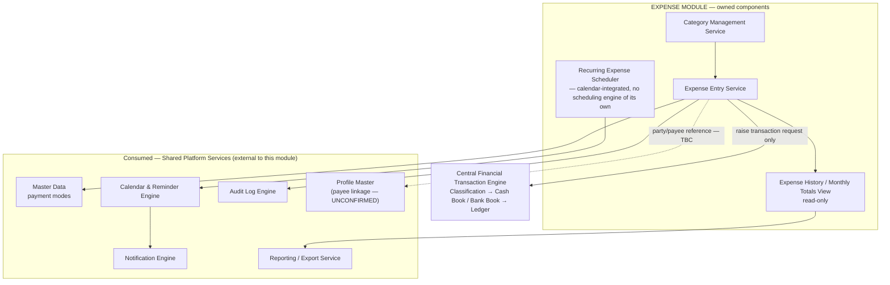
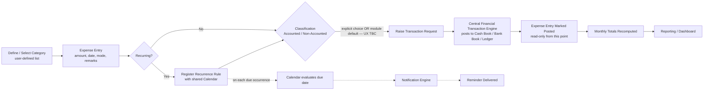

# SYSTEM ARCHITECTURE — EXPENSE MANAGEMENT MODULE
## Personal Business Management System (PBMS)

**Scope of this document:** the Expense Management module only. All shared platform capabilities (Authentication, RBAC, Profile identity, Master Data, Central Financial Transaction Engine, Calendar & Reminders, Notifications, Audit Logging, Reporting/Export) are treated as existing, external dependencies this module consumes — they are described only to the extent needed to show the module's boundary, never redesigned here.

---

## 1. Module Purpose & Scope

The Expense Management module exists to record, categorize, and monitor the business's operating expenses in one place. It gives the business:

- A **fully user-defined categorization scheme** for expenses — the business names and manages its own categories rather than choosing from a fixed system list.
- A simple, low-friction **expense entry** path (category, amount, date, payment mode, remarks) that posts directly into the business's central cash/bank position via the platform's Central Financial Transaction Engine (CFE).
- **Recurring-expense awareness**, so an expense that repeats on a schedule (rent, subscriptions, salaries, utilities) is tracked against the shared calendar for upcoming/overdue visibility, without the module owning any scheduling infrastructure itself.
- A **read-only historical record** of every expense ever entered, with automatic monthly totals, so spending can be reviewed but not silently altered after the fact.

**Explicitly out of scope for this module:** identity management, authentication/session handling, permission enforcement, financial posting/ledger logic, document storage infrastructure, notification delivery, calendar-scheduling mechanics, audit-log storage, and reporting/export infrastructure. Every one of these is a shared platform capability the module calls, never something it builds.

**Explicitly unresolved and not assumed in this document:** (a) whether an expense's payee/party must reference the platform's Profile identity service, and (b) whether Accounted/Non-Accounted classification is an explicit choice at entry or a module default. Both are carried forward as open items in Section 10 rather than resolved here.

---

## 2. Component Architecture



**Reading notes:**

- The module owns exactly four things: category definitions, the entry workflow, the recurring-expense scheduling *trigger* (not the scheduling engine — that belongs to the shared Calendar service), and the read-only history/monthly-totals view.
- Every dashed line marks an unresolved boundary (Section 10), not an implemented dependency.
- No box in the "owned components" group ever writes to Cash Book, Bank Book, or Ledger data directly — the single solid arrow leaving `EE` toward `CFE` is the only path by which an expense affects the business's financial position.

---

## 3. Data Ownership

| Entity | Owned By | Key Attributes | Notes |
|---|---|---|---|
| **Expense Category** | Expense Module | Category name (user-defined), status (active/inactive), created-by, created-date | Not a fixed system enumeration — the business defines and manages its own list. No approval workflow is documented for creating a category. |
| **Expense Entry** | Expense Module | Category reference, amount, date, payment mode, remarks, recurring flag, recurrence frequency (if applicable), classification tag *(mechanism TBC — see Section 10)* | Immutable once posted — corrections are handled as new entries or adjustments, not edits, consistent with the platform-wide historical-preservation rule. |
| **Payment Mode value** | Master Data (shared) | — | Expense *references* this value; it does not maintain its own copy of the payment-mode list. |
| **Cash Book / Bank Book / Central Ledger entry** | Central Financial Transaction Engine (shared) | Amount, direction, classification, source module = "Expense", source record reference, entered-by, timestamp | The Expense Entry record holds a reference to the resulting ledger entry; it does not hold the running cash/bank balance itself. |
| **Payee/party identity** | **Unresolved** — either Profile Master (shared) or free-text within Expense Entry | — | See Section 10, Item 1. This document does not assume either shape. |
| **Recurrence schedule state** | Calendar & Reminder Engine (shared) | Next-due computation, reminder trigger state | Expense supplies the recurrence *rule* (frequency); the shared Calendar service owns *evaluating* it against the current date. |
| **Audit trail of expense actions** | Audit Log Engine (shared) | Actor, action, entity, timestamp | Expense raises the event; it does not store the log. |

---

## 4. Inputs & Outputs

### Inputs

| Input | Source | Required? |
|---|---|---|
| Category selection or new category name | User (Employee/Administrator) | Yes — every entry must belong to a category |
| Expense amount | User | Yes |
| Expense date | User | Yes |
| Payment mode (Cash / Bank, and specific bank account if Bank) | User, validated against Master Data | Yes |
| Remarks | User | Optional |
| Recurring flag + frequency (if recurring) | User | Optional, required only if the entry is marked recurring |
| Payee/party reference | User — **shape unconfirmed** (Profile ID vs. free text) | Depends on Section 10 resolution |
| Classification (Accounted / Non-Accounted) | User or module default — **UX unconfirmed** | Depends on Section 10 resolution |

### Outputs

| Output | Destination |
|---|---|
| Transaction-raise request (amount, direction, classification context, payment mode, source reference) | Central Financial Transaction Engine |
| Posting confirmation / receipt | Back to the user via the Expense Entry Service |
| Recurrence rule registration | Calendar & Reminder Engine |
| Audit event (category created, expense recorded) | Audit Log Engine |
| Monthly expense totals, category-wise breakdown | Expense History view; Executive Dashboard; Expense reports (via Reporting/Export service) |

---

## 5. Workflow



**Key behavior called out explicitly:**

- There is **no approval gate** anywhere in this workflow — an expense entry, once submitted and posted through the CFE, is immediately reflected in the business's cash/bank position and immediately becomes read-only history.
- The recurring path (dashed) is entirely separate from the posting path (solid): registering a recurrence rule does not itself post anything. Each occurrence still requires (or triggers) its own individual Expense Entry, which then follows the same solid-line posting path as any other entry. The shared Calendar service fires a reminder on **every** occurrence, not only on a final due date — this is a platform-wide scheduling rule Expense inherits, not something Expense implements.

---

## 6. Financial Posting Sequence

```mermaid
sequenceDiagram
    participant User as Employee / Administrator
    participant EXP as Expense Module
    participant CFE as Central Financial Transaction Engine
    participant Book as Cash Book / Bank Book
    participant Led as Central Ledger
    participant Aud as Audit Log Engine
    participant Dash as Dashboard / Reports

    User->>EXP: Submit expense (category, amount, date, mode, remarks)
    EXP->>EXP: Validate mandatory fields; validate payment mode/bank account consistency
    EXP->>CFE: Raise transaction request (amount, mode, classification context)
    CFE->>CFE: Classify Accounted / Non-Accounted
    CFE->>Book: Post to Cash Book or selected Bank Account
    Book->>Led: Write Central Ledger entry
    CFE->>Aud: Record actor, timestamp, entity reference
    Led->>Dash: Update monthly totals / dashboard figures
    CFE-->>EXP: Posting confirmation
    EXP-->>User: Confirmation; entry becomes read-only history
```

**Architectural guarantee:** the Expense module never holds an intermediate, uncommitted financial state. A submission either results in a fully posted, ledgered, audited entry, or it is rejected at validation before ever reaching the CFE (e.g., Bank mode selected without a specific bank account). There is no partial-posting state for the module to reconcile.

---

## 7. Dependencies

| Direction | Component | Nature of Dependency |
|---|---|---|
| **Upstream** (Expense depends on) | Master Data | Payment-mode reference values |
| **Upstream** | Central Financial Transaction Engine | The sole path for classification and Cash Book/Bank Book/Ledger posting |
| **Upstream** | Calendar & Reminder Engine | Recurrence-rule evaluation and due-date scheduling |
| **Upstream** | Notification Engine | Delivery of upcoming/overdue recurring-expense reminders (invoked by Calendar, not directly by Expense) |
| **Upstream** | Audit Log Engine | Immutable recording of category creation and expense entries |
| **Upstream — unconfirmed** | Profile Master | Only if payee/party linkage is confirmed (Section 10) |
| **Downstream** (depends on Expense) | Executive Dashboard | Monthly expense totals, category breakdown |
| **Downstream** | Expense Reports (via Reporting/Export) | Category-wise, period-wise expense reporting |
| **Downstream — unconfirmed** | Global Search | Only if Expense is confirmed to be within Global Search's indexed scope (Section 10) |

**What Expense is never a dependency of:** Authentication, RBAC, Profile Master, Document Management infrastructure, Notification delivery mechanics, Calendar scheduling mechanics, Audit storage, or Reporting/Export infrastructure. These are one-directional dependencies — Expense consumes them, never the reverse.

---

## 8. RBAC Touchpoints

Expense does not implement any permission logic. It only **declares** which of its actions are restricted; the shared RBAC service performs the actual allow/deny check on every request, server-side, regardless of UI state.

| Action | Typical Role | Notes |
|---|---|---|
| Define / edit / deactivate an expense category | Employee or Administrator | No approval workflow is documented for category management; category creation is treated as a normal configuration action, not a restricted one, unless the business decides otherwise. |
| Record an expense entry | Employee or Administrator | **No approval gate documented anywhere in the source requirements.** This is a deliberate, confirmed characteristic of this module (unlike Finance's sanction gate or Chit Fund's group-approval gate) — every posted entry takes immediate financial effect. |
| View expense history / monthly totals | Employee or Administrator | Read-only for everyone; no edit affordance exists on a posted entry. |
| Delete an expense entry or category | **Not permitted** as a destructive operation | Consistent with the platform-wide rule that financial and business records are never hard-deleted; if "deletion" is offered at all, it is a non-destructive status change, and any such restriction is Administrator-only. |

---

## 9. Ownership Boundary

| Expense Management OWNS | Expense Management MUST NOT OWN |
|---|---|
| Expense Category definitions (fully user-defined, no fixed system list) | Cash Book, Bank Book, or Central Ledger posting logic (Central Financial Transaction Engine's exclusive responsibility) |
| Expense Entry data (category, amount, date, payment mode, remarks, recurring flag) | Payment-mode reference values (Master Data owns the values; Expense only selects from them) |
| The recurrence *rule* attached to an expense (frequency) | The recurrence *evaluation/triggering mechanism* (Calendar & Reminder Engine) |
| Read-only historical presentation and monthly-total computation for its own data | Notification delivery mechanics (Notification Engine) |
| Raising a transaction request with the correct amount and payment-mode context | Authentication, session management, or the RBAC permission-check mechanism itself |
| — | Document storage infrastructure (if document attachment is ever confirmed for Expense, storage remains owned by Document Management) |
| — | Audit-log storage (Expense raises audit events; it never maintains its own parallel history-of-changes store) |
| — | Payee/party identity data (if Profile linkage is confirmed, identity remains owned by Profile Master, never duplicated into Expense) |

---

## 10. Open Architecture Questions — Not Resolved Here

These items are preserved as genuinely open, exactly as they stand in the source requirements. This document deliberately does not invent an answer to any of them; each should be closed with an explicit architecture decision before the corresponding part of the module is built.

1. **Payee / party linkage to Profile Master (unconfirmed).**
   It is not stated whether an Expense Entry's payee/party must reference the platform's shared Profile identity service (consistent with the platform's single-identity principle applied elsewhere, e.g., Rental's tenant relationship) or may be recorded as an independent/free-text field local to the Expense Entry.
   - *If Profile-linked:* a payee becomes a normal Profile-reference relationship, and that person's Expense-side history unifies automatically with any other role they hold elsewhere in the platform (e.g., a payee who is also a loan guarantor).
   - *If free-text:* the payee record sits entirely outside the Profile Master's guarantee, and no cross-module identity unification occurs for that party.
   - This decision affects the Expense Entry schema directly and should be confirmed before that schema is finalized.

2. **Accounted / Non-Accounted classification UX (unconfirmed).**
   It is not stated whether classification is an **explicit choice** the user makes on every expense-entry screen, or a **module-level default** (with or without override) applied automatically based on the fact that the transaction originated from Expense.
   - This does not change *where* classification happens (it always happens once, at the Central Financial Transaction Engine's intake boundary) — it only changes *how the user experiences* supplying that classification from the Expense module's screen.
   - Should be confirmed before the Expense Entry Service's UI/API contract is finalized.

3. **Document attachment support (unconfirmed).**
   Whether an Expense Entry may have a supporting document (receipt/invoice) attached via the shared Document Management service is not explicitly stated in the source requirements.

4. **Global Search inclusion (unconfirmed).**
   Whether Expense Entries and Categories fall within Global Search's indexed/searchable scope is not explicitly listed.

5. **Category governance (unconfirmed).**
   Whether category creation/editing is an Administrator-only configuration action or is open to any authenticated user is not explicitly stated; Section 8 assumes no restriction pending clarification.

---

*End of standalone Expense Management module system architecture.*
