# HIGH-LEVEL SYSTEM ARCHITECTURE DOCUMENT
## Personal Business Management System (PBMS)

**Client:** Dhavanam Finance
**Solution Provider:** Florix Technologies Pvt. Ltd. (A Division of Florix Smart Infra Solutions Pvt Ltd)

---

## Table of Contents

1. Document Control
2. Architecture Purpose
3. System Overview
4. Architecture Vision
5. Architecture Principles
6. System Context
7. High-Level Architecture
8. Layered Architecture
9. Presentation Architecture
10. Application/API Architecture
11. Business Module Architecture
12. Finance Architecture
13. Chit Fund Architecture
14. Rental Architecture
15. Expense Architecture
16. Investment Architecture
17. Receivables & Payables Architecture
18. Central Financial Transaction Engine
19. Accounted / Non-Accounted Architecture
20. Profile Architecture
21. Shared Platform Services
22. Authentication & Security Architecture
23. Data Architecture
24. Data Flow Architecture
25. Asynchronous Processing
26. Notification Architecture
27. Calendar & Scheduling Architecture
28. Document Architecture
29. Search Architecture
30. Reporting & Dashboard Architecture
31. Audit Architecture
32. Backup & Recovery Architecture
33. Technology Stack
34. Deployment Architecture
35. Environment Architecture
36. Integration Architecture
37. Cross-Cutting Concerns
38. Scalability Architecture
39. Reliability & Failure Boundaries
40. Architectural Dependency Map
41. Component Ownership Matrix
42. Security Boundary
43. Data Ownership
44. Architectural Decision Records
45. Traceability Matrix
46. Non-Functional Architecture Mapping
47. Architecture Risks
48. Open Architecture Decisions
49. Architecture Quality Review
50. Final Architecture Summary

---

## 1. Document Control

| Field | Value |
|---|---|
| Document Title | High-Level System Architecture Document — Personal Business Management System (PBMS) |
| Client | Dhavanam Finance |
| Solution Provider | Florix Technologies Pvt. Ltd. (A Division of Florix Smart Infra Solutions Pvt Ltd) |
| Document Type | High-Level System Architecture Document (technical architecture baseline) |
| Document Version | 1.0 |
| Document Status | Draft — for architecture review. Contains flagged **TBC — Architecture Decision Required** and **RECOMMENDED ARCHITECTURE DECISION** items; see Section 48. |
| Date | 09 September 2026 |
| Confidentiality | Confidential — derived from the approved PBMS Business Requirements Document (BRD) and Product Requirements Document (PRD). |
| Prepared By | Solution Architecture function |
| Approved By | Pending — architecture review and sign-off outstanding |

### 1.1 Purpose and Positioning of This Document

This document is the **high-level technical architecture baseline** for PBMS. It sits below the BRD and PRD in the document hierarchy and above detailed design artifacts (database schemas, API specifications, UI specifications, deployment runbooks) that are produced later in the engineering lifecycle. It answers **how PBMS is organized technically** so that the business and product requirements already approved in the BRD and PRD can be implemented reliably, consistently, and extensibly. It intentionally does not restate BRD/PRD business rationale except where necessary to justify a structural decision, and it does not descend into schema-level, API-endpoint-level, or pixel-level detail.

### 1.2 Source Authority and Precedence

| # | Source | Role in This Document | Availability at Time of Authoring |
|---|---|---|---|
| 1 | PBMS Business Requirements Document (BRD), v1.0, 09 Sep 2026 | Primary business-requirements source; authoritative for *why* and *what business outcome* | Supplied and reviewed in full |
| 2 | PBMS Product Requirements Document (PRD), v1.0, 09 Sep 2026 | Primary product/functional-requirements source; authoritative for *what the product must do*, including the PRD's own Section 7 ("Product Architecture Overview") and Section 28 ("Technical Product Constraints"), which already encode the Developer Build Guide's nine-layer structure and the confirmed technology stack | Supplied and reviewed in full |
| 3 | PBMS V4 Software Development Proposal (FLX/PBMS/2026/025/V4, 17 Aug 2026) | Primary project/commercial-scope baseline per the BRD and PRD's own source-priority rules | **Not supplied directly to this exercise.** Its content reaches this document only indirectly, as already reconciled and cited inside the BRD and PRD (e.g., "V4 §8.4"). No V4 content is used beyond what the BRD/PRD already quote or summarize. |
| 4 | PBMS System Architecture, Layers 1–4 (existing layered architecture documentation) | Technical architecture baseline where it exists, particularly for build-layer boundaries | **Not supplied directly to this exercise.** The BRD and PRD both cite and rely on this document (e.g., "Build Guide Layer 5," "Build Guide Rule 4.1–4.5," daily-backup/30-day-retention in "Layer 4 §14"). This document treats every such citation inside the BRD/PRD as authoritative and carries it forward; it does not have access to any Layer 1–4 content beyond what the BRD/PRD quote. |
| 5 | PBMS-Price_breakup.pdf (Cost Architecture) | Referenced by the BRD/PRD only to gauge relative capability complexity | Not supplied; not used here — this is consistent with the BRD/PRD, which also exclude commercial content from functional scope |

**Precedence rule applied in this document:** (1) explicit statements in the BRD/PRD are authoritative; (2) where the BRD/PRD cite the V4 proposal, the Developer Build Guide, or the Layer 1–4 architecture documents verbatim or in close paraphrase, this document treats those citations as carrying the cited source's authority; (3) where the BRD/PRD themselves flag an item TBC, this document preserves that TBC rather than resolving it; (4) where an architectural decision is needed to make the approved requirements implementable but no source document decides it, this document proposes a **RECOMMENDED ARCHITECTURE DECISION**, clearly distinguished from confirmed architecture; (5) this document does not invent technology, business rules, or topology beyond what is stated or directly implied by the BRD/PRD.

**Explicit gap acknowledgement:** Because the V4 proposal and the Layer 1–4 architecture documents were not directly available when authoring this document, any technical boundary that those documents might specify in more detail than the BRD/PRD quote (for example, exact schema partitioning within Layer 2, or exact CI/CD topology within Layer 1) is marked **TBC — Architecture Decision Required** in the relevant section rather than inferred. Section 48 consolidates all such gaps.

---

## 2. Architecture Purpose

This High-Level System Architecture Document exists to translate the approved BRD and PRD into a coherent technical structure that engineering, QA, DevOps, and future maintainers can build against without re-deriving business intent from first principles. Specifically, it:

- Identifies the components that make up PBMS and the layer each belongs to.
- Defines how those components relate — which may call which, which may never call which directly.
- Describes how data and financial transactions flow between components, end to end.
- States where business logic lives for each of the six business modules, and where it must not live (i.e., inside the Central Financial Layer instead).
- Documents how security, authorization, and auditability are structured as centralized, cross-cutting concerns rather than per-module features.
- Documents how shared platform services are structured so they are built once and consumed by every module.
- Documents how PBMS is intended to scale and evolve — additional modules, additional volume, additional users — without re-architecting the financial core.

This document is **not** a BRD, a PRD, a database schema document, an API specification, a detailed coding specification, a deployment runbook, or a UI/UX specification. Readers seeking business rationale should consult the BRD; readers seeking functional/product detail (field-level requirements, permissions matrices, acceptance criteria) should consult the PRD. This document is the bridge between those two documents and the detailed engineering artifacts that follow it (data model, API contracts, infrastructure-as-code, UI component specifications), none of which are produced here.

---

## 3. System Overview

PBMS is a centralized, secure, web-based platform through which Dhavanam Finance operates six business verticals — **Finance Management, Chit Fund Management, Rental Property Management, Expense Management, Investment Management, and Receivables & Payables** — under one login, one reusable customer/party identity (**Profile**), and one financial processing core (the **Central Financial Transaction Engine**, comprising Accounted/Non-Accounted classification, a Central Cash Book, a Central Bank Book supporting multiple bank accounts, and a Central Ledger).

Every one of the six business modules is architecturally a **consumer** of a common set of platform capabilities — authentication, role-based access control, Profile identity, master data, document management, calendar and reminders, Telegram notifications, global search, audit logging, reporting, data export, backup/recovery, and the executive dashboard — rather than an independent application that happens to share a login screen. This is the architectural expression of the BRD's Business Objectives (BO-002, BO-004, BO-011) and the PRD's Core Product Principles (PRD §8): centralization is not a convenience, it is the mechanism by which Dhavanam Finance's single reconciled cash/bank position, single customer identity, and single audit trail are actually achieved and kept consistent as the business grows.

The system is delivered as a single fixed-scope release at a "basic-to-intermediate" functional depth (per the BRD/PRD scope baseline), built on a confirmed technology stack — React.js (frontend), Python/Django REST Framework (backend), PostgreSQL (database), Redis (cache/broker), Celery and Celery Beat (asynchronous/scheduled processing), Gunicorn behind Nginx (application serving), MinIO/S3-compatible object storage (documents), and JWT plus Telegram OTP (authentication) — and is architected as a **modular, centralized, layered monolith**, not a microservices system. Nothing in the BRD or PRD supports a distributed/microservices topology, and this document does not introduce one (see Section 6 and Section 33).

---

## 4. Architecture Vision

PBMS is architected as a modular, centralized, secure, and scalable business management platform in which independent business modules consume shared platform capabilities and a centralized financial transaction layer, rather than each module independently implementing identity, security, or financial posting logic.

The governing dependency relationship — confirmed by the PRD's own architectural boundary rule (PRD §7.3: *"No business module may independently implement authentication, RBAC, audit logging, notifications, document storage, search, reporting infrastructure, financial posting logic, the Cash Book, the Bank Book, the Central Ledger, or Profile identity"*) — flows as follows:

```
Business Modules
(Finance, Chit Fund, Rental, Expense, Investment, Receivables & Payables)
        │  raise business events and transaction requests only
        ▼
Shared Platform Services
(Auth/RBAC, Profile, Master Data, Documents, Calendar, Notifications,
 Search, Audit, Reporting/Export, Backup & Recovery)
        │  every module and the financial layer depend on these
        ▼
Central Financial Processing
(Central Transaction Engine → Accounted/Non-Accounted classification →
 Cash Book / Bank Book → Central Ledger)
        │  the sole path by which any financial state changes
        ▼
Persistent Data
(PostgreSQL — relational system of record; Redis — cache/broker;
 Object Storage — documents)
        │
        ▼
Reporting / Dashboard / Export
(derived exclusively from the Central Ledger and module data,
 never independently recalculated)
```

This is not a simplification for readability — it is the actual, binding dependency direction established in the PRD (Section 7.3, "Architectural boundary rule") and reinforced by the Developer Build Guide rules the BRD and PRD both cite (e.g., "If a developer is about to write cash-balance or ledger logic inside a module, stop — it belongs in Layer 5," PRD §10.3 BR-CFE-001). A business module never bypasses Shared Platform Services or the Central Financial Processing layer to reach persistence or reporting directly; every arrow above is a hard architectural boundary, enforced server-side, not merely a suggested layering convention.

---

## 5. Architecture Principles

These ten principles are binding on every subsequent section of this document and on all downstream design and engineering artifacts. Each is derived directly from a BRD business principle and/or a PRD core product principle (PRD §8); none is introduced independently of the source documents.

### AP-001 — Modular Architecture
Each of the six business modules (Finance, Chit Fund, Rental, Expense, Investment, Receivables & Payables) has a clearly bounded set of responsibilities — its own workflows, its own module-specific entities, and its own module-specific business rules. A module's internal implementation may change without requiring changes to another module, provided the shared interfaces it depends on (Central Transaction Engine, Profile, Master Data, etc.) remain stable. **Implication:** module code must not reach into another module's internal tables or business logic; cross-module interaction happens only through the shared/central layers (Sections 9, 21).

### AP-002 — Centralized Financial Logic
Financial posting logic (classification, Cash Book/Bank Book posting, ledger creation) exists in exactly one place — the Central Financial Transaction Engine — and is never duplicated inside a module. **Implication:** no module maintains its own notion of a running cash or bank balance; every module raises a transaction request and reads back the result (Section 18).

### AP-003 — Single Profile Identity
A Profile ID is created once, for a given person or party, and is thereafter selected — never re-created — by every module that needs to reference that person (Finance, Chit Fund, Rental, Investment, and, per confirmed identity-reuse rules, guarantors/co-borrowers). **Implication:** there is exactly one identity-owning service (the Profile Master, Section 20); modules hold references to a Profile ID, not copies of identity data.

### AP-004 — Accounted / Non-Accounted Separation
The Accounted and Non-Accounted financial streams are classified once, at the point a transaction is raised, and remain distinguishable through calculation, collection, the ledger, and reporting. They are never merged into a single irreversible figure. **Implication:** every financial data structure from the Cash Book entry upward carries a classification flag that persists through its entire lifecycle (Section 19).

### AP-005 — Shared Services
Capabilities needed by more than one module (documents, calendar, notifications, search, master data, reporting, audit, backup) are implemented exactly once, as platform services, and consumed by every module that needs them. **Implication:** a module requirement that looks like "Module X needs document upload" is satisfied by Module X calling the shared Document Management service, never by Module X building its own upload/storage logic (Section 21).

### AP-006 — Central Authorization
Authentication (login, Telegram OTP, JWT session) and authorization (Administrator/Employee role enforcement) are implemented once, centrally, and enforced server-side on every request, regardless of which module or which client (web UI) originates the request. **Implication:** no module implements its own login screen, session logic, or permission check independent of the shared Authentication & RBAC service (Section 22).

### AP-007 — Auditability
Every critical action — creation, approval, closure, deletion, master-data change — across every module is captured by one centralized, immutable Audit Log Engine, attributing the action to the user who performed it and the user who authorized it (where applicable), with a permanent timestamp. **Implication:** audit capture is a side effect of passing through the shared write path (API layer + Central Transaction Engine where financial), not something each module re-implements (Section 31).

### AP-008 — Data Integrity
Financial and business records must remain internally consistent at all times: a customer ledger, the Central Cash/Bank Books, and the Central Ledger must never disagree about what happened. Historical records are never hard-deleted. **Implication:** the Central Ledger is the single reconciliation point; all reporting is derived from it rather than recomputed independently per module (Sections 18, 23).

### AP-009 — Extensibility
Future business modules, or deeper functionality within the current six, must be able to consume the existing Shared Platform Services and Central Financial Layer without those layers being rebuilt or duplicated. **Implication:** the interfaces exposed by the Central Financial Layer and Shared Platform Services are the platform's stable extension points; a new module is architecturally just another consumer of them (Section 38).

### AP-010 — Separation of Concerns
Business modules, the Central Financial Layer, Shared Platform Services, the persistence layer, the infrastructure layer, and the presentation layer are distinct architectural layers with clear boundaries and a defined dependency direction (Section 4). **Implication:** a concern belonging to one layer (e.g., UI state) must not leak into another (e.g., the database schema encoding presentation-only logic), and the reverse.

---

## 6. System Context

The System Context diagram shows PBMS at its highest level of abstraction: who and what interacts with it, and the one confirmed external dependency (the Telegram Bot API), plus the infrastructure services on which it depends for storage.

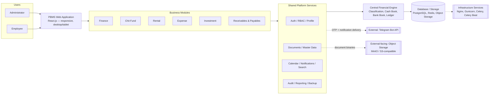

**Reading notes:** Administrators and Employees are the only two human actor types (BRD §9, PRD §6). External parties named in the BRD/PRD — customers, chit members, tenants, vendors — are business *subjects*, not system users; they do not authenticate into PBMS (BRD §8; no source document describes a customer-facing login). The Telegram Bot API is the only confirmed external system integration (Section 36). Object storage and the database/cache/broker are infrastructure dependencies rather than third-party business integrations, shown here for completeness because the BRD/PRD treat backup and document storage as architecturally significant.

---

## 7. High-Level Architecture

The primary PBMS architecture is a layered, modular monolith. This structure is not a generic template applied for convenience — it is the structure directly implied by the PRD's own Product Architecture Overview (PRD §7.1–7.3) and its Layered Build-Order Alignment table, which maps every PRD section to one of nine build layers sourced from the Developer Build Guide. No microservices decomposition, event-driven service mesh, or polyglot-persistence architecture is described anywhere in the BRD or PRD, and none is introduced here.

```
┌──────────────────────────────────────────────────────────────────┐
│  PRESENTATION LAYER                                               │
│  React.js single-page application — responsive, desktop/tablet    │
└───────────────────────────────┬────────────────────────────────────┘
                                 │ HTTPS / JSON (REST)
┌───────────────────────────────▼────────────────────────────────────┐
│  APPLICATION / API LAYER                                           │
│  Django REST Framework — authentication gate, RBAC enforcement,    │
│  request validation, orchestration of module + shared services     │
└───────────────────────────────┬────────────────────────────────────┘
                                 │
┌───────────────────────────────▼────────────────────────────────────┐
│  BUSINESS DOMAIN LAYER                                              │
│  Finance | Chit Fund | Rental | Expense | Investment |              │
│  Receivables & Payables                                             │
│  (module-specific workflows, entities, and business rules only)     │
└───────────────────────────────┬────────────────────────────────────┘
                                 │ raises transaction requests / business events only
┌───────────────────────────────▼────────────────────────────────────┐
│  CENTRAL FINANCIAL LAYER                                            │
│  Central Transaction Engine → Accounted/Non-Accounted               │
│  Classification → Cash Book | Bank Book (multi-account) →           │
│  Central Ledger (single source of truth for reporting)              │
└───────────────────────────────┬────────────────────────────────────┘
                                 │
┌───────────────────────────────▼────────────────────────────────────┐
│  SHARED PLATFORM SERVICES                                           │
│  Auth/RBAC | Profile | Documents | Master Data | Calendar |         │
│  Notifications | Search | Audit | Reporting/Export | Backup         │
└───────────────────────────────┬────────────────────────────────────┘
                                 │
┌───────────────────────────────▼────────────────────────────────────┐
│  DATA LAYER                                                          │
│  PostgreSQL (system of record) | Redis (cache / broker) |            │
│  Object Storage — MinIO / S3-compatible (documents)                  │
└───────────────────────────────┬────────────────────────────────────┘
                                 │
┌───────────────────────────────▼────────────────────────────────────┐
│  INFRASTRUCTURE LAYER                                                │
│  Nginx (reverse proxy) | Gunicorn (WSGI application server) |        │
│  Celery (async workers) | Celery Beat (scheduler)                    │
└──────────────────────────────────────────────────────────────────┘
```

**Placement note on Shared Platform Services:** the diagram positions Shared Platform Services below the Central Financial Layer to reflect that both the Business Domain Layer and the Central Financial Layer consume shared services (Profile, Audit, Master Data, Notifications), not that the Central Financial Layer depends on the Business Domain Layer. Section 8 states the precise dependency direction per layer; this box diagram should be read alongside Section 8 rather than as a strict single-direction call stack.

---

## 8. Layered Architecture Model

This section documents PBMS as nine explicit layers, directly aligned to the PRD's own Layered Build-Order Alignment table (PRD §7.3), which is itself sourced from the Developer Build Guide referenced throughout the BRD/PRD. Build order and architectural boundary are treated as the same structure: a layer is not permitted to be built, or to assume responsibility for a capability, out of the order and ownership defined here.

### Layer 1 — Infrastructure & Environments

| Aspect | Detail |
|---|---|
| Purpose | Provide the runtime foundation every other layer depends on. |
| Responsibilities | Source control/repository; CI/CD pipeline; environment provisioning; PostgreSQL, Redis, and object-storage provisioning; Nginx and Gunicorn setup. |
| Major Components | Nginx, Gunicorn, PostgreSQL instance(s), Redis instance(s), MinIO/S3-compatible storage, CI/CD tooling (**TBC** — not named in source documents). |
| Inputs | Client-provided hosting/domain/SSL/infrastructure (per PRD §29, "client-provided hosting/domain/SSL/database hosting"). |
| Outputs | A running, network-reachable environment for every higher layer. |
| Dependencies | None (foundational layer). |
| What It Owns | Compute, network, and storage provisioning; environment configuration. |
| What It Must NOT Own | Any business logic, data schema design, or application-level security logic. |
| Consumers | Every other layer. |
| Upstream / Downstream | No upstream; downstream to all layers. |

### Layer 2 — Core Data Schema

| Aspect | Detail |
|---|---|
| Purpose | Establish the foundational data structures every other layer reads or writes. |
| Responsibilities | Profile schema (identity, KYC, guarantor/co-borrower links); User and Role schema; Master Data schema; Central Ledger/Cash Book/Bank Book schema. |
| Major Components | Profile Master tables, User/Role tables, Master Data tables, Central Financial schema (Cash Book, Bank Book, Ledger entry structures). |
| Inputs | Data requirements confirmed in BRD §24 and PRD §22 (Data Requirements). |
| Outputs | A stable schema surface for Layer 3 (Auth), Layer 4 (Shared Services), Layer 5 (Financial Engine), and all business modules. |
| Dependencies | Layer 1 (a running PostgreSQL instance). |
| What It Owns | The structural definition of Profile, User/Role, Master Data, and core financial-entry schemas. |
| What It Must NOT Own | Module-specific business schema (Loan, Chit Group, Property, etc. — owned by the respective module, Section 23). |
| Consumers | Layers 3–9. |
| Upstream / Downstream | Upstream: Layer 1. Downstream: every subsequent layer. |

### Layer 3 — Authentication & RBAC

| Aspect | Detail |
|---|---|
| Purpose | Establish who is using the system and what they are permitted to do, enforced identically everywhere. |
| Responsibilities | Login; Telegram OTP as a second factor; JWT issuance and session expiry; Administrator/Employee permission enforcement at the API layer. |
| Major Components | Authentication service, OTP verification service (Telegram-backed, logically separate from business notifications per BR-GEN-004), JWT session manager, RBAC permission-check middleware. |
| Inputs | Credentials, OTP responses, API requests carrying a session token. |
| Outputs | A valid/invalid authentication decision; an allow/deny authorization decision on every restricted action. |
| Dependencies | Layer 2 (User/Role schema); external Telegram Bot API (Section 36). |
| What It Owns | Session lifecycle; the Administrator/Employee permission model; server-side enforcement of restricted actions (BR-030). |
| What It Must NOT Own | Business-specific approval logic (e.g., loan sanction) — Layer 3 enforces *who may act*, not *what the action means*, which belongs to the relevant business module (Section 11 onward). |
| Consumers | Every layer above it, on every request. |
| Upstream / Downstream | Upstream: Layer 2. Downstream: Layers 4–9. |

### Layer 4 — Shared Platform Services

| Aspect | Detail |
|---|---|
| Purpose | Provide, once, every capability more than one business module needs. |
| Responsibilities | Audit Log Engine; Notification Engine (Telegram, business events); Calendar & Reminder Engine; Global Search; Document Management; Data Export; Backup & Recovery; Master Data management surface (Administrator-facing). |
| Major Components | As listed in Section 21 (one component per shared service). |
| Inputs | Business events and write operations from every module and from the Central Financial Layer. |
| Outputs | Audit entries, notifications, calendar entries, search index updates, document references, exported files, backups. |
| Dependencies | Layers 2–3 (schema, identity, auth context for attribution). |
| What It Owns | The single implementation of each shared capability listed above. |
| What It Must NOT Own | Financial posting logic (Layer 5) or module-specific business rules (Layers 6–7). |
| Consumers | Layers 5–9 and the Presentation Layer (for calendar, search, notifications, document, and reporting UI). |
| Upstream / Downstream | Upstream: Layers 2–3. Downstream: Layers 5–9. |

### Layer 5 — Central Financial Transaction Engine

| Aspect | Detail |
|---|---|
| Purpose | Be the single, mandatory path through which every financial movement in the business is captured, classified, and posted. |
| Responsibilities | Unified transaction intake; Accounted/Non-Accounted classification; Cash Book posting; Bank Book posting (per bank account); Central Ledger entry creation. |
| Major Components | Transaction Engine service, Classification component, Cash Book, Bank Book (multi-account), Central Ledger. |
| Inputs | Transaction-raise requests from any of the six business modules (never a direct database write from a module). |
| Outputs | A posted, classified, ledgered financial entry, and a posting confirmation returned to the raising module. |
| Dependencies | Layers 2–4 (schema, identity/attribution via Layer 3, audit via Layer 4). |
| What It Owns | All cash-balance and ledger logic, platform-wide, with no exception (BR-CFE-001, "a business module shall never post directly to the Cash Book, Bank Book, or Central Ledger"). |
| What It Must NOT Own | Module-specific business rules that determine *when* or *how much* a transaction should be (e.g., interest calculation formula, chit penalty percentage) — those are computed by the module and handed to the engine as an already-determined amount and classification context. |
| Consumers | Layers 6–8 (every business module; the dashboard/reporting aggregation layer). |
| Upstream / Downstream | Upstream: Layers 1–4. Downstream: Layers 6–9. This is the layer every business module's financial activity must pass through before reaching persistence or reporting. |

### Layer 6 — Finance Module (First Business Module)

| Aspect | Detail |
|---|---|
| Purpose | Prove the full architecture (Layers 1–5) end to end through the most financially complex module, before the remaining modules are built. |
| Responsibilities | Full loan lifecycle: application, approval/sanction, disbursement, dual-stream (Accounted/Non-Accounted) interest calculation and collection, top-up, closure, NPA classification. |
| Major Components | As detailed in Section 12. |
| Inputs | Profile references, loan terms, collection entries. |
| Outputs | Transaction-raise requests to Layer 5; audit events to Layer 4; loan-lifecycle data to Layer 8 (dashboard/reporting). |
| Dependencies | Layers 1–5 fully operational before this layer is built or activated (Build Guide sequencing, cited PRD §35). |
| What It Owns | Loan entity, loan-lifecycle state, interest-calculation logic, loan-specific business rules (Section 12). |
| What It Must NOT Own | Cash/Bank/Ledger posting (Layer 5); Profile identity (Layer 4); authentication (Layer 3). |
| Consumers | Layer 8 (dashboard/reporting), Layer 4 (documents, calendar, notifications, audit, search — as a consumer, not an owner). |
| Upstream / Downstream | Upstream: Layers 1–5. Downstream: Layer 8. |

### Layer 7 — Remaining Business Modules

| Aspect | Detail |
|---|---|
| Purpose | Extend the proven architecture to the remaining five business areas. |
| Responsibilities | Chit Fund, Rental, Expense, Investment, and Receivables & Payables — each module's own workflows and entities (Sections 13–17). |
| Major Components | As detailed in Sections 13–17. |
| Inputs | Profile references (where applicable), module-specific configuration (master data), and transaction-triggering business events. |
| Outputs | Transaction-raise requests to Layer 5; audit events to Layer 4; module data to Layer 8. |
| Dependencies | Layers 1–6 (the proven pattern established by Finance). |
| What It Owns | Each module's own entities and business rules (Sections 13–17). |
| What It Must NOT Own | Anything owned by Layers 1–5 (see Layer 6 row — identical constraint applies to every module in this layer). |
| Consumers | Layer 8. |
| Upstream / Downstream | Upstream: Layers 1–6. Downstream: Layer 8. |

### Layer 8 — Executive Dashboard & Reporting Aggregation

| Aspect | Detail |
|---|---|
| Purpose | Aggregate data that only exists once the modules below it are producing real transactions. |
| Responsibilities | Executive Dashboard; module-level and cross-module reports; the Money Flow report; PDF/Excel export. |
| Major Components | Reporting/Aggregation service, Dashboard service, Export service. |
| Inputs | The Central Ledger (Layer 5) and module data (Layers 6–7) — never independently recalculated business figures. |
| Outputs | Dashboard views, report datasets, exported files. |
| Dependencies | Layer 5 (Central Ledger as source of truth, BR-CFE-005) and Layers 6–7 (module data must exist to aggregate). This is why Layer 8 is built last among the functional layers (PRD §35). |
| What It Owns | Aggregation, presentation-ready computation (ageing buckets, period totals), and export formatting. |
| What It Must NOT Own | Any primary financial or business record — Layer 8 is read-only over data owned elsewhere (BR-028, "reports are read-only"). |
| Consumers | The Presentation Layer. |
| Upstream / Downstream | Upstream: Layers 5–7. Downstream: Presentation Layer only. |

### Layer 9 — Hardening & Handover

| Aspect | Detail |
|---|---|
| Purpose | Confirm the built system meets its security, performance, and operational obligations before go-live. |
| Responsibilities | Security review; load testing; backup-and-restore drill; audit-completeness verification; training; documentation handover. |
| Major Components | No new runtime component — this layer is a verification and delivery activity across all prior layers. |
| Inputs | The fully built system (Layers 1–8). |
| Outputs | A production-ready, verified system; user and technical documentation; trained users. |
| Dependencies | Layers 1–8 complete. |
| What It Owns | Go-live readiness verification, per the Definition of Done (PRD §38). |
| What It Must NOT Own | New functional scope — Layer 9 verifies, it does not add capability. |
| Consumers | The business (Dhavanam Finance) at go-live. |
| Upstream / Downstream | Upstream: Layers 1–8. No architectural downstream — this is the delivery gate. |

## 9. Presentation Architecture

### 9.1 Confirmed Technology

React.js, delivered as a responsive single-page application for desktop and tablet browsers (PRD §5.1, §31; native mobile explicitly out of scope, BRD §10.2).

### 9.2 Application Shell and Major Areas

The frontend is architected as one application shell hosting role-aware navigation into the six business modules and the shared-service screens, rather than six independent front-end applications. This mirrors the PRD's UI/UX requirements (PRD §31), which describe one common navigation surface, not per-module portals.

| Area | Architectural Role | Notes |
|---|---|---|
| Authentication screens | Entry point; not part of the authenticated shell | Login → Telegram OTP verification → session establishment (Section 22). No business screen is reachable before this completes. |
| Application shell / global navigation | Persistent frame around every authenticated screen | Presents the six modules and shared services (Calendar, Notifications, Search, Reports, Settings); Administrator-only items (Master Data, User Management, Audit Log) are hidden or disabled for Employee sessions at the presentation layer, **in addition to** server-side enforcement (UX-001; AP-006) — the UI restriction is a usability convenience, never the security boundary itself. |
| Executive Dashboard | Landing view after authentication (primary Administrator view) | Consolidated, auto-refreshing view sourced from Layer 8 (Section 30). |
| Module interfaces (Finance, Chit Fund, Rental, Expense, Investment, Receivables & Payables) | One interface area per module, structurally consistent (list/detail/workspace pattern) | Finance is explicitly specified as a single "Loan Management Workspace" (PRD §11.1, FR-FIN-027); other modules follow the same list-and-workspace presentation pattern at a lighter weight, per PRD §31. |
| Shared components — Search, Calendar, Notifications, Reports | Cross-module surfaces reachable from the global navigation, not owned by any one module | Backed respectively by the Global Search, Calendar & Reminder, Notification, and Reporting shared services (Section 21). |
| Administration (Master Data, User Management, Audit Log Viewer) | Administrator-only area | Backed by the Master Data and Audit Log shared services; not reachable by an Employee session (Section 22). |
| Error / loading states | Cross-cutting presentation concern, not a module concern | Every data-fetching screen requires a defined loading and error state (UX-004); exact visual treatment is a UI/UX design decision, not an architectural one, and is marked **TBC** here consistent with the PRD (UX-004, UX-005). |

### 9.3 Frontend-to-Backend Communication

The React application communicates with the Application/API Layer (Section 10) exclusively over HTTPS using JSON request/response payloads against a REST API exposed by Django REST Framework. There is no direct frontend connection to the database, cache, object storage, or Telegram — every one of those is reached through the API layer, which enforces authentication and authorization on every call (AP-006). The frontend holds a JWT (Section 22) obtained at login and presents it on every subsequent request; the API layer is the sole point at which that token is validated and the caller's role is checked, so no restricted action can be made available merely by altering client-side UI state (AC-PLAT-001).

---

## 10. Application / API Architecture

### 10.1 Confirmed Technology

Python, Django REST Framework (PRD §5, §28). All backend business logic — the Central Transaction Engine, interest calculation, chit calculation, penalty rules, reporting, scheduled jobs, and notifications — is implemented in Python, per the Developer Build Guide constraint the PRD cites verbatim: *"Do not introduce alternate frameworks or databases without sign-off."*

### 10.2 Backend Structural Layers

| Sub-Layer | Role | Owns |
|---|---|---|
| API Layer | The single entry point for every client request; exposes REST resources per capability (Section 30 catalogue, at capability level only — no endpoint-level detail is specified here, consistent with the PRD's own restraint at PRD §30). | Request routing, input validation (FR-VAL-001–009), response shaping. |
| Authentication Middleware / Gate | Validates the JWT and Telegram-OTP-derived session on every request before any further processing occurs. | Session validity, token expiry (Section 22). |
| Authorization (RBAC enforcement) | Checks the authenticated user's role (Administrator/Employee) against the action being requested, for every restricted action, at the API layer — never only in the UI (BR-030, AC-PLAT-001). | Allow/deny decisions on restricted actions (approval, closure, deletion, master-data change). |
| Business Services (per module) | Module-specific orchestration: validates module-specific business rules, computes module-specific figures (e.g., interest due, chit penalty), and raises transaction requests to the Central Transaction Engine. | Module workflows and rules (Sections 12–17). |
| Central Transaction Processing | The Central Financial Transaction Engine (Layer 5, Section 18) — invoked by business services, never bypassed. | Classification, Cash Book/Bank Book posting, ledger entry creation. |
| Shared Services | Profile, Master Data, Document Management, Calendar, Notifications, Search, Audit, Reporting/Export, Backup (Section 21) — invoked by business services and by the Central Transaction Engine (for audit). | The one implementation of each shared capability. |
| Validation | Cross-cutting: mandatory-field checks, state-transition checks, payment-mode/bank-account consistency checks (FR-VAL-001–009). | Rejection of invalid requests before they reach a business service or the transaction engine. |
| Audit | Cross-cutting: every critical write, wherever it originates, produces an audit entry (Section 31). | Attribution and immutability of the audit record. |
| Reporting | Layer 8 — reads from the Central Ledger and module data; never writes business state. | Aggregation and export only. |
| Background Jobs | Celery workers and Celery Beat schedules (Section 25) — due-date evaluation, reminder generation, recurring-item rollovers, scheduled backups. | Asynchronous and time-triggered processing that must not block a synchronous user request. |

### 10.3 Module Boundary Rule

This is one of the most important structural rules in the entire architecture, and it is stated here exactly as the PRD binds it (PRD §7.3): **no business module may independently implement authentication, RBAC, audit logging, notifications, document storage, search, reporting infrastructure, financial posting logic, the Cash Book, the Bank Book, the Central Ledger, or Profile identity.** Any module-level requirement that appears to need one of these must instead call the corresponding shared-platform or Central-Financial-Layer capability.

The corollary — also binding — is that **modules do not directly access another module's internal business logic or data.** Where module-to-module interaction is genuinely required by the business (for example: a chit member's Profile also being a loan customer's Profile; a Receivable's party also being a Rental tenant), the interaction happens through a controlled, shared interface boundary, never through one module querying another module's internal tables or invoking another module's internal functions directly:

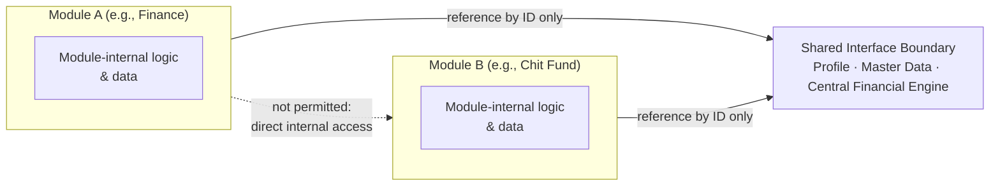

In practice, this means Module A never holds a foreign key into Module B's internal schema; both hold a reference to the same Profile ID (owned by the shared Profile Master, Section 20) or post through the same Central Transaction Engine (Section 18) — the shared layer is the only point of contact between modules.

## 11. Business Module Architecture

### 11.1 Common Module Pattern

All six business modules follow the same architectural pattern: each owns its own workflows, entities, and business rules; each raises transactions to the Central Financial Layer rather than posting directly; each references Profiles rather than owning identity data; and each consumes Shared Platform Services rather than reimplementing them. Sections 12–17 apply this pattern individually. The comparative summary below is provided for architecture review before the detailed per-module sections.

| Module | Core Financial Behavior | Approval Gate | Profile Reference | Distinctive Lifecycle Element |
|---|---|---|---|---|
| Finance | Dual-stream (Accounted/Non-Accounted) interest on pending principal; disbursement; collection | Administrator sanctions before a loan is Active; Administrator-only closure | Borrower + up to 2 guarantors + 1 co-borrower, all existing Profiles | Interest recalculates automatically on every principal collection; no auto-closure at zero balance |
| Chit Fund | Installment collection; automatic penalty; prize disbursement | Scheme/group approval before activation; Administrator-only closure | Members enrolled only via existing/newly-created Profile | Next collection amount is auto-derived from the latest auction/prize outcome — exact formula **TBC** |
| Rental | Rent / Maintenance / Combined collection | No explicit approval gate documented beyond general RBAC | Tenants registered against existing Profile | Two-level parent/child property roll-up |
| Expense | Direct cash/bank posting per entry | None documented | Party linkage **TBC** (Section 17) — Expense entries are not confirmed to reference Profile | User-defined categories; read-only history |
| Investment | Recurring instalments; closure to history | None documented | Not applicable — investments are business assets, not party relationships | Reminder fires on every recurring occurrence, not only at maturity |
| Receivables & Payables | Receivable collection (with automatic overdue penalty); payable payment | None documented | Party linkage **TBC** — recommended Profile linkage (Section 17) | Automatic overdue penalty on Receivables only; no equivalent penalty documented for Payables |

### 11.2 What Every Module Must NOT Own (applies to Sections 12–17 uniformly)

Per the module boundary rule (Section 10.3), no module in Sections 12–17 owns: authentication/session logic; the Administrator/Employee permission model itself (modules only *declare* which of their actions are restricted); Cash Book, Bank Book, or Central Ledger logic; Profile identity data; document storage; the notification-delivery mechanism; the calendar/reminder-scheduling mechanism; the audit-log store; or reporting/export infrastructure. Each module row below states this by exception only where a specific temptation to violate it exists in the source documents.

---

## 12. Finance Architecture

### Module Purpose
Manage the complete loan lifecycle — customer onboarding through approval, sanction, disbursement, collection, top-up, and closure — with official (Accounted) and non-accounted interest tracked as two separate streams throughout (BRD §13; PRD §11).

### Major Capabilities
Loan application against an existing Profile; guarantor/co-borrower attachment; Employee-submits/Administrator-sanctions approval gate; disbursement; interest calculated on pending principal (not fixed EMI) and recalculated on every collection; partial payments allocated across principal/official interest/non-accounted interest/penalty/adjustment; top-up under the same Loan ID; Administrator-only closure (never automatic); NPA classification at a configurable interval (default three months); the Loan Management Workspace as the single operational screen for the full lifecycle.

### Major Components
Loan Application service; Approval/Sanction workflow; Disbursement service; Interest Calculation engine (module-internal — computes the amount, does not post it); Collection/Allocation service; Top-Up service; Closure service; NPA classifier.

### Main Data Owned
Loan record (status, principal, interest terms by stream, collateral, collection schedule); loan collection/transaction history; guarantor/co-borrower link records (composite Loan ID + Profile ID + role).

### Dependencies
Profile Master (borrower/guarantor/co-borrower identity); Master Data (interest types, loan types, collection frequencies, penalty rules); Central Transaction Engine (all financial posting); Document Management (Aadhaar, PAN, loan agreement, promissory note, cheques); Audit Log Engine; Calendar & Notification Engine (due/overdue reminders).

### Inputs
Profile ID(s); loan terms (principal, interest rates/frequencies by stream, collection frequency, first collection date); collateral/security detail; collection entries (amount, allocation, mode, date).

### Outputs
Loan ID (on sanction); transaction-raise requests to the Central Transaction Engine; receipts; audit events; loan-lifecycle data to the Executive Dashboard and Finance reports.

### Shared Services Used
Profile, Master Data, Document Management, Calendar & Reminders, Notifications, Audit, Reporting/Export.

### Financial Integration
Every disbursement and every collection component (principal, official interest, non-accounted interest, penalty, other charge) is raised as a separate transaction to the Central Transaction Engine, which classifies and posts each to the Cash Book or the selected Bank Book and creates the corresponding Central Ledger entry (BR-CFE-003; PRD §11.1 FR-FIN-021). Finance never maintains its own cash/bank running balance.

### External Integration
None directly; Telegram delivery of due/overdue/payment notifications is via the shared Notification Engine, not a Finance-specific integration.

### Key Workflow

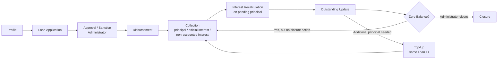

### Architectural Boundary
Finance computes *what is due* (interest on pending principal, penalty, allocation) and *what happened* (a collection was recorded); it hands the resulting amount and Accounted/Non-Accounted classification context to the Central Transaction Engine, which alone decides how that amount affects the Cash Book, Bank Book, and Ledger.

### What the Module Must NOT Own
Cash/Bank/Ledger balances (Layer 5); borrower identity data beyond a Profile ID reference (Layer 4); the approval *mechanism* (RBAC/Layer 3) — Finance only marks sanction and closure as Administrator-restricted actions, it does not implement the role check itself.

---

## 13. Chit Fund Architecture

### Module Purpose
Digitize the complete chit scheme lifecycle across multiple concurrent schemes and groups — configuration, Profile-based member enrollment, installment collection, automatic penalty, auction/prize distribution, and scheme closure (BRD §14; PRD §12).

### Major Capabilities
Scheme master containing multiple Groups; group configuration (start date, duration, collection amount, frequency, capacity, penalty %, prize/dividend structure); scheme/group approval before activation; member enrollment strictly via existing/newly-created Profile (no separate member-creation form); per-member due/collection/penalty tracking; automatic penalty on overdue installments; auction/bidding and winner/prize entry; automatic next-collection-amount recalculation; formal closure with settlement and archival.

### Major Components
Scheme/Group configuration service; Member Enrollment service; Installment Collection service; Penalty Calculator (module-internal); Auction/Prize service; Next-Collection Calculator (module-internal); Closure/Settlement service.

### Main Data Owned
Chit Scheme record; Chit Group record (configuration, status); Chit Member enrollment (Group ID + Profile ID); installment collection history; auction/prize records per cycle.

### Dependencies
Profile Master (member identity); Master Data (penalty rules, collection frequencies); Central Transaction Engine (installment and prize-disbursement posting); Calendar & Notification Engine (due reminders, winner-declaration notices); Audit Log Engine.

### Inputs
Group configuration parameters; Profile ID for enrollment; installment collection entries; auction winner and prize amount per cycle.

### Outputs
Transaction-raise requests (installments, prize disbursements) to the Central Transaction Engine; updated member ledgers and due status; recalculated next-collection amount and schedule; audit events; Chit Fund reports.

### Shared Services Used
Profile, Master Data, Calendar & Reminders, Notifications, Audit, Reporting/Export.

### Financial Integration
Every installment collection and every prize disbursement is raised to the Central Transaction Engine for classification and posting (BR-CHIT rules; PRD §12.1). The module itself computes the penalty amount and the recalculated next-collection figure; it does not post either directly to a book or ledger.

### External Integration
None directly; winner-declaration and due/overdue communication go through the shared Notification Engine.

### Key Workflow

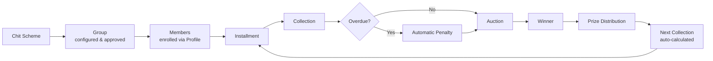

### Architectural Boundary
Chit Fund owns the calculation logic that determines penalty amounts and the next cycle's collection amount from the auction outcome; it does not own how that amount is reflected in cash/bank/ledger, and it does not own member identity beyond the Profile ID reference.

### What the Module Must NOT Own
Cash/Bank/Ledger posting (Layer 5); member identity data (Layer 4, Profile Master); the exact numeric formula relating prize amount, dividend structure, and next-collection amount is **not specified in the source documents** and is flagged in Section 48 as **TBC — Architecture Decision Required**, consistent with BRD Open Issue OI-03 and PRD Risk R-01; this document does not invent that formula.

---

## 14. Rental Architecture

### Module Purpose
Manage residential and commercial rental properties under a two-level parent/child structure (or as standalone properties), covering tenants, agreements, rent/maintenance collection, occupancy, and lease lifecycle (BRD §15; PRD §13).

### Major Capabilities
Parent property (e.g., building/complex) containing multiple child properties (individual flats/shops/units), or a standalone property with no hierarchy; parent-level roll-up (total units, occupied, vacant, expected rent, total outstanding) computed from child-property data; tenant registration against an existing Profile with KYC/emergency contact; rental agreement creation (rent, deposit, escalation, due dates); three collection types — Rent only, Maintenance only, Rent + Maintenance combined, with maintenance tracked independently; automatic occupancy status change on tenant allocation; lease renewal, rent revision, notice management, and lease closure.

### Major Components
Property Hierarchy service (parent/child); Tenant Registration service; Agreement service; Collection service (three collection types); Occupancy tracker; Lease Lifecycle service (renewal/closure).

### Main Data Owned
Parent Property record; Child Property record (rent, maintenance, tenant, agreement, dues, and ledger data all live at child-property level per BR-RENT-001, even when summarized at parent level); Tenant record (Property ID + Profile ID); Rental Agreement record; rent/maintenance collection history.

### Dependencies
Profile Master (tenant identity); Master Data (payment modes, document types); Central Transaction Engine (rent/maintenance posting); Document Management (agreement uploads); Calendar & Notification Engine (rent due/overdue reminders); Audit Log Engine.

### Inputs
Property attributes; Profile ID for tenant registration; agreement terms; collection entries (rent and/or maintenance, mode, date).

### Outputs
Transaction-raise requests to the Central Transaction Engine; updated tenant ledger; occupancy status; Rental reports (portfolio and unit-level).

### Shared Services Used
Profile, Master Data, Document Management, Calendar & Reminders, Notifications, Audit, Reporting/Export.

### Financial Integration
Every rent/maintenance collection is raised to the Central Transaction Engine for classification and Cash/Bank Book posting (FR-RENT-013). Maintenance is tracked as an obligation independent of rent (BR-RENT-002) but posts through the same central mechanism.

### External Integration
None directly.

### Key Workflow

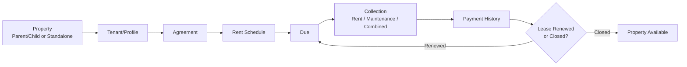

### Architectural Boundary
Rental owns property, tenancy, and agreement data and the rules governing occupancy and roll-up computation; it does not own cash/bank posting or tenant identity beyond the Profile ID reference.

### What the Module Must NOT Own
Cash/Bank/Ledger posting (Layer 5); tenant identity data (Layer 4); the parent-level roll-up figures are always derived from child-property data at read time — the parent record must not maintain its own independently-updatable copies of those totals (BR-RENT-001).

---

## 15. Expense Architecture

### Module Purpose
Record, categorize, and monitor business expenses with fully user-defined categories, posting every expense to the central Cash Book or Bank Book (BRD §16; PRD §14).

### Major Capabilities
User-defined expense categories (not a fixed system list); expense entry (category, amount, date, payment mode, remarks); direct posting to the central Cash/Bank Book; upcoming/recurring expense tracking integrated with the shared calendar; read-only expense history with automatic monthly totals.

### Major Components
Category management service; Expense Entry service; Recurring Expense scheduler (calendar-integrated).

### Main Data Owned
Expense Category record; Expense Entry record (category, amount, date, payment mode, remarks, recurring flag).

### Dependencies
Master Data (payment modes); Central Transaction Engine (posting); Calendar & Notification Engine (recurring/upcoming reminders); Audit Log Engine.

### Inputs
Category selection/creation; expense amount, date, payment mode, remarks.

### Outputs
Transaction-raise request to the Central Transaction Engine; monthly expense totals; Expense reports.

### Shared Services Used
Master Data, Calendar & Reminders, Notifications, Audit, Reporting/Export.

### Financial Integration
Every expense entry posts directly through the Central Transaction Engine to the Cash Book or the selected bank account's Bank Book (FR-EXP-003).

### External Integration
None.

### Key Workflow


### Architectural Boundary
Expense owns category definitions and expense-entry data; it hands every entry to the Central Transaction Engine for posting and classification.

### What the Module Must NOT Own
Cash/Bank/Ledger posting (Layer 5). **Open item carried from the BRD/PRD:** whether an expense's "party"/payee is required to reference the shared Profile Master, and whether Accounted/Non-Accounted classification is an explicit per-entry choice or a module default, are both **not specified** in the source documents (BRD §16 note; PRD TBC-002, R-05) and are preserved here as **TBC — Architecture Decision Required** (Section 48) rather than resolved by assumption.

---

## 16. Investment Architecture

### Module Purpose
Track, monitor, and close business investments as a structured digital register, with recurring-instalment and maturity reminders and a read-only historical ledger on closure (BRD §17; PRD §15).

### Major Capabilities
Investment register (name, company/organization, type — fixed deposit/shares/bond/loan/others —, amount, date, category, platform, agreement/certificate upload); recurring designation (monthly/quarterly/half-yearly/annual) with reminders on **every** occurrence, not only at maturity; maturity-date and expected-return tracking with approach alerts; closure capturing final amount received, moving the record to read-only history.

### Major Components
Investment Register service; Recurring Instalment scheduler; Maturity Tracker; Closure service.

### Main Data Owned
Investment record (active/closed); investment instalment history.

### Dependencies
Master Data (investment types/categories); Central Transaction Engine (instalment and closure posting); Document Management (agreement/certificate); Calendar & Notification Engine (every-occurrence and maturity reminders); Audit Log Engine.

### Inputs
Investment registration detail; recurring frequency (if applicable); instalment entries; closure detail (final amount received).

### Outputs
Transaction-raise requests to the Central Transaction Engine; reminders; Investment reports (active, recurring due, upcoming maturity, closed history).

### Shared Services Used
Master Data, Document Management, Calendar & Reminders, Notifications, Audit, Reporting/Export.

### Financial Integration
Each recurring instalment and the closure figure post through the Central Transaction Engine (FR-INV-004).

### External Integration
None.

### Key Workflow


### Architectural Boundary
Investment owns the register, recurrence schedule, and closure state; it does not own cash/bank posting.

### What the Module Must NOT Own
Cash/Bank/Ledger posting (Layer 5). **Open item carried from the BRD/PRD:** additional Investment information fields beyond those already documented are explicitly deferred by the source documents to a client requirement-freeze exercise (BRD §17, BR-INV-007; PRD §15.3, TBC-007) — this document does not invent those fields and marks the data model as provisional pending that confirmation (Section 48).

---

## 17. Receivables & Payables Architecture

Treated here, as in the BRD/PRD, as a complete PBMS domain in its own right — newly formalized in the V4 scope baseline, not an extension of Finance.

### Module Purpose
Track amounts owed **to** the business (Receivables) and **by** the business (Payables) outside the lending book, with automatic overdue penalty on Receivables, fully integrated with the central Cash/Bank system (BRD §18; PRD §16).

### Major Capabilities
**Receivable:** raise against a customer/party (amount, due date, status); automatic penalty applied once overdue, using a configured percentage; payment recording reduces outstanding. **Payable:** raise against a vendor/party (amount, due date, status, remarks); payment recording captures payment mode. Both: ageing and party-wise outstanding reporting.

### Major Components
Receivable service (including automatic overdue-penalty evaluator); Payable service; shared Party-reference handling (see Architectural Boundary below).

### Main Data Owned
Receivable record (party reference, amount, due date, status, penalty, payment history); Payable record (party/vendor reference, amount, due date, status, remarks, payment history).

### Dependencies
Master Data (penalty rules, payment modes); Central Transaction Engine (all receipt/payment posting); Calendar & Notification Engine (due/overdue evaluation — recipient model **TBC**, Section 48); Audit Log Engine; Profile Master (**pending confirmation** — see Architectural Boundary).

### Inputs
Party reference; amount; due date; payment entries (amount, mode, date).

### Outputs
Transaction-raise requests to the Central Transaction Engine; updated outstanding balance; ageing reports.

### Shared Services Used
Master Data, Calendar & Reminders (due/overdue evaluation), Notifications, Audit, Reporting/Export; Profile (pending confirmation).

### Financial Integration
All receipts and payments under this module route through the Central Transaction Engine to the Cash Book or Bank Book (FR-RP-006; BR-025).

### External Integration
None.

### Key Workflow

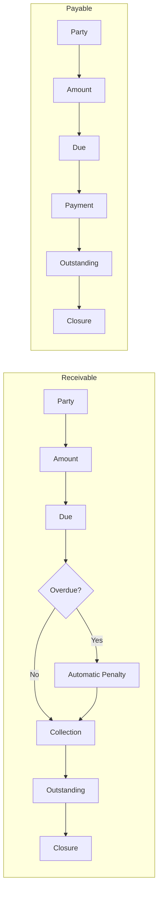

### Architectural Boundary
The module owns due-date monitoring, the automatic-penalty rule for Receivables, and outstanding-balance computation; it hands every financial movement to the Central Transaction Engine.

### What the Module Must NOT Own
Cash/Bank/Ledger posting (Layer 5). **Open item carried from the BRD/PRD, and the single most consequential unresolved data-architecture question in this document:** whether a Receivable's "customer/party" and a Payable's "vendor/party" must reference the shared Profile Master (consistent with the platform-wide single-identity principle, AP-003) or may be recorded as an independent/free-text party is **not stated** in any supplied source document (BRD Open Issue OI-01; PRD TBC-008, Risk R-04). The BRD/PRD's own stated recommendation — Profile linkage, for consistency with AP-003 — is carried forward here as a **RECOMMENDED ARCHITECTURE DECISION**, not confirmed architecture; Section 20.4 and Section 48 discuss the data-model consequence of each option.

## 18. Central Financial Transaction Engine

This is the single most important architectural component in PBMS. Every other section of this document — module architecture, data architecture, reporting architecture — is written to be consistent with what this section establishes.

### 18.1 Transaction Flow

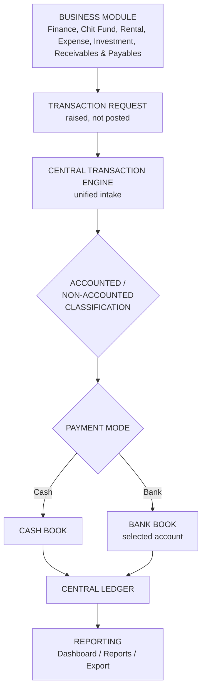

### 18.2 Architectural Responsibilities

| Responsibility | Owner |
|---|---|
| Unified transaction intake — the single entry point for every financial movement raised by any of the six modules | Central Transaction Engine |
| Financial classification (Accounted / Non-Accounted) | Central Transaction Engine |
| Posting logic (which book, which account) | Central Transaction Engine |
| Cash movement (Cash Book running balance) | Central Transaction Engine |
| Bank movement (per-account Bank Book running balance) | Central Transaction Engine |
| Ledger creation (Central Ledger entry) | Central Transaction Engine |
| Financial transaction consistency (a transaction is never partially posted) | Central Transaction Engine |
| Business events (a loan was disbursed, a chit installment fell due, a rent payment was collected) | Business Modules |
| Business entities (Loan, Chit Group, Property, Investment, Receivable/Payable) | Business Modules |
| Business workflows (approval, enrollment, occupancy, closure) | Business Modules |
| Module-specific rules (interest calculation, chit penalty %, auction outcome) | Business Modules |

**Binding statement (restated from the PRD verbatim intent):** business modules raise financial transactions. They do not independently implement central financial posting logic. A module that computes "how much is due" and "what stream it belongs to" has done its job; only the Central Transaction Engine decides how that computed amount changes the Cash Book, Bank Book, or Ledger.

### 18.3 What the Engine Guarantees

| Guarantee | Mechanism |
|---|---|
| Every receipt/payment screen, in every module, presents a Cash/Bank selector | Enforced as a shared UI/API contract (FR-CFE-006), not re-implemented per module |
| Selecting Bank requires a specific bank account before the entry is accepted | Validation at the engine's intake boundary (FR-VAL-003) |
| A transaction's posting occurs automatically and immediately upon successful recording | BR-CFE-003 |
| Historical Cash Book, Bank Book, and Central Ledger entries are never deleted | BR-CFE-004; AP-008 |
| Reporting, dashboards, and exports are computed from the Central Ledger, never recalculated independently by a module | BR-CFE-005; AP-008 |
| Every posted transaction is attributable to the user who entered it | FR-CFE-007 |

### 18.4 Generic Transaction Sequence

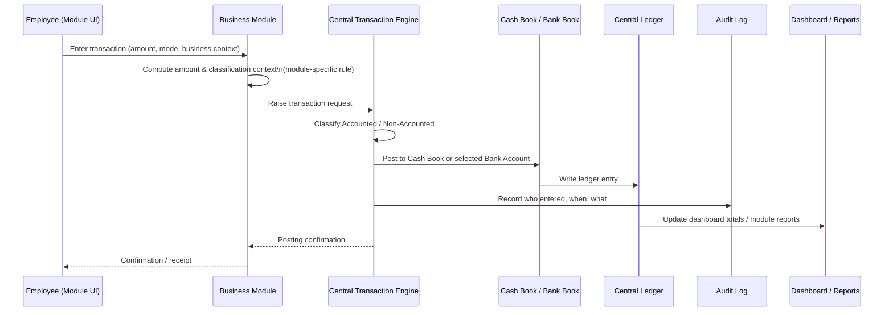

### 18.5 Implementation Details Deliberately Left Open

Consistent with this document's remit as a *high-level* architecture (not a detailed design), the following are acknowledged as engineering-level decisions still to be made, and are **not** resolved here: the exact transaction-intake payload schema; the concurrency/locking strategy for simultaneous postings against the same bank account or Cash Book; and whether a classification can be corrected by an Administrator after entry, or is fixed permanently at the point of entry (PRD §10.4 — **TBC**). These are flagged again in Section 48.

---

## 19. Accounted / Non-Accounted Architecture

### 19.1 Where Classification Occurs

Classification happens exactly once per transaction, at the Central Transaction Engine's intake boundary (Section 18), immediately after a business module raises the transaction request. It is never assigned twice, never assigned independently by two different components, and never inferred after the fact from downstream data.

### 19.2 How Separation Is Maintained Through the System

| Stage | How the Two Streams Remain Distinct |
|---|---|
| Entry | Every transaction carries an Accounted/Non-Accounted flag from the moment the Central Transaction Engine accepts it (AP-004). |
| Calculation | Finance computes official (Accounted) interest and non-accounted interest as two separate figures on the same loan (BR-FIN-005/BR-013); other modules' transactions inherit a single classification appropriate to their business context. |
| Collection | Collections are recorded against each stream separately — a collection is never split silently across streams without an explicit allocation. |
| Outstanding | Outstanding balances are computed and shown per stream (e.g., Finance's principal / official interest outstanding / non-accounted interest outstanding, always as separate figures, never summed into one). |
| Ledger | Both streams post to the same Central Ledger, but every entry retains its classification attribute — the Ledger is one physical store holding two logically distinct, always-distinguishable streams. |
| Reporting | Dashboards and reports display Accounted and Non-Accounted totals as two figures side by side; no report screen offers a "combined total" that discards the distinction (BR-DASH-001; AC-CFE-003). |

### 19.3 How the System Prevents Accidental Merging

The architectural safeguard is structural, not procedural: because the classification flag is a mandatory attribute of every Cash Book entry, Bank Book entry, and Central Ledger entry (Section 23), any aggregation query that omits a `GROUP BY classification` is, by construction, producing a non-conforming report — this is treated as a data-architecture invariant that reporting components must respect (Layer 8, Section 8), not a business rule that a report author must remember unaided. The engine never writes an entry with a "combined" or null classification.

### 19.4 Accounted / Non-Accounted Flow Diagram

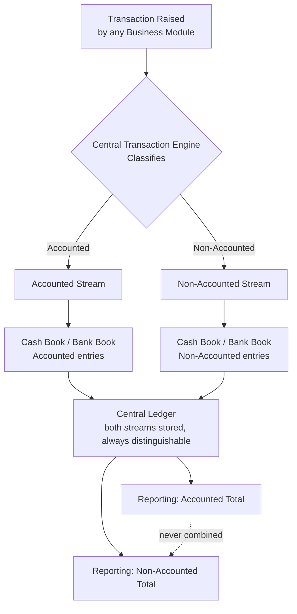

### 19.5 Open Item Preserved from the Source Documents

Whether classification is an **explicit choice** made by staff at every transaction-entry screen, or is **defaulted** based on the raising module's context (with override where needed), is not stated for every module — it is explicitly confirmed only for Finance's dual interest streams (BRD Open Issue OI-05; PRD §10.4, Risk R-05). This document does not assume either UX pattern platform-wide; it is preserved as **TBC — Architecture Decision Required** (Section 48).

---

## 20. Profile Architecture

### 20.1 Architecture

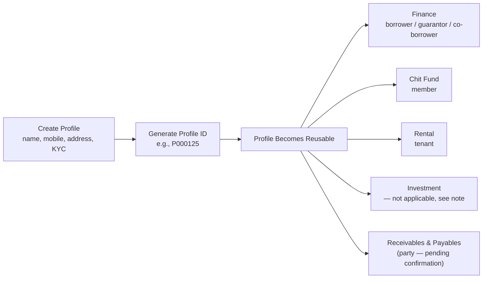

*Note: Investment records a business asset, not a party relationship, so Investment does not reference Profile in the source documents; it is included above only to show the complete module list from the BRD/PRD component tree, not to imply a confirmed Profile relationship.*

### 20.2 Single Identity, Cross-Module Reference

A Profile ID is generated once per distinct person/party and is the **only** mechanism by which any module represents that person. This is enforced structurally, not just procedurally: the Profile Master (Layer 2/4) is the sole owner of identity attributes (name, nickname, mobile, address, Aadhaar, PAN, reference contact); every module that needs to represent a person holds a reference to a Profile ID, never a duplicate copy of identity fields (AP-003; BR-001/BR-002). No module provides a separate person-creation form (BR-GEN-002) — where no Profile exists, one is created once in the Profile Master, then selected, exactly as the PRD specifies for Chit Fund member enrollment and generalizes platform-wide (PRD §9.3).

### 20.3 What the Profile Carries

| Element | Detail |
|---|---|
| Identity | Name, nickname, mobile, address |
| KYC | Aadhaar, PAN |
| Reference | Reference name and contact |
| Documents | Attached via the shared Document Management service (Section 28), not stored redundantly per module |
| Guarantors / Co-borrower | Up to two guarantors and one co-borrower per loan, each themselves an existing Profile ID (FR-PLAT-009) — this is a relationship *from* a Loan to other Profiles, not an attribute stored on the Profile itself |
| Cross-module history | The Profile accumulates a complete, queryable history across every module the person participates in (FR-PLAT-011) |

### 20.4 Avoiding Duplicate Identities

The architecture avoids duplicate customer identities in two ways: (1) structurally, by making Profile the only entity capable of representing a person, so no module schema contains person-identity fields of its own; and (2) procedurally, by requiring search-and-select before creation at every enrollment point (BR-XMOD-001; BO-010). Where the exact duplicate-detection logic (e.g., matching on Aadhaar/PAN) is not specified in the source documents, this document does not invent it (PRD FR-VAL-002 — **TBC**).

**Consequence for Receivables & Payables and Expense (Section 17, Section 15):** if the eventual decision is to require Profile linkage for a Receivable/Payable's party (the BRD/PRD's own recommendation), that party becomes just another Profile-reference relationship, identical in shape to Rental's tenant relationship, and the single-identity guarantee extends cleanly to this module. If the decision instead is to allow an independent/free-text party, that party record sits **outside** the Profile Master's guarantee entirely, and Dhavanam Finance should be aware that such a party's history will not be unified with any Profile-based relationship the same real-world person may have elsewhere in the system (e.g., a Payable vendor who is also a loan guarantor). This trade-off is a business decision, not a technical one, but the architecture is exposing it here because it directly determines whether AP-003 holds without exception. See Section 48 for formal tracking.

## 21. Shared Platform Services

Each service below is implemented exactly once and consumed by every module that needs it (AP-005). All twelve are module-agnostic: none contains logic specific to Finance, Chit Fund, Rental, Expense, Investment, or Receivables & Payables.

### 21.1 Authentication

| Aspect | Detail |
|---|---|
| Purpose | Verify user identity before any business function is reachable. |
| Owner | Shared Platform (Layer 3). |
| Consumers | Every module; the Presentation Layer. |
| Inputs | Username/password; Telegram OTP response. |
| Outputs | JWT session token; authenticated context (user, role) for downstream authorization. |
| Dependencies | User/Role schema (Layer 2); Telegram Bot API (Section 36). |
| Persistence | Session/token state (mechanism — **TBC**, e.g., stateless JWT vs. server-side session store — not specified). |
| Integration | Telegram Bot API for OTP delivery, kept logically separate from the business Notification Engine (BR-GEN-004). |
| Failure Considerations | Telegram unavailable → OTP cannot be delivered → login blocked (retry policy **TBC**, Section 39). |
| Architectural Boundary | Authentication only establishes *who*; it does not decide *what they may do* (that is RBAC, Section 21.1 continues below, and Section 22). |

### 21.2 RBAC (Role-Based Access Control)

| Aspect | Detail |
|---|---|
| Purpose | Enforce the Administrator/Employee permission model on every restricted action. |
| Owner | Shared Platform (Layer 3). |
| Consumers | Every module's write and restricted-read operations. |
| Inputs | Authenticated user context; the action being requested. |
| Outputs | Allow/deny decision. |
| Dependencies | Authentication (must run first); User/Role schema. |
| Persistence | Role assignment (Layer 2). |
| Integration | None external. |
| Failure Considerations | A permission-check failure must fail closed (deny), never open. |
| Architectural Boundary | RBAC enforces role membership; it does not encode module-specific business rules about *when* an Administrator-only action is even offered (e.g., "closure is only offered once a loan is Active") — that precondition logic lives in the module. |

### 21.3 Profile Management

See Section 20 for full architectural treatment. Summary: Purpose — single reusable identity; Owner — Shared Platform (Layer 2/4); Consumers — Finance, Chit Fund, Rental, and (pending confirmation) Receivables & Payables/Expense; Inputs — identity/KYC data; Outputs — a Profile ID; Dependencies — Document Management (for KYC attachments); Persistence — Profile Master table (PostgreSQL); Integration — none external; Failure Considerations — none beyond standard data-layer failure (Section 39); Architectural Boundary — Profile owns identity only, never module-specific relationship data beyond the guarantor/co-borrower link records it hosts on behalf of Finance.

### 21.4 Master Data

| Aspect | Detail |
|---|---|
| Purpose | Provide Administrator-defined reference values that every module draws from, once. |
| Owner | Shared Platform (Layer 2/4); configuration authority is Administrator-only (FR-PLAT-012). |
| Consumers | All six modules (interest types, loan types, collection frequencies, payment modes, transaction types, penalty rules, document types, bank master, reminder templates, currency/date format, financial year, receipt number format). |
| Inputs | Administrator configuration actions. |
| Outputs | Reference values consumed at module screens for selection (Employees have read-only access, FR-PLAT-012). |
| Dependencies | RBAC (Administrator-only write). |
| Persistence | Master Data tables (Layer 2). |
| Integration | None external. |
| Failure Considerations | Incomplete or late master data blocks the corresponding module's configuration (BRD Risk RISK-004). |
| Architectural Boundary | Master Data stores values; it does not enforce how a module applies them (e.g., it stores a penalty percentage, Chit Fund applies it). |

### 21.5 Audit Log Engine

See Section 31 for full treatment. Summary: Purpose — immutable record of critical actions platform-wide; Owner — Shared Platform (Layer 4); Consumers — every module and the Central Transaction Engine, as a write-side effect; Inputs — actor, action, entity, timestamp from every critical write; Outputs — permanent audit entries; Dependencies — Authentication (for actor identity); Persistence — append-only audit store; Integration — none external; Failure Considerations — an audit-write failure on a critical transaction must not silently succeed the underlying business action without a recorded audit trail (Section 39); Architectural Boundary — records what happened, never decides what was allowed (Section 31.1).

### 21.6 Notification Engine

See Section 26 for full treatment. Summary: Purpose — deliver due/overdue/payment/business-activity alerts via Telegram, across all six modules; Owner — Shared Platform (Layer 4); Consumers — all six modules (trigger events) and the Calendar/Reminder Engine (due-date triggers); Inputs — trigger events and reminder rules; Outputs — outbound Telegram messages, logged; Dependencies — Calendar & Reminder Engine, Telegram Bot API; Persistence — notification/delivery log; Integration — Telegram Bot API (Section 36); Failure Considerations — delivery failure must be logged, not silently dropped (retry policy **TBC**); Architectural Boundary — logically separate from Telegram OTP authentication (BR-GEN-004) even though both use the same external Telegram Bot API infrastructure.

### 21.7 Calendar & Reminder Scheduling

See Section 27 for full treatment. Summary: Purpose — maintain one shared calendar of due dates across modules and trigger reminders on schedule; Owner — Shared Platform (Layer 4), driven by Celery Beat (Layer 1 infrastructure); Consumers — Finance (loan due dates), Chit Fund (collection schedule), Rental (rent due dates), Investment (maturity/recurring dates), Expense (recurring/upcoming); Inputs — due dates and recurrence rules originating in each module; Outputs — calendar entries; reminder-trigger events to the Notification Engine; Dependencies — Celery Beat scheduler; Persistence — calendar/schedule store; Integration — none external; Failure Considerations — a missed scheduled evaluation delays reminder generation (Section 39); Architectural Boundary — determines *when*, modules determine *what* (Section 27).

### 21.8 Global Search

| Aspect | Detail |
|---|---|
| Purpose | Find a Profile, loan, chit group, property, or transaction without knowing which module holds it. |
| Owner | Shared Platform (Layer 4). |
| Consumers | All modules' UI, via the global navigation. |
| Inputs | User search query and filters. |
| Outputs | Cross-entity result set. |
| Dependencies | Read access to Profile, Loan, Chit Group, Property, and transaction data (confirmed scope per PRD §9.8); Expense and Receivables/Payables inclusion is **TBC** (PRD TBC-004). |
| Persistence | Search index or query mechanism — **TBC — Search Technology Decision** (Section 29). |
| Integration | None external. |
| Failure Considerations | Search unavailability degrades discoverability but is not a financial-integrity risk. |
| Architectural Boundary | Search is read-only and does not modify underlying records. |

### 21.9 Document Management

See Section 28 for full treatment. Summary: Purpose — upload/view/download/replace documents against a Profile, Loan, Chit Group, Property (confirmed) and Investment (extension, PRD §9.5); Owner — Shared Platform (Layer 4); Consumers — all modules with document needs; Inputs — file binaries, document-type metadata; Outputs — stored files with retrieval references; Dependencies — Master Data (document types, mandatory-document rules); Persistence — Object Storage (MinIO/S3-compatible), Layer/metadata in PostgreSQL; Integration — Object Storage; Failure Considerations — upload/download failure surfaced to user, retry policy **TBC**; Architectural Boundary — deletion is Administrator-only (BR-GEN-003) and is enforced here, not per module.

### 21.10 Data Export

| Aspect | Detail |
|---|---|
| Purpose | Produce PDF/Excel output from any report. |
| Owner | Shared Platform (Layer 8, reporting sub-layer). |
| Consumers | All modules' reports; the Executive Dashboard. |
| Inputs | A generated report dataset. |
| Outputs | PDF or Excel file (confirmed baseline, PRD FR-PLAT-024); CSV is referenced only in a Receivables & Payables cost-document context and is **TBC** platform-wide. |
| Dependencies | Reporting/Aggregation (Layer 8). |
| Persistence | Generated files (transient, or object storage — **TBC**). |
| Integration | None external. |
| Failure Considerations | Export failure does not affect underlying data; it is a read-side concern only. |
| Architectural Boundary | Export never writes back to a business record. |

### 21.11 Backup & Recovery

See Section 32 for full treatment. Summary: Purpose — protect the business's data against loss; Owner — Shared Platform / Infrastructure (Layer 1 mechanism, Layer 4 policy); Consumers — the whole platform; Inputs — scheduled trigger (Celery Beat); Outputs — a restorable backup artifact; Dependencies — PostgreSQL and Object Storage; Persistence — backup storage location (**TBC** — not specified whether on/off-site); Integration — none external; Failure Considerations — a failed scheduled backup must be detectable, not silent (Section 39); Architectural Boundary — backup is infrastructure-level and has no business-rule content.

### 21.12 Reporting / Dashboard Services

See Section 30 for full treatment. Summary: Purpose — consolidated and module-level reporting, plus the Executive Dashboard; Owner — Layer 8 (Reporting/Aggregation); Consumers — Administrator (primary), Employee (module-level, scope **TBC** for dashboard); Inputs — the Central Ledger and module data; Outputs — dashboard views, report datasets, drill-through to source records; Dependencies — Central Ledger (Layer 5), module data (Layers 6–7); Persistence — none of its own — reads from the systems of record; Integration — Data Export; Failure Considerations — reporting unavailability does not affect transactional integrity, since reporting never writes; Architectural Boundary — strictly read-only (BR-028).

---

## 22. Authentication & Security Architecture

### 22.1 Confirmed Mechanism

Telegram OTP authentication as a second factor, JWT-based session authentication, session expiry, and server-side Administrator/Employee role enforcement (BRD §27; PRD §9.1–9.2).

### 22.2 Security Flow

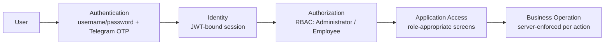

### 22.3 Security Principles Applied

| Principle | Architectural Expression |
|---|---|
| Two-factor login | Password plus Telegram OTP, both required before a session is issued (FR-PLAT-001–002). |
| Session-bound authorization | A JWT carries the authenticated identity; every subsequent request is authorized against the role attached to that session, not re-derived from client state (FR-PLAT-003; AC-PLAT-001). |
| Server-side enforcement | Restricted actions (deletion, closure, approval, master-data change) are checked at the API layer regardless of UI state (BR-GEN-001, BR-030). |
| Secure credential storage | Passwords are stored encrypted/hashed; plaintext credentials are never persisted (SEC-001, SEC-003). |
| Controlled file access | Document access follows the same RBAC model as the rest of the platform (Section 28); deletion is Administrator-only (BR-GEN-003). |
| Auditability | Login success/failure and OTP verification success/failure are themselves audit events (Section 31.1). |
| Historical preservation | Security-relevant records (audit entries, login history) are never deleted, consistent with the platform-wide historical-preservation rule (BR-026). |
| Session expiry | Sessions expire automatically and can be deliberately ended (logout); exact duration is **TBC** (PRD TBC-001). |

### 22.4 Separation of Shared-Service Security from Module Security

Shared services do not implement their own independent authentication or a parallel RBAC system. A module screen that appears to need "its own login" or "its own permission list" (for example, a module-specific admin-only setting) is, architecturally, just another restricted action checked against the same two roles by the same central RBAC gate — there is exactly one Administrator/Employee model in the entire system, not one per module and not one per shared service.

## 23. Data Architecture

### 23.1 Confirmed Data Technologies

PostgreSQL (system of record, relational); Redis (cache and Celery message broker); MinIO/S3-compatible object storage (documents/files). No polyglot persistence (e.g., a separate document database or search-specific data store) is confirmed in the source documents; where one might be architecturally convenient (e.g., a dedicated search index, Section 29), this document marks it **TBC** rather than assuming it.

### 23.2 Logical Data Domains

| Domain | Contents | Owning Layer |
|---|---|---|
| Core Data | Profile, User, Role | Layer 2 / Shared Platform |
| Shared Platform Data | Master Data, Document metadata, Calendar entries, Notification log | Layer 4 |
| Financial Data | Cash Book entries, Bank Book entries (per account), Central Ledger entries | Layer 5 |
| Finance Data | Loan, guarantor/co-borrower links, loan collection/transaction history | Layer 6 |
| Chit Data | Chit Scheme, Chit Group, Chit Member, installment/collection history, auction/prize records | Layer 7 |
| Rental Data | Parent Property, Child Property, Tenant, Rental Agreement, rent/maintenance collection history | Layer 7 |
| Expense Data | Expense Category, Expense Entry | Layer 7 |
| Investment Data | Investment record, instalment history | Layer 7 |
| Receivables/Payables Data | Receivable, Payable, payment history | Layer 7 |
| Audit Data | Audit Log entries | Layer 4 |
| Notification Data | Notification/delivery log | Layer 4 |
| Scheduling Data | Calendar/reminder schedule state | Layer 4 |
| Document Data | File binaries (object storage) + metadata (PostgreSQL) | Layer 4 |
| Reporting Data | No independent store — computed at read time from Financial Data + module data | Layer 8 |

### 23.3 Data Ownership and Relationships (High Level)

- **Profile** is referenced by, never duplicated into, Loan (borrower/guarantor/co-borrower), Chit Member, Tenant, and — pending confirmation — Receivable/Payable party and Expense payee (Section 20).
- **Master Data** is referenced by every module that needs a configured value (interest type, penalty rule, payment mode, document type, bank account); it is never copied into a module's own table.
- **Cash Book Entry / Bank Book Entry / Central Ledger Entry** each carry: amount, direction, Accounted/Non-Accounted classification, source module, source record reference, entered-by, timestamp (PRD §22) — this shape is uniform across all six modules' financial activity, not module-specific.
- **Module entities** (Loan, Chit Group, Property, Investment, Expense Entry, Receivable/Payable) each hold a reference to the financial entries they generated, but the financial entries themselves live in the Central Financial domain, not inside the module's own schema.

### 23.4 Transaction Consistency

A business transaction is consistent only when its module-level record, its Central Transaction Engine posting, its Cash/Bank Book entry, its Central Ledger entry, and its audit entry all agree — this is achieved by treating the module's write and the engine's posting as a single logical unit of work (exact database-transaction-boundary implementation is an engineering decision, not specified here). No report or dashboard figure is permitted to diverge from what the Central Ledger records (AP-008; BR-CFE-005).

### 23.5 Historical Records and Retention

Per BR-026 and AP-008, no module's schema design may support hard deletion of a Loan, Chit Group, Property, Investment, Receivable/Payable, or any financial entry once created; where "deletion" is offered at all in the UI, it is an Administrator-only, non-destructive operation (e.g., archival/status change), consistent with the closure patterns described in Sections 12–17. Document retention specifically follows the shared Document Management service's rules (Section 28). A general data-retention policy beyond "never hard-deleted" (e.g., how long closed/archived records remain in primary storage versus being moved to cold storage) is **not specified** in the source documents and is marked **TBC**.

---

## 24. Data Flow Architecture

### 24.1 Business Transaction Flow


### 24.2 Profile Flow

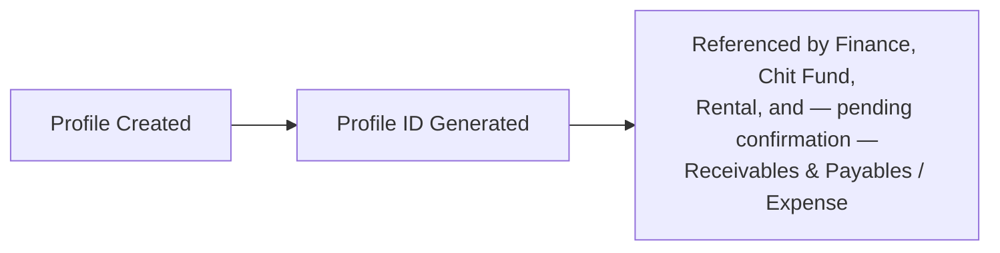

### 24.3 Notification Flow

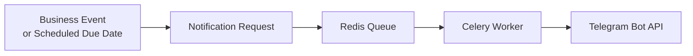

### 24.4 Document Flow

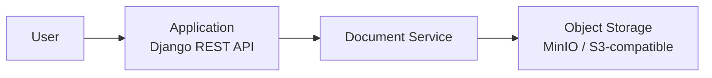

### 24.5 Search Flow

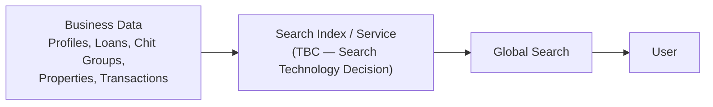

Search-indexing architecture beyond this data-source diagram is not described further because no search technology is confirmed by the source documents (Section 29); this document does not speculate on indexing mechanics (e.g., full-text index refresh cadence) beyond what BRD/PRD state.

---

## 25. Asynchronous Processing

### 25.1 Confirmed Technologies

Celery (background/asynchronous task execution), Celery Beat (scheduled/recurring task triggering), Redis (message broker underlying both) (BRD §32/33 context via PRD §28; PRD §6.4 names Celery Beat as a "Scheduler" system actor).

### 25.2 Architectural Role

| Concern | Synchronous (within the request/response cycle) | Asynchronous (Celery / Celery Beat) |
|---|---|---|
| Recording a business transaction (loan collection, chit installment, rent payment, expense, investment instalment, receivable/payable payment) | Yes — the user must see immediate confirmation and updated figures (BR-CFE-003, FR-FIN-021) | No |
| Posting to Cash Book/Bank Book/Ledger | Yes — occurs "automatically and immediately upon successful recording" (BR-CFE-003) | No |
| Due-date evaluation (is a loan/chit/rent/investment/receivable now due or overdue?) | No | Yes — evaluated on a schedule via Celery Beat |
| Reminder/notification generation and delivery | No | Yes — generated and sent via Celery workers, queued through Redis |
| Recurring-item due-date rollover (recurring expense, recurring investment instalment schedule) | No | Yes |
| Scheduled backups | No | Yes, where documented (Section 32) |
| Dashboard auto-refresh on a business event | Event-driven (triggered by the synchronous write completing), not purely time-based | The refresh trigger itself is synchronous-adjacent (fired at the moment of the write); the notion of a "refresh queue" is not applicable here |

### 25.3 Why the Distinction Matters Architecturally

A user recording a collection must not wait on notification delivery, calendar recalculation across the whole business, or a backup job — those are explicitly background concerns. Conversely, financial posting (Section 18) is explicitly **not** deferred to a background job; it must complete, and be reflected in the ledger and dashboard, within the same request that recorded the transaction (BR-CFE-003). This document does not invent additional queue topology (multiple broker instances, priority queues, dead-letter queues) beyond what the BRD/PRD support; where such detail matters, it is an engineering decision for the Celery/Redis configuration, not an architectural commitment made here.

---

## 26. Notification Architecture

### 26.1 Flow

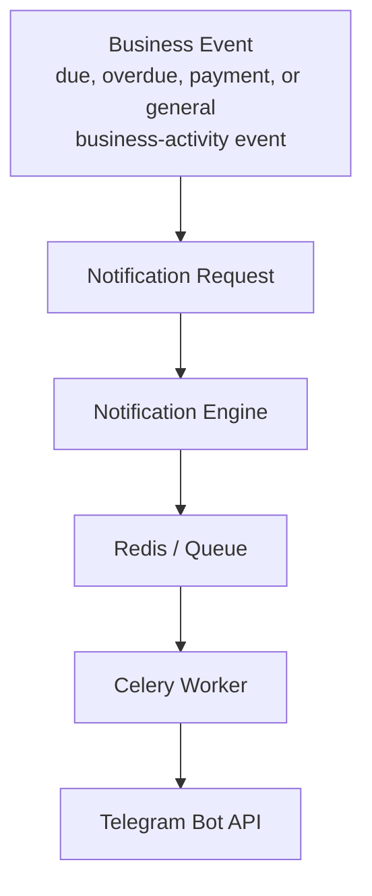

### 26.2 Generation, Queueing, Delivery

| Stage | Architectural Detail |
|---|---|
| Generation | A module (via the Calendar & Reminder Engine for due/overdue events, or directly for payment/activity events) raises a notification request carrying trigger event, message type, and target entity. |
| Queueing | The request is placed on a Redis-backed queue for asynchronous processing (Section 25), decoupling notification delivery from the user's synchronous request. |
| Delivery | A Celery worker consumes the queue and calls the Telegram Bot API to deliver the message. |
| Retry | Retry policy on delivery failure is **not specified** in the source documents — **TBC** (PRD TBC-014-adjacent; Section 39). |
| Failure Handling | Failed delivery is logged as a notification event with a failure status, per the general principle that failures must be visible, not silent (BRD §29). |
| Audit | Every notification is logged (recipient, channel, message type, trigger event, timestamp, delivery status) per the Notification data entity (PRD §22). |

### 26.3 OTP vs. Business Notifications — Confirmed Separation

Telegram OTP authentication (Section 22) and this business Notification Engine are **explicitly separate services** at the architecture level (BR-GEN-004), even though both ultimately call the same external Telegram Bot API. They must not share code paths, queues, or logs in a way that conflates a login-security event with a business alert. This is a confirmed, non-negotiable architectural rule, not a stylistic preference.

### 26.4 Open Item Preserved from the Source Documents

The exact recipient model — whether external parties (customers, chit members, tenants) receive Telegram messages directly, or only internal staff do, or this is configurable per notification type — is **not specified** (BRD Open Issue OI-04; PRD TBC-014, Risk R-06). This has direct architectural consequences (whether the system must capture and manage an external party's Telegram identity/consent) and is preserved here as **TBC — Architecture Decision Required** (Section 48).

---

## 27. Calendar & Scheduling Architecture

### 27.1 Confirmed Scope

A single shared calendar aggregates loan due dates (Finance), chit collection schedules (Chit Fund), rent due dates (Rental), and investment maturity/recurring dates (Investment) (FR-PLAT-017). Expense's recurring/upcoming tracking is also calendar-integrated (FR-EXP-004).

### 27.2 Architectural Separation of Concerns

The scheduling service determines **when** an event should trigger (evaluating due dates against the current date on a schedule, via Celery Beat); business modules determine **what** the event means (a loan is now overdue and should be flagged NPA-eligible; a chit installment overdue triggers a penalty; a rent payment overdue flags the property). This mirrors, at the calendar level, the same separation the Central Transaction Engine enforces at the financial level (Section 18): the shared service owns the mechanism, the module owns the meaning.

### 27.3 Components

| Component | Role |
|---|---|
| Celery Beat | Time-triggered evaluation of due dates across modules, on a schedule. |
| Calendar Store | The aggregated view of due dates by module, date, and entity reference. |
| Reminder Rule Configuration | Administrator-managed master data (reminder templates, frequency, escalation rules — FR-PLAT-016, FR-PLAT-018). |
| Notification Trigger | On a due/overdue determination, the Calendar & Reminder Engine raises a notification request to the Notification Engine (Section 26). |

### 27.4 Recurring-Item Rule

Recurring items (recurring investments, recurring expenses) generate a reminder on **every** occurrence, not only at final maturity (FR-PLAT-019; BR-022) — this is a confirmed, explicit architectural requirement distinguishing PBMS's scheduling behavior from a simpler "final due date only" reminder model.

---

## 28. Document Architecture

### 28.1 Flow

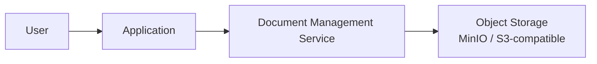

### 28.2 Capabilities

| Capability | Detail |
|---|---|
| Upload / View / Download / Replace | Confirmed against Profile, Loan, Chit Group, and Property; Investment agreement/certificate upload is treated as an extension of the same shared capability (FR-PLAT-013). |
| Document Type | Configurable as master data (FR-PLAT-014). |
| Mandatory Documents | Definable per context via master data. |
| Access Control | Follows the platform RBAC model (Section 22); no document-specific parallel permission system. |
| Deletion Restrictions | Administrator-only (BR-GEN-003). |
| Storage | Object Storage (MinIO/S3-compatible); this document does not invent a specific bucket-per-module or bucket-per-entity topology, as none is specified in the source documents. |

### 28.3 Open Item Preserved from the Source Documents

Whether Expense entries and Receivables/Payables entries support document attachment at all is **not explicitly stated** (PRD TBC-003) and is preserved as **TBC — Architecture Decision Required** rather than assumed.

---

## 29. Search Architecture

Global Search spans, at confirmed scope, Profiles, Loans, Chit Groups, Properties, and transactions (PRD §9.8, FR-PLAT-020), with cross-module search and advanced filters. Profile search is the entry point for the "search-and-select, never re-create" identity discipline that underpins AP-003.

**TBC — Search Technology Decision:** No search index or search technology (e.g., native PostgreSQL full-text search versus a dedicated search engine) is named in any supplied source document. This document deliberately does not introduce one (per the explicit instruction not to invent a specific search technology); the decision is recorded in Section 48 for architecture sign-off before Layer 4 (Shared Platform Services) is finalized.

Whether Expense entries and Receivables/Payables records are included in Global Search's indexed scope is also **not explicitly listed** (PRD TBC-004) and is preserved as open.

---

## 30. Reporting & Dashboard Architecture

### 30.1 Flow

```mermaid
flowchart TB
    BD[Business Data\nModule Records] --> CFD[Central Financial Data\nCentral Ledger]
    CFD --> AGG[Reporting / Aggregation Layer]
    BD --> AGG
    AGG --> DASH[Executive Dashboard]
    AGG --> REP[Module & Consolidated Reports]
    REP --> EXP[PDF / Excel Export]
```

### 30.2 Executive Dashboard

The dashboard shows consolidated live figures — total customers, active loans, collections this period, total outstanding, overdue amount, closures, an ageing summary (1–30/31–60/61–90/90+ days), and a collection summary split by interest/principal — auto-refreshing on business events (profile created, transaction recorded, loan closed), per FR-DASH-001–006. Accounted and Non-Accounted totals are always shown as a split, never merged (BR-DASH-001; Section 19).

### 30.3 Module and Cross-Module Reports

Each module has its own confirmed report set (Sections 12–17 reference these; the full catalogue is in the PRD §18.1). The cross-module **Money Flow Report** (total income less total expense per month, across all modules) is the architecturally significant cross-cutting report, because it is the one report that genuinely aggregates every module's data through the Central Ledger rather than presenting one module's view (FR-PLAT-026).

### 30.4 Historical Reporting

Because historical records are never deleted (AP-008), every report can, in principle, be run against any past period; reports are read-only and never used to alter the underlying record (BR-REP-001/BR-028) — selecting a report row opens the corresponding source record for any permitted edit, rather than allowing in-report editing.

### 30.5 What Is Not Invented Here

No analytics infrastructure (a data warehouse, an OLAP cube, a BI tool integration) is confirmed by the source documents, and none is introduced in this architecture. Reporting is a read path over the Central Ledger and module tables, computed at request time or via a lightweight aggregation step — not a separately maintained analytical data store.

---

## 31. Audit Architecture

### 31.1 Flow

```mermaid
flowchart LR
    U[User] --> AC[Authenticated Context]
    AC --> BA[Business Action]
    BA --> AE[Audit Event]
    AE --> STORE[(Immutable Audit Store)]
```

### 31.2 Captured Fields

Actor, action, affected entity, timestamp, and — for approval-gated actions — both the initiating user and the authorizing user (FR-AUDIT-001, FR-AUDIT-003). The full audit-event catalogue (login/OTP events, Profile creation/edit, every Finance/Chit Fund/Rental/Expense/Investment/Receivables-Payables lifecycle event, master-data modification, document upload/deletion, backup execution) is enumerated in the PRD (§25.1) and is not restated field-by-field here, consistent with this document's remit to describe architecture, not a field-level specification.

### 31.3 Authorization vs. Audit — a Deliberately Separated Concern

The Audit Log Engine **records** what happened; it does not decide whether an action was **allowed** — that is RBAC's responsibility (Section 22). An audited attempt can still fail authorization (a denied action may itself be worth logging, e.g., failed login attempts, SEC-002); a permitted action is always audited if it is "critical." Architecturally, these are two independent components invoked in sequence — authorization first, business action second, audit third — never merged into one component, so that a future change to permission rules never risks silently disabling audit capture, and vice versa.

### 31.4 Immutability and Historical Preservation

Audit entries are never deleted (FR-AUDIT-002; BR-026/BR-027) — this is enforced as a data-architecture invariant (Section 23.5), not a UI restriction. Field-level "before/after" change capture versus event-level logging only is not fully specified for non-financial edits (PRD TBC-015) and is preserved as **TBC**.

---

## 32. Backup & Recovery Architecture

### 32.1 High-Level Approach

Automated, scheduled database backups with restore capability (FR-PLAT-027). The BRD notes that a **daily backup frequency with 30-day retention** is documented specifically in the (unsupplied) Layer 4 architecture document (BRD §29, §33, citing "System Architecture Layer 4 §14") rather than in the commercial proposal itself; this document carries that figure forward as **Confirmed (sourced from architecture documentation, not directly verified here)**, per the BRD's own sourcing note, and flags it in Section 48 as an item Dhavanam Finance should explicitly re-confirm (BRD Open Issue OI-07) since this document could not independently inspect the original Layer 4 file.

### 32.2 Scope

| Element | Status |
|---|---|
| Database backup (PostgreSQL) | Confirmed requirement (FR-PLAT-027); daily frequency/30-day retention per BRD sourcing note above |
| File/object storage backup (documents) | Not explicitly addressed as a separate backup stream in the supplied BRD/PRD text — **TBC** |
| Scheduled trigger mechanism | Celery Beat (consistent with Section 25's role for all scheduled jobs) |
| Restore capability | Confirmed as a requirement ("with restore capability," FR-PLAT-027); restore procedure detail is a runbook concern, out of scope for this document |
| Infrastructure snapshot relationship | Not specified — **TBC** whether backups are database-level dumps, infrastructure-level snapshots, or both |

### 32.3 RPO / RTO

No source document supplied to this exercise states a numeric Recovery Point Objective or Recovery Time Objective. Consistent with the instruction not to invent such figures:

- **RPO:** TBC. (A daily backup cadence, if confirmed, would structurally imply a maximum data-loss window on the order of one day, but this document does not state that as a committed RPO — only Dhavanam Finance and Florix Technologies can commit to an RPO figure.)
- **RTO:** TBC.

Both should be formally agreed before Layer 9 (Hardening & Handover, Section 8) is exited, since the Definition of Done (PRD §38) requires a backup-and-restore drill to have been performed.

## 33. Technology Stack

| Technology | Purpose | Architectural Layer | Dependency | Status |
|---|---|---|---|---|
| React.js | Frontend single-page application | Presentation | Consumes the Django REST Framework API | Confirmed |
| Python | Backend implementation language | Application/API, Business Domain, Central Financial | Runs under Gunicorn | Confirmed |
| Django REST Framework | Backend web/API framework | Application/API | Python | Confirmed |
| PostgreSQL | Relational database, system of record | Data | Provisioned at Layer 1 | Confirmed |
| Redis | Cache and Celery message broker | Data / Infrastructure | Provisioned at Layer 1 | Confirmed |
| Celery | Asynchronous background task execution | Infrastructure | Redis (broker) | Confirmed |
| Celery Beat | Scheduled/recurring task triggering | Infrastructure | Celery, Redis | Confirmed |
| Gunicorn | WSGI application server for Django | Infrastructure | Python/Django | Confirmed |
| Nginx | Reverse proxy / request routing | Infrastructure | Gunicorn | Confirmed |
| MinIO / S3-compatible object storage | Document/file storage | Data | Provisioned at Layer 1 | Confirmed |
| JWT | Session token mechanism | Application/API (Layer 3) | Authentication service | Confirmed |
| Telegram OTP | Second-factor authentication | Application/API (Layer 3) | External Telegram Bot API | Confirmed |
| Telegram Bot API (notification channel) | Business notification delivery | Shared Platform (Layer 4) | External | Confirmed |

**Constraint statement (carried forward verbatim in intent from the PRD/Developer Build Guide):** no alternate framework or database is to be introduced without formal sign-off, because the delivery estimate, timeline, and hosting plan are built around this stack. This document introduces no additional confirmed technology beyond this list; any technology named elsewhere in this document as a possibility (e.g., a search index in Section 29) is explicitly marked TBC/Recommended, never Confirmed.

---

## 34. Deployment Architecture

```
Client Browser
      │  HTTPS
      ▼
   Nginx  (reverse proxy, TLS termination)
      │
      ▼
React Application Delivery  (static assets served/proxied)
      │
      ▼
   Gunicorn  →  Django (Application/API Layer)
      │
      ├──────────────► PostgreSQL   (system of record)
      ├──────────────► Redis         (cache / Celery broker)
      ├──────────────► Celery Workers  (async processing)
      ├──────────────► Celery Beat     (scheduled processing)
      └──────────────► Object Storage  (MinIO / S3-compatible)

External:
   Celery Workers  ───────────────► Telegram Bot API  (OTP + notifications)
```

**Hosting responsibility:** infrastructure (hosting, domain, SSL, cloud/database hosting) is client-provided per the BRD/PRD (PRD §29); Florix Technologies is not responsible for downtime or data loss arising from client-side infrastructure lapses. No specific cloud provider is named in the source documents, and none is introduced here (**TBC — Cloud Provider / Hosting Topology**, Section 48). Telegram integration is the only external runtime dependency shown, consistent with Section 6 and Section 36.

---

## 35. Environment Architecture

The source documents (as available to this exercise) confirm that Layer 1 responsibilities include "environments" generically (PRD §7.3, Layer 1 row: "Repo, CI/CD, environments, PostgreSQL/Redis/MinIO provisioning, Nginx/Gunicorn") but do not enumerate a specific environment model (e.g., Development / Testing-QA / Staging / Production) with defined isolation boundaries between them. Because the original Layer 1–4 architecture documents were not directly supplied to this exercise (Section 1.2), this document does not assume a specific environment count or topology.

| Environment | Purpose | Isolation | Status |
|---|---|---|---|
| Development | Engineering build and unit-level verification | From Production data and credentials | **TBC** — implied by standard practice, not explicitly confirmed in supplied sources |
| Testing / QA | Functional, integration, and UAT testing (PRD §38 requires UAT with representative test data) | From Production data | **TBC** |
| Staging | Pre-production verification | From Production | **TBC** — not explicitly named in supplied sources |
| Production | Live business operation on client-provided infrastructure | N/A | Confirmed to exist (deployment is explicitly required, PRD §5.1); its isolation from other environments is **TBC** |

**Recommended Architecture Decision:** given the client-provided-infrastructure constraint (Section 34) and the "basic-to-intermediate" scope depth, a minimum of two environments (Testing/UAT and Production) is recommended so that UAT (a Definition-of-Done requirement, PRD §38) does not run against the live production database. This is a recommendation, not confirmed architecture, and should be validated against the actual Layer 1 architecture documentation and the client's infrastructure procurement (due Week 14 per PRD Appendix B.3) once available.

---

## 36. Integration Architecture

| Integration | Purpose | Direction | Data | Trigger | Protocol/Technology | Failure Handling | Security | Dependency |
|---|---|---|---|---|---|---|---|---|
| Telegram Bot API — OTP channel | Second-factor authentication at login | Outbound (send OTP) | One-time verification code | Login attempt | Telegram Bot API | Login blocked if OTP undeliverable/unverifiable; retry policy **TBC** | OTP not logged in plaintext beyond what verification requires | Client-provided Telegram bot account and credentials |
| Telegram Bot API — Notification channel | Due/overdue/payment/business-activity alerts | Outbound | Reminder/alert content | Scheduled (Celery Beat) or event-driven | Telegram Bot API | Failed delivery logged; retry policy **TBC** | Recipient identity/consent model **TBC** (Section 26.4) | Same bot infrastructure as OTP, logically separate service |
| Object Storage (MinIO/S3-compatible) | Store uploaded documents (KYC, agreements, certificates) | Bidirectional | File binaries and metadata | Document upload/download/replace | S3-compatible API | Upload/download failure surfaced to user; retry **TBC** | Access controlled per RBAC/document rules | Client-provided storage credentials/config, or self-hosted MinIO |
| Client-provided hosting/domain/SSL/database hosting | Production runtime environment | N/A (infrastructure) | N/A | Deployment | N/A | Florix not responsible for client-side infrastructure lapses | Credentials handled confidentially; access relinquished at engagement end | Must be provisioned by the client per the agreed timeline |

**Explicitly not integrations built into PBMS** (confirmed out-of-scope per BRD §10.2/PRD §5.2): bank API integration/auto-reconciliation, payment gateway/online payment collection, SMS/WhatsApp gateways, digital signature integration, GST/statutory filing or external accounting-software integration. None of these appear elsewhere in this document as architecture, confirmed or recommended.

---

## 37. Cross-Cutting Concerns

| Concern | Confirmed Requirement | Architectural Recommendation (where source is silent) |
|---|---|---|
| Security | Encrypted credential storage, JWT + Telegram OTP, server-side RBAC (Section 22) | — |
| Logging | General user-activity logging alongside critical-transaction audit (FR-PLAT-022) | Centralized application log aggregation — **TBC**, not named in source documents |
| Audit | Immutable, centralized audit trail (Section 31) | — |
| Error Handling | Business-critical processes must not fail silently (BRD §29) | Standardized API error-response schema — **TBC** (PRD TBC-017) |
| Monitoring | Centralized error monitoring referenced at a high level (NFR-008) | Specific tooling/alerting thresholds — **TBC** |
| Backup | Automated scheduled backup with restore capability (Section 32) | — |
| Data Integrity | Central Ledger as sole source of truth; historical preservation (AP-008) | — |
| Performance | System must "respond quickly enough for day-to-day operational use" (BRD §29) | No numeric target — **TBC** |
| Scalability | Must grow with transaction volume/customer base without re-architecting the financial core (BO-011; NFR-003) | See Section 38 |
| Maintainability | Modular architecture enabling new capability without disruption (NFR-003) | — |
| Observability | Centralized error monitoring at a high level (NFR-008) | Distributed tracing / structured logging — **TBC**, not named in source documents |

---

## 38. Scalability Architecture

PBMS's scalability story is architectural, not infrastructural: no source document commits to a specific horizontal-scaling mechanism (auto-scaling groups, container orchestration, database read replicas), and none is introduced here (BRD §29 — scalability target explicitly **TBC**; NFR-005). What the architecture does commit to is that growth is absorbed **without re-architecting the financial core** (BO-011), via the following structural properties:

| Growth Vector | How the Architecture Absorbs It |
|---|---|
| Additional business modules | A new module becomes just another consumer of the Central Financial Layer and Shared Platform Services (AP-009); it does not require changes to Layers 1–5. |
| Increased transaction volume | All transaction posting flows through one engine (Layer 5); scaling that engine's throughput (e.g., via database tuning, connection pooling, or read replicas for reporting) is an infrastructure/engineering optimization within Layer 5's boundary, not a redesign of where posting logic lives. |
| More users | Authentication/RBAC (Layer 3) and the API layer are stateless-session-oriented (JWT), which is structurally compatible with adding application-server capacity behind Nginx; no specific concurrent-user target is committed here (**TBC**). |
| More documents | Document Management (Section 28) delegates storage to Object Storage, which is designed for binary-object growth independent of the relational database. |
| More scheduled jobs | Celery/Celery Beat (Section 25) is designed for horizontally addable worker capacity; this document does not commit to a specific worker-scaling policy (**TBC**). |
| More notifications | The Notification Engine is queue-based (Redis-backed, Section 26), decoupling notification volume growth from the synchronous request path. |
| More reports | Reporting (Layer 8) reads from the Central Ledger rather than maintaining its own duplicated dataset, so report growth does not multiply the number of places financial data is stored. |

**What this document does not claim:** it does not assert a specific horizontal-scalability feature (e.g., "the system auto-scales to N concurrent users") because no source document supports such a claim. Modularity and shared services are the confirmed mechanism for accommodating growth; specific capacity targets and scaling automation remain **TBC** pending Dhavanam Finance's confirmation of expected volumes (BRD §33; PRD Risk R-09).

---

## 39. Reliability & Failure Boundaries

| Component | Failure | Impact | Expected Architectural Behavior | Recovery |
|---|---|---|---|---|
| PostgreSQL (database) unavailable | All modules and the Central Financial Layer lose read/write capability | Full application outage — no transaction can be posted or read | System should fail closed (reject writes rather than accept and lose them); exact behavior **TBC** (not specified in source documents) | Restore from backup per Section 32; RTO **TBC** |
| Redis unavailable | Celery task queueing and any Redis-backed caching stop functioning | Notifications, scheduled reminders, and other background jobs are delayed or not dispatched; synchronous transaction posting itself is not confirmed to depend on Redis, so core financial posting should be unaffected if Redis is used only for cache/broker purposes — **TBC** confirmation needed | Background jobs should queue for retry once Redis recovers rather than silently drop; exact behavior **TBC** | Restart Redis; queued-but-undelivered jobs process on recovery — **TBC** whether persistence is configured |
| Telegram Bot API unavailable | OTP delivery and business notification delivery both fail | Login may be blocked if OTP cannot be delivered (Section 22); due/overdue reminders are delayed | Failure should be logged, not silent (BRD §29); retry policy **TBC** | Delivery resumes on Telegram API recovery; queued notifications, if retried, are delivered late |
| Background worker (Celery) failure | Scheduled/queued jobs stop processing | Notifications and reminders stop firing; recurring rollovers are delayed | Job failures should be visible/logged (BRD §29); exact monitoring/alerting **TBC** | Worker restart; queue backlog processes once workers resume — **TBC** whether jobs are durably queued |
| Scheduled job (Celery Beat) failure | Due-date evaluation does not run on schedule | Reminders and due/overdue determinations are delayed platform-wide | Should be detectable (not silently missed) | Beat restart; missed evaluation window is **TBC** whether backfilled |
| Object storage unavailable | Document upload/download/replace fails | Users cannot attach or retrieve KYC/agreement/certificate documents | Failure surfaced to the user (not silently accepted); retry **TBC** | Restore object storage service; documents already stored are unaffected once service resumes |
| Invalid business transaction (e.g., Bank mode without a bank account) | Transaction rejected at intake | User must correct and resubmit | Rejected before posting — no partial Cash/Bank/Ledger entry is created (FR-VAL-003) | N/A — no recovery needed, transaction never committed |
| Unauthorized operation attempted | API rejects the request | Action does not occur | Rejected at the API layer regardless of UI state (BR-030, AC-PLAT-001); the attempt itself may be an audit-worthy event | N/A |

**Note on retry/recovery specificity:** per the instruction to specify retry/recovery behavior only where the source documents support it, most rows above are marked TBC for exact mechanism. What is confirmed, platform-wide, is the *principle* that business-critical failures must be visible and recoverable, never silent (BRD §29, NFR "Reliability" row) — this document does not go further than that principle into specific retry-count or backoff-strategy commitments.

## 40. Architectural Dependency Map

| Component | Depends On | Used By | Criticality | Failure Impact |
|---|---|---|---|---|
| Authentication | User/Role schema (Layer 2); Telegram Bot API | Every module; every shared service | Critical | No component is reachable without it — total access outage |
| Profile | Document Management (KYC attachments) | Finance, Chit Fund, Rental; Receivables & Payables/Expense (pending confirmation) | Critical | Modules cannot represent people/parties; new business relationships cannot be recorded |
| Master Data | RBAC (Administrator-only writes) | All six modules | High | Modules cannot be configured or lose access to reference values (e.g., penalty rates, payment modes) |
| Finance | Profile, Master Data, Central Financial Engine, Documents, Calendar/Notifications, Audit | Reporting/Dashboard | High (P0 business area) | Lending operations halt; no new disbursement/collection can be recorded |
| Chit Fund | Profile, Master Data, Central Financial Engine, Calendar/Notifications, Audit | Reporting/Dashboard | High (P0 business area) | Installment collection and auction processing halt |
| Rental | Profile, Master Data, Central Financial Engine, Documents, Calendar/Notifications, Audit | Reporting/Dashboard | Medium–High | Rent/maintenance collection halts |
| Expense | Master Data, Central Financial Engine, Calendar/Notifications, Audit | Reporting/Dashboard | Medium | Expense recording halts; lowest direct business criticality of the six (P1–P2) |
| Investment | Master Data, Central Financial Engine, Documents, Calendar/Notifications, Audit | Reporting/Dashboard | Medium | Instalment/maturity tracking halts |
| Receivables & Payables | Master Data, Central Financial Engine, Calendar/Notifications, Audit, Profile (pending confirmation) | Reporting/Dashboard | High (P0 business area) | Non-lending collection/payment tracking halts |
| Central Financial Engine | PostgreSQL; Authentication (attribution); Audit | All six modules; Reporting/Dashboard | Critical | No financial transaction anywhere in the business can be posted — the single most severe failure short of total outage |
| Audit | Authentication (actor identity); PostgreSQL | All modules; Central Financial Engine; Document Management; Master Data | High | Critical actions proceed without a recorded trail — a governance failure, not necessarily a functional halt |
| Notification | Calendar & Reminder Engine; Redis; Telegram Bot API | All six modules (due/overdue/payment/activity alerts) | Medium | Reminders/alerts are delayed or not delivered; underlying business data is unaffected |
| Calendar | Module due-date data (Finance, Chit Fund, Rental, Investment, Expense); Celery Beat | Notification Engine; Presentation Layer (Calendar screen) | Medium | Due-date visibility and reminder triggering degrade |
| Search | Profile, Loan, Chit Group, Property, transaction data (read access) | Presentation Layer (global search) | Low–Medium | Discoverability degrades; no data-integrity risk |
| Documents | Profile, Loan, Chit Group, Property, Investment (as attachment targets); Object Storage | Finance, Rental, Investment (confirmed); Chit Fund; Profile | Medium | Upload/retrieval of KYC/agreement/certificate evidence halts |
| Reporting | Central Ledger (Layer 5); module data (Layers 6–7) | Presentation Layer (Dashboard, Reports screens) | Medium | Management visibility degrades; underlying transactional integrity is unaffected (reporting is read-only) |
| PostgreSQL | Layer 1 infrastructure | Every layer above Layer 1 | Critical | Total application outage |
| Redis | Layer 1 infrastructure | Celery, Celery Beat, caching (if used) | High | Background processing (notifications, reminders, scheduled jobs) stalls; core synchronous transaction posting is not confirmed to depend on Redis (Section 39 — TBC) |
| Celery / Celery Beat | Redis | Notification Engine, Calendar & Reminder Engine, Backup & Recovery scheduling | Medium–High | Asynchronous/scheduled capability across the whole platform stalls |
| Object Storage | Layer 1 infrastructure | Document Management | Medium | Document upload/retrieval fails; core financial/business records (in PostgreSQL) are unaffected |
| Telegram (Bot API) | External availability | Authentication (OTP); Notification Engine | Medium–High (login-blocking if OTP required) | Login may be blocked (if OTP cannot be delivered); business notifications delayed |

---

## 41. Component Ownership Matrix

| Component | Architectural Owner | Primary Responsibility | Consumers | Must Not Own |
|---|---|---|---|---|
| Authentication & RBAC | Shared Platform (Layer 3) | Identity verification; role-based authorization, enforced server-side | All layers above Layer 3 | Business-rule preconditions for restricted actions (e.g., "closure only once Active" — module-owned) |
| Profile Master | Shared Platform (Layer 2/4) | Single reusable identity, KYC, cross-module history | Finance, Chit Fund, Rental; Receivables & Payables/Expense (pending) | Module-specific relationship data beyond guarantor/co-borrower links |
| Master Data | Shared Platform (Layer 2/4), Administrator-configured | Reusable reference values | All six modules | How a module applies a configured value |
| Central Financial Transaction Engine | Central Financial Layer (Layer 5) | Classification, Cash Book/Bank Book posting, Central Ledger creation | All six modules; Reporting | Module-specific calculation of amounts (interest, penalty) |
| Finance Module | Business Domain (Layer 6) | Loan lifecycle, dual-stream interest computation | Reporting/Dashboard | Cash/Bank/Ledger posting; Profile identity |
| Chit Fund Module | Business Domain (Layer 7) | Scheme/group lifecycle, penalty and next-collection computation | Reporting/Dashboard | Cash/Bank/Ledger posting; Profile identity |
| Rental Module | Business Domain (Layer 7) | Property/tenancy lifecycle, occupancy roll-up | Reporting/Dashboard | Cash/Bank/Ledger posting; tenant identity |
| Expense Module | Business Domain (Layer 7) | Category and expense-entry management | Reporting/Dashboard | Cash/Bank/Ledger posting |
| Investment Module | Business Domain (Layer 7) | Investment register, recurrence, closure | Reporting/Dashboard | Cash/Bank/Ledger posting |
| Receivables & Payables Module | Business Domain (Layer 7) | Receivable/Payable lifecycle, overdue-penalty computation | Reporting/Dashboard | Cash/Bank/Ledger posting |
| Document Management | Shared Platform (Layer 4) | Upload/view/download/replace; Admin-only deletion | Finance, Rental, Investment, Chit Fund, Profile | RBAC (consumes it, does not re-implement it) |
| Calendar & Reminder Engine | Shared Platform (Layer 4) | Due-date aggregation and scheduling mechanism | Notification Engine; Presentation | The business meaning of a due date (module-owned) |
| Notification Engine | Shared Platform (Layer 4) | Business-alert generation and delivery via Telegram | All six modules | Telegram OTP authentication (separate service, BR-GEN-004) |
| Global Search | Shared Platform (Layer 4) | Cross-entity discovery | Presentation | Underlying record modification (read-only) |
| Audit Log Engine | Shared Platform (Layer 4) | Immutable action logging | All layers | Authorization decisions (RBAC-owned) |
| Reporting / Dashboard | Central Financial + Business Domain aggregation (Layer 8) | Aggregation and presentation of figures | Presentation | Primary business/financial records (read-only) |
| Backup & Recovery | Shared Platform / Infrastructure (Layer 1 mechanism, Layer 4 policy) | Scheduled backup, restore capability | Whole platform | Business logic of any kind |

---

## 42. Security Boundary

```mermaid
flowchart TB
    U[User\nAdministrator or Employee] --> AUTH[Authentication\nLogin + Telegram OTP]
    AUTH --> AUTHZ[Authorization\nRBAC: role check per action]

    subgraph BOUNDARY["SECURITY BOUNDARY — everything below requires a valid,\nauthorized session on every request"]
        AUTHZ --> APP[Application\nDjango REST API]
        APP --> BIZ[Business Module\nFinance / Chit Fund / Rental /\nExpense / Investment / Receivables & Payables]
        BIZ --> SHARED[Shared Services\nProfile, Master Data, Documents,\nCalendar, Notifications, Search, Audit]
        BIZ --> FIN[Financial Engine\nClassification, Cash Book, Bank Book, Ledger]
        SHARED --> DATA[(Data Layer\nPostgreSQL, Redis, Object Storage)]
        FIN --> DATA
    end
```

**Boundary statement:** no arrow crosses into the boundary except through Authentication → Authorization. There is no path from a User to the Application, a Business Module, Shared Services, the Financial Engine, or the Data Layer that bypasses the authentication/authorization gate — including internal service-to-service calls between a module and the Central Transaction Engine, which carry the authenticated caller's context forward for attribution (Section 18.2, FR-CFE-007) rather than operating as an anonymous internal trust relationship.

---

## 43. Data Ownership Principles

| Data Category | Owning Layer | Principle |
|---|---|---|
| Profile (identity) | Shared Platform (Layer 2/4) | Owned once, centrally; every module reference is by Profile ID, never a copy (AP-003, Section 20). |
| Financial transactions (Cash Book, Bank Book, Central Ledger) | Central Financial Layer (Layer 5) | Owned exclusively by the Central Transaction Engine; no module schema contains an independently-updatable cash/bank balance (AP-002, Section 18). |
| Audit records | Shared Platform (Layer 4) | Owned by the Audit Log Engine alone; no module maintains its own parallel history-of-changes store for critical actions (AP-007, Section 31). |
| Notifications | Shared Platform (Layer 4) | Owned by the Notification Engine; modules raise trigger events, they do not maintain their own delivery logs (Section 26). |
| Documents | Shared Platform (Layer 4) | Owned by Document Management (metadata in PostgreSQL, binaries in Object Storage); modules hold references only (Section 28). |
| Scheduling / due dates | Shared Platform (Layer 4) | The calendar aggregation and triggering mechanism is owned centrally; the due date's business meaning is owned by the originating module (Section 27). |
| Reporting outputs | Layer 8 (computed, not stored as a separate system of record) | Reporting has no ownership claim over any primary data; it is a read projection of the Central Ledger and module data (Section 30). |
| Module-specific business data (Loan, Chit Group, Property, Investment, Expense Entry, Receivable/Payable) | The respective business module (Layers 6–7) | Each module owns its own entities and lifecycle state exclusively; no other module or shared service writes to it directly (AP-001, Sections 12–17). |

**Why ownership is stated explicitly:** every row above exists to prevent a specific, named duplicate-implementation risk. Where two components might plausibly both claim a capability (e.g., "should Finance keep its own copy of the customer's KYC documents for convenience?"), the answer is always determined by this table, not by local convenience during implementation.

---

## 44. Architectural Decision Records

| ADR-ID | Decision | Reason | Alternatives Considered | Status | Source |
|---|---|---|---|---|---|
| ADR-001 | Adopt a modular, layered monolith (not microservices) | The BRD/PRD describe one centralized financial core and shared services consumed by six modules within a single deployable application; no source document describes independent service boundaries, service-to-service network contracts, or per-module data stores | Microservices decomposition per business module (rejected — would duplicate financial/identity logic across service boundaries, contradicting AP-002/AP-003) | Confirmed | PRD §7, §28; BRD §10 |
| ADR-002 | One Central Transaction Engine as the sole financial-posting path | BR-CFE-001 explicitly prohibits modules from posting directly to Cash Book/Bank Book/Ledger | Per-module ledger logic (rejected — this is the exact anti-pattern the source documents warn against) | Confirmed | PRD §10.3, BR-CFE-001 |
| ADR-003 | Single Profile Master as the only identity-owning component | BR-001/BR-002 require one Profile ID reused across modules; no module provides its own person-creation form | Per-module customer records with manual reconciliation (rejected — this is the AS-IS problem the BRD documents, BRD §5 BP-001) | Confirmed | BRD §21 BR-XMOD-001; PRD §8 Principle 1 |
| ADR-004 | Exactly two roles — Administrator and Employee — enforced server-side | Confirmed identically in BRD §9 and PRD §6; illustrative additional role icons in earlier proposal versions are explicitly superseded | A richer role hierarchy (e.g., Owner/Manager/Accountant/Collector/Viewer, seen in V1/V2 diagrams) (rejected — PRD Appendix A treats these as illustrative artifacts, not confirmed roles) | Confirmed | BRD §9; PRD §6, Appendix A |
| ADR-005 | Accounted/Non-Accounted classification as a mandatory attribute on every financial entry | BR-CFE-002/AP-004 require the two streams to remain distinguishable end-to-end and never merged | Post-hoc tagging or a separate reconciliation process (rejected — risks accidental merging, which V4 explicitly prohibits) | Confirmed | BRD §20; PRD §10.5 |
| ADR-006 | Telegram OTP (authentication) and the business Notification Engine are separate services sharing only the external Telegram Bot API | BR-GEN-004 explicitly requires this separation | A single combined "Telegram service" (rejected — explicitly contradicted by BR-GEN-004) | Confirmed | BRD §26; PRD §9.1, §9.6 |
| ADR-007 | Reporting and the Executive Dashboard are strictly read-only, computed from the Central Ledger | BR-CFE-005/BR-028 require reports to be derived from the ledger, never independently recalculated, and never editable | A separate analytics/reporting datastore recomputing figures independently (rejected — risks the reports disagreeing with the ledger) | Confirmed | PRD §9.10, §18.2 |
| ADR-008 | Historical records are never hard-deleted; deletion, where offered, is Administrator-only and non-destructive | BR-026/BR-027 require permanent historical preservation and attributable action history | Hard deletion with soft-delete flags maintained per module (rejected as a blanket default — the confirmed rule is no hard deletion at all, not merely a recoverable delete) | Confirmed | BRD §23, §28; PRD §21 BR-026 |
| ADR-TBC-001 | Search technology selection | No search technology is named in any supplied source document | PostgreSQL full-text search vs. a dedicated search engine — not evaluated here | **Architecture Decision Required** | Section 29; PRD §7.8 (silent on technology) |
| ADR-TBC-002 | Receivables/Payables/Expense party linkage to Profile Master | Not stated in any supplied source document; BRD/PRD record a recommendation, not a decision | (a) Require Profile linkage [BRD/PRD's own recommendation]; (b) independent/free-text party | **Architecture Decision Required** | BRD Open Issue OI-01; PRD TBC-008, Risk R-04 |
| ADR-TBC-003 | Per-module Accounted/Non-Accounted classification UX (explicit vs. defaulted) | Confirmed only for Finance's dual interest streams; not stated platform-wide | (a) Explicit selection everywhere; (b) module-level default with override | **Architecture Decision Required** | BRD Open Issue OI-05; PRD §10.4, Risk R-05 |
| ADR-TBC-004 | Notification recipient model (internal-only vs. customer-facing) | Not specified in any supplied source document | (a) Staff only; (b) staff + external party; (c) configurable per type | **Architecture Decision Required** | BRD Open Issue OI-04; PRD TBC-014, Risk R-06 |
| ADR-TBC-005 | Environment topology (Dev/QA/Staging/Prod) | Layer 1 responsibilities are named generically; no specific environment count/isolation model supplied | Two-environment (Test+Prod) vs. three/four-environment model | **Architecture Decision Required** (Recommended: at least Testing/UAT + Production, Section 35) | PRD §7.3 Layer 1 row |

---

## 45. Traceability Matrix

| Architecture Component | Business Requirement | Product Requirement | Architecture Layer | Source Document | Source Section | Status |
|---|---|---|---|---|---|---|
| Central Financial Transaction Engine (Section 18) | BR-CFE-001–007; BO-004 | FR-CFE-001–007; BR-CFE-001–005 | Layer 5 | BRD; PRD | BRD §19; PRD §10 | Confirmed |
| Accounted/Non-Accounted Architecture (Section 19) | BO-005; Section 20 | Core Principle 3 (§8); FR-CFE-002 | Layer 5 | BRD; PRD | BRD §20; PRD §10.5 | Confirmed |
| Profile Architecture (Section 20) | BO-003, BO-010; BR-XMOD-001 | FR-PLAT-007–011; BR-001–003 | Layer 2/4 | BRD; PRD | BRD §21; PRD §9.3 | Confirmed |
| Authentication & Security Architecture (Section 22) | Section 27 (Security & Governance) | FR-PLAT-001–006; SEC-001–007 | Layer 3 | BRD; PRD | BRD §27; PRD §9.1–9.2 | Confirmed (session/OTP policy detail TBC) |
| Shared Platform Services (Section 21) | BR-XMOD-002–008 | Core Principles 11–16 (§8); FR-PLAT-012–027 | Layer 4 | BRD; PRD | BRD §21; PRD §9.4–9.11 | Confirmed |
| Finance Architecture (Section 12) | BR-FIN-001–019 | FR-FIN-001–028; BR-FIN-001–005 | Layer 6 | BRD; PRD | BRD §13; PRD §11 | Confirmed |
| Chit Fund Architecture (Section 13) | BR-CHIT-001–011 | FR-CHIT-001–017; BR-CHIT-001–004 | Layer 7 | BRD; PRD | BRD §14; PRD §12 | Confirmed (next-collection formula TBC) |
| Rental Architecture (Section 14) | BR-RENT-001–010 | FR-RENT-001–015; BR-RENT-001–003 | Layer 7 | BRD; PRD | BRD §15; PRD §13 | Confirmed |
| Expense Architecture (Section 15) | BR-EXP-001–006 | FR-EXP-001–005; BR-EXP-001–002 | Layer 7 | BRD; PRD | BRD §16; PRD §14 | Confirmed (party-linkage/classification UX TBC) |
| Investment Architecture (Section 16) | BR-INV-001–007 | FR-INV-001–006; BR-INV-001–002 | Layer 7 | BRD; PRD | BRD §17; PRD §15 | Confirmed (additional fields TBC) |
| Receivables & Payables Architecture (Section 17) | BR-RP-001–006 | FR-RP-001–006; BR-RP-001–002 | Layer 7 | BRD; PRD | BRD §18; PRD §16 | Confirmed (Profile linkage TBC) |
| Executive Dashboard & Reporting (Section 30) | BO-009; Section 25 | FR-DASH-001–006; FR-PLAT-023–026 | Layer 8 | BRD; PRD | BRD §25; PRD §17–18 | Confirmed |
| Audit Architecture (Section 31) | BO-008; BRULE-016–017; Section 28 | FR-AUDIT-001–003; BR-026–027 | Layer 4 | BRD; PRD | BRD §28; PRD §25 | Confirmed (field-level change capture TBC) |
| Notification Architecture (Section 26) | BR-XMOD-003; Section 26 | FR-PLAT-015–016; BR-GEN-004 | Layer 4 | BRD; PRD | BRD §26; PRD §24 | Confirmed (recipient model TBC) |
| Calendar & Scheduling Architecture (Section 27) | BR-XMOD-004 | FR-PLAT-017–019 | Layer 4 | BRD; PRD | BRD §21; PRD §9.7 | Confirmed |
| Document Architecture (Section 28) | BR-XMOD-002 | FR-PLAT-013–014; BR-GEN-003 | Layer 4 | BRD; PRD | BRD §21; PRD §9.5 | Confirmed (Expense/R&P attachment TBC) |
| Search Architecture (Section 29) | BR-XMOD-005 | FR-PLAT-020 | Layer 4 | BRD; PRD | BRD §21; PRD §9.8 | Confirmed scope; technology TBC |
| Backup & Recovery Architecture (Section 32) | Section 29 (NFR); Section 31 | FR-PLAT-027; NFR-BACKUP-001 | Layer 1/4 | BRD; PRD | BRD §29, §33; PRD §9.11 | Confirmed requirement; frequency/retention sourced from unsupplied Layer 4 doc per BRD citation |
| Technology Stack (Section 33) | — (technical constraint, not a business requirement) | Section 28 (Technical Product Constraints) | All layers | PRD | PRD §28 | Confirmed |
| Six-module scope (Sections 11–17) | BO-001–002; BRD §10 Business Scope Matrix | PRD §5.1; Appendix A | Layers 6–7 | BRD; PRD | BRD §10, §34; PRD §5, §34 | Confirmed |

---

## 46. Non-Functional Architecture Mapping

| NFR | Architectural Response | Relevant Component | Status |
|---|---|---|---|
| Security | Two-factor authentication, server-side RBAC, encrypted credential storage (Section 22) | Layer 3 | Confirmed |
| Performance | No numeric response-time target is committed; architecture keeps synchronous paths (transaction posting) separate from asynchronous paths (notifications, reminders) to protect responsiveness (Section 25) | Layers 5, Infrastructure | Qualitative only — numeric target TBC |
| Reliability | Business-critical failures must be visible and recoverable, not silent (Section 39) | All layers | Confirmed as principle; specific mechanisms TBC |
| Scalability | Modular, layer-separated architecture allows new modules and growing volume to be absorbed without redesigning the financial core (Section 38) | Layers 5–7 | Confirmed as architectural property; numeric capacity targets TBC |
| Availability | No numeric uptime target committed | Infrastructure Layer | TBC |
| Auditability | Centralized, immutable Audit Log Engine (Section 31) | Layer 4 | Confirmed |
| Data Integrity | Central Ledger as sole source of truth; historical preservation; no hard deletion (Sections 18, 23) | Layer 5, Data Layer | Confirmed |
| Maintainability | Modular architecture; shared services as stable extension points (AP-009) | All layers | Confirmed as design goal |
| Backup | Automated scheduled backup with restore capability (Section 32) | Layer 1/4 | Confirmed requirement; RPO/RTO TBC |
| Recovery | Restore capability confirmed; drill required before go-live (PRD §38) | Layer 1/4 | Confirmed requirement; RTO TBC |

---

## 47. Architecture Risks

| ID | Risk | Cause | Affected Component | Business Impact | Technical Impact | Mitigation | Status |
|---|---|---|---|---|---|---|---|
| AR-001 | The Chit Fund next-collection formula is architecturally unresolved | No numeric formula is specified in any supplied source document (only "derived automatically with reference to the latest prize amount and group configuration") | Chit Fund Module (Section 13), Central Financial Engine (amount received as input) | Incorrect member dues if a formula is assumed and later found wrong | Rework of the Chit Fund calculation component and any data already computed with an incorrect formula | Confirm the exact formula with Dhavanam Finance's chit-operations team before Chit Fund development begins (Layer 7); document it as a formal business rule before implementation | Open |
| AR-002 | Party identity for Receivables/Payables (and possibly Expense) is architecturally unresolved | No supplied source document states whether these parties must reference the Profile Master | Profile Architecture (Section 20), Receivables & Payables Module (Section 17), Data Ownership (Section 43) | If independent party records are chosen, a real-world person's Receivables/Payables history will not unify with their other Profile-based relationships, undermining BO-003/BO-010 | Data-model rework if the decision is made after the schema is built with the opposite assumption | Confirm before Layer 2 (Core Data Schema) is finalized for this module, given the schema-level consequence | Open |
| AR-003 | Search technology is unselected | No source document names a search technology | Global Search (Section 29), Layer 4 | Delayed cross-module discoverability if under-scoped at build time | Rework if a lightweight approach (e.g., database query-based search) proves inadequate at production data volumes | Select and validate a search approach before Layer 4 is finalized; reassess if data volume grows materially post-go-live | Open |
| AR-004 | No confirmed RPO/RTO | No source document (available to this exercise) states numeric recovery targets | Backup & Recovery (Section 32) | Undefined business tolerance for data loss/downtime in a disaster scenario | Backup/restore architecture cannot be sized or tested against a target without one | Confirm RPO/RTO with Dhavanam Finance before Layer 9 (Hardening & Handover) exit; perform the required restore drill against whatever target is agreed | Open |
| AR-005 | Notification retry/failure-handling policy is unspecified | No source document specifies retry count, backoff, or dead-lettering for failed Telegram delivery | Notification Architecture (Section 26), Asynchronous Processing (Section 25) | Missed due-date/overdue communication if failures are not retried, increasing missed-collection risk (a named BRD risk, RISK-008) | Silent notification loss is possible without an explicit retry/monitoring mechanism | Define and implement a retry/monitoring policy during Layer 4 build; validate during testing (per BRD RISK-008 mitigation) | Open |
| AR-006 | Environment topology is unconfirmed | Layer 1 architecture documents were not available to this exercise; no environment model is stated in the BRD/PRD | Environment Architecture (Section 35) | UAT could inadvertently run against production data/state if environments are not clearly separated | Risk of data corruption or client-visible defects reaching production untested | Confirm environment model with the (unsupplied) Layer 1 architecture documentation or agree one explicitly before infrastructure provisioning (due Week 14 per PRD Appendix B.3) | Open |
| AR-007 | This document was authored without direct access to the V4 proposal or the Layer 1–4 architecture documents | Those documents were not supplied to this exercise; only their citations inside the BRD/PRD were available | Section 1.2 (Source Authority); every section that cites a Build Guide rule or Layer reference | A technical boundary or figure that exists in more detail in the original Layer 1–4 documents may not be fully reflected here | This document may be less granular than the original architecture documentation in places it could not directly inspect | Reconcile this document against the original V4 proposal and Layer 1–4 files when they become available, before treating this document as final | Open |

---

## 48. Open Architecture Decisions

This section consolidates every **TBC — Architecture Decision Required** and **RECOMMENDED ARCHITECTURE DECISION** raised elsewhere in this document, in one place, for architecture sign-off. Items already resolved by the BRD/PRD (e.g., the two-role model, the six-module scope, the confirmed technology stack) are **not** repeated here.

| # | Open Decision | Type | Section(s) | Recommended Path |
|---|---|---|---|---|
| 1 | Exact Chit Fund next-collection formula | TBC — Architecture Decision Required | 13, 44 (ADR-TBC placeholder), 47 (AR-001) | Confirm with Dhavanam Finance's chit-operations team before Layer 7 build |
| 2 | Additional Investment information fields | TBC — Architecture Decision Required | 16 | Confirm during the client requirement-freeze exercise the source documents already call for |
| 3 | Receivables/Payables (and Expense) party linkage to Profile Master | TBC — Architecture Decision Required (Recommended: require Profile linkage, per BRD/PRD's own stated preference) | 17, 20.4, 43, 44 (ADR-TBC-002), 47 (AR-002) | Confirm before Layer 2 schema finalization for this module |
| 4 | Accounted/Non-Accounted classification UX — explicit choice vs. module default | TBC — Architecture Decision Required | 19.5, 44 (ADR-TBC-003) | Confirm per module before Layer 5 (Central Financial Engine) build |
| 5 | Telegram notification recipient model (staff-only vs. customer-facing vs. configurable) | TBC — Architecture Decision Required | 26.4, 44 (ADR-TBC-004) | Confirm before Layer 4 Notification Engine build |
| 6 | Search technology selection | TBC — Architecture Decision Required | 29, 44 (ADR-TBC-001), 47 (AR-003) | Select before Layer 4 finalization; no technology is assumed |
| 7 | Whether Expense and Receivables/Payables are in Global Search's indexed scope | TBC — Architecture Decision Required | 21.8, 29 | Confirm alongside item 6 |
| 8 | Whether Expense and Receivables/Payables support document attachment | TBC — Architecture Decision Required | 28.3 | Confirm before Layer 4 Document Management scope is finalized for these modules |
| 9 | Backup retention/frequency confirmation | Confirmed per BRD citation of an unsupplied Layer 4 document (daily/30-day); recommended to be independently re-confirmed | 32.1 (BRD Open Issue OI-07) | Dhavanam Finance to confirm this is acceptable, since this document could not independently verify the original Layer 4 source |
| 10 | RPO / RTO | TBC — Architecture Decision Required | 32.3, 46, 47 (AR-004) | Agree numeric targets before Layer 9 exit |
| 11 | Notification and background-job retry/failure policy | TBC — Architecture Decision Required | 25, 26.2, 39, 47 (AR-005) | Define during Layer 4 build |
| 12 | Environment topology (Dev/QA/Staging/Prod) | TBC — Architecture Decision Required (Recommended: minimum Testing/UAT + Production) | 35, 44 (ADR-TBC-005), 47 (AR-006) | Confirm against the (unsupplied) Layer 1 architecture documentation or agree explicitly |
| 13 | Cloud provider / hosting topology | TBC — Architecture Decision Required | 34 | To be determined once client-provided infrastructure (due Week 14 per PRD Appendix B.3) is procured |
| 14 | CI/CD tooling | TBC — Architecture Decision Required | 8 (Layer 1), 35 | Not named in any supplied source document |
| 15 | Session expiry duration, OTP retry/lockout policy, password-reset workflow | TBC — Architecture Decision Required | 22.3 | Confirm during Layer 3 build (PRD TBC-001) |
| 16 | Database replication / read-replica strategy for reporting | Not addressed by any supplied source document | 38 | Consider only if reporting load against the primary database becomes a demonstrated concern post-go-live; not committed here |
| 17 | Whether Cash Book/Bank Book classification can be corrected post-entry by an Administrator | TBC — Architecture Decision Required | 18.5 | Confirm before Layer 5 build (PRD §10.4) |
| 18 | Reconciliation of this document against the original V4 proposal and Layer 1–4 architecture files | Process item, not a design decision | 1.2, 47 (AR-007) | Perform when those documents become available; treat this document as provisional with respect to any Layer 1–4 detail it could not directly inspect |

**Explicit statement per the instructions governing this document:** this section does not assume any of the above are unresolved if the (unsupplied) V4 proposal or Layer 1–4 architecture documents already decide them — it reports what remained undecided in the BRD and PRD as supplied, and flags separately (item 18) that the original source documents should be checked before this list is treated as final.

---

## 49. Architecture Quality Review

| # | Check | Result |
|---|---|---|
| 1 | BRD requirements are represented | ✅ Sections 3–5, 11–20, traceability in Section 45 |
| 2 | PRD requirements are represented | ✅ Sections 9–39, traceability in Section 45 |
| 3 | PBMS V4 scope is respected | ✅ Six-module, centralized-financial-layer scope adopted throughout (per BRD/PRD's own adoption of V4 as authoritative) |
| 4 | All six business modules exist | ✅ Sections 12–17 |
| 5 | Central Financial Transaction Engine exists | ✅ Section 18 |
| 6 | Accounted/Non-Accounted separation exists | ✅ Section 19 |
| 7 | Cash Book exists | ✅ Sections 18, 23 |
| 8 | Bank Book exists | ✅ Sections 18, 23 |
| 9 | Multiple bank accounts are supported | ✅ Section 18.3 (FR-CFE-004) |
| 10 | Central Ledger exists | ✅ Sections 18, 23 |
| 11 | Profile reuse exists | ✅ Section 20 |
| 12 | Authentication exists | ✅ Section 22 |
| 13 | RBAC exists | ✅ Sections 21.2, 22 |
| 14 | Shared services are centralized | ✅ Section 21 |
| 15 | Audit is centralized | ✅ Section 31 |
| 16 | Notifications are centralized | ✅ Section 26 |
| 17 | Calendar is centralized | ✅ Section 27 |
| 18 | Documents are centralized | ✅ Section 28 |
| 19 | Search is centralized | ✅ Section 29 |
| 20 | Reporting is centralized | ✅ Section 30 |
| 21 | Backup/recovery is represented | ✅ Section 32 |
| 22 | Telegram integration is represented | ✅ Sections 6, 22, 26, 36 |
| 23 | PostgreSQL is represented | ✅ Sections 23, 33, 34 |
| 24 | Redis is represented | ✅ Sections 23, 25, 33, 34 |
| 25 | Celery is represented | ✅ Sections 25, 33, 34 |
| 26 | Celery Beat is represented | ✅ Sections 25, 27, 33, 34 |
| 27 | React is represented | ✅ Section 9, 33 |
| 28 | Django REST Framework is represented | ✅ Section 10, 33 |
| 29 | Nginx/Gunicorn are represented | ✅ Sections 34, 33 |
| 30 | MinIO/S3-compatible storage is represented | ✅ Sections 23, 28, 33, 34 |
| 31 | No unsupported technology was presented as confirmed | ✅ Every technology in Section 33 traces to BRD/PRD; all others (search index, CI/CD tooling, cloud provider) are explicitly TBC |
| 32 | No unsupported business rule was invented | ✅ Every business rule cited traces to a BRD/PRD requirement ID; unresolved rules (chit formula, etc.) are marked TBC, not assumed |
| 33 | Module boundaries are clear | ✅ Sections 10.3, 11.2, 41 |
| 34 | Data ownership is clear | ✅ Section 43 |
| 35 | Financial ownership is clear | ✅ Sections 18, 41, 43 |
| 36 | Security boundaries are clear | ✅ Section 42 |
| 37 | Dependencies are documented | ✅ Section 40 |
| 38 | Failure boundaries are documented | ✅ Section 39 |
| 39 | TBC decisions are clearly identified | ✅ Section 48 (consolidated), and inline throughout |
| 40 | Architecture is traceable to BRD/PRD | ✅ Section 45 |

**Overall review outcome:** this architecture document satisfies all 40 quality checks derived from the governing brief. It carries forward, rather than resolves, every item the BRD and PRD themselves left open — consistent with the instruction to mark gaps rather than invent decisions.

---

## 50. Final Architecture Summary

PBMS is architected as a modular, centralized, layered monolith — not a microservices system — in which six business modules (Finance, Chit Fund, Rental, Expense, Investment, and Receivables & Payables) consume a common set of Shared Platform Services (authentication/RBAC, Profile identity, master data, documents, calendar/reminders, notifications, search, audit, reporting/export, backup/recovery) and a single Central Financial Transaction Engine (Accounted/Non-Accounted classification, Cash Book, multi-account Bank Book, and Central Ledger) built on React.js, Django REST Framework, PostgreSQL, Redis, Celery/Celery Beat, Gunicorn/Nginx, MinIO/S3-compatible storage, and JWT/Telegram-OTP authentication.

The architecture's defining discipline, carried through every section of this document, is that **modules raise business events and transaction requests; they never implement identity, security, financial posting, or shared-service logic themselves.** This is what makes Dhavanam Finance's single reconciled cash/bank position, single customer identity, Accounted/Non-Accounted integrity, and centralized audit trail achievable in practice rather than merely aspirational — and it is what allows the platform to absorb future modules or additional volume by adding another consumer of the existing shared layers, rather than by re-architecting the financial core (BO-011, AP-009).

This document is faithful to the approved BRD and PRD and to every citation those two documents make to the (unsupplied) V4 proposal and Layer 1–4 architecture documentation. Eighteen specific architecture decisions remain open (Section 48) — most significantly, the exact Chit Fund next-collection formula, the Receivables/Payables/Expense identity-linkage decision, and the RPO/RTO targets — and this document deliberately does not resolve them by invention. It recommends that Dhavanam Finance and Florix Technologies close these items, and reconcile this document against the original V4 proposal and Layer 1–4 files once available (Section 48, item 18), before this architecture is treated as the final baseline for detailed design.

**Suitability of this document:** as a high-level architecture baseline, this document is suitable for client architecture review, technical design review, developer onboarding, initial implementation planning, QA planning (via the traceability and acceptance-relevant sections), DevOps planning (via Sections 33–36), and future maintenance/expansion planning (via Sections 38, 40–41, 43). It is not, and does not attempt to be, a substitute for the detailed database schema, API specification, or deployment runbook that should follow it.

---

*End of High-Level System Architecture Document.*


