# MODULE-WISE SYSTEM ARCHITECTURE
## Personal Business Management System (PBMS)
**Client:** Dhavanam Finance | **Solution Provider:** Florix Technologies Pvt. Ltd.
**Derived From:** PBMS High-Level System Architecture Document, v1.0

---

## How to Use This Document

The High-Level System Architecture Document describes PBMS as one integrated platform. This companion document breaks that platform apart **module by module**, so each of the six business modules — **Finance, Chit Fund, Rental, Expense, Investment, and Receivables & Payables** — has its own standalone system architecture that a module owner, developer, or AI tool can work from independently.

For each module you get two things:

1. **A ready-to-use architecture prompt** — a self-contained instruction block. Feed it to an AI assistant (or use it as a briefing document for a human architect) and it will regenerate *just that module's* system architecture, without needing the rest of this document as context.
2. **The individual system architecture itself** — already produced here, so you can use it immediately without running the prompt.

Every module architecture below obeys the same non-negotiable boundary rule inherited from the high-level document, restated once here so each module doc is genuinely self-contained:

> **A business module never implements authentication, RBAC, audit logging, notifications, document storage, search, reporting infrastructure, financial posting logic, the Cash Book, the Bank Book, the Central Ledger, or Profile identity. It raises business events and transaction requests to the Central Financial Transaction Engine and consumes Shared Platform Services — it never builds these itself.**

All six module documents therefore share the same three-tier dependency shape:

```
Module (owns its own entities, workflows, business rules)
   │  raises transaction requests + business events only
   ▼
Shared Platform Services  +  Central Financial Transaction Engine
   │
   ▼
Data Layer (PostgreSQL / Redis / Object Storage)
```

---

# 1. FINANCE MODULE

## 1.1 Architecture Prompt

```
You are a solution architect. Produce a standalone system architecture for the
FINANCE (LENDING) module of a business management platform, under these constraints:

CONTEXT
- The Finance module manages the complete loan lifecycle: application, approval/
  sanction, disbursement, collection, top-up, closure, and NPA classification.
- It runs inside a platform with a central Profile identity service, a Central
  Financial Transaction Engine (handles all Cash Book / Bank Book / Ledger
  posting and Accounted vs Non-Accounted classification), and shared platform
  services (Auth/RBAC, Master Data, Document Management, Calendar/Reminders,
  Notifications, Audit Logging, Reporting/Export).
- Interest is dual-stream: an official ("Accounted") interest figure and a
  separate non-accounted interest figure, tracked side by side on the same
  loan, never merged.
- Interest is calculated on PENDING PRINCIPAL, not a fixed EMI schedule, and
  recalculates on every principal collection.
- A loan can have up to 2 guarantors and 1 co-borrower, each an existing
  Profile — not new identity records.
- Employees submit loan applications; only an Administrator can sanction
  (approve) a loan and only an Administrator can close a loan (never automatic,
  even at zero balance).
- Top-up adds principal under the SAME loan ID (not a new loan).
- NPA classification triggers after a configurable overdue interval (default
  3 months).

HARD BOUNDARY RULE (must not be violated in your output)
- The module must NEVER implement: authentication, RBAC enforcement logic,
  Profile identity storage, Cash Book/Bank Book/Ledger posting, document
  storage, notification delivery, calendar scheduling mechanics, audit log
  storage, or reporting/export infrastructure.
- The module computes WHAT is due and WHAT stream it belongs to, then raises a
  transaction request to the Central Financial Transaction Engine, which alone
  decides how that affects cash/bank/ledger.

DELIVERABLE — produce all of the following for the Finance module ONLY:
1. Module purpose and scope statement
2. A component diagram (owned components vs. consumed shared services)
3. A data ownership table (entities this module owns vs. entities it only
   references by ID)
4. Inputs and outputs (what enters the module, what it emits)
5. A loan lifecycle workflow diagram (application → sanction → disbursement →
   collection/recalculation → top-up/closure/NPA)
6. A sequence diagram showing exactly how a collection transaction is raised
   to the Central Financial Transaction Engine and confirmed back
7. Dependencies (upstream services it depends on, downstream consumers of its
   data)
8. RBAC touchpoints (which actions are Administrator-only vs. Employee-usable)
9. A table of "what this module owns" vs. "what this module must never own"
10. Open architecture questions specific to this module, clearly marked TBC —
    do not invent answers to unresolved business rules (e.g., exact
    duplicate-detection logic, session-level classification UX)

Keep the output focused only on the Finance module — do not describe the
other five business modules except where a dependency crosses a shared
boundary (Profile, Central Financial Engine, shared services).
```

## 1.2 Individual System Architecture

### 1.2.1 Module Purpose & Scope

Manage the complete loan lifecycle — customer onboarding through approval, sanction, disbursement, collection, top-up, and closure — with official (Accounted) and non-accounted interest tracked as two permanently separate streams throughout. Finance is the most financially complex module and is architecturally the first module built once the platform's foundational layers (Infrastructure, Data Schema, Auth/RBAC, Shared Services, Central Financial Engine) are in place.

### 1.2.2 Component Architecture

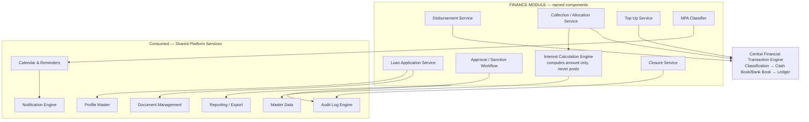

### 1.2.3 Data Ownership

| Owned by Finance (Layer 6) | Referenced Only (owned elsewhere) |
|---|---|
| Loan record — status, principal, interest terms by stream, collateral, collection schedule, top-up history | Profile ID (borrower, up to 2 guarantors, 1 co-borrower) — owned by Profile Master |
| Loan collection / transaction history (module-side record of what was raised) | Cash Book / Bank Book / Central Ledger entries — owned by Central Financial Engine |
| Guarantor/co-borrower link records (composite Loan ID + Profile ID + role) | Interest type, loan type, collection frequency, penalty rule values — owned by Master Data |
| NPA classification state per loan | Document binaries (Aadhaar, PAN, loan agreement, promissory note, cheques) — owned by Document Management |
| — | Audit trail of every loan action — owned by Audit Log Engine |

### 1.2.4 Inputs & Outputs

| Direction | Item |
|---|---|
| **In** | Profile ID(s) for borrower/guarantor(s)/co-borrower; loan terms (principal, interest rate/frequency per stream, collection frequency, first collection date); collateral/security detail; collection entries (amount, allocation, mode, date) |
| **Out** | Loan ID (on sanction); transaction-raise requests to the Central Financial Transaction Engine; receipts; audit events; loan-lifecycle data feeding the Executive Dashboard and Finance reports |

### 1.2.5 Loan Lifecycle Workflow

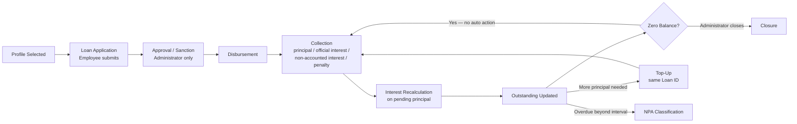

### 1.2.6 Financial Posting Sequence

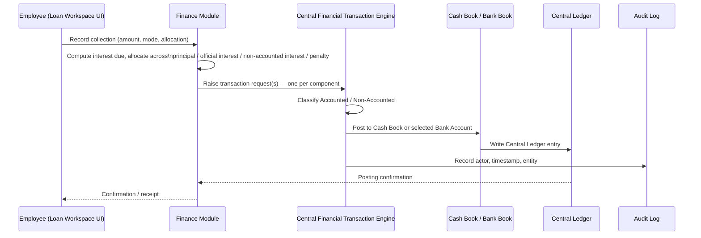

### 1.2.7 Dependencies

| Upstream (Finance depends on) | Downstream (depends on Finance) |
|---|---|
| Profile Master, Master Data, Central Financial Transaction Engine, Document Management, Calendar & Notification Engine, Audit Log Engine | Executive Dashboard, Finance reports, Global Search (loan records) |

### 1.2.8 RBAC Touchpoints

| Action | Role Required |
|---|---|
| Submit loan application | Employee or Administrator |
| Sanction / approve loan | **Administrator only** |
| Disburse | Employee (post-sanction) or Administrator |
| Record collection | Employee or Administrator |
| Top-up | Employee submits, Administrator approves (mirrors sanction gate) |
| Close loan | **Administrator only** |
| Delete/void any historical record | Not permitted — non-destructive only |

*(Finance only **declares** which actions are restricted; the permission check itself is enforced by the shared RBAC service, never re-implemented here.)*

### 1.2.9 Ownership Boundary

| Finance OWNS | Finance MUST NOT OWN |
|---|---|
| Loan entity, lifecycle state, interest-calculation formulas, allocation rules, NPA rule | Cash/Bank/Ledger balances (Central Financial Engine) |
| What is due, when, and which stream it belongs to | Borrower identity data beyond a Profile ID reference (Profile Master) |
| Marking sanction/closure as Administrator-restricted | The RBAC permission-check mechanism itself (Auth/RBAC service) |

### 1.2.10 Open Items (Module-Specific)

- Exact concurrency/locking behavior when two collections post against the same loan simultaneously — **TBC**, engineering-level decision.
- Whether Accounted/Non-Accounted classification is an explicit choice at every collection screen or defaulted with override — confirmed only for Finance's dual-interest concept; the UX pattern itself is **TBC**.
- Session-level correction of a misclassified entry post-posting — **TBC**.

---

# 2. CHIT FUND MODULE

## 2.1 Architecture Prompt

```
You are a solution architect. Produce a standalone system architecture for the
CHIT FUND module of a business management platform, under these constraints:

CONTEXT
- The module manages multiple concurrent Chit Schemes, each containing
  multiple Groups.
- A Group has configuration: start date, duration, collection amount,
  frequency, capacity, penalty percentage, prize/dividend structure.
- Members are enrolled strictly by selecting an EXISTING Profile or creating
  one via the shared Profile service — there is no separate member-creation
  form inside this module.
- The module tracks per-member due/collection/penalty status, applies an
  AUTOMATIC penalty when an installment is overdue, records auction/bidding
  outcomes and prize distribution, and auto-recalculates the next cycle's
  collection amount from the auction/prize outcome.
- The exact numeric formula relating prize amount, dividend structure, and the
  next collection amount is NOT specified — do not invent one; treat it as an
  open architecture decision.
- Scheme/Group requires an approval step before activation; closure
  (settlement + archival) is Administrator-only.

HARD BOUNDARY RULE (must not be violated in your output)
- The module must NEVER implement: authentication, RBAC enforcement,
  Profile identity storage, Cash Book/Bank Book/Ledger posting, notification
  delivery, calendar scheduling mechanics, audit log storage, or reporting
  infrastructure.
- The module computes the penalty amount and the recalculated next-collection
  figure; it raises every installment collection and every prize disbursement
  to the Central Financial Transaction Engine, which alone posts to
  cash/bank/ledger.

DELIVERABLE — produce all of the following for the Chit Fund module ONLY:
1. Module purpose and scope statement
2. A component diagram (owned components vs. consumed shared services)
3. A data ownership table (Scheme, Group, Member enrollment, installment
   history, auction/prize records vs. what is only referenced by ID)
4. Inputs and outputs
5. A scheme/group lifecycle workflow diagram (configuration → approval →
   enrollment → installment → collection → penalty (if overdue) → auction →
   prize → next-cycle recalculation → closure)
6. A sequence diagram for a single installment collection reaching the
   Central Financial Transaction Engine
7. Dependencies (upstream/downstream)
8. RBAC touchpoints
9. A table of "what this module owns" vs. "what it must never own"
10. Open architecture questions specific to this module — explicitly flag the
    unresolved next-collection-amount formula as the single most important
    open item, do not resolve it by assumption

Keep the output focused only on the Chit Fund module.
```

## 2.2 Individual System Architecture

### 2.2.1 Module Purpose & Scope

Digitize the complete chit scheme lifecycle across multiple concurrent schemes and groups — configuration, Profile-based member enrollment, installment collection, automatic penalty, auction/prize distribution, and scheme closure.

### 2.2.2 Component Architecture

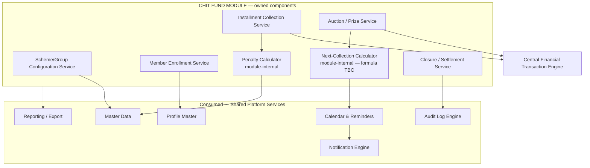

### 2.2.3 Data Ownership

| Owned by Chit Fund (Layer 7) | Referenced Only |
|---|---|
| Chit Scheme record | Profile ID for each member — owned by Profile Master |
| Chit Group record (configuration, status) | Penalty-rate / collection-frequency values — owned by Master Data |
| Chit Member enrollment (Group ID + Profile ID) | Installment / prize-disbursement postings — owned by Central Financial Engine |
| Installment collection history | Audit trail — owned by Audit Log Engine |
| Auction/prize records per cycle | — |

### 2.2.4 Inputs & Outputs

| Direction | Item |
|---|---|
| **In** | Group configuration parameters; Profile ID for enrollment; installment collection entries; auction winner and prize amount per cycle |
| **Out** | Transaction-raise requests (installments, prize disbursements) to the Central Financial Transaction Engine; updated member ledgers and due status; recalculated next-collection amount and schedule; audit events; Chit Fund reports |

### 2.2.5 Lifecycle Workflow

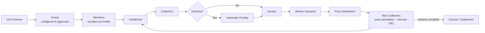

### 2.2.6 Financial Posting Sequence

```mermaid
sequenceDiagram
    participant Emp as Employee (Chit Group UI)
    participant CHIT as Chit Fund Module
    participant CFE as Central Financial Transaction Engine
    participant Book as Cash Book / Bank Book
    participant Led as Central Ledger

    Emp->>CHIT: Record installment collection for member
    CHIT->>CHIT: Check due status; apply penalty if overdue
    CHIT->>CFE: Raise transaction request (installment + penalty if any)
    CFE->>CFE: Classify Accounted / Non-Accounted
    CFE->>Book: Post entry
    Book->>Led: Write ledger entry
    CFE-->>CHIT: Posting confirmation
    CHIT-->>Emp: Updated member due status
```

### 2.2.7 Dependencies

| Upstream | Downstream |
|---|---|
| Profile Master, Master Data, Central Financial Transaction Engine, Calendar & Notification Engine, Audit Log Engine | Executive Dashboard, Chit Fund reports, Global Search |

### 2.2.8 RBAC Touchpoints

| Action | Role Required |
|---|---|
| Configure Scheme/Group | Administrator |
| Approve Group for activation | **Administrator only** |
| Enroll member | Employee or Administrator |
| Record installment collection | Employee or Administrator |
| Record auction winner / prize | Employee or Administrator (approval pattern **TBC**) |
| Close scheme/group (settlement + archival) | **Administrator only** |

### 2.2.9 Ownership Boundary

| Chit Fund OWNS | Chit Fund MUST NOT OWN |
|---|---|
| Scheme/Group configuration and status; penalty computation; next-collection computation | Cash/Bank/Ledger posting (Central Financial Engine) |
| Member enrollment linkage (Group + Profile) | Member identity data (Profile Master) |
| — | The exact prize→next-collection formula is not yet defined anywhere — this module must not invent it |

### 2.2.10 Open Items (Module-Specific)

- **Most consequential open item:** the numeric formula relating prize amount, dividend structure, and next-collection amount is undocumented. Confirm with chit-operations stakeholders before build.
- Whether auction/prize entries require an approval gate analogous to loan sanction — **TBC**.
- Whether members are notified of auction outcomes directly (recipient model, see Shared Notification section) — **TBC**.

---

# 3. RENTAL MODULE

## 3.1 Architecture Prompt

```
You are a solution architect. Produce a standalone system architecture for the
RENTAL PROPERTY MANAGEMENT module of a business management platform, under
these constraints:

CONTEXT
- The module manages residential and commercial rental properties under a
  TWO-LEVEL parent/child structure (e.g., a parent building containing
  multiple child flats/shops/units), OR as standalone properties with no
  hierarchy.
- Parent-level figures (total units, occupied, vacant, expected rent, total
  outstanding) are always DERIVED at read time from child-property data — the
  parent record must never hold its own independently-updatable copy of these
  totals.
- All rent/maintenance/tenant/agreement/dues/ledger data lives at the
  CHILD-property level, even when summarized at the parent.
- Tenants are registered against an existing Profile (KYC + emergency
  contact); there is no separate tenant-identity form.
- Three collection types exist: Rent only, Maintenance only, or Rent +
  Maintenance combined — maintenance is tracked as an obligation independent
  of rent even when collected together.
- Tenant allocation automatically changes occupancy status.
- The module supports lease renewal, rent revision, notice management, and
  lease closure.

HARD BOUNDARY RULE (must not be violated in your output)
- The module must NEVER implement: authentication, RBAC enforcement, Profile
  identity storage, Cash Book/Bank Book/Ledger posting, document storage,
  notification delivery, calendar scheduling mechanics, audit log storage, or
  reporting infrastructure.
- Every rent/maintenance collection is raised to the Central Financial
  Transaction Engine for classification and posting; the module never
  maintains its own cash/bank running balance.

DELIVERABLE — produce all of the following for the Rental module ONLY:
1. Module purpose and scope statement
2. A component diagram (owned components vs. consumed shared services)
3. A data ownership table distinguishing Parent Property, Child Property,
   Tenant, Agreement, and collection history, and explicitly stating that
   parent roll-ups are computed, not stored
4. Inputs and outputs
5. A property/tenancy lifecycle workflow diagram (property setup → tenant/
   Profile → agreement → rent schedule → due → collection (rent/maintenance/
   combined) → renewal or closure)
6. A sequence diagram for a rent/maintenance collection reaching the Central
   Financial Transaction Engine
7. Dependencies (upstream/downstream)
8. RBAC touchpoints
9. A table of "what this module owns" vs. "what it must never own",
   explicitly including the parent/child roll-up rule
10. Open architecture questions specific to this module

Keep the output focused only on the Rental module.
```

## 3.2 Individual System Architecture

### 3.2.1 Module Purpose & Scope

Manage residential and commercial rental properties under a two-level parent/child structure (or as standalone properties), covering tenants, agreements, rent/maintenance collection, occupancy, and lease lifecycle.

### 3.2.2 Component Architecture

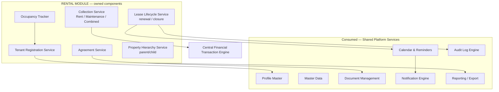

### 3.2.3 Data Ownership

| Owned by Rental (Layer 7) | Referenced Only |
|---|---|
| Parent Property record (identity/config only — **no stored totals**) | Profile ID for each tenant — owned by Profile Master |
| Child Property record — rent, maintenance, tenant link, agreement, dues, ledger data all live here | Payment modes, document types — owned by Master Data |
| Tenant record (Property ID + Profile ID) | Rent/maintenance postings — owned by Central Financial Engine |
| Rental Agreement record | Agreement file binaries — owned by Document Management |
| Rent/maintenance collection history | Audit trail — owned by Audit Log Engine |
| **Derived, never stored:** parent-level roll-ups (total units, occupied, vacant, expected rent, total outstanding) — computed at read time from child-property data | — |

### 3.2.4 Inputs & Outputs

| Direction | Item |
|---|---|
| **In** | Property attributes; Profile ID for tenant registration; agreement terms; collection entries (rent and/or maintenance, mode, date) |
| **Out** | Transaction-raise requests to the Central Financial Transaction Engine; updated tenant ledger; occupancy status; Rental reports (portfolio and unit-level) |

### 3.2.5 Lifecycle Workflow

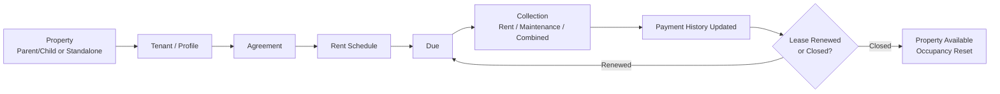

### 3.2.6 Financial Posting Sequence

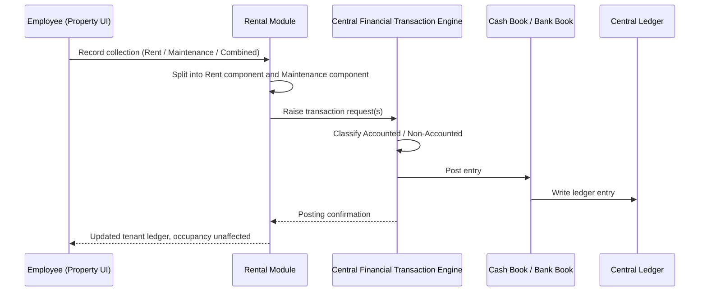

### 3.2.7 Dependencies

| Upstream | Downstream |
|---|---|
| Profile Master, Master Data, Central Financial Transaction Engine, Document Management, Calendar & Notification Engine, Audit Log Engine | Executive Dashboard, Rental reports, Global Search |

### 3.2.8 RBAC Touchpoints

| Action | Role Required |
|---|---|
| Create parent/child property | Administrator (typical) |
| Register tenant | Employee or Administrator |
| Create/renew agreement | Employee or Administrator |
| Record collection | Employee or Administrator |
| Close lease | Employee or Administrator — no explicit approval gate documented beyond general RBAC |

### 3.2.9 Ownership Boundary

| Rental OWNS | Rental MUST NOT OWN |
|---|---|
| Property, tenancy, and agreement data; occupancy and roll-up computation rules | Cash/Bank/Ledger posting (Central Financial Engine) |
| Which figures are derived at parent level | Tenant identity data beyond a Profile ID reference |
| — | An independently-updatable copy of parent-level totals (this is the single most important invariant for this module) |

### 3.2.10 Open Items (Module-Specific)

- No explicit approval gate is documented for lease closure or rent revision beyond general RBAC — confirm whether one is required.
- Notice-management workflow detail (notice periods, escalation) not fully specified — **TBC**.

---

# 4. EXPENSE MODULE

## 4.1 Architecture Prompt

```
You are a solution architect. Produce a standalone system architecture for the
EXPENSE MANAGEMENT module of a business management platform, under these
constraints:

CONTEXT
- The module records, categorizes, and monitors business expenses.
- Categories are fully USER-DEFINED — not a fixed system list.
- Every expense entry (category, amount, date, payment mode, remarks) posts
  DIRECTLY to the central Cash Book or Bank Book via the platform's Central
  Financial Transaction Engine — there is no approval gate documented for
  expense entries.
- Recurring expenses integrate with the shared calendar for upcoming/overdue
  tracking.
- Expense history is READ-ONLY once recorded, with automatic monthly totals.
- It is NOT confirmed in source requirements whether an expense's payee/party
  must reference the platform's shared Profile identity service, and it is
  NOT confirmed whether Accounted/Non-Accounted classification is an explicit
  per-entry choice or a module default — do not resolve either by assumption;
  flag both as open items.

HARD BOUNDARY RULE (must not be violated in your output)
- The module must NEVER implement: authentication, RBAC enforcement, Profile
  identity storage, Cash Book/Bank Book/Ledger posting, notification
  delivery, calendar scheduling mechanics, audit log storage, or reporting
  infrastructure.
- Every expense entry is handed to the Central Financial Transaction Engine
  for classification and posting; the module never posts directly to a book
  or ledger itself.

DELIVERABLE — produce all of the following for the Expense module ONLY:
1. Module purpose and scope statement
2. A component diagram (owned components vs. consumed shared services)
3. A data ownership table (Expense Category, Expense Entry)
4. Inputs and outputs
5. A workflow diagram (category definition → expense entry → classification →
   posting → reporting), including the recurring-expense path via the shared
   calendar
6. A sequence diagram for a single expense entry reaching the Central
   Financial Transaction Engine
7. Dependencies (upstream/downstream)
8. RBAC touchpoints
9. A table of "what this module owns" vs. "what it must never own"
10. Open architecture questions specific to this module — explicitly list the
    payee/Profile-linkage question and the classification-UX question as
    unresolved, do not invent answers

Keep the output focused only on the Expense module.
```

## 4.2 Individual System Architecture

### 4.2.1 Module Purpose & Scope

Record, categorize, and monitor business expenses with fully user-defined categories, posting every expense to the central Cash Book or Bank Book.

### 4.2.2 Component Architecture

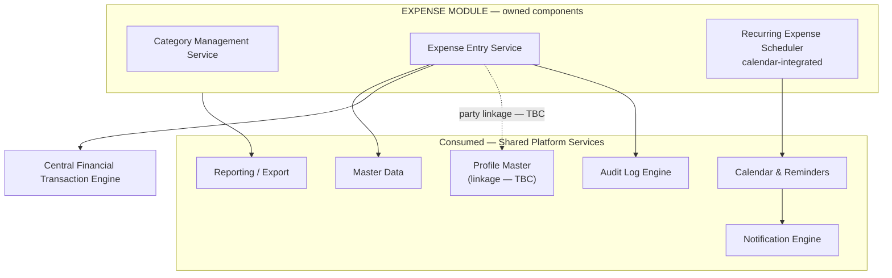

### 4.2.3 Data Ownership

| Owned by Expense (Layer 7) | Referenced Only |
|---|---|
| Expense Category record | Payment mode values — owned by Master Data |
| Expense Entry record (category, amount, date, payment mode, remarks, recurring flag) | Expense postings — owned by Central Financial Engine |
| — | Payee/party identity — **linkage to Profile Master unresolved (TBC)** |
| — | Audit trail — owned by Audit Log Engine |

### 4.2.4 Inputs & Outputs

| Direction | Item |
|---|---|
| **In** | Category selection/creation; expense amount, date, payment mode, remarks |
| **Out** | Transaction-raise request to the Central Financial Transaction Engine; monthly expense totals; Expense reports |

### 4.2.5 Workflow

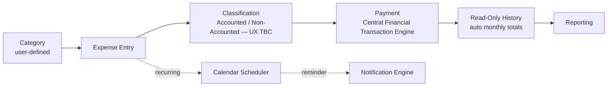

### 4.2.6 Financial Posting Sequence

```mermaid
sequenceDiagram
    participant Emp as Employee (Expense UI)
    participant EXP as Expense Module
    participant CFE as Central Financial Transaction Engine
    participant Book as Cash Book / Bank Book
    participant Led as Central Ledger

    Emp->>EXP: Record expense (category, amount, mode, date)
    EXP->>CFE: Raise transaction request
    CFE->>CFE: Classify Accounted / Non-Accounted
    CFE->>Book: Post entry
    Book->>Led: Write ledger entry
    CFE-->>EXP: Posting confirmation
    EXP-->>Emp: Confirmation; monthly total updated
```

### 4.2.7 Dependencies

| Upstream | Downstream |
|---|---|
| Master Data, Central Financial Transaction Engine, Calendar & Notification Engine, Audit Log Engine, (Profile Master — pending confirmation) | Executive Dashboard, Expense reports |

### 4.2.8 RBAC Touchpoints

| Action | Role Required |
|---|---|
| Define expense category | Administrator (typical for reference data) or Employee — **TBC** |
| Record expense entry | Employee or Administrator |
| No approval gate documented | — |

### 4.2.9 Ownership Boundary

| Expense OWNS | Expense MUST NOT OWN |
|---|---|
| Category definitions and expense-entry data | Cash/Bank/Ledger posting (Central Financial Engine) |
| — | Payee identity data (if Profile linkage is confirmed, that identity is owned by Profile Master, not Expense) |

### 4.2.10 Open Items (Module-Specific)

- Whether an expense's payee/party must reference the shared Profile Master, or may remain free-text — **not specified, TBC**.
- Whether Accounted/Non-Accounted classification is an explicit per-entry choice or a module default — **not specified, TBC**.
- Whether expense entries support document attachment — **not specified, TBC**.
- Whether Expense is included in Global Search's indexed scope — **not specified, TBC**.

---

# 5. INVESTMENT MODULE

## 5.1 Architecture Prompt

```
You are a solution architect. Produce a standalone system architecture for the
INVESTMENT MANAGEMENT module of a business management platform, under these
constraints:

CONTEXT
- The module is a structured digital register for business investments — it
  does NOT represent a party/relationship (unlike loans, chit members, or
  tenants), so it does NOT reference the platform's Profile identity service.
- An investment record captures: name, company/organization, type (fixed
  deposit / shares / bond / loan / others), amount, date, category, platform,
  and an agreement/certificate upload.
- An investment may be designated RECURRING (monthly / quarterly /
  half-yearly / annual). Recurring investments generate a reminder on EVERY
  occurrence, not only at final maturity — this is a confirmed, deliberate
  behavior, distinct from a "final due date only" reminder model.
- Maturity-date and expected-return tracking triggers approach alerts.
- Closure captures the final amount received and moves the record to a
  READ-ONLY historical state.
- Additional Investment data fields beyond what is listed above are explicitly
  deferred to a future requirement-freeze exercise — do not invent fields.

HARD BOUNDARY RULE (must not be violated in your output)
- The module must NEVER implement: authentication, RBAC enforcement, Profile
  identity storage, Cash Book/Bank Book/Ledger posting, document storage,
  notification delivery, calendar scheduling mechanics, audit log storage, or
  reporting infrastructure.
- Each recurring instalment and the closure figure post through the Central
  Financial Transaction Engine — the module never posts directly.

DELIVERABLE — produce all of the following for the Investment module ONLY:
1. Module purpose and scope statement
2. A component diagram (owned components vs. consumed shared services) —
   explicitly show that Profile is NOT a dependency of this module
3. A data ownership table (Investment record, instalment history)
4. Inputs and outputs
5. A lifecycle workflow diagram (registration → category/platform → active
   tracking with recurring instalments and maturity alerts → closure →
   read-only history → reporting)
6. A sequence diagram for a recurring instalment or closure amount reaching
   the Central Financial Transaction Engine
7. Dependencies (upstream/downstream)
8. RBAC touchpoints
9. A table of "what this module owns" vs. "what it must never own"
10. Open architecture questions specific to this module — flag the deferred
    additional-fields decision explicitly

Keep the output focused only on the Investment module.
```

## 5.2 Individual System Architecture

### 5.2.1 Module Purpose & Scope

Track, monitor, and close business investments as a structured digital register, with recurring-instalment and maturity reminders and a read-only historical ledger on closure.

### 5.2.2 Component Architecture

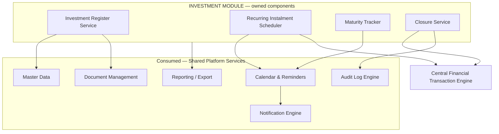

> **Note:** Investment does not reference the Profile Master — it records a business asset, not a party relationship. This is a deliberate architectural difference from Finance, Chit Fund, and Rental.

### 5.2.3 Data Ownership

| Owned by Investment (Layer 7) | Referenced Only |
|---|---|
| Investment record (active/closed; name, company/organization, type, amount, date, category, platform) | Investment types/categories — owned by Master Data |
| Investment instalment history | Instalment/closure postings — owned by Central Financial Engine |
| — | Agreement/certificate file binaries — owned by Document Management |
| — | Audit trail — owned by Audit Log Engine |

### 5.2.4 Inputs & Outputs

| Direction | Item |
|---|---|
| **In** | Investment registration detail; recurring frequency (if applicable); instalment entries; closure detail (final amount received) |
| **Out** | Transaction-raise requests to the Central Financial Transaction Engine; reminders; Investment reports (active, recurring due, upcoming maturity, closed history) |

### 5.2.5 Lifecycle Workflow

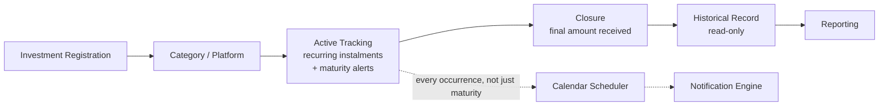

### 5.2.6 Financial Posting Sequence

```mermaid
sequenceDiagram
    participant Emp as Employee (Investment UI)
    participant INV as Investment Module
    participant CFE as Central Financial Transaction Engine
    participant Book as Cash Book / Bank Book
    participant Led as Central Ledger

    Emp->>INV: Record instalment or closure amount
    INV->>CFE: Raise transaction request
    CFE->>CFE: Classify Accounted / Non-Accounted
    CFE->>Book: Post entry
    Book->>Led: Write ledger entry
    CFE-->>INV: Posting confirmation
    INV-->>Emp: Confirmation; record updated (or moved to history on closure)
```

### 5.2.7 Dependencies

| Upstream | Downstream |
|---|---|
| Master Data, Central Financial Transaction Engine, Document Management, Calendar & Notification Engine, Audit Log Engine | Executive Dashboard, Investment reports |

### 5.2.8 RBAC Touchpoints

| Action | Role Required |
|---|---|
| Register investment | Employee or Administrator |
| Record instalment | Employee or Administrator |
| Close investment | Employee or Administrator — no explicit approval gate documented |

### 5.2.9 Ownership Boundary

| Investment OWNS | Investment MUST NOT OWN |
|---|---|
| The register, recurrence schedule, and closure state | Cash/Bank/Ledger posting (Central Financial Engine) |
| — | Party identity (not applicable — Investment has no party relationship) |

### 5.2.10 Open Items (Module-Specific)

- Additional Investment data fields beyond the confirmed set are explicitly deferred to a future client requirement-freeze exercise — data model is provisional pending that confirmation.

---

# 6. RECEIVABLES & PAYABLES MODULE

## 6.1 Architecture Prompt

```
You are a solution architect. Produce a standalone system architecture for the
RECEIVABLES & PAYABLES module of a business management platform, under these
constraints:

CONTEXT
- The module tracks two independent flows outside the lending book:
  RECEIVABLES (amounts owed TO the business) and PAYABLES (amounts owed BY
  the business).
- Receivable: raised against a customer/party (amount, due date, status);
  an AUTOMATIC penalty applies once overdue, using a configured percentage;
  payment recording reduces outstanding.
- Payable: raised against a vendor/party (amount, due date, status,
  remarks); payment recording captures payment mode. No automatic penalty is
  documented for Payables — this asymmetry is deliberate and confirmed.
- Both sides support ageing and party-wise outstanding reporting.
- Whether a Receivable's "customer/party" and a Payable's "vendor/party" must
  reference the platform's shared Profile identity service, or may be
  recorded as an independent/free-text party, is UNRESOLVED. The
  recommended-but-unconfirmed direction is to require Profile linkage, for
  consistency with the platform's single-identity principle — treat this as
  a RECOMMENDED architecture decision, not confirmed, and explain the
  consequence of each option.

HARD BOUNDARY RULE (must not be violated in your output)
- The module must NEVER implement: authentication, RBAC enforcement, Profile
  identity storage, Cash Book/Bank Book/Ledger posting, notification
  delivery, calendar scheduling mechanics, audit log storage, or reporting
  infrastructure.
- All receipts and payments route through the Central Financial Transaction
  Engine to the Cash Book or Bank Book — the module never posts directly.

DELIVERABLE — produce all of the following for the Receivables & Payables
module ONLY:
1. Module purpose and scope statement
2. A component diagram showing the Receivable and Payable sub-flows as
   siblings, both consuming the same shared services and Central Financial
   Engine, plus the pending Profile-linkage decision point
3. A data ownership table (Receivable record, Payable record) — mark party
   linkage as pending confirmation
4. Inputs and outputs
5. TWO lifecycle workflow diagrams side by side: one for Receivable (party →
   amount → due → overdue check → automatic penalty → collection →
   outstanding → closure) and one for Payable (party → amount → due →
   payment → outstanding → closure)
6. A sequence diagram for a receipt/payment reaching the Central Financial
   Transaction Engine
7. Dependencies (upstream/downstream)
8. RBAC touchpoints
9. A table of "what this module owns" vs. "what it must never own"
10. Open architecture questions specific to this module — make the
    Profile-linkage question the headline open item, and explain the
    data-model consequence of each of the two options (Profile-linked vs.
    independent/free-text party) without picking one for the reader

Keep the output focused only on the Receivables & Payables module.
```

## 6.2 Individual System Architecture

### 6.2.1 Module Purpose & Scope

Track amounts owed **to** the business (Receivables) and **by** the business (Payables) outside the lending book, with automatic overdue penalty on Receivables, fully integrated with the central Cash/Bank system.

### 6.2.2 Component Architecture

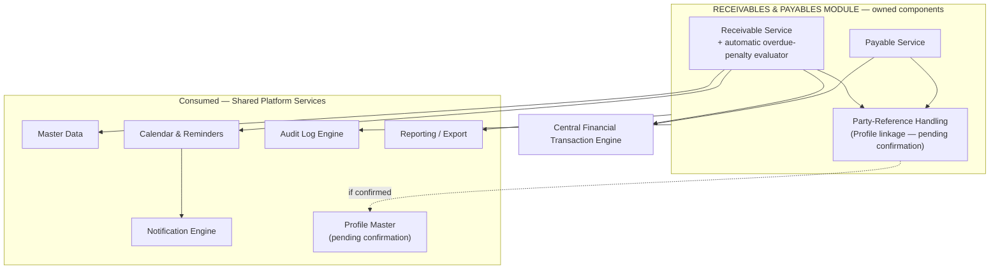

### 6.2.3 Data Ownership

| Owned by Receivables & Payables (Layer 7) | Referenced Only |
|---|---|
| Receivable record (party reference, amount, due date, status, penalty, payment history) | Penalty rate / payment mode values — owned by Master Data |
| Payable record (party/vendor reference, amount, due date, status, remarks, payment history) | Receipt/payment postings — owned by Central Financial Engine |
| — | Party identity — **Profile linkage pending confirmation** (Section 6.2.10) |
| — | Audit trail — owned by Audit Log Engine |

### 6.2.4 Inputs & Outputs

| Direction | Item |
|---|---|
| **In** | Party reference; amount; due date; payment entries (amount, mode, date) |
| **Out** | Transaction-raise requests to the Central Financial Transaction Engine; updated outstanding balance; ageing reports |

### 6.2.5 Lifecycle Workflows

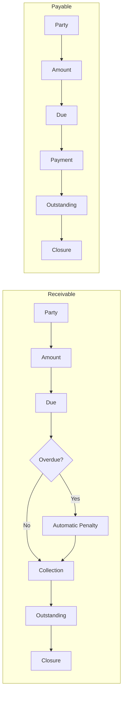

### 6.2.6 Financial Posting Sequence

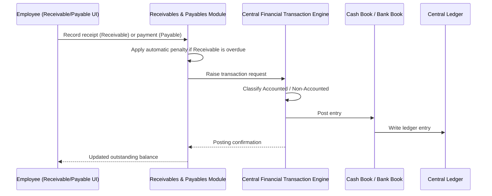

### 6.2.7 Dependencies

| Upstream | Downstream |
|---|---|
| Master Data, Central Financial Transaction Engine, Calendar & Notification Engine, Audit Log Engine, (Profile Master — pending confirmation) | Executive Dashboard, Ageing reports |

### 6.2.8 RBAC Touchpoints

| Action | Role Required |
|---|---|
| Raise Receivable / Payable | Employee or Administrator |
| Record collection / payment | Employee or Administrator |
| Close Receivable / Payable | Employee or Administrator — no explicit approval gate documented |

### 6.2.9 Ownership Boundary

| Receivables & Payables OWNS | Must NOT OWN |
|---|---|
| Due-date monitoring, automatic-penalty rule (Receivables only), outstanding-balance computation | Cash/Bank/Ledger posting (Central Financial Engine) |
| — | Party identity — if Profile linkage is confirmed, that identity is owned by Profile Master, not this module |

### 6.2.10 Open Items (Module-Specific) — Headline Item

**Profile linkage for party/vendor (single most consequential open item across the six modules):**

| Option | Consequence |
|---|---|
| **A — Require Profile linkage** (the platform's own recommended direction, for consistency with the single-identity principle) | A Receivable/Payable party becomes just another Profile-reference relationship, identical in shape to Rental's tenant relationship. The person's full cross-module history unifies automatically (e.g., a Payable vendor who is also a loan guarantor is recognized as the same person). |
| **B — Independent / free-text party** | The party record sits entirely outside the Profile Master's guarantee. That party's Receivables/Payables history will NOT unify with any Profile-based relationship the same real-world person may have elsewhere in the system. |

This is a business decision with a direct schema consequence and should be confirmed **before** this module's data schema is finalized. Additional open items: whether due/overdue calendar evaluation notifies an internal user or an external party (recipient model, shared with Notification Engine); whether document attachment is supported for Receivable/Payable records.

---

# 7. QUICK-REFERENCE COMPARISON

| Module | Approval Gate | Profile Reference | Central Financial Engine Interaction | Distinctive Rule |
|---|---|---|---|---|
| Finance | Administrator sanctions + closes | Borrower + 2 guarantors + 1 co-borrower | Every disbursement/collection component raised separately | Interest recalculates on every principal collection |
| Chit Fund | Scheme/Group approval + Admin closure | Members via Profile only | Every installment + prize disbursement raised | Next-collection amount auto-derived — formula TBC |
| Rental | None documented beyond general RBAC | Tenants via Profile | Every rent/maintenance collection raised | Parent totals always derived, never stored |
| Expense | None documented | **TBC** | Every entry raised directly | User-defined categories; read-only history |
| Investment | None documented | Not applicable (asset, not party) | Every instalment + closure raised | Reminder on every recurring occurrence |
| Receivables & Payables | None documented | **TBC — headline open item** | Every receipt/payment raised | Automatic overdue penalty on Receivables only |

---

*End of Module-Wise System Architecture — companion to the PBMS High-Level System Architecture Document, v1.0.*
