# PRODUCT REQUIREMENTS DOCUMENT
## Personal Business Management System (PBMS)
### Client: Dhavanam Finance
### Product Owner / Developer: Florix Technologies Pvt. Ltd.

---

## Table of Contents

**PART I — Foundations**
1. Document Control
2. Executive Summary
3. Product Vision
4. Business Context & Problem Statement
5. Product Scope
6. Users, Actors & Roles
7. Product Architecture Overview
8. Core Product Principles

**PART II — Platform & Financial Core**
9. Global Functional Requirements
10. Central Financial Transaction Engine

**PART III — Business Modules**
11. Finance Management Module
12. Chit Fund Management Module
13. Rental Management Module
14. Expense Management Module
15. Investment Management Module
16. Receivables & Payables Module

**PART IV — Cross-Cutting Product Requirements**
17. Dashboard & Business Analytics
18. Reporting Requirements
19. End-to-End Business Workflows
20. State Machines
21. Business Rules Catalogue
22. Data Requirements
23. Permissions Matrix
24. Notifications Matrix
25. Audit Requirements
26. Validation & Error Handling Requirements
27. Non-Functional Requirements
28. Technical Product Constraints
29. External Integrations
30. API-Level Product Requirements
31. UI/UX Requirements

**PART V — Delivery & Governance**
32. Acceptance Criteria (Consolidated)
33. Traceability Matrix
34. Scope Baseline
35. MVP / Delivery Prioritization
36. Dependencies
37. Risks & Open Questions
38. Definition of Done
39. Final Requirements Summary

**Appendices**
A. Requirements Reconciliation Log (V1 → V2 → V4)
B. Commercial / Delivery Reference (non-functional, for context only)

---

# PART I — FOUNDATIONS

## 1. Document Control

| Field | Value |
|---|---|
| Product Name | Personal Business Management System (PBMS) |
| Product Code / Proposal Reference | FLX/PBMS/2026/025/V4 (authoritative business scope baseline) |
| Client | Dhavanam Finance |
| Product Owner / Development Company | Florix Technologies Pvt. Ltd. (A Division of Florix Smart Infra Solutions Pvt Ltd) |
| Source Documents Consolidated | (1) PBMS_Developer_Build_Guide.md — layered architecture; (2) PBMS.pdf — earlier proposal (pre-V2); (3) PBMS_V4_Proposal_Dhavanam_Finance_2.pdf — V4 proposal, dated 17 Aug 2026 (**primary business-scope source**); (4) PBMS-Price_breakup.pdf — cost/effort architecture, dated 16 Jul 2026; (5) PBMS-updated.pdf — V2 proposal, FLX/PBMS/2026/025/v2 |
| Document Type | Product Requirements Document (PRD) |
| PRD Version | 1.0 |
| Status | Draft for Review — contains flagged TBC / Implementation Decision Required items (see Section 37) |
| Date Prepared | 09 September 2026 |
| Confidentiality Classification | Confidential — derived from proprietary Florix Technologies / Dhavanam Finance commercial documents. Handle under the same confidentiality terms as the source proposals. |
| Document Purpose | This PRD is the single functional source of truth for PBMS. It reconciles all prior proposal iterations (V1, V2, V4) and the layered architecture and cost-architecture documents into one implementation-ready specification for product, engineering, QA, design, and client stakeholders. It supersedes descriptions of PBMS scope found in any individual source document. |

### 1.1 Revision History

| Version | Date | Author | Change Description |
|---|---|---|---|
| 0.1 | — | Florix Technologies | Initial PBMS proposal (5 modules: Finance, Chit Fund, Investment, Rental, Expense). No Central Transaction Engine; segment-specific databases. |
| 0.2 (v2) | — | Florix Technologies | Revised proposal (FLX/PBMS/2026/025/v2), reduced scope/cost/timeline (₹75,000 / 8 weeks). Same 5 modules, simplified feature depth. |
| 4.0 (V4) | 17 Aug 2026 | Florix Technologies | Major scope expansion: added **Receivables & Payables** as a 6th module; introduced the **Central Transaction Engine**, **Accounted/Non-Accounted classification**, **Central Cash Book**, **Central Bank Book** (multi-account), and **Central Ledger** as mandatory architecture; introduced dual (official + non-accounted) interest streams, loan top-up, manual loan closure, dividend chit support, two-level rental property hierarchy, and Annexure A (38-requirement scope baseline). Superseded FLX/PBMS/2026/025/v2. |
| 1.0 (this PRD) | 09 Sep 2026 | Product/BA synthesis | First consolidated PRD reconciling all source documents against the V4 baseline and the layered Developer Build Guide. |

### 1.2 How to Read This Document

- Requirement IDs are used throughout: **FR** (Functional Requirement), **BR** (Business Rule), **NFR** (Non-Functional Requirement), **SEC** (Security Requirement), **DR** (Data Requirement), **INT** (Integration Requirement), **UX** (User Experience Requirement), **AC** (Acceptance Criterion), **TBC** (To Be Confirmed / Implementation Decision Required).
- Where source documents conflict, this PRD applies the priority order defined in the assignment brief: **(1) PBMS V4 Proposal → (2) latest PBMS requirement documentation → (3) Layered Architecture documents → (4) earlier proposal versions (V1/V2) → (5) Cost Architecture document.** All material conflicts are logged in Appendix A and Section 37, not silently merged.
- Anything not explicitly stated in a source document is marked **TBC** rather than invented.

---

## 2. Executive Summary

**What PBMS is.** The Personal Business Management System (PBMS) is a centralized, secure, web-based platform that lets Dhavanam Finance run all of its business verticals — lending, chit funds, rental property, investments, general expenses, and receivables/payables — through **one login, one customer identity, and one financial core**, instead of physical ledgers, spreadsheets, and disconnected registers.

**Why it is being built.** Dhavanam Finance today records loans, chit cycles, rent, investments and expenses manually. This makes it slow and error-prone to reconcile cash and bank positions, track a customer who participates in more than one business line, monitor overdue collections, and produce timely reports for decision-making.

**Proposed solution.** PBMS replaces manual record-keeping with a single digital system built on two architectural layers:
1. **Business modules** that staff use day to day — Finance, Chit Fund, Rental, Expense, Investment, and Receivables & Payables.
2. **A shared platform and central financial layer** that every module depends on — authentication and role-based access, a reusable Profile identity, document management, master data, the Central Transaction Engine (Cash Book, Bank Book, Central Ledger), the executive dashboard, calendar/reminders, Telegram notifications, global search, reporting/export, audit logging, and backup/recovery.

**Main business outcomes.**
- A single, live, reconciled view of cash and bank position across the entire business.
- One customer record reused across every module a person participates in (as borrower, guarantor, co-borrower, chit member, tenant), eliminating duplicate data entry.
- Official (Accounted) and off-book (Non-Accounted) financial activity tracked in full, in parallel, without ever being merged.
- Controlled, auditable approval workflows for financially significant actions (loan sanction, closures, deletions, master-data changes).
- Consolidated, exportable reporting and an executive dashboard that refreshes on business events.

**High-level scope.** All six business modules described above, plus the shared platform and central financial layer, delivered as a single fixed-scope release at a **basic-to-intermediate functional level** (V4, Section 21), built on Python/Django REST Framework, React.js, PostgreSQL, Redis, Celery, and JWT + Telegram OTP authentication.

**Core architectural/product principles carried through this entire PRD:**
1. Business modules never implement financial posting logic themselves — they raise transactions; the Central Transaction Engine classifies and posts them.
2. A person has exactly one Profile ID, created once, reused everywhere.
3. Accounted and Non-Accounted business streams are tracked in parallel and are never merged into a single figure.
4. Only two roles exist in the system: **Administrator** and **Employee**, enforced server-side.
5. Historical records are never hard-deleted; every transaction is attributable to the user who entered it.

---

## 3. Product Vision

### 3.1 Vision Statement
To give Dhavanam Finance a single digital operating system for its entire business — lending, chit funds, rental, investments, and expenses — where every rupee that moves through the business, in any vertical, is captured once, classified correctly, and reflected instantly in one Cash Book, one Bank Book, and one Central Ledger.

### 3.2 Mission
Replace physical ledgers, spreadsheets, and siloed registers with a role-based, auditable, centrally-reconciled web application that a small internal team (Administrator + Employees) can operate without needing separate systems per business line.

### 3.3 Strategic Objectives
- **SO-1:** Eliminate duplicate customer data entry across business verticals via a single reusable Profile identity.
- **SO-2:** Guarantee that cash and bank balances are always correct and reconciled, by routing every financial movement — from any module — through one Central Transaction Engine.
- **SO-3:** Preserve the operational distinction between Accounted and Non-Accounted business without merging or losing either stream.
- **SO-4:** Make every financially significant action attributable and auditable (who did what, when, and who approved it).
- **SO-5:** Give management (Administrator) a real-time, consolidated view of the business without manual report compilation.
- **SO-6:** Deliver a system that can absorb new modules or deeper functionality later without re-architecting the financial core (Section 4.3 of V4: "financial logic is never duplicated inside a module").

### 3.4 Success Definition
PBMS is successful when:
- Every transaction raised by any of the six modules is visible, correctly classified (Accounted/Non-Accounted), and posted to the correct book (Cash or the correct Bank account) without manual reconciliation.
- A person who is, for example, a loan customer, a chit member, and a tenant is represented by exactly one Profile ID across all three contexts.
- Administrators can approve, reject, close, or delete only through server-enforced, audited actions; Employees cannot bypass these controls from the UI or the API.
- The Executive Dashboard and standard reports give management current, accurate totals without recompiling manual registers.
- The system passes User Acceptance Testing against the Annexure A scope baseline (38 requirements) at the agreed basic-to-intermediate functional level.

---

## 4. Business Context & Problem Statement

### 4.1 Current Operating Model
Dhavanam Finance operates several independent business verticals — lending, chit funds, rental property, investments, and business expenses — using physical ledgers, separate registers, and spreadsheets, with no shared source of truth across verticals.

### 4.2 Problems Caused by the Current Model

| Problem Area | Description |
|---|---|
| Data duplication | The same person (borrower, guarantor, chit member, tenant) is re-entered separately in each register with no shared identity. |
| Financial reconciliation | Cash and bank positions must be manually reconciled across multiple registers and business lines; there is no single live balance. |
| Customer information fragmentation | KYC, contact details, and documents are not centrally available; a person's full history across verticals cannot be seen in one place. |
| Collection tracking | Due dates, outstanding balances, and overdue accounts are tracked manually per register, making dues easy to miss. |
| Reporting | Producing a consolidated report (e.g., total outstanding across all loans, or income vs. expense for a month) requires manual compilation across registers. |
| Approval / control | There is no enforced separation between who can create a transaction and who can authorize it (e.g., loan sanction, closure, deletion). |
| Auditability | Manual registers do not reliably capture who recorded an entry, when, or whether it was later altered. |
| Scalability | As the business grows, manual processes become slower and more error-prone (V4, Executive Summary). |

### 4.3 Problem → Solution → Outcome Mapping

| Current Problem | PBMS Solution | Expected Outcome |
|---|---|---|
| Same person entered multiple times across verticals | Single reusable Profile ID, selected — never re-entered — from Finance, Chit Fund, Rental, and Investment | One customer record, one document set, one history, reused everywhere |
| Manual cash/bank reconciliation across registers | Central Transaction Engine posts every module's transactions to one Cash Book and one Bank Book (multi-account) | A single, always-current, reconciled cash/bank position |
| Loss of the Accounted/Non-Accounted distinction | Every transaction is classified Accounted or Non-Accounted and the two streams are tracked in parallel, end-to-end, never merged | Full visibility into both official and non-accounted business without commingling |
| No enforced approval discipline | Loans (and other restricted actions) move through Employee-creates → Admin-approves workflows enforced server-side | Nothing of financial consequence goes live without authorization |
| No reliable audit trail | Immutable audit log capturing who entered, who approved, when, and what changed, on every critical transaction | Every entry is attributable; historical records are never deleted |
| Manual, delayed reporting | Executive Dashboard with live consolidated totals; module and cross-module reports with PDF/Excel export | Management sees business health in real time instead of after manual compilation |
| Loan/chit/rental due dates tracked manually | Shared Calendar synced with loan due dates, chit collection schedules, rent due dates, investment maturities; Telegram reminders | Fewer missed collections and renewals |

---

## 5. Product Scope

Scope is governed by the V4 proposal (Annexure A — 38 requirements) and Section 21 of V4 ("Scope Depth & Functional Level"). All modules are delivered at a **basic-to-intermediate functional level**.

### 5.1 In Scope

- Shared platform: Authentication (JWT + Telegram OTP), Role-Based Access Control (Administrator, Employee), Profile ID subsystem (with guarantors and co-borrower), Document Management, Master Data Management, Executive Dashboard, Calendar & Reminders, Telegram Notifications, Global Search, Reporting & Export (PDF/Excel), Audit Logs, Backup & Recovery.
- Central Financial Layer: Central Transaction Engine, Accounted/Non-Accounted classification, Central Cash Book, Central Bank Book (multiple bank accounts), Central Ledger.
- **Module 1 — Finance Management**: customer/loan setup, approval & sanction, disbursement, interest calculation & collection (official + non-accounted, dual stream), loan lifecycle management (top-up, manual closure, NPA), Loan Management Workspace, Finance reports.
- **Module 2 — Chit Fund Management**: scheme & group configuration, Profile-based member enrollment, collection & due management, automatic penalty, prize & dividend process (auction), next-collection calculation, closure & settlement, Chit reports.
- **Module 3 — Rental Management**: two-level property hierarchy (parent/child), tenant & agreement management, rent/maintenance/combined collection types, collection & outstanding tracking, occupancy & lease lifecycle, Rental reports.
- **Module 4 — Expense Management**: user-defined categories, expense entry & classification, recurring/upcoming expenses, history & summary, Expense reports.
- **Module 5 — Investment Management**: investment register, recurring investments with reminders, maturity tracking, closure to read-only history, Investment reports.
- **Module 6 — Receivables & Payables**: receivables with automatic overdue penalty, payables, integration with the central Cash/Bank books, Receivables/Payables reports.
- Responsive web UI (desktop and tablet browsers).
- Production deployment, user training, technical/user documentation, and 12 months' warranty support from production deployment (V4, Section 24).

### 5.2 Out of Scope (per V4 Sections 17–18)

- Native mobile applications (Android/iOS).
- Bank API integration and automated bank-statement reconciliation.
- Payment gateway integration and online payment collection.
- Digital signature integration on rental or loan agreements.
- SMS and WhatsApp gateways (and any associated per-message charges).
- Migration of historical records from existing manual registers or spreadsheets.
- GST, statutory filing, or external accounting-software integration.
- All recurring/third-party/platform charges (domain, hosting, SSL, object storage, Telegram bot setup, SMTP, SMS/WhatsApp, payment gateway, other paid APIs) — these are the client's responsibility to procure and pay for directly (V4, Section 17).
- Data entry, content creation, or ongoing operational support.
- Any functionality beyond the basic-to-intermediate functional level defined in V4 Section 21 (e.g., advanced automation/rules engines, bulk-import/migration tooling, custom report builders, predictive analytics/scoring, granular per-field permissions or custom role designers, multi-channel notification orchestration, statutory accounting certification).

### 5.3 Future Scope / Potential Extensions (not committed requirements)

These are explicitly named in source documents as things that **may** be pursued later, under separate commercial terms — they are **not** part of this PRD's committed scope:

- Deepening any module beyond basic-to-intermediate (advanced analytics, configurable rule engines, bulk tooling, multi-level approvals) — available as a Change Request or a separate enhancement engagement post-go-live (V4, Section 21).
- An Annual Maintenance Contract (AMC) after the 12-month warranty expires, covering bug fixes, security patches, performance monitoring, and an agreed allowance of minor enhancements per year (V4, Section 25).
- Any change request not listed in Annexure A (V4, Section 22), estimated separately.


## 6. Users, Actors & Roles

**Authoritative role model:** PBMS has exactly **two** roles — **Administrator** and **Employee** — confirmed identically in the V4 proposal (Section 7.1: "Two roles — Administrator and Employee — with role-based screen and action permissions") and the Developer Build Guide (Layer 3: "Two roles: Administrator and Employee"). This is a **resolved conflict**: earlier architecture diagrams in the V1/V2 proposals depict additional user icons (Owner, Manager, Accountant, Collector, Viewer) in illustrative overview graphics. Per the source-priority rules, these illustrative icons are **not** treated as confirmed distinct system roles — they are superseded by the two-role model confirmed in both the V4 proposal and the Developer Build Guide. See Appendix A.

### 6.1 Administrator

| Aspect | Description |
|---|---|
| Responsibilities | Full operational and configuration authority over PBMS. Approves/sanctions loans; approves/rejects chit and other restricted workflows; performs closures and deletions; manages master data; manages users. |
| Approval authority | Sole authority to approve or reject loan applications and sanction disbursement (BR-FIN-001); sole authority for loan closure, top-up approval "where required," chit scheme/group activation approval, and any other action flagged "Admin-only" (Build Guide, Rule 4.4). |
| Configuration authority | Owns all Master Data Management: interest types, loan types, collection frequencies, penalty rules, payment modes, transaction types, document types, mandatory documents, bank master, reminder templates, currency/date format, financial year, receipt number format, dashboard preferences (V4 §7.5). |
| Deletion restrictions | Deletion rights, where they exist at all, are restricted to Administrator (V4 §7.1, §7.3; Build Guide Rule 4.3/4.4). Historical records are never hard-deleted. |
| Reporting access | Full access to all module reports, the Executive Dashboard, and export functions. |
| Master-data management | Exclusive. |
| User management | Administrator manages user accounts and role assignment (Layer 3 of Build Guide). Exact self-service vs. superuser-only provisioning process: **TBC**. |

### 6.2 Employee

| Aspect | Description |
|---|---|
| Operational access | Day-to-day operational use of all six business modules: creating Profiles, creating loan applications, recording collections, enrolling chit members, registering tenants, entering expenses, registering investments, raising receivables/payables. |
| Transaction creation | Can create/raise transactions (loan applications, collections, chit installments, rent collections, expense entries, investment entries, receivable/payable entries) but cannot unilaterally make them live/binding where an approval gate exists. |
| Submission workflows | Creates a loan and **submits it for approval** — creation alone does not activate a loan (V4 §8.2). |
| Collection operations | Can record collections/payments across modules, subject to Admin-only restrictions on deletion, closure, and approval. |
| Restrictions | Cannot approve/sanction loans, cannot perform Admin-only closures or deletions, cannot modify master data, cannot access user management or system configuration (BR-GEN-001; Build Guide Rule 4.4). |

### 6.3 Role → Responsibility → Allowed/Restricted Action Summary

| Role | Responsibilities | Allowed Actions | Restricted Actions |
|---|---|---|---|
| Administrator | Governance, approval, configuration, oversight | Approve/reject/sanction loans; close loans; approve top-ups where required; activate chit schemes/groups; manage master data; manage users; delete (where deletion is permitted at all); access all reports/dashboard/audit logs | None beyond system-enforced business rules (e.g., cannot resurrect a hard-deleted historical record, because none exist) |
| Employee | Day-to-day data entry and collection | Create Profiles; create/submit loan applications; record collections/payments; enroll chit members (via existing Profile); register tenants/properties; enter expenses; register investments; raise receivables/payables; view reports within their access | Approve/sanction/reject loans; close loans; delete records; modify master data; manage users/system configuration |

### 6.4 Non-Human Actors

| Actor | Description |
|---|---|
| Central Transaction Engine | System actor that receives, classifies, and posts every transaction raised by any module (Section 10). |
| Notification Engine | System actor that sends Telegram notifications for due/overdue/payment/business events (Section 24). |
| Scheduler (Celery Beat) | System actor that runs due-date evaluation, reminder generation, and recurring-item due-date rollovers on a schedule. |
| Telegram Bot API | External system actor used for OTP delivery and notification delivery (Section 29). |


## 7. Product Architecture Overview

Architectural boundaries in this PRD follow the Developer Build Guide's nine-layer build order, which is the authoritative source for **where** a capability lives. The V4 proposal is authoritative for **what** must be built; the Build Guide is authoritative for **how modules are structurally bounded relative to shared services**.

### 7.1 Product Component Tree

```
PBMS
├── Shared Platform Services
│   ├── Authentication & RBAC (JWT + Telegram OTP)
│   ├── Profile ID Master (identity, KYC, guarantors, co-borrower, documents)
│   ├── Document Management
│   ├── Master Data Management
│   ├── Executive Dashboard
│   ├── Calendar & Reminder Engine
│   ├── Telegram Notification Engine
│   ├── Global Search & Advanced Filters
│   ├── Reporting & Export (PDF / Excel)
│   ├── Audit Log Engine
│   └── Backup & Recovery
├── Central Financial Layer
│   ├── Central Transaction Engine
│   ├── Accounted / Non-Accounted Classification
│   ├── Central Cash Book
│   ├── Central Bank Book (multiple bank accounts)
│   └── Central Ledger (single source of truth for reporting)
└── Business Modules (raise transactions only; never post financial entries themselves)
    ├── Module 1 — Finance Management
    ├── Module 2 — Chit Fund Management
    ├── Module 3 — Rental Management
    ├── Module 4 — Expense Management
    ├── Module 5 — Investment Management
    └── Module 6 — Receivables & Payables
```

### 7.2 Overall Architecture Diagram

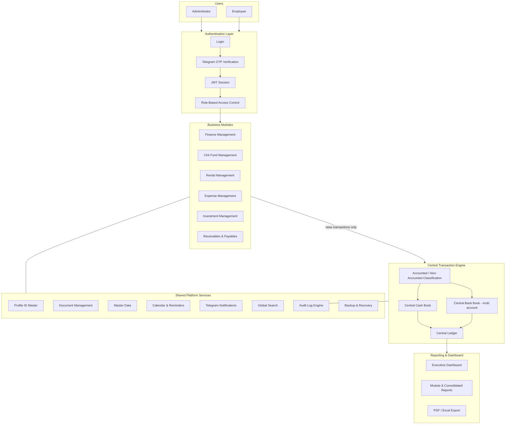

### 7.3 Layered Build-Order Alignment

| Architecture Layer (Build Guide) | Owns | This PRD Section |
|---|---|---|
| Layer 1 — Infrastructure & Environments | Repo, CI/CD, environments, PostgreSQL/Redis/MinIO provisioning, Nginx/Gunicorn | Section 28 (Technical Constraints) |
| Layer 2 — Core Data Schema | Profile, Guarantor/Co-borrower links, User & Role tables, Master Data, Central Ledger/Cash Book/Bank Book schema | Section 22 (Data Requirements) |
| Layer 3 — Authentication & RBAC | Login, Telegram OTP, JWT session, Administrator/Employee permissions | Section 9.1–9.2 |
| Layer 4 — Shared Platform Services | Audit Log Engine, Notification Engine, Calendar/Reminder Engine, Global Search, Document Management, Data Export, Backup & Recovery | Section 9.5–9.11 |
| Layer 5 — Central Financial Engine | Central Transaction Engine, Accounted/Non-Accounted classification, Cash Book, Bank Book, Central Ledger | Section 10 |
| Layer 6 — First Business Module (Finance) | Full loan lifecycle proving the architecture | Section 11 |
| Layer 7 — Remaining Modules | Chit Fund, Rental, Investment, Expense (and, per V4, Receivables & Payables) | Sections 12–16 |
| Layer 8 — Executive Dashboard & Reporting Aggregation | Cross-module dashboard and reporting | Sections 17–18 |
| Layer 9 — Hardening & Handover | Security review, load testing, backup drill, audit completeness, training, documentation | Section 38 (Definition of Done) |

**Architectural boundary rule (binding on this PRD):** No business module (Sections 11–16) may independently implement authentication, RBAC, audit logging, notifications, document storage, search, reporting infrastructure, financial posting logic, the Cash Book, the Bank Book, the Central Ledger, or Profile identity. Any module-level requirement that appears to require one of these must instead reference the corresponding shared-platform or central-financial-layer capability.


## 8. Core Product Principles

These are the non-negotiable, product-wide principles established by V4 (Sections 3.2, 4.1–4.5, 7) and the Developer Build Guide (Section 4, "Non-Negotiable Architectural Rules"). Every module-level requirement in this PRD must be consistent with them.

| # | Principle | Why It Exists | Product Behavior It Mandates |
|---|---|---|---|
| 1 | **One Customer/Profile Identity** | The same person recurs across lending, chit funds, rental, and investment; re-entering them causes duplicate, inconsistent records. | A Profile ID is created once (e.g., `P000125`) and is *selected*, never re-entered, from Finance, Chit Fund, Rental, and Investment. Guarantors and co-borrowers are themselves selected from existing Profile IDs. |
| 2 | **One Central Financial Transaction Engine** | Letting each module implement its own cash/bank/ledger logic would duplicate financial logic and risk inconsistent balances. | All modules raise transactions only; the Central Transaction Engine performs classification and posting. Financial logic is built once, not once per module. |
| 3 | **Accounted vs. Non-Accounted Separation** | Dhavanam Finance's business model formally separates activity requiring official accounting/financial reporting from activity managed independently but never merged into the official books. | Every transaction is classified Accounted or Non-Accounted at the point of entry; the two streams are tracked in parallel through calculation, collection, outstanding, ledger, closure, and reporting, and are never combined into a single irreversible figure. |
| 4 | **Central Cash Book** | A single, live cash position is required across all cash-based activity in the business. | Opening cash + receipts − payments = available cash, updated by every module's cash transactions. |
| 5 | **Central Bank Book (multi-account)** | The business holds multiple bank accounts; each must reconcile independently, and payment-mode selection must not be re-implemented per module. | Every receipt/payment screen carries a Cash/Bank selector; selecting Bank requires a bank account and updates that account's running balance automatically. |
| 6 | **Central Ledger as Single Source of Truth** | Reports must be generated from one consistent dataset, not from module-specific approximations. | All reporting, dashboards, and exports are derived from the Central Ledger, not recomputed independently inside a module. |
| 7 | **Role-Based Access Control** | Only two operational roles exist, and restricted actions must be enforced at the API layer, not just hidden in the UI. | Administrator and Employee, with server-side enforcement of restricted actions (approval, closure, deletion, master-data changes). |
| 8 | **Approval-Based Critical Operations** | Nothing of financial consequence should go live without independent authorization. | Loan creation by an Employee requires Administrator approval/sanction before the loan becomes active; other restricted actions follow the same create → authorize pattern where specified. |
| 9 | **Historical Record Preservation** | Financial and audit integrity requires that history cannot be rewritten or erased. | Records are never hard-deleted. Deletion, where permitted at all, is Administrator-only and does not erase the underlying transaction history. |
| 10 | **Centralized Audit Trail** | Every transaction must be attributable to the user who entered it, and every approval to the user who approved it. | An immutable audit log records who entered, who approved, when, and what changed, for all critical transactions, built once as a shared service. |
| 11 | **Shared Notification System** | Reminders and alerts must be consistent across modules rather than reinvented per module. | One Telegram Notification Engine covers due-date, overdue, payment, and business-activity alerts across all six modules; Telegram OTP is a separate authentication service. |
| 12 | **Shared Calendar/Reminder System** | Due dates originate in different modules (loans, chit installments, rent, investment maturities) but must appear in one place. | A single shared calendar auto-syncs with loan due dates, chit collection schedules, rent due dates, and investment maturity/recurring dates. |
| 13 | **Shared Document Management** | Documents belong to the Profile, not to a single module's screen. | Upload/view/download/replace against a Profile, loan, chit group, or property, with Administrator-only deletion and configurable mandatory-document rules. |
| 14 | **Shared Search** | Users need to find a customer, loan, chit group, property, or transaction without knowing which module holds it. | One global search and advanced-filter capability spans profiles, loans, chit groups, properties, and transactions. |
| 15 | **Centralized Reporting** | Consolidated, cross-module reports (e.g., Money Flow) are only possible from one dataset. | Reports are built against the Central Ledger and module data through a single reporting/export service, with a common filter matrix (module, Accounted/Non-Accounted, Cash/Bank, date range, profile, loan, chit group, property, bank account, status). |
| 16 | **Reusable Master Data** | Interest types, penalty rules, payment modes, and similar configuration values must be defined once and reused everywhere. | Administrator-managed master data (interest types, loan types, collection frequencies, payment modes, transaction types, penalty rules, document types, bank master, currency/date format, financial year, reminder templates) is shared across all modules that need it. |


---

# PART II — PLATFORM & FINANCIAL CORE

## 9. Global Functional Requirements

### 9.1 Authentication

| ID | Requirement |
|---|---|
| FR-PLAT-001 | The system shall provide secure user login with encrypted credential storage (V4 §6, §7.1). |
| FR-PLAT-002 | The system shall require Telegram OTP verification as a second factor at login, maintained as a service **separate** from the general notification engine (V4 §7.7, §7.9). |
| FR-PLAT-003 | The system shall issue a JWT on successful authentication and enforce session expiry (V4 §5, Build Guide Layer 3). |
| FR-PLAT-004 | The system shall provide controlled logout that invalidates the active session. |
| SEC-001 | Passwords shall be stored using encrypted/hashed storage; plaintext credentials shall never be persisted (V4 §6). |
| SEC-002 | Failed OTP or login attempts shall be logged for monitoring/audit purposes (Section 25). |
| TBC-001 | Exact session expiry duration, OTP retry/lockout policy, and password-reset workflow are not specified in any source document — **Implementation Decision Required**. |

### 9.2 Role-Based Access Control (RBAC)

| ID | Requirement |
|---|---|
| FR-PLAT-005 | The system shall support exactly two roles: **Administrator** and **Employee** (V4 §7.1; Build Guide Layer 3). |
| FR-PLAT-006 | The system shall enforce role-based screen and action permissions. |
| BR-GEN-001 | Restricted actions — deletion, closure, approval, and master-data changes — shall be limited to the Administrator role and enforced at the **API layer**, not only hidden in the UI (Build Guide Rule 4.4). |
| AC-PLAT-001 | Given an Employee-authenticated session, when a request is made to an Administrator-only endpoint (e.g., loan approval), then the API shall reject the request regardless of what the UI displays. |

### 9.3 Profile Management

| ID | Requirement |
|---|---|
| FR-PLAT-007 | The system shall generate a single, reusable, auto-generated Profile ID (e.g., `P000125`) for every distinct person/customer/member (V4 §7.2). |
| FR-PLAT-008 | A Profile shall capture: name, nickname, mobile, address, KYC details (Aadhaar, PAN), reference name, and reference contact (V4 §7.2). |
| FR-PLAT-009 | A Profile shall support up to **two guarantors** and **one co-borrower**, each selectable from existing Profile IDs — not re-entered (V4 §7.2, §8.1). |
| FR-PLAT-010 | A Profile shall be selectable — never re-created — from Finance, Chit Fund, Rental, and Investment (V4 §7.2, §9.2). |
| FR-PLAT-011 | The system shall maintain complete Profile history across every module the person participates in (V4 §7.2, §9.2). |
| BR-GEN-002 | No module shall provide a separate person/member-creation form; a Profile ID must be searched for and selected. Where no Profile exists, one is created once in the Profile master and then selected (V4 §9.2 — explicitly stated for Chit Fund; applied as a general principle per §7.2/§8.1). |
| TBC-002 | Whether Expense Management or Receivables & Payables reference the Profile ID master for "party"/"customer"/"vendor," or use an independent free-text party field, is **not explicitly stated** in V4 (§11, §13). **Implementation Decision Required** — see Section 37, R-04. |

### 9.4 Master Data (Administrator-Managed)

| Category | Confirmed Items (V4 §7.5) |
|---|---|
| Finance configuration | Interest types, loan types, collection frequencies, default interest rate, loan number format |
| Transaction configuration | Payment modes, transaction types, penalty rules, adjustment types, collection modes, bank master |
| Document configuration | Document types, mandatory documents, file upload settings |
| Reminder configuration | Reminder templates, reminder frequency, due and overdue reminder rules |
| General configuration | Currency, date format, financial year, receipt number format, dashboard preferences |

FR-PLAT-012: The system shall allow the Administrator to define, edit, and manage every master-data category listed above; Employees shall have read-only access to master data for selection purposes only.

### 9.5 Document Management

| ID | Requirement |
|---|---|
| FR-PLAT-013 | The system shall allow upload, view, download, and replace of documents against a Profile, loan, chit group, or property (V4 §7.3). Investment records also carry agreement/certificate uploads (V4 §12.1) — treated as an extension of the same shared capability. |
| FR-PLAT-014 | Document types shall be configurable as master data, with mandatory documents definable per context (V4 §7.3). |
| BR-GEN-003 | Document deletion is restricted to Administrator (V4 §7.3). |
| TBC-003 | Whether Expense entries and Receivables/Payables entries support document attachment is **not explicitly stated** — TBC. |

### 9.6 Notifications (see also Section 24, Notifications Matrix)

| ID | Requirement |
|---|---|
| FR-PLAT-015 | The system shall provide a Telegram-based notification engine covering payment, due, and overdue events across all six modules (V4 §7.7). |
| FR-PLAT-016 | Notification content shall be governed by configurable reminder templates, frequency, and escalation rules (V4 §7.5, §7.7). |
| BR-GEN-004 | Telegram OTP verification (authentication) is a **separate service** from the general Telegram notification engine and must not be conflated in implementation (V4 §7.7, §7.9). |

### 9.7 Calendar & Reminders

| ID | Requirement |
|---|---|
| FR-PLAT-017 | The system shall maintain a shared calendar auto-synced with loan due dates, chit collection schedules, rent due dates, and (per Module 5) investment maturity and recurring-instalment dates (V4 §7.7, §12.2–12.3). |
| FR-PLAT-018 | The system shall raise reminders on due and overdue events per configurable rules (V4 §7.5). |
| FR-PLAT-019 | Recurring items (recurring investments, recurring expenses) shall generate a reminder on **every** recurring occurrence, not only at final maturity (V4 §12.2). |

### 9.8 Global Search

| ID | Requirement |
|---|---|
| FR-PLAT-020 | The system shall provide global search and advanced filters across profiles, loans, chit groups, properties, and transactions (V4 §7.8). |
| TBC-004 | Whether global search also indexes Expense entries and Receivables/Payables records is not explicitly listed in V4 §7.8 (which names profiles, loans, chit groups, properties, transactions) — **Implementation Decision Required**. |

### 9.9 Audit Logs (see also Section 25)

| ID | Requirement |
|---|---|
| FR-PLAT-021 | The system shall maintain an immutable audit trail on all critical transactions, capturing who entered, who approved, when, and what changed (V4 §7.9). |
| FR-PLAT-022 | The system shall log user activity generally, in addition to critical-transaction audit entries (V4 §6, §7.9). |
| BR-GEN-005 | Historical audit records are never deleted (Build Guide Rule 4.3; V4 §6). |

### 9.10 Reports & Export

| ID | Requirement |
|---|---|
| FR-PLAT-023 | The system shall support a common report filter matrix: module, Accounted/Non-Accounted, Cash/Bank, date range, customer/profile, loan, chit group, property, bank account, and status (V4 §7.8). |
| FR-PLAT-024 | The system shall export any report to **PDF** and **Excel** (V4 §7.8). CSV export is referenced only for the Receivables & Payables cost-document context and is not confirmed platform-wide — treat PDF/Excel as the confirmed baseline and CSV as **TBC** at the platform level. |
| FR-PLAT-025 | Selecting any report row shall open the corresponding underlying record (V4 §7.8). |
| BR-GEN-006 | Reports are read-only; business records cannot be modified from a report screen (V4 §7.8). |
| FR-PLAT-026 | The system shall provide a consolidated **Money Flow report**: total income less total expense per month, across all modules (V4 §7.8). |

### 9.11 Backup & Recovery

| ID | Requirement |
|---|---|
| FR-PLAT-027 | The system shall perform automated, scheduled database backups with restore capability (V4 §6, §7.9). |
| NFR-BACKUP-001 | Backup frequency, retention period, and restore-time objective are **not specified** in any source document — TBC. |


## 10. Central Financial Transaction Engine

This is the architectural and functional core of PBMS (Build Guide Layer 5; V4 Section 3–4, 7.4). **No business module may implement its own cash-balance or ledger logic.** Every transaction — a loan disbursement, a chit installment, a rent collection, an expense entry, an investment instalment, a receivable/payable settlement — is *raised* by a module and *processed* by this engine.

### 10.1 Transaction Flow

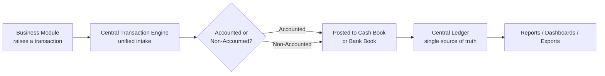

### 10.2 Structural Requirements (what must exist)

| ID | Requirement |
|---|---|
| FR-CFE-001 | The system shall provide one Central Transaction Engine that is the single intake point for every financial transaction raised by any of the six business modules (V4 §3.1, §4.1, §7.4). |
| FR-CFE-002 | The Central Transaction Engine shall classify every incoming transaction as **Accounted** or **Non-Accounted** (V4 §7.4). |
| FR-CFE-003 | The system shall maintain a **Central Cash Book** with a running balance: opening cash + receipts − payments = available cash (V4 §7.4). |
| FR-CFE-004 | The system shall maintain a **Central Bank Book** with an independent running balance per bank account, supporting **multiple bank accounts** (V4 §7.4). |
| FR-CFE-005 | The system shall maintain a **Central Ledger** that is the single source of truth from which all reporting is derived (V4 §3.1, §4.3, §7.4). |
| FR-CFE-006 | Every receipt/payment screen, in every module, shall present a **Cash/Bank payment-mode selector**; selecting Bank shall require choosing a specific bank account and shall automatically update that account's Bank Book (V4 §7.4; Build Guide Rule 4.5). |
| FR-CFE-007 | Every transaction posted through the engine shall be attributable to the user who entered it (Build Guide Rule 4.3; V4 §6). |

### 10.3 Business Rules (how the engine must behave)

| ID | Rule |
|---|---|
| BR-CFE-001 | A business module shall never post directly to the Cash Book, Bank Book, or Central Ledger; it shall only raise a transaction request to the Central Transaction Engine (Build Guide Rule 4.1: "If a developer is about to write cash-balance or ledger logic inside a module, stop — it belongs in Layer 5"). |
| BR-CFE-002 | Accounted and Non-Accounted values shall be captured, tracked, collected, and reported **separately end-to-end** and shall never be combined into a single irreversible figure (V4 §3.2). |
| BR-CFE-003 | A transaction's Cash Book/Bank Book posting shall occur automatically and immediately upon successful recording of the transaction by the raising module (V4 §8.4: "Every transaction immediately updates the customer ledger, pending principal, total outstanding, Cash/Bank book, dashboard and reports"). |
| BR-CFE-004 | Historical Cash Book, Bank Book, and Central Ledger entries are never deleted (Build Guide Rule 4.3). |
| BR-CFE-005 | Reporting, dashboards, and exports must be computed from the Central Ledger (and the Cash/Bank Books it derives from), not recalculated independently by a module (V4 §4.3). |

### 10.4 Implementation Details (deferred to engineering; not product requirements per se)

- Exact schema for the transaction intake payload (transaction type, source module, source record ID, amount, Accounted/Non-Accounted flag, payment mode, bank account reference, entered-by, timestamp).
- Whether classification (Accounted/Non-Accounted) is selected explicitly by the user at transaction entry or is defaulted/derived from the raising module's business context (e.g., a "Non-Accounted interest" field in Finance vs. a Chit Fund transaction that is inherently one stream) — **TBC**, see Section 37, R-05.
- Concurrency/locking strategy for simultaneous postings to the same bank account or Cash Book.
- Whether the classification is fixed at entry or can later be re-classified by an Administrator (**not stated — TBC**).

### 10.5 What "Accounted" vs. "Non-Accounted" Means (Product Definition)

| Term | Definition (per V4 Executive Summary / Business Structure, and PBMS.pdf Executive Summary) |
|---|---|
| **Accounted Business** | Business activities that require formal accounting records, financial reporting, and organized transaction management. |
| **Non-Accounted Business** | Business activities that are managed independently while maintaining complete separation from Accounted business records. |

Both categories operate independently while sharing the same platform (authentication, reporting, notifications, administration) and the same Central Transaction Engine, Cash Book, and Bank Book infrastructure — but their values are never merged into one figure (V4 §3.2, Principle 3).

### 10.6 What Happens When a Transaction Is Created (Generic Sequence)

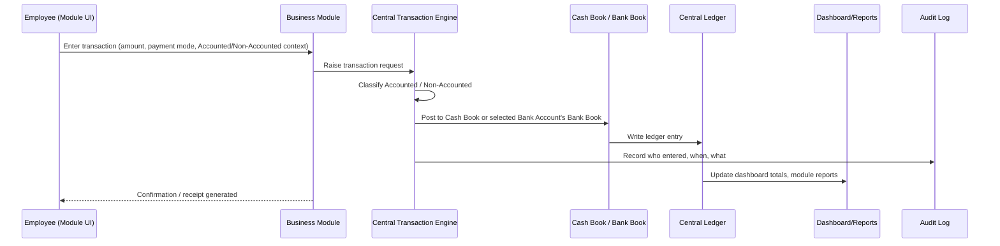


---

# PART III — BUSINESS MODULES

## 11. Finance Management Module

**Purpose (V4 §8):** Manage the complete loan lifecycle — customer onboarding through approval, sanction, disbursement, collection, top-up, and closure — with official (Accounted) and non-accounted interest tracked separately throughout.

### 11.1 Functional Requirements

| ID | Requirement | Source |
|---|---|---|
| FR-FIN-001 | An Employee shall create a loan against an existing Profile ID; customer details shall not be re-entered. | V4 §8.1 |
| FR-FIN-002 | A guarantor and/or co-borrower shall be attachable to the loan where applicable, selected from existing Profile IDs. | V4 §8.1, §7.2 |
| FR-FIN-003 | Loan setup shall capture principal amount, security/collateral details, and repayment terms. | V4 §8.1 |
| FR-FIN-004 | Loan setup shall capture the **official (Accounted) interest rate and frequency** and the **non-accounted (operational) interest rate and frequency**, as two separate fields/streams. | V4 §8.1 |
| FR-FIN-005 | Loan setup shall capture collection frequency and first collection date. | V4 §8.1 |
| FR-FIN-006 | Loan documents shall be attachable: Aadhaar, PAN, loan agreement, promissory note, cheques, and others (configurable document types). | V4 §8.1 |
| FR-FIN-007 | An Employee shall submit a created loan for approval; creation alone shall not activate the loan. | V4 §8.2 |
| FR-FIN-008 | An Administrator shall review a submitted loan and approve (sanction) or reject it, with remarks. | V4 §8.2 |
| FR-FIN-009 | On sanction, the system shall generate a unique **Loan ID** to which all future transactions for that loan are linked. | V4 §8.2 |
| FR-FIN-010 | The system shall permanently store created-by, approved-by, approval date, and approval status for every loan. | V4 §8.2 |
| FR-FIN-011 | The first collection date shall default to the day after sanction and remain user-configurable. | V4 §8.2 |
| FR-FIN-012 | Disbursement shall capture disbursement date, mode (Cash/Bank), and disbursing bank account (when Bank is selected). | V4 §8.3 |
| FR-FIN-013 | On disbursement, an initial ledger entry shall be raised automatically and posted to the Cash Book or Bank Book via the Central Transaction Engine. | V4 §8.3 |
| FR-FIN-014 | Interest shall be calculated on the **pending Principal Amount**, not on a fixed EMI schedule. | V4 §8.4 |
| FR-FIN-015 | Interest shall recalculate automatically each time principal is collected and the pending amount reduces. | V4 §8.4 |
| FR-FIN-016 | Principal collection, official interest collection, and non-accounted interest collection shall be recorded as **separate** entries. | V4 §8.4 |
| FR-FIN-017 | Every collection entry shall capture payment mode, collection date, collected-by, and reference/remarks. | V4 §8.4 |
| FR-FIN-018 | The system shall support partial payments. | V4 §8.4 |
| FR-FIN-019 | The system shall support penalty, other-charge, refund, and adjustment entries against a loan. | V4 §8.4 |
| FR-FIN-020 | The system shall generate a receipt on every collection. | V4 §8.4 |
| FR-FIN-021 | Every collection transaction shall immediately update: the customer ledger, pending principal, total outstanding, the relevant Cash/Bank Book, the dashboard, and reports. | V4 §8.4 |
| FR-FIN-022 | The system shall support a **top-up loan**: additional principal added to an active loan **under the same Loan ID**, with approval where required — not a new loan origination. | V4 §8.5 |
| FR-FIN-023 | A loan reaching zero outstanding shall **not** close automatically; it shall remain Active until an authorized user (Administrator) explicitly closes it. | V4 §8.5 |
| FR-FIN-024 | Loan closure shall be Administrator-controlled, recording a closure date, after which the loan is archived (not deleted). | V4 §8.5 |
| FR-FIN-025 | The complete loan timeline — creation, disbursement, interest collection, principal collection, penalty, top-up, adjustment, closure — shall be permanently recorded. | V4 §8.5 |
| FR-FIN-026 | Loan status shall be one of: **Pending Approval, Active, Closed, NPA**. | V4 §8.5 |
| FR-FIN-027 | The system shall provide a single **Loan Management Workspace** screen covering the full loan lifecycle: a customer directory (left panel) and, per selected loan, customer info, loan info, financial summary, transaction ledger, documents, and loan timeline (centre panel), plus quick actions (new loan, record transaction, disbursement, top-up, close loan, upload documents, print receipt, print loan details, print ledger). | V4 §8.6 |
| FR-FIN-028 | The system shall support a configurable **NPA** classification interval, defaulting to three months. | V4 §8.6 (Reports) |

### 11.2 Finance Reports

| Report | Data Included |
|---|---|
| Loan Creation Report | Loan ID, customer, principal, date, status, sanction information |
| Loan Closure Report | Loan ID, customer, closure date, principal settled, interest settled, closure status |
| Loan Outstanding Report | Principal outstanding, official interest outstanding, non-accounted interest outstanding, and total — shown **separately** |
| NPA Report | Configurable interval, default three months |
| Interest Collection Report | Accounted and non-accounted collections, shown separately |
| Principal Collection Report | Principal collected |
| Top-Up Loan Report | Top-up history against Loan IDs |
| Customer Ledger Report | Full ledger per customer |
| Collection Summary / Cash Collection / Bank Collection Reports | Collections split by payment mode |
| Active Loan / Closed Loan / Loan Maturity Reports | Status-based loan lists |

### 11.3 Workflow — Loan Origination to Sanction

| Field | Detail |
|---|---|
| **Purpose** | Bring a loan from creation to an authorized, active state. |
| **Actors** | Employee (creates, submits), Administrator (reviews, approves/rejects) |
| **Preconditions** | A Profile ID exists for the borrower (and guarantor/co-borrower, if used). |
| **Inputs** | Profile ID, principal amount, collateral details, official interest rate/frequency, non-accounted interest rate/frequency, collection frequency, first collection date, loan documents |
| **Main Flow** | 1. Employee selects an existing Profile ID. 2. Employee enters loan terms and attaches guarantor/co-borrower and documents. 3. Employee submits the loan for approval. 4. Administrator reviews the submission. 5. Administrator approves (sanctions) or rejects with remarks. 6. On approval, the system generates a Loan ID and sets status to Active. |
| **Alternative Flow** | Administrator rejects → loan remains in a rejected/not-active state with remarks recorded; Employee may revise and resubmit (resubmission mechanics: **TBC**). |
| **Business Rules** | BR-FIN-001 (below); FR-FIN-007 through FR-FIN-011 |
| **Financial Impact** | None until disbursement; sanction alone does not post a financial transaction (disbursement does — see 11.4). |
| **Notification** | TBC whether Employee/Administrator receive a Telegram notification on submission/approval — not explicitly stated; **implied desirable, not confirmed**. |
| **Audit Event** | Created-by, approved-by, approval date, and status change are permanently recorded (FR-FIN-010). |
| **Final State** | Loan status = Active, Loan ID generated. |

### 11.4 Workflow — Disbursement

| Field | Detail |
|---|---|
| **Purpose** | Release sanctioned principal and post the corresponding financial entry. |
| **Actors** | Employee or Administrator (role for disbursement entry not explicitly restricted beyond general RBAC) |
| **Preconditions** | Loan status = Active (sanctioned) |
| **Inputs** | Disbursement date, payment mode (Cash/Bank), disbursing bank account (if Bank) |
| **Main Flow** | 1. User enters disbursement details against the sanctioned loan. 2. System raises a transaction to the Central Transaction Engine. 3. Engine posts to Cash Book or the selected Bank Book. 4. Initial ledger entry is created. |
| **Business Rules** | BR-CFE-001, BR-CFE-003, BR-FIN-002 |
| **Financial Impact** | Cash/Bank Book decreases by principal disbursed; Central Ledger records the disbursement. |
| **Audit Event** | Attributed to the user who entered disbursement. |
| **Final State** | Loan carries a recorded disbursement; collection cycle can begin. |

### 11.5 Workflow — Interest Calculation & Collection

| Field | Detail |
|---|---|
| **Purpose** | Collect principal and interest against an active loan, correctly split between Accounted and Non-Accounted streams. |
| **Actors** | Employee (records collection) |
| **Preconditions** | Loan status = Active; pending principal > 0 (interest continues to accrue as long as principal is outstanding). |
| **Inputs** | Collection date, payment mode, collected-by, reference/remarks, amounts allocated to principal / official interest / non-accounted interest / penalty / other charges |
| **Main Flow** | 1. Employee opens the Loan Management Workspace for the customer/loan. 2. Employee records a collection, allocating the amount received across principal, official interest, and/or non-accounted interest. 3. System recalculates interest on the new pending principal. 4. System raises the transaction to the Central Transaction Engine (classified Accounted/Non-Accounted per component). 5. Receipt is generated. |
| **Alternative Flow** | Partial payment — amount collected is less than total due; outstanding is reduced by the amount actually received (FR-FIN-018). |
| **Business Rules** | BR-FIN-002 (below); FR-FIN-014 through FR-FIN-021 |
| **Financial Impact** | Cash/Bank Book increases; customer ledger, pending principal, and total outstanding update immediately. |
| **Notification** | Payment alert / collection confirmation via Telegram (Section 24). |
| **Audit Event** | Collection attributed to collected-by user; timestamped. |
| **Final State** | Updated pending principal, outstanding, and ledger; loan remains Active (even at zero outstanding, per FR-FIN-023). |

### 11.6 Workflow — Top-Up and Closure

| Field | Detail |
|---|---|
| **Purpose** | Extend an existing loan (top-up) or formally end it (closure). |
| **Actors** | Employee (raises top-up request), Administrator (approves top-up where required; performs closure) |
| **Preconditions — Top-up** | Loan status = Active |
| **Preconditions — Closure** | Loan status = Active (regardless of outstanding balance) |
| **Main Flow — Top-up** | 1. Employee/Administrator raises additional principal against the existing Loan ID. 2. Approval obtained where required. 3. Additional principal is disbursed and posted through the Central Transaction Engine under the same Loan ID. |
| **Main Flow — Closure** | 1. Administrator reviews the loan. 2. Administrator explicitly closes the loan, recording a closure date. 3. Loan status changes to Closed; loan is archived (history preserved). |
| **Business Rules** | FR-FIN-022 (top-up under same Loan ID); FR-FIN-023–FR-FIN-024 (no auto-closure; Admin-only closure) |
| **Audit Event** | Top-up and closure are both attributed and timestamped; part of the permanent loan timeline (FR-FIN-025). |
| **Final State** | Top-up: loan remains Active with increased principal. Closure: loan status = Closed. |

### 11.7 Finance Module Business Rules

| ID | Rule |
|---|---|
| BR-FIN-001 | A loan shall not become active until it has been approved/sanctioned by an authorized Administrator (V4 §8.2). |
| BR-FIN-002 | Interest is calculated on pending principal, not a fixed EMI, and recalculates automatically whenever principal is collected (V4 §8.4, Executive Summary business-reality table). |
| BR-FIN-003 | A loan at zero outstanding remains Active until an Administrator explicitly closes it (V4 §8.5, Annexure A item 13). |
| BR-FIN-004 | A top-up creates no new Loan ID; it is recorded under the existing Loan ID (V4 §8.5, Annexure A item 14). |
| BR-FIN-005 | Official and non-accounted interest are calculated, collected, tracked as outstanding, ledgered, and reported separately at all times (V4 Annexure A item 10). |

### 11.8 Finance Module Acceptance Criteria

- **AC-FIN-001:** Given an Employee has created a loan application, when the Employee submits it, then the loan status shall move to a pending-approval state and disbursement shall remain unavailable until an Administrator authorizes (approves/sanctions) it.
- **AC-FIN-002:** Given an Administrator approves a submitted loan, when the approval is confirmed, then the system shall generate a unique Loan ID and set status to Active, and shall permanently record the approver, approval date, and status.
- **AC-FIN-003:** Given an active loan with a partial principal collection recorded, when the collection is saved, then the system shall recalculate interest on the new pending principal and update the customer ledger, total outstanding, and the relevant Cash/Bank Book immediately.
- **AC-FIN-004:** Given an active loan reaches zero outstanding principal and interest, when no explicit closure action has been taken, then the loan status shall remain Active (not auto-close).
- **AC-FIN-005:** Given an Employee attempts to close a loan, when the request reaches the API, then the system shall reject the action unless the requester holds the Administrator role.
- **AC-FIN-006:** Given a top-up is recorded against an active loan, when the top-up is saved, then the additional principal shall be linked to the existing Loan ID, not a new one.


## 12. Chit Fund Management Module

**Purpose (V4 §9):** Digitize the complete chit scheme lifecycle across multiple schemes and groups — group creation, Profile-based member enrollment, installment collection, automatic penalty, prize distribution, and scheme closure.

### 12.1 Functional Requirements

| ID | Requirement | Source |
|---|---|---|
| FR-CHIT-001 | The system shall support a Scheme master, with multiple Groups belonging to each Scheme. | V4 §9.1 |
| FR-CHIT-002 | Group configuration shall capture start date, duration, collection amount, collection frequency, and member capacity. | V4 §9.1 |
| FR-CHIT-003 | Penalty percentage and dividend/prize structure shall be configurable per group. | V4 §9.1 |
| FR-CHIT-004 | A group shall require scheme approval and a group status before activation. | V4 §9.1 |
| FR-CHIT-005 | The system shall identify a scheme/group as **dividend-type** and apply the corresponding calculation workflow. | V4 §9.1, §9.6 |
| FR-CHIT-006 | Members shall be added **only** by searching and selecting an existing Profile ID; the module shall provide **no** separate member-creation form. | V4 §9.2 |
| FR-CHIT-007 | Where a prospective member has no Profile, one shall be created once in the Profile master, then selected. | V4 §9.2 |
| FR-CHIT-008 | Member enrollment shall capture registration, KYC verification, and join date. | V4 §9.2 |
| FR-CHIT-009 | The system shall maintain complete member history across all groups a member belongs to. | V4 §9.2 |
| FR-CHIT-010 | Installment collection shall generate payment confirmation and a receipt, and update the member ledger on every entry. | V4 §9.3 |
| FR-CHIT-011 | Per-member tracking shall include current due, collection status, collection date, amount collected, pending amount, penalty, and next collection date. | V4 §9.3 |
| FR-CHIT-012 | The system shall provide a collection tracker and due tracker across the group, with payment reminders and due notifications. | V4 §9.3 |
| FR-CHIT-013 | Penalty percentage shall be defined at group level and calculated **automatically** once a member payment becomes overdue, added to total due — no manual calculation. | V4 §9.4 |
| FR-CHIT-014 | Penalty collection shall be recorded and tracked separately from the base installment. | V4 §9.4 |
| FR-CHIT-015 | The system shall support a dividend/auction process with bidding and winner selection, prize amount finalization per cycle, prize disbursement (Cash/Bank, date, entry), and member notification on winner declaration. | V4 §9.5 |
| FR-CHIT-016 | The **next collection amount** shall be calculated automatically with reference to the latest prize amount and group configuration; member dues and the collection schedule shall update automatically once the prize is entered. This calculation is centralized in chit fund business logic, not performed manually. | V4 §9.6 |
| FR-CHIT-017 | Scheme closure shall require verification of completion, final settlement, member settlement, and archival of records with full audit history. | V4 §9.7 |

### 12.2 Chit Fund Reports

Chit Collection Report; Member Ledger Report; Outstanding/Due Report; Penalty Report; Prize/Auction Winner Report; Scheme and Group Performance Report; Member Payment History and Prize History; Scheme Closure and Settlement Report (V4 §9).

### 12.3 Chit Fund Lifecycle Diagram

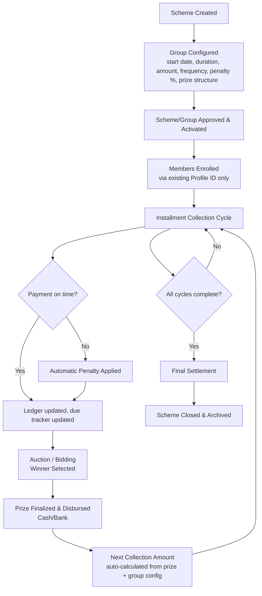

### 12.4 Chit Fund Business Rules

| ID | Rule |
|---|---|
| BR-CHIT-001 | A member cannot be added to a group except by selecting an existing Profile ID (V4 §9.2). |
| BR-CHIT-002 | Penalty is calculated automatically at the configured group-level percentage once a payment is overdue; no manual penalty entry is permitted (V4 §9.4). |
| BR-CHIT-003 | The next collection amount is derived automatically from the latest prize amount and group configuration; it is not manually entered (V4 §9.6). |
| BR-CHIT-004 | A scheme/group cannot be activated without scheme approval and group-status confirmation (V4 §9.1). |
| TBC-005 | The exact mathematical formula relating prize amount, dividend distribution, and the resulting next-collection amount is **not specified numerically** in the source documents ("derived automatically with reference to the latest prize amount and the group configuration" — V4 §9.6). This is a critical calculation and must be confirmed with the client/business analyst before implementation — see Section 37, R-01. |
| TBC-006 | Whether the Chit Fund module supports Accounted vs. Non-Accounted classification per scheme/group (as opposed to only at the Central Transaction Engine's generic level) is not explicitly stated for this module — TBC. |

### 12.5 Chit Fund Acceptance Criteria

- **AC-CHIT-001:** Given an Employee attempts to enroll a chit member without selecting an existing Profile ID, when the enrollment is submitted, then the system shall block the action and require Profile selection or Profile creation first.
- **AC-CHIT-002:** Given a member's installment becomes overdue past the configured due date, when the due-date check runs, then the system shall automatically apply the group's configured penalty percentage without manual entry.
- **AC-CHIT-003:** Given a group's auction winner and prize amount have been entered, when the entry is saved, then the system shall automatically recalculate the next collection amount and update all members' dues and the collection schedule.
- **AC-CHIT-004:** Given a scheme closure is initiated, when final settlement is completed, then all group and member records shall be archived (not deleted) with full audit history intact.

---

## 13. Rental Management Module

**Purpose (V4 §10):** Manage residential and commercial rental properties under a parent/child property structure — tenants, agreements, rent and maintenance collection, outstanding dues, occupancy, and lease renewal — from a single property portfolio view.

### 13.1 Functional Requirements

| ID | Requirement | Source |
|---|---|---|
| FR-RENT-001 | The system shall support a two-level property structure: a **Parent Property** (e.g., apartment building, complex, commercial block) containing multiple **Child Properties** (individual flats, shops, offices, units). | V4 §10.1 |
| FR-RENT-002 | Multiple parent properties shall be supported, each with any number of child properties. | V4 §10.1 |
| FR-RENT-003 | A child property may be residential or commercial; a single parent property may contain both. | V4 §10.1 |
| FR-RENT-004 | Rent, maintenance, tenant, agreement, dues, and ledger shall be maintained at **child-property level**. | V4 §10.1 |
| FR-RENT-005 | The parent-property level shall show a consolidated view: total units, occupied, vacant, expected rent, and total outstanding, rolled up from child properties. | V4 §10.1 |
| FR-RENT-006 | A standalone property with no sub-units may be recorded directly as a single property (i.e., without requiring the parent/child hierarchy). | V4 §10.1 |
| FR-RENT-007 | Property records shall capture unit/floor details, property type, amenities, ownership, legal/tax details, images, and documents. | V4 §10.1 |
| FR-RENT-008 | Tenant registration shall be against a Profile ID, with KYC and emergency contact details. | V4 §10.2 |
| FR-RENT-009 | The system shall support creating a rental agreement within the system, uploading signed agreement documents, and linking the agreement to both property and tenant, capturing lease details, rent amount, security deposit, escalation terms, and due dates. | V4 §10.2 |
| FR-RENT-010 | The system shall support three collection types: **Rent only**, **Maintenance only** (for agreements where rent is not collected through the system), and **Rent + Maintenance combined**; maintenance shall be tracked independently of rent, with its own dues and collection. | V4 §10.3 |
| FR-RENT-011 | Rent/maintenance collection shall generate payment confirmation and a digital receipt, updating the tenant ledger on every entry. | V4 §10.4 |
| FR-RENT-012 | Outstanding calculation shall include current due, pending months, total outstanding, and next due date, with overdue properties highlighted. | V4 §10.4 |
| FR-RENT-013 | Payment mode (Cash/Bank) shall post to the central Cash/Bank books. | V4 §10.4 |
| FR-RENT-014 | Occupancy/vacancy status shall be tracked per child property, with vacancy duration rolled up to the parent property; occupancy shall update automatically on tenant allocation. | V4 §10.5 |
| FR-RENT-015 | The system shall support lease renewal, rent revision, notice management, lease closure, and marking a property available for rent. | V4 §10.5 |

### 13.2 Rental Reports

Occupancy Report; Rent Collection Report; Overdue Report; Maintenance Report; Lease Expiry Report; Parent-Property Summary and Child-Property Detail Report; Tenant Ledger Report (V4 §10).

### 13.3 Rental Lifecycle Diagram

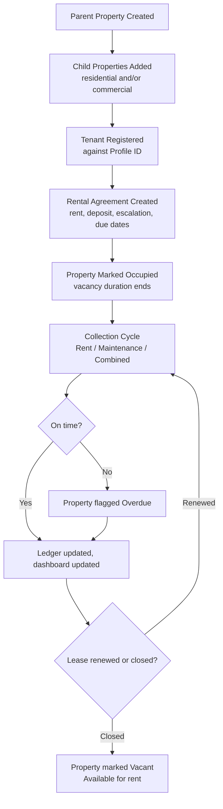

### 13.4 Rental Module Business Rules

| ID | Rule |
|---|---|
| BR-RENT-001 | Rent, maintenance, tenant, agreement, dues, and ledger data belong to the child-property record even when a consolidated view is shown at the parent level (V4 §10.1). |
| BR-RENT-002 | A maintenance-only collection type applies specifically to agreements where rent is not collected through the system, and its dues/collection are tracked independently of any rent stream (V4 §10.3). |
| BR-RENT-003 | Occupancy status changes automatically when a tenant is allocated to a property, and vacancy duration is rolled up to the parent property (V4 §10.5). |

### 13.5 Rental Module Acceptance Criteria

- **AC-RENT-001:** Given a parent property with multiple child properties, when the parent-property summary is viewed, then total units, occupied, vacant, expected rent, and total outstanding shall be shown as figures rolled up from the child properties.
- **AC-RENT-002:** Given a tenant with a "Maintenance only" agreement, when a maintenance payment is collected, then the transaction shall be tracked independently of any rent due for that property.
- **AC-RENT-003:** Given a tenant is allocated to a vacant child property, when the allocation is saved, then the property's occupancy status shall automatically change to Occupied and the vacancy-duration counter shall stop.


## 14. Expense Management Module

**Purpose (V4 §11):** Record, categorize, and monitor all business expenses with user-defined categories, posting every expense to the central Cash Book or Bank Book.

### 14.1 Functional Requirements

| ID | Requirement | Source |
|---|---|---|
| FR-EXP-001 | Expense categories shall be fully **user-defined** (not a fixed list). | V4 §11.1 |
| FR-EXP-002 | Expense entry shall capture category, amount, date, payment mode, and remarks. | V4 §11.1 |
| FR-EXP-003 | Every expense shall post to the central Cash Book or the selected bank account via the Central Transaction Engine. | V4 §11.1 |
| FR-EXP-004 | The system shall support upcoming and recurring expense tracking, integrated with the shared calendar, with reminders for upcoming/recurring expenses. | V4 §11.2 |
| FR-EXP-005 | The system shall maintain a read-only expense history providing a complete audit trail, with automatic monthly expense totals. | V4 §11.3 |

### 14.2 Expense Reports
Expense Summary Report; Category-wise Expense Report; Monthly Expense Report; Cash and Bank Expense Reports (V4 §11).

### 14.3 Expense Business Rules

| ID | Rule |
|---|---|
| BR-EXP-001 | Expense categories are created and managed by the user (not restricted to a fixed system list), consistent with the "no fixed categories" design principle described for this module. |
| BR-EXP-002 | Expense history is read-only once recorded; corrections require an adjustment/reversal mechanism rather than direct edits (**exact correction workflow — TBC**, not specified in source documents). |

### 14.4 Expense Acceptance Criteria
- **AC-EXP-001:** Given a user creates a new expense category, when the category is saved, then it shall be immediately available for selection on the expense-entry screen.
- **AC-EXP-002:** Given an expense is recorded with payment mode = Bank, when the entry is saved, then the selected bank account's Bank Book balance shall decrease by the expense amount.
- **AC-EXP-003:** Given a recurring expense is configured, when its due date arrives, then the system shall raise a reminder via the shared calendar/notification engine.

---

## 15. Investment Management Module

**Purpose (V4 §12):** Track, monitor, and close business investments as a structured digital register, with maturity reminders and a read-only historical ledger.

### 15.1 Functional Requirements

| ID | Requirement | Source |
|---|---|---|
| FR-INV-001 | The Investment Register shall capture investment name, company/organization, investment type (fixed deposit, shares, bond, loan, others), investment amount, investment date, category, platform, agreement/certificate upload, reference number, and remarks. | V4 §12.1 |
| FR-INV-002 | An investment may be marked **recurring**, with a recurrence frequency of monthly, quarterly, half-yearly, or annual; recurring instalment amount and next due date shall be maintained against the record. | V4 §12.2 |
| FR-INV-003 | The system shall raise a reminder on **every** recurring instalment, not only at maturity, synced to the shared calendar and sent as a Telegram reminder. | V4 §12.2 |
| FR-INV-004 | Each recurring instalment shall be recorded against the investment and posted to the Cash Book or Bank Book via the Central Transaction Engine, maintaining a running total of instalments paid to date. | V4 §12.2 |
| FR-INV-005 | The system shall track maturity date, expected return, and reminder frequency, synced to the shared calendar, with alerts as closing dates approach. | V4 §12.3 |
| FR-INV-006 | On closure, the system shall capture the final amount received, mark the investment Closed, and move it to a **read-only historical ledger**, preserving a complete audit trail. | V4 §12.4 |

### 15.2 Investment Reports
Active Investments Report; Recurring Investment Due Report; Upcoming Maturity Report; Closed Investments Report; Investment History & Summary (V4 §12).

### 15.3 Investment Field Specification Note (per V4)
> "The V4 requirement documentation states that any additional Investment fields are to be defined by the client rather than assumed by the development team. The workflow above is confirmed and included. Additional fields required by Dhavanam Finance will be captured during the requirement freeze in Week 1 and built within this scope, provided they remain within the functional level described in Section 21." (V4 §12, field-specification note)

**TBC-007:** Exact additional Investment fields are explicitly deferred to a Week-1 requirement freeze with the client — this is a confirmed **open item**, not an oversight, and must be tracked to closure before Investment module development begins (see Section 37, R-02).

### 15.4 Investment Lifecycle Diagram

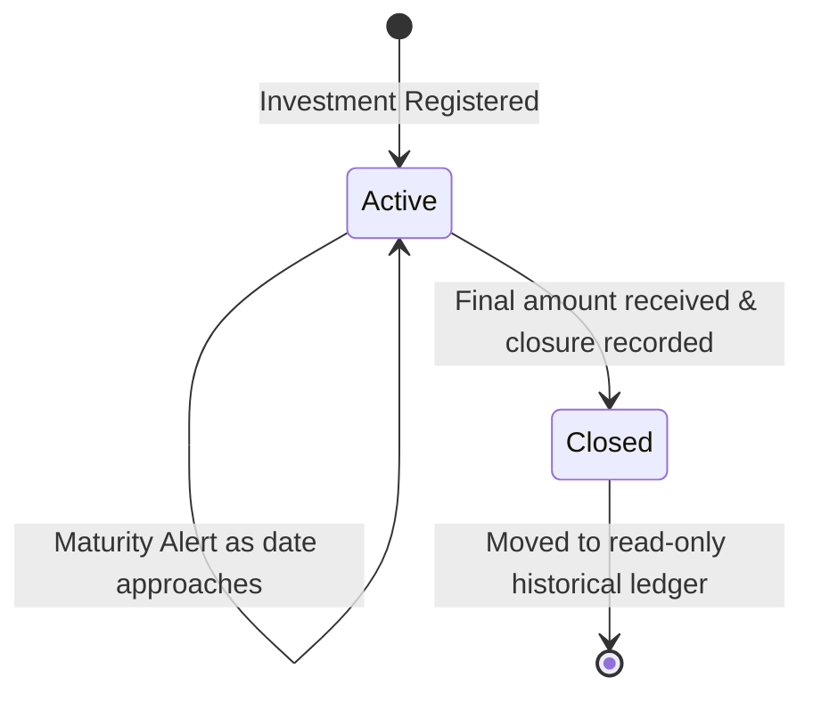

### 15.5 Investment Business Rules

| ID | Rule |
|---|---|
| BR-INV-001 | A recurring investment generates a reminder on every instalment occurrence, not only at final maturity (V4 §12.2). |
| BR-INV-002 | Once closed, an investment record becomes read-only history; it cannot be edited further, only viewed (V4 §12.4). |

### 15.6 Investment Acceptance Criteria
- **AC-INV-001:** Given a recurring investment with a monthly frequency, when a due date is reached, then the system shall raise a Telegram reminder and reflect the due instalment on the shared calendar.
- **AC-INV-002:** Given an investment is closed with a final amount received, when the closure is saved, then the record shall move to the read-only historical ledger and shall no longer accept new instalment entries.

---

## 16. Receivables & Payables Module

**Purpose (V4 §13):** Track amounts owed to and by the business outside the lending book, with automatic penalty on overdue receivables, connected to the central Cash and Bank system. **This module is new in V4** and did not exist in the V1/V2 proposals (Appendix A).

### 16.1 Functional Requirements

| ID | Requirement | Source |
|---|---|---|
| FR-RP-001 | The system shall allow a **Receivable** to be raised against a customer or party, capturing amount, due date, and status. | V4 §13.1 |
| FR-RP-002 | A configurable penalty percentage shall be applied **automatically** to a receivable once its due date passes. | V4 §13.1 |
| FR-RP-003 | Payment recording against a receivable shall update its outstanding balance. | V4 §13.1 |
| FR-RP-004 | The system shall allow a **Payable** to be raised against a party or vendor, capturing amount, due date, status, and remarks. | V4 §13.2 |
| FR-RP-005 | Payment recording against a payable shall capture payment mode. | V4 §13.2 |
| FR-RP-006 | All receipts and payments under this module shall route through the Central Transaction Engine to the Cash Book or Bank Book. | V4 §13.3 |

### 16.2 Receivables & Payables Reports
Receivables Report with ageing; Payables Report with ageing; Party-wise Outstanding Report (V4 §13).

### 16.3 Receivables & Payables Business Rules

| ID | Rule |
|---|---|
| BR-RP-001 | A receivable's overdue penalty is applied automatically once the due date passes, using the configured penalty percentage — no manual calculation (V4 §13.1). |
| BR-RP-002 | All receivable/payable financial movements are posted only through the Central Transaction Engine, consistent with the platform-wide rule that modules never implement their own posting logic (V4 §13.3; BR-CFE-001). |

### 16.4 Open Items Specific to This Module

- **TBC-008:** Whether "customer or party" (Receivables) and "party or vendor" (Payables) must reference the shared Profile ID master, or may be recorded against a free-text/independent party record, is not explicitly stated in V4 §13. Given the platform-wide "one customer identity" principle (Section 8, Principle 1), the Product/BA recommendation is to require Profile ID linkage for consistency, but this is **not confirmed** in the source documents and must be decided before data-model finalization (see Section 37, R-04).
- **TBC-009:** Whether Receivables/Payables entries require an explicit Accounted/Non-Accounted classification choice at entry, or inherit a default, is not explicitly stated for this module (contrast with Finance, which explicitly captures both streams). Given BR-CFE-002 (the classification applies to every transaction platform-wide), this module is assumed to be **in scope for classification by the Central Transaction Engine**, but the module-level UI/UX for making that selection is not specified.

### 16.5 Receivables Lifecycle Diagram

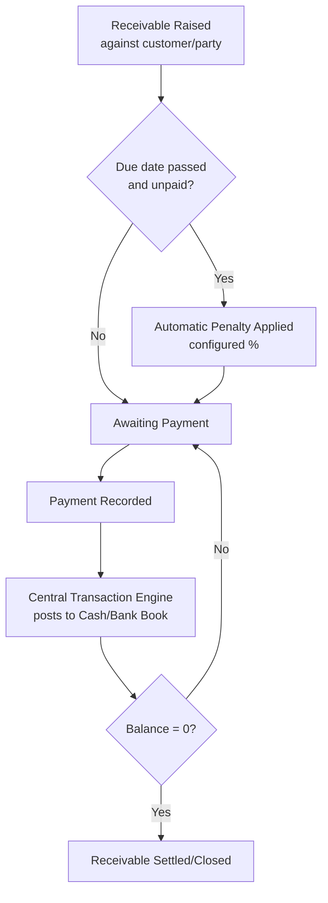

### 16.6 Payables Lifecycle Diagram

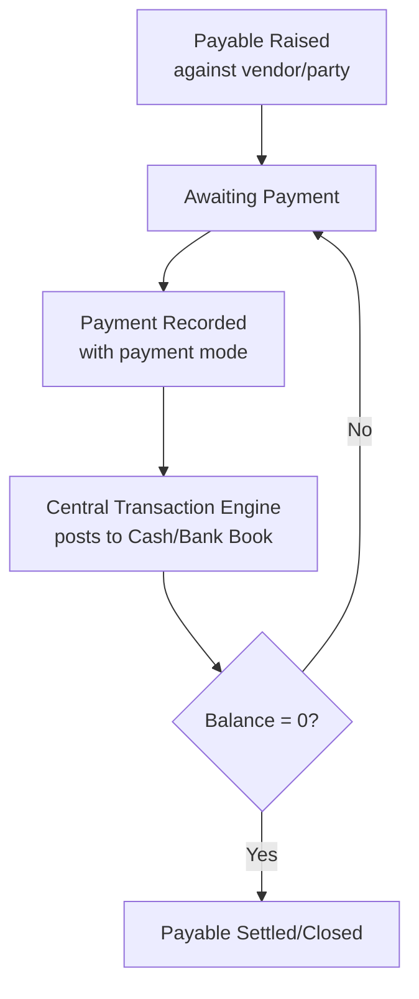

### 16.7 Receivables & Payables Acceptance Criteria
- **AC-RP-001:** Given a receivable's due date passes without full payment, when the overdue check runs, then the system shall automatically apply the configured penalty percentage to the outstanding balance.
- **AC-RP-002:** Given a payment is recorded against a payable with payment mode = Bank, when the entry is saved, then the transaction shall post to the selected bank account's Bank Book through the Central Transaction Engine.


---

# PART IV — CROSS-CUTTING PRODUCT REQUIREMENTS

## 17. Dashboard & Business Analytics

### 17.1 Executive Dashboard Requirements (V4 §7.6)

| ID | Requirement | Data Type |
|---|---|---|
| FR-DASH-001 | Show consolidated live figures across all delivered modules. | Aggregated |
| FR-DASH-002 | Show total customers, active loans, collections this month, total outstanding, overdue amount, and loans closed. | Real-time / Calculated |
| FR-DASH-003 | Show an outstanding ageing summary — customer-wise and amount-wise — across 1–30, 31–60, 61–90, and 90+ day buckets. | Calculated |
| FR-DASH-004 | Show a collection summary for today, this week, and this month, split between interest and principal. | Calculated |
| FR-DASH-005 | Show recent transactions and top overdue accounts; selecting either shall open the underlying record. | Filtered |
| FR-DASH-006 | Auto-refresh the dashboard on every business event — profile created, loan created or modified, transaction recorded, loan closed. | Real-time |

### 17.2 Classification of Dashboard Data

| Category | Examples |
|---|---|
| **Real-time data** | Current Cash/Bank balances; recent transactions feed |
| **Calculated data** | Outstanding ageing buckets; interest-vs-principal collection split; pending principal |
| **Aggregated data** | Total customers, active loans, total outstanding, loans closed |
| **Filtered data** | Top overdue accounts; module-specific dashboard views |

### 17.3 Module-Level Dashboard Content (as documented per module)

| Module | Dashboard Elements Confirmed in Source |
|---|---|
| Finance | Active loans, today's collections, outstanding amount, due today, recent transactions (V1/V2 diagrams; consistent with V4 executive dashboard fields) |
| Chit Fund | Active chit groups, total members, collection today, due today, pending installments |
| Rental | Total properties, occupied properties, rent due today, monthly collection, recent transactions |
| Investment | Active investments, total investment amount, investments closing soon, closed investments |
| Expense | Today's/monthly/pending/upcoming expenses, recent transactions |
| Receivables & Payables | **TBC** — no module-specific dashboard widgets are explicitly described in V4 beyond the general Executive Dashboard and ageing reports. |

**TBC-010:** Whether Receivables & Payables contributes its own dedicated dashboard tile set (as the other five modules do in earlier diagrams) is not explicitly confirmed in V4 — flagged for design/requirement-freeze confirmation.

**BR-DASH-001:** Accounted and Non-Accounted totals must be shown as a **split**, never merged into one combined figure, consistent with Principle 3 (Section 8).

---

## 18. Reporting Requirements

### 18.1 Report Catalogue

For every report: module, purpose, confirmed filters, Accounted/Non-Accounted behavior, and export formats.

| Report | Module | Purpose | Filters (from common matrix, V4 §7.8) | Accounted/Non-Accounted | Export |
|---|---|---|---|---|---|
| Loan Creation Report | Finance | List loans created, with sanction info | Date range, status, profile | N/A (creation event) | PDF, Excel |
| Loan Closure Report | Finance | List closed loans with settlement detail | Date range, profile | Shows both streams settled | PDF, Excel |
| Loan Outstanding Report | Finance | Principal/interest outstanding | Date range, profile, loan | Principal / official interest / non-accounted interest / total shown separately | PDF, Excel |
| NPA Report | Finance | Loans overdue beyond configurable interval (default 3 months) | Interval, date range | Applies to both streams | PDF, Excel |
| Interest Collection Report | Finance | Interest collected | Date range, Cash/Bank | Accounted and non-accounted collections shown separately | PDF, Excel |
| Principal Collection Report | Finance | Principal collected | Date range | N/A | PDF, Excel |
| Top-Up Loan Report | Finance | Top-up history | Date range, loan | N/A | PDF, Excel |
| Customer Ledger Report | Finance | Full customer ledger | Profile | Both streams | PDF, Excel |
| Collection Summary / Cash / Bank Collection Reports | Finance | Collections by mode | Date range, Cash/Bank, bank account | N/A | PDF, Excel |
| Active / Closed Loan / Loan Maturity Reports | Finance | Status-based lists | Status, date range | N/A | PDF, Excel |
| Chit Collection Report | Chit Fund | Installment collections | Date range, scheme/group | TBC | PDF, Excel |
| Member Ledger Report | Chit Fund | Per-member ledger | Profile, group | TBC | PDF, Excel |
| Outstanding/Due Report | Chit Fund | Dues per member/group | Group, date range | TBC | PDF, Excel |
| Penalty Report | Chit Fund | Penalties applied | Group, date range | TBC | PDF, Excel |
| Prize/Auction Winner Report | Chit Fund | Auction outcomes | Group, date range | TBC | PDF, Excel |
| Scheme and Group Performance Report | Chit Fund | Scheme/group summary | Scheme, group | TBC | PDF, Excel |
| Member Payment History and Prize History | Chit Fund | Full member history | Profile | TBC | PDF, Excel |
| Scheme Closure and Settlement Report | Chit Fund | Closure detail | Scheme | TBC | PDF, Excel |
| Occupancy Report | Rental | Occupied/vacant status | Property, parent property | N/A | PDF, Excel |
| Rent Collection Report | Rental | Rent collected | Date range, property | TBC | PDF, Excel |
| Overdue Report | Rental | Overdue rent/maintenance | Property, date range | TBC | PDF, Excel |
| Maintenance Report | Rental | Maintenance collection detail | Property, date range | TBC | PDF, Excel |
| Lease Expiry Report | Rental | Upcoming lease expiries | Date range | N/A | PDF, Excel |
| Parent-Property Summary / Child-Property Detail Report | Rental | Roll-up and drill-down | Property hierarchy | N/A | PDF, Excel |
| Tenant Ledger Report | Rental | Per-tenant ledger | Tenant/profile | TBC | PDF, Excel |
| Expense Summary Report | Expense | Total expenses | Date range | TBC | PDF, Excel |
| Category-wise Expense Report | Expense | Expenses by category | Category, date range | TBC | PDF, Excel |
| Monthly Expense Report | Expense | Monthly totals | Month | TBC | PDF, Excel |
| Cash and Bank Expense Reports | Expense | Expenses by payment mode | Cash/Bank | N/A | PDF, Excel |
| Active Investments Report | Investment | Currently active investments | Date range, category | TBC | PDF, Excel |
| Recurring Investment Due Report | Investment | Upcoming recurring instalments | Date range | TBC | PDF, Excel |
| Upcoming Maturity Report | Investment | Investments nearing maturity | Date range | TBC | PDF, Excel |
| Closed Investments Report | Investment | Historical closed investments | Date range | TBC | PDF, Excel |
| Investment History & Summary | Investment | Full history | Profile/category | TBC | PDF, Excel |
| Receivables Report with ageing | Receivables & Payables | Ageing of receivables | Party, date range | TBC | PDF, Excel |
| Payables Report with ageing | Receivables & Payables | Ageing of payables | Party, date range | TBC | PDF, Excel |
| Party-wise Outstanding Report | Receivables & Payables | Outstanding by party | Party | TBC | PDF, Excel |
| **Money Flow Report** | Cross-module | Total income − total expense per period, across all modules | Date range, module | Cross-module aggregate | PDF, Excel |

**Note on "TBC" in the Accounted/Non-Accounted column:** V4 explicitly documents dual-stream reporting for **Finance** only. For all other modules, the source documents do not explicitly state whether reports break out Accounted vs. Non-Accounted; because BR-CFE-002 applies platform-wide, the Product/BA assumption is that the underlying transactions carry the classification, but the report **column-level** breakdown is not confirmed for non-Finance modules. Exact report columns beyond those named above are also **TBC** where not explicitly listed in the source documents (per assignment instruction: mark unspecified fields TBC rather than inventing them).

### 18.2 General Reporting Rules

- BR-REP-001: Reports are read-only; no report screen allows editing the underlying business record (V4 §7.8).
- BR-REP-002: Every report supports the common filter matrix where applicable: module, Accounted/Non-Accounted, Cash/Bank, date range, customer/profile, loan, chit group, property, bank account, status (V4 §7.8).
- FR-REP-001: Selecting a report row opens the corresponding source record (V4 §7.8).


## 19. End-to-End Business Workflows

Full workflow detail (actors, preconditions, business rules, acceptance criteria) for each of these is documented in Sections 11–16. This section presents each as a consolidated, single-line-per-step chain for quick reference, plus the elements requested that are not repeated above (Trigger, Validation, Final State summary).

### 19.1 Finance
**Trigger:** Employee initiates a new loan for a Profile. **Chain:** Profile selected → Loan Application (terms, guarantor/co-borrower, docs) → Employee Submission → Admin Approval/Rejection → Sanction (Loan ID issued) → Disbursement (Cash/Bank posting) → Collection cycles (interest recalculates on pending principal; Accounted/Non-Accounted tracked separately) → optional Top-Up (same Loan ID) → Admin-initiated Closure. **Validation:** Profile must exist; principal/interest fields required; Bank mode requires a bank account. **Approval gate:** Sanction and Closure (Admin only). **Financial Impact:** Disbursement and every collection post through the Central Transaction Engine. **Notification:** Due/overdue/payment alerts via Telegram. **Audit:** created-by/approved-by/collected-by on every step. **Final State:** Loan = Closed (archived, history intact) or NPA if unresolved beyond the configured interval.

### 19.2 Chit Fund
**Trigger:** Administrator/Employee configures a new chit Scheme/Group. **Chain:** Scheme created → Group configured (amount, frequency, capacity, penalty %, prize structure) → Approval/activation → Members enrolled (existing Profile ID only) → Installment collection cycles (automatic penalty on overdue) → Auction/bidding → Winner & prize entry → Next-collection amount auto-calculated → repeat until scheme complete → Final settlement → Closure & archival. **Validation:** Member must resolve to an existing/newly-created Profile ID; group capacity enforced. **Approval gate:** Scheme/group activation. **Financial Impact:** Every collection and every prize disbursement posts through the Central Transaction Engine. **Notification:** Due reminders; winner-declaration notification. **Audit:** Full audit history retained through closure. **Final State:** Scheme = Closed/Settled, archived.

### 19.3 Rental
**Trigger:** A property (parent or standalone) is registered. **Chain:** Property registered → Child properties added (if hierarchical) → Tenant registered (Profile ID) → Rental Agreement created → Property marked Occupied → Collection cycles (Rent / Maintenance / Combined) → Outstanding/overdue tracking → Lease renewal or Lease closure → Property marked Vacant. **Validation:** Agreement must link a valid property and tenant. **Approval gate:** None explicitly documented beyond general RBAC. **Financial Impact:** Every collection posts through the Central Transaction Engine. **Notification:** Due/overdue rent reminders. **Audit:** Ledger updated on every entry. **Final State:** Lease Closed, property Vacant and available.

### 19.4 Expense
**Trigger:** A user records a business expense. **Chain:** Category selected/created → Expense entered (amount, date, mode, remarks) → Posted through Central Transaction Engine to Cash/Bank Book → Recorded in read-only expense history → Rolled into monthly totals/reports. **Validation:** Category, amount, date, and payment mode required. **Approval gate:** None documented for expense entry itself. **Financial Impact:** Direct Cash/Bank Book posting. **Notification:** Reminders for upcoming/recurring expenses. **Audit:** Expense history is read-only, providing the audit trail. **Final State:** Expense recorded and reflected in reports; recurring expenses roll forward to next due date.

### 19.5 Investment
**Trigger:** A new investment is registered. **Chain:** Investment registered (type, amount, date, platform) → optionally marked Recurring (frequency, next due date) → Recurring instalments posted each cycle with reminders → Maturity tracking with alerts as closing date approaches → Closure (final amount received) → Moved to read-only historical ledger. **Validation:** Investment type and amount required; recurring investments require a frequency. **Approval gate:** None explicitly documented. **Financial Impact:** Each instalment and the closure post through the Central Transaction Engine. **Notification:** Reminder on every recurring instalment and as maturity approaches. **Audit:** Complete audit trail preserved through closure. **Final State:** Investment = Closed, read-only.

### 19.6 Receivable
**Trigger:** A receivable is raised against a customer/party. **Chain:** Receivable created (amount, due date) → Due-date monitoring → Automatic penalty if overdue → Payment(s) recorded → Balance reduces → Fully settled. **Validation:** Amount and due date required. **Approval gate:** None explicitly documented. **Financial Impact:** Payments post through the Central Transaction Engine. **Notification:** TBC (not explicitly documented for this module — see Section 24). **Audit:** Payment entries attributed to entering user. **Final State:** Receivable balance = 0 (settled/closed).

### 19.7 Payable
**Trigger:** A payable is raised against a vendor/party. **Chain:** Payable created (amount, due date, remarks) → Payment(s) recorded with payment mode → Balance reduces → Fully settled. **Validation:** Amount and due date required. **Approval gate:** None explicitly documented. **Financial Impact:** Payments post through the Central Transaction Engine. **Notification:** TBC. **Audit:** Payment entries attributed to entering user. **Final State:** Payable balance = 0 (settled/closed).

---

## 20. State Machines

Only states explicitly supported by source documents are modeled; anything not stated is marked TBC rather than invented.

### 20.1 Loan State Machine (confirmed statuses: Pending Approval, Active, Closed, NPA — V4 §8.5)

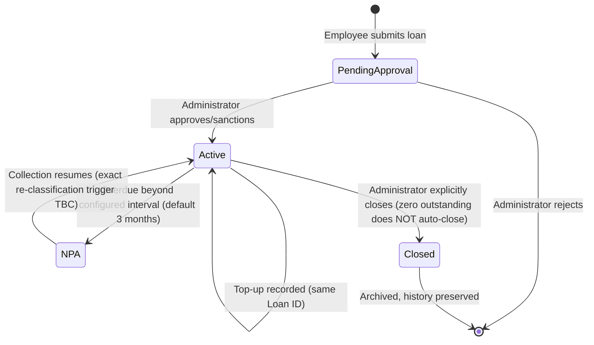
**TBC-011:** The exact system trigger that moves a loan out of NPA status back to Active (e.g., resumed payment) is not explicitly specified — Implementation Decision Required.

### 20.2 Chit Scheme/Group State Machine (statuses inferred from V4 §9.1, §9.7 — exact status labels TBC)

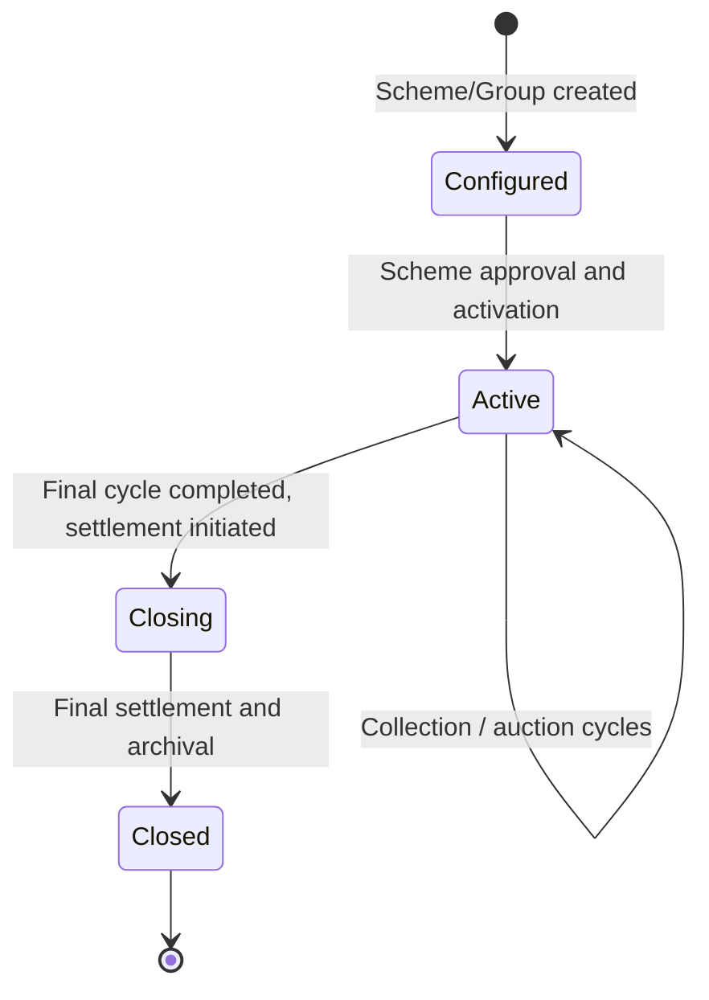
**TBC-012:** Exact status label set for Chit Scheme/Group (e.g., "Draft/Pending Approval/Active/Closed") is not enumerated in the source documents the way Finance's is — Implementation Decision Required.

### 20.3 Rental Property Occupancy State Machine (V4 §10.5)

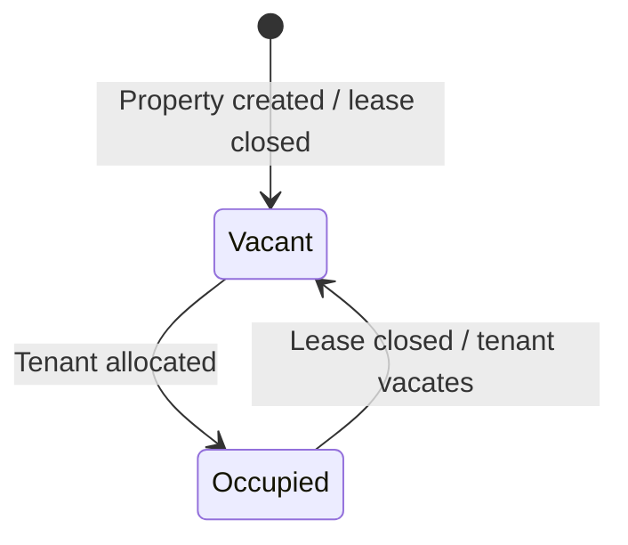

### 20.4 Investment State Machine (V4 §12.4)

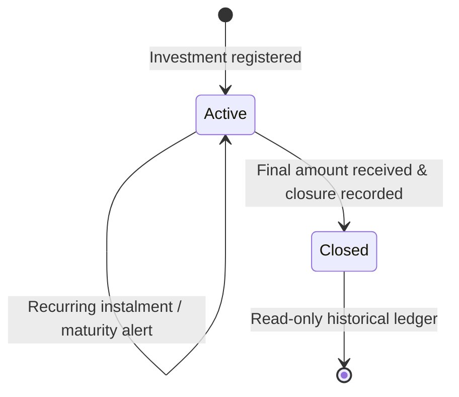

### 20.5 Expense State (V4 §11 — limited state model)

The source documents describe Expense as **recorded → read-only history**, with recurring expenses rolling forward. No explicit "Draft/Paid/Pending" status model is documented for one-time expenses beyond "recorded"; recurring expenses carry a due/upcoming state implicitly via the calendar integration.

**TBC-013:** Whether one-time expenses support a "Pending Payment" vs. "Paid" status (as opposed to being recorded only once actually paid) is not explicitly stated — Implementation Decision Required.

### 20.6 Receivable / Payable State Machine (inferred from V4 §13)

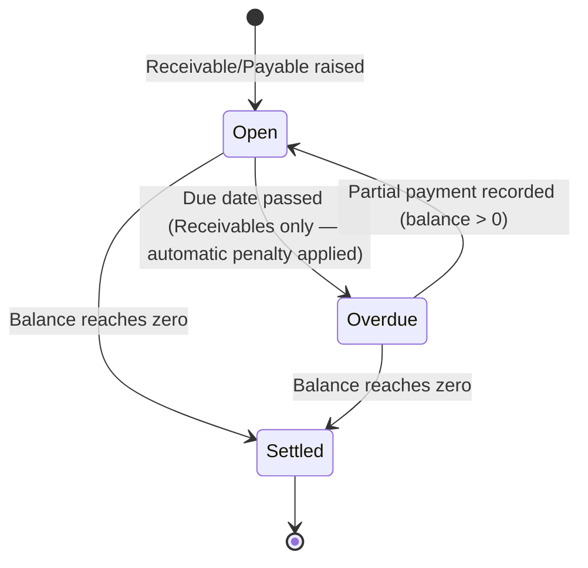


## 21. Business Rules Catalogue

This is the master, numbered catalogue of PBMS business rules. Module-scoped rule IDs used in Sections 10–16 (e.g., BR-FIN-001) map to entries here for traceability.

| Rule ID | Rule Name | Module | Trigger | Condition | System Behavior | Exception | Priority | Source / Confidence |
|---|---|---|---|---|---|---|---|---|
| BR-001 | Profile Uniqueness | Platform | A person is being registered anywhere in PBMS | No existing Profile ID matches the person | System generates one auto-numbered Profile ID (e.g., P000125) | If a matching Profile already exists, creation is blocked in favor of selection | P0 | V4 §7.2 — Confirmed |
| BR-002 | Profile Reuse Across Modules | Platform | Finance, Chit Fund, Rental, or Investment needs a person record | A Profile ID already exists for that person | The existing Profile is selected, never re-entered | None | P0 | V4 §7.2, §9.2 — Confirmed |
| BR-003 | Guarantor/Co-Borrower Reuse | Finance | A loan requires a guarantor or co-borrower | — | Guarantor/co-borrower must be selected from existing Profile IDs, up to 2 guarantors + 1 co-borrower per profile | None | P0 | V4 §7.2, §8.1 — Confirmed |
| BR-004 | Admin-Only Restricted Actions | Platform | Deletion, closure, approval, or master-data change is attempted | Requesting user's role ≠ Administrator | Action is rejected at the API layer | None | P0 | V4 §7.1; Build Guide Rule 4.4 — Confirmed |
| BR-005 | Accounted / Non-Accounted Separation | Central Financial Layer | Any transaction is raised by any module | — | Transaction is classified Accounted or Non-Accounted and the two streams are tracked separately end-to-end | Never merged into one figure | P0 | V4 §3.2, §7.4 — Confirmed |
| BR-006 | Central Financial Posting Only | Central Financial Layer | A module needs to record a financial movement | — | Module raises a transaction to the Central Transaction Engine; module never posts directly to Cash Book/Bank Book/Ledger | None | P0 | Build Guide Rule 4.1; V4 §4.3 — Confirmed |
| BR-007 | Cash Book Running Balance | Central Financial Layer | A cash transaction is posted | Payment mode = Cash | Opening cash + receipts − payments = available cash, updated immediately | None | P0 | V4 §7.4 — Confirmed |
| BR-008 | Bank Book Per-Account Balance | Central Financial Layer | A bank transaction is posted | Payment mode = Bank | The selected bank account's independent running balance updates immediately; a bank account selection is mandatory | Transaction rejected if Bank selected without a bank account | P0 | V4 §7.4 — Confirmed |
| BR-009 | Loan Approval Gate | Finance | Employee submits a loan | Loan status = Pending Approval | Loan cannot become Active/disbursable until Administrator approves/sanctions | Administrator may reject with remarks | P0 | V4 §8.2 — Confirmed |
| BR-010 | Interest on Pending Principal | Finance | A loan is Active | Principal remains outstanding | Interest is calculated on pending principal (not fixed EMI) and recalculates automatically on every principal collection | None | P0 | V4 §8.4 — Confirmed |
| BR-011 | No Automatic Loan Closure | Finance | Pending principal and interest reach zero | — | Loan remains Active; only an explicit Administrator action closes it | None | P0 | V4 §8.5; Annexure A #13 — Confirmed |
| BR-012 | Loan Top-Up Retains Loan ID | Finance | Additional principal is added to an active loan | Loan status = Active | Top-up is recorded under the existing Loan ID; no new Loan ID is generated | Approval required "where required" (criteria TBC) | P0 | V4 §8.5; Annexure A #14 — Confirmed (approval trigger TBC) |
| BR-013 | Dual Interest Stream Separation | Finance | Interest is calculated/collected | — | Official (Accounted) and non-accounted interest are calculated, collected, tracked as outstanding, ledgered, and reported **separately** at every stage | None | P0 | V4 Annexure A #10 — Confirmed |
| BR-014 | Chit Member Enrollment via Profile Only | Chit Fund | A member is added to a group | — | Enrollment requires searching/selecting an existing Profile ID; no separate member-creation form exists | If no Profile exists, one is created once, then selected | P0 | V4 §9.2 — Confirmed |
| BR-015 | Chit Automatic Penalty | Chit Fund | A member's installment becomes overdue | Group-level penalty % is configured | Penalty is applied automatically and added to total due | No manual penalty entry | P0 | V4 §9.4 — Confirmed |
| BR-016 | Chit Next-Collection Auto-Calculation | Chit Fund | An auction winner/prize amount is entered | — | Next collection amount and member dues update automatically from the latest prize amount and group configuration | Exact formula TBC (see TBC-005) | P0 | V4 §9.6 — Confirmed (formula TBC) |
| BR-017 | Chit Scheme/Group Activation Approval | Chit Fund | A scheme/group is configured | — | Scheme/group requires approval and status confirmation before activation | None | P1 | V4 §9.1 — Confirmed |
| BR-018 | Rental Data Ownership at Child-Property Level | Rental | Rent, maintenance, tenant, agreement, dues, or ledger data is recorded | Property is part of a parent/child hierarchy | Data is owned by the child property; parent-level view is a roll-up only | Standalone (non-hierarchical) properties record data directly | P1 | V4 §10.1 — Confirmed |
| BR-019 | Rental Maintenance Tracked Independently | Rental | Collection type = Maintenance only or Rent + Maintenance | — | Maintenance dues and collection are tracked separately from rent | None | P1 | V4 §10.3 — Confirmed |
| BR-020 | Rental Occupancy Auto-Update | Rental | A tenant is allocated to a property | — | Occupancy status changes to Occupied automatically; vacancy duration stops and rolls up to parent | Reverses to Vacant on lease closure | P1 | V4 §10.5 — Confirmed |
| BR-021 | Expense Categories Are User-Defined | Expense | A category is needed for an expense entry | — | Categories are created and managed by the user; no fixed system category list | None | P2 | V4 §11.1 — Confirmed |
| BR-022 | Investment Reminder on Every Recurring Instalment | Investment | An investment is marked recurring | Next due date reached | Reminder is raised on every occurrence, not only at final maturity | None | P1 | V4 §12.2 — Confirmed |
| BR-023 | Investment Closure Is Read-Only | Investment | An investment is closed | Final amount received captured | Record moves to a read-only historical ledger | No further instalment entries accepted | P1 | V4 §12.4 — Confirmed |
| BR-024 | Receivable Automatic Overdue Penalty | Receivables & Payables | A receivable's due date passes unpaid | Penalty % is configured | Penalty is applied automatically to the outstanding balance | None | P0 | V4 §13.1 — Confirmed |
| BR-025 | Receivables/Payables Central Posting | Receivables & Payables | A receipt or payment is recorded | — | Transaction routes through the Central Transaction Engine to Cash Book/Bank Book | None | P0 | V4 §13.3 — Confirmed |
| BR-026 | Historical Record Preservation | Platform | Any record is candidate for deletion | — | Historical records are never hard-deleted; deletion, where it exists at all, is Administrator-only | None | P0 | Build Guide Rule 4.3; V4 §6 — Confirmed |
| BR-027 | Audit Attribution | Platform | Any critical transaction occurs | — | The audit log records who entered, who approved, when, and what changed | None | P0 | V4 §7.9 — Confirmed |
| BR-028 | Reports Are Read-Only | Platform | A user opens a report | — | The report cannot be used to modify the underlying record | Selecting a row opens the record in its native (editable, if permitted) screen | P1 | V4 §7.8 — Confirmed |
| BR-029 | Document Deletion Is Administrator-Only | Platform | A document deletion is attempted | Requesting user's role ≠ Administrator | Deletion is rejected | None | P1 | V4 §7.3 — Confirmed |
| BR-030 | RBAC Enforced Server-Side | Platform | Any restricted action is attempted via any client | — | The API layer enforces the permission check independent of UI state | None | P0 | Build Guide Rule 4.4 — Confirmed |


## 22. Data Requirements

Product-level data dictionary. This is not a database schema; it describes entities, purpose, key identifiers, important attributes, relationships, lifecycle, and owning module/layer.

| Entity | Purpose | Key Identifier | Important Attributes | Relationships | Lifecycle | Owning Layer |
|---|---|---|---|---|---|---|
| **Profile** | Single reusable identity for any person (customer, guarantor, co-borrower, chit member, tenant) | Profile ID (e.g., P000125) | Name, nickname, mobile, address, KYC (Aadhaar, PAN), reference name/contact, documents | Referenced by Loans, Chit Members, Tenants, Guarantor/Co-borrower links | Created once; never deleted; reused indefinitely | Shared Platform (Profile ID Master) |
| **Guarantor/Co-Borrower Link** | Associates a Profile as guarantor or co-borrower on a loan | Composite (Loan ID + Profile ID + role) | Role (guarantor 1/2, co-borrower) | Links Loan ↔ Profile | Created at loan setup; persists with loan history | Finance / Shared Profile Master |
| **User** | System login account | User ID | Username, encrypted credentials, role | Linked to Role; attributed on all actions | Created by Administrator; not hard-deleted | Shared Platform (Auth & RBAC) |
| **Role** | Defines permission set | Role name (Administrator / Employee) | Permission set | Linked to Users | Fixed two-role set | Shared Platform (Auth & RBAC) |
| **Document** | Uploaded file evidence | Document ID | Type, mandatory flag, linked entity (Profile/Loan/Chit Group/Property/Investment), uploaded-by, uploaded-at | Attached to Profile, Loan, Chit Group, Property (confirmed); Investment (implied via certificate upload) | Uploaded/viewed/downloaded/replaced; deletion Admin-only | Shared Platform (Document Management) |
| **Master Data** (Interest Type, Loan Type, Collection Frequency, Payment Mode, Transaction Type, Penalty Rule, Adjustment Type, Collection Mode, Bank Master, Document Type, Reminder Template) | Reusable configuration values | Per-category code/name | Category-specific attributes (e.g., default interest rate for Interest Type) | Referenced by modules needing that configuration | Administrator-managed; historically preserved | Shared Platform (Master Data) |
| **Bank Account** | Represents one of the business's bank accounts | Bank Account ID | Bank name, account identifier, opening balance, running balance | Linked to Bank Book entries | Created by Administrator (master data); persists | Central Financial Layer |
| **Cash Book Entry** | One posting to the central cash ledger | Entry ID | Amount, direction (receipt/payment), Accounted/Non-Accounted flag, source module, source record, entered-by, timestamp | Derived from any module's cash transaction | Immutable once posted | Central Financial Layer |
| **Bank Book Entry** | One posting to a specific bank account's ledger | Entry ID | Amount, direction, bank account reference, Accounted/Non-Accounted flag, source module, source record, entered-by, timestamp | Derived from any module's bank transaction | Immutable once posted | Central Financial Layer |
| **Central Ledger Entry** | The canonical financial record from which reporting is derived | Entry ID | All Cash/Bank Book entry attributes plus classification and module linkage | Aggregates Cash Book + Bank Book | Immutable; source of truth for reports | Central Financial Layer |
| **Loan** | A finance-module lending record | Loan ID (generated on sanction) | Profile ID, principal, official interest rate/frequency, non-accounted interest rate/frequency, collection frequency, status, created-by, approved-by, approval date, disbursement detail, collateral detail | Linked to Profile (borrower), Guarantor/Co-borrower links, Collection transactions, Documents | Draft (pre-submission, if applicable) → Pending Approval → Active → (NPA) → Closed; never deleted | Finance Module |
| **Loan Collection/Transaction** | A collection or adjustment against a loan | Transaction ID | Amount, allocation (principal/official interest/non-accounted interest/penalty/other), payment mode, collection date, collected-by | Linked to Loan; posted via Central Transaction Engine | Immutable once posted | Finance Module → Central Financial Layer |
| **Chit Scheme** | Groups multiple chit groups | Scheme ID | Name, dividend-type flag | Contains multiple Chit Groups | Created; approved; active; closed | Chit Fund Module |
| **Chit Group** | One chit cycle instance under a scheme | Group ID | Start date, duration, collection amount, collection frequency, member capacity, penalty %, prize/dividend structure, status | Belongs to Scheme; has Members; has Installment Collections | Configured → Approved/Active → Closing → Closed/Archived | Chit Fund Module |
| **Chit Member** | A Profile's membership in a chit group | Composite (Group ID + Profile ID) | Join date, KYC verification flag | Links Group ↔ Profile | Enrolled; persists through group closure | Chit Fund Module |
| **Chit Installment / Collection** | One installment collection event | Transaction ID | Amount collected, pending amount, penalty, collection date | Linked to Chit Member, Chit Group; posted via Central Transaction Engine | Immutable once posted | Chit Fund Module → Central Financial Layer |
| **Auction/Prize Record** | One auction cycle's outcome | Auction ID | Winner (Profile ID), prize amount, disbursement mode/date | Linked to Chit Group | Created per cycle; drives next-collection calculation | Chit Fund Module |
| **Property (Parent)** | Top-level property record | Parent Property ID | Total units, address, ownership | Contains Child Properties | Created; persists | Rental Module |
| **Property (Child)** | Individual rentable unit | Child Property ID | Unit/floor detail, type (residential/commercial), amenities, occupancy status | Belongs to Parent Property (or stands alone) | Vacant ↔ Occupied | Rental Module |
| **Tenant** | A Profile occupying a property | Composite (Property ID + Profile ID) | KYC, emergency contact | Links Property ↔ Profile | Created at agreement; ends at lease closure | Rental Module |
| **Rental Agreement** | Terms governing a tenancy | Agreement ID | Rent amount, security deposit, escalation terms, due dates, collection type (Rent/Maintenance/Combined) | Linked to Property, Tenant, Documents | Active → Renewed / Closed | Rental Module |
| **Rent/Maintenance Collection** | One collection event | Transaction ID | Amount, date, payment mode | Linked to Agreement; posted via Central Transaction Engine | Immutable once posted | Rental Module → Central Financial Layer |
| **Expense Category** | User-defined classification | Category ID | Name | Referenced by Expense entries | Created/managed by user; historically preserved | Expense Module |
| **Expense Entry** | One expense record | Expense ID | Category, amount, date, payment mode, remarks, recurring flag | Posted via Central Transaction Engine | Recorded; read-only thereafter | Expense Module → Central Financial Layer |
| **Investment** | One investment record | Investment ID | Name, company/org, type, amount, date, category, platform, recurring flag/frequency, maturity date, expected return | Documents (agreement/certificate) | Active → Closed (read-only) | Investment Module |
| **Investment Instalment** | One recurring payment against an investment | Transaction ID | Amount, date | Linked to Investment; posted via Central Transaction Engine | Immutable once posted | Investment Module → Central Financial Layer |
| **Receivable** | Amount owed **to** the business | Receivable ID | Party reference, amount, due date, status, penalty | Party linkage: TBC (Profile ID vs. free-text — see TBC-008) | Open → Overdue → Settled | Receivables & Payables Module |
| **Payable** | Amount owed **by** the business | Payable ID | Party/vendor reference, amount, due date, status, remarks | Party linkage: TBC | Open → Settled | Receivables & Payables Module |
| **Audit Log Entry** | Immutable record of a critical action | Log ID | Actor, action, timestamp, affected entity, before/after (where applicable) | References any entity above | Immutable; never deleted | Shared Platform (Audit Log Engine) |
| **Notification** | One outbound Telegram message | Notification ID | Recipient, channel, message type, trigger event, timestamp, delivery status | References the triggering entity | Sent; logged | Shared Platform (Notification Engine) |


## 23. Permissions Matrix

"Confirmed" = explicitly or directly implied by V4/Build Guide. "TBC" = not explicitly assigned in source documents.

| Action | Administrator | Employee | Notes |
|---|---|---|---|
| Login (with Telegram OTP) | ✅ | ✅ | Both roles authenticate identically (V4 §7.1) |
| Create Profile | ✅ | ✅ | Either role may create a Profile when none exists (V4 §9.2 pattern generalized) |
| Edit Profile | ✅ | TBC | Not explicitly restricted; TBC whether Employees can edit KYC fields post-creation |
| Upload Document | ✅ | ✅ | V4 §7.3 |
| Delete Document | ✅ | ❌ | V4 §7.3 — Admin-only |
| Create Loan Application | ✅ | ✅ | V4 §8.1 |
| Submit Loan for Approval | ✅ | ✅ | V4 §8.2 |
| Approve / Reject / Sanction Loan | ✅ | ❌ | V4 §8.2 — Admin-only |
| Record Loan Disbursement | ✅ | TBC | Not explicitly role-restricted beyond requiring a sanctioned loan; TBC whether Employees may enter disbursement |
| Record Loan Collection | ✅ | ✅ | V4 §8.4 |
| Approve Loan Top-Up | ✅ | ❌ (raises only) | "with approval where required" — approval role = Admin, consistent with BR-004 |
| Close Loan | ✅ | ❌ | V4 §8.5 — Admin-only |
| Modify Finance/Chit/Rental/Expense/Investment Master Data | ✅ | ❌ | V4 §7.5 — Admin-only |
| Create Chit Scheme/Group | ✅ | TBC | Configuration likely Admin; TBC whether Employee can configure vs. only Admin approves |
| Approve/Activate Chit Scheme/Group | ✅ | ❌ | V4 §9.1 |
| Enroll Chit Member | ✅ | ✅ | V4 §9.2 |
| Record Chit Installment Collection | ✅ | ✅ | V4 §9.3 |
| Enter Auction Winner / Prize | ✅ | TBC | Not explicitly role-restricted |
| Close Chit Scheme | ✅ | ❌ | Consistent with BR-004 (closure = Admin-only) |
| Register Property / Tenant | ✅ | ✅ | V4 §10.1–10.2 |
| Create Rental Agreement | ✅ | ✅ | V4 §10.2 |
| Record Rent/Maintenance Collection | ✅ | ✅ | V4 §10.4 |
| Close Lease | ✅ | TBC | Consistent with BR-004 pattern; not explicitly stated for Rental |
| Create Expense Category | ✅ | ✅ | V4 §11.1 — "user-defined" |
| Record Expense Entry | ✅ | ✅ | V4 §11.1 |
| Register / Manage Investment | ✅ | ✅ | V4 §12.1 |
| Close Investment | ✅ | TBC | Consistent with BR-004 pattern; not explicitly stated for Investment |
| Raise Receivable / Payable | ✅ | ✅ | V4 §13.1–13.2 |
| Record Receivable/Payable Payment | ✅ | ✅ | V4 §13.1–13.2 |
| View Reports (module-level) | ✅ | ✅ | Not explicitly restricted; general reporting access assumed for operational roles |
| View Executive Dashboard | ✅ | TBC | V4 describes it as an executive tool; whether Employees see the full dashboard or a scoped view is TBC |
| Export Reports (PDF/Excel) | ✅ | TBC | Not explicitly role-restricted |
| View Audit Logs | ✅ | ❌ (assumed) | Audit/compliance function typically Admin-only; not explicitly stated — **TBC**, recommended Admin-only by default |
| Manage Users / Assign Roles | ✅ | ❌ | Build Guide Layer 3 — Admin-only by architectural convention |
| Configure System Settings (currency, date format, financial year, receipt format, dashboard preferences) | ✅ | ❌ | V4 §7.5 — Admin-only |
| Perform Backup/Restore | ✅ (or system-scheduled) | ❌ | V4 §7.9 — automated; manual restore, if any, is Admin-only by convention |

---

## 24. Notifications Matrix

Telegram OTP (authentication) is intentionally **excluded** from this matrix — it is a separate service per BR-GEN-004 and Section 9.1.

| Event | Module | Trigger | Recipient | Channel | Message Type | Timing | Priority | Retry Requirement | Audit Requirement |
|---|---|---|---|---|---|---|---|---|---|
| Loan payment due | Finance | Due date approaching (per reminder rule) | Customer/Employee (recipient model TBC) | Telegram | Due reminder | Configurable lead time | P1 | TBC | Logged as notification event |
| Loan payment overdue | Finance | Due date passed without full collection | Customer/Employee (TBC) | Telegram | Overdue alert | On overdue detection | P0 | TBC | Logged |
| Loan collection received | Finance | Collection recorded | Customer/Employee (TBC) | Telegram | Payment confirmation | Immediate | P2 | TBC | Logged |
| Chit installment due | Chit Fund | Due date approaching | Member/Employee (TBC) | Telegram | Due reminder | Configurable lead time | P1 | TBC | Logged |
| Chit installment overdue | Chit Fund | Due date passed | Member/Employee (TBC) | Telegram | Overdue alert | On overdue detection | P0 | TBC | Logged |
| Chit auction winner declared | Chit Fund | Winner entered | Member(s) | Telegram | Winner declaration | Immediate | P1 | TBC | Logged |
| Rent due | Rental | Due date approaching | Tenant/Employee (TBC) | Telegram | Due reminder | Configurable lead time | P1 | TBC | Logged |
| Rent overdue | Rental | Due date passed | Tenant/Employee (TBC) | Telegram | Overdue alert | On overdue detection | P0 | TBC | Logged |
| Recurring/upcoming expense due | Expense | Due date approaching | Employee/Administrator | Telegram | Due reminder | Configurable lead time | P2 | TBC | Logged |
| Investment recurring instalment due | Investment | Every recurring occurrence (not only maturity) | Employee/Administrator | Telegram | Due reminder | Configurable lead time | P1 | TBC | Logged |
| Investment maturity approaching | Investment | Closing date nears | Employee/Administrator | Telegram | Maturity alert | Configurable lead time | P1 | TBC | Logged |
| Receivable/Payable due or overdue | Receivables & Payables | Due date approaching/passed | TBC — not documented for this module | Telegram | Due/overdue alert | TBC | TBC | TBC | TBC |
| General business-activity notification | Cross-module | Any confirmed business event (V4 §7.7) | Employee/Administrator | Telegram | Business alert | Event-driven | P2 | TBC | Logged |

**TBC-014:** Exact recipient logic (does the customer/tenant/member receive Telegram messages directly, or only internal staff?) is not explicitly specified — the source documents describe "Telegram notifications" broadly without naming the external recipient's registration mechanism. This is an **Implementation Decision Required** item with material UX and data-privacy implications (see Section 37, R-06).


## 25. Audit Requirements

**Principle:** Audit capture is distinct from business-action authorization. The Audit Log Engine **records** what happened; it does not decide whether an action was **allowed** — that is RBAC's responsibility (Section 9.2, BR-030). An audited action can still fail authorization; a permitted action is always audited if it is "critical."

### 25.1 Audit Event Catalogue

| Event | Category | Captured Fields |
|---|---|---|
| Login success/failure | Authentication | User, timestamp, result |
| OTP verification success/failure | Authentication | User, timestamp, result |
| Profile creation | Profile | Created-by, timestamp, Profile ID |
| Profile edit | Profile | Edited-by, timestamp, changed fields (TBC granularity) |
| Loan creation | Finance | Created-by, timestamp, Loan/application reference |
| Loan submission for approval | Finance | Submitted-by, timestamp |
| Loan approval / rejection / sanction | Finance | Approved/rejected-by, timestamp, remarks, resulting status |
| Loan disbursement | Finance | Entered-by, timestamp, amount, mode |
| Loan collection (principal/interest/penalty/adjustment) | Finance | Collected-by, timestamp, amount, allocation |
| Loan top-up | Finance | Entered-by, approved-by (if required), timestamp |
| Loan closure | Finance | Closed-by, timestamp, closure date |
| Chit scheme/group creation and approval | Chit Fund | Created/approved-by, timestamp |
| Chit member enrollment | Chit Fund | Enrolled-by, timestamp, Profile ID |
| Chit installment collection | Chit Fund | Collected-by, timestamp, amount |
| Chit auction/winner declaration | Chit Fund | Entered-by, timestamp, winner, prize amount |
| Chit scheme closure | Chit Fund | Closed-by, timestamp |
| Property/tenant/agreement changes | Rental | Entered-by, timestamp, change summary |
| Rent/maintenance collection | Rental | Collected-by, timestamp, amount |
| Lease renewal/closure | Rental | Entered-by, timestamp |
| Expense entry / category change | Expense | Entered-by, timestamp |
| Investment registration, instalment, closure | Investment | Entered-by, timestamp |
| Receivable/payable creation and payment | Receivables & Payables | Entered-by, timestamp, amount |
| Master data modification | Platform | Administrator, timestamp, field changed, old/new value |
| Document upload / deletion | Platform | User, timestamp, document reference, action |
| Backup execution / restore | Platform | System/Administrator, timestamp, result |

### 25.2 Audit Requirements

| ID | Requirement |
|---|---|
| FR-AUDIT-001 | Every critical transaction (as catalogued above) shall be logged with actor, action, timestamp, and affected entity. |
| FR-AUDIT-002 | Audit log entries shall be immutable and never deleted (BR-026). |
| FR-AUDIT-003 | Approval-gated actions (loan sanction/rejection, closures) shall record both the initiating user and the authorizing user. |
| TBC-015 | Field-level "before/after" change capture (vs. event-level logging only) is not explicitly specified for non-financial edits (e.g., Profile edits) — Implementation Decision Required. |

---

## 26. Validation & Error Handling Requirements

Only generic validation categories explicitly implied by the confirmed workflows are listed; exact error messages are not specified in any source document and are therefore not invented.

| ID | Requirement |
|---|---|
| FR-VAL-001 | The system shall require mandatory fields (e.g., Profile Aadhaar/PAN where configured mandatory, loan principal, chit group collection amount, rent amount) before allowing a record to be saved. |
| FR-VAL-002 | The system shall prevent creation of a duplicate Profile where sufficient matching identity information (e.g., Aadhaar/PAN) already exists (exact duplicate-detection logic — **TBC**). |
| FR-VAL-003 | The system shall reject a Bank-mode transaction that does not specify a bank account (BR-008). |
| FR-VAL-004 | The system shall reject any Administrator-restricted action attempted by an Employee session at the API layer (BR-004, BR-030). |
| FR-VAL-005 | The system shall reject an expired or invalid session/JWT and require re-authentication. |
| FR-VAL-006 | The system shall reject an invalid or expired Telegram OTP at login. |
| FR-VAL-007 | The system shall prevent an invalid state transition (e.g., approving an already-approved loan, closing an already-closed loan, enrolling the same Profile twice in the same chit group). |
| FR-VAL-008 | The system shall reject non-numeric or negative values for financial amount fields (principal, interest rate, collection amount, rent, expense amount, investment amount, receivable/payable amount). |
| FR-VAL-009 | The system shall enforce mandatory-document rules configured in master data before allowing an action that depends on them (exact enforcement points — **TBC**, not itemized per workflow in source documents). |
| TBC-016 | Exact user-facing error message text, field-level validation messages, and duplicate-transaction detection logic (e.g., preventing the same collection being recorded twice) are not specified — Implementation Decision Required, to be defined during UI/UX design (V4 Stage 2). |

---

## 27. Non-Functional Requirements

| ID | Category | Requirement | Confidence |
|---|---|---|---|
| SEC-003 | Security | Encrypted password/credential storage (V4 §6) | Confirmed |
| SEC-004 | Security | Secure database access and controlled file access (V4 §6) | Confirmed |
| SEC-005 | Security | Role-Based Access Control enforced server-side (BR-030) | Confirmed |
| SEC-006 | Security | Session management with enforced expiry (V4 §6) | Confirmed |
| SEC-007 | Security | Two-factor login via Telegram OTP (V4 §5–6) | Confirmed |
| NFR-001 | Reliability | Automated scheduled database backups with restore capability (V4 §6, §7.9) | Confirmed (frequency/retention TBC) |
| NFR-002 | Auditability | Immutable audit trail on all critical transactions (V4 §7.9) | Confirmed |
| NFR-003 | Maintainability | Modular architecture allowing new modules/enhancements without rebuilding the financial core (V4 §5, "governing design rule") | Confirmed as a design goal |
| NFR-004 | Availability/Performance | No numeric SLA (uptime %, response time) is specified in any source document | **TBC** |
| NFR-005 | Scalability | No specific user-count, transaction-volume, or data-volume target is specified | **TBC** |
| NFR-006 | Browser Compatibility / Responsiveness | Responsive user interface across desktop and tablet browsers (V4 §15, Project Deliverables) | Confirmed — desktop and tablet only; native mobile is explicitly out of scope (Section 5.2) |
| NFR-007 | Data Integrity | Historical records never deleted; every transaction attributable (BR-026, BR-027) | Confirmed |
| NFR-008 | Observability | Centralized error monitoring (V4 §6, "Monitoring & Compliance") | Confirmed at a high level; specific tooling/alerting thresholds — TBC |
| NFR-009 | Support Hours | Warranty-period technical assistance during business hours, Monday to Saturday (V4 §24) | Confirmed (this is a support-service NFR, not a system SLA) |

---

## 28. Technical Product Constraints

These are **technical architecture constraints**, not functional requirements — they describe how the product must be built, not what it must do for a user.

| Layer | Technology | Source |
|---|---|---|
| Backend language | Python 3.x | V4 §5; Build Guide §2 |
| Backend framework | Django REST Framework | V4 §5; Build Guide §2 |
| Frontend | React.js | V4 §5; Build Guide §2 |
| Database | PostgreSQL | V4 §5; Build Guide §2 |
| Cache | Redis | V4 §5; Build Guide §2 |
| Background processing | Celery | V4 §5; Build Guide §2 |
| Task scheduler | Celery Beat | V4 §5; Build Guide §2 |
| Application server | Gunicorn, behind Nginx | V4 §5; Build Guide §2 |
| File / object storage | MinIO / cloud object storage | V4 §5; Build Guide §2 |
| Authentication | JWT-based sessions + Telegram OTP verification | V4 §5; Build Guide §2 |

**Constraint statement:** "Do not introduce alternate frameworks or databases without sign-off — the estimate, timeline, and hosting plan are built around this stack" (Build Guide §2). All backend business logic — the transaction engine, interest calculation, chit calculation, penalty rules, reporting, scheduled jobs, and notifications — is implemented in Python (V4 §5).

---

## 29. External Integrations

| Integration | Purpose | Direction | Data Exchanged | Trigger | Failure Behavior | Security Consideration | Dependency |
|---|---|---|---|---|---|---|---|
| **Telegram Bot API** — OTP channel | Second-factor authentication at login | Outbound (send OTP) | One-time code | Login attempt | Login blocked if OTP cannot be delivered/verified (retry policy TBC) | OTP must not be logged in plaintext beyond what's necessary for verification | Client-provided Telegram bot account and credentials (V4 §16, required by Week 15) |
| **Telegram Bot API** — Notification channel | Due/overdue/payment/business-activity alerts | Outbound | Reminder/alert content | Scheduled (Celery Beat) or event-driven | Failed delivery should be logged; retry policy — TBC | Recipient identity/opt-in mechanism — TBC (see TBC-014) | Same bot infrastructure as OTP, but logically a separate service (BR-GEN-004) |
| **Object storage (MinIO / cloud storage)** | Store uploaded documents (KYC, agreements, certificates) | Bidirectional | File binaries and metadata | Document upload/download/replace | Upload/download failure surfaced to user; retry — TBC | Access must be controlled per RBAC/document rules | Client-provided storage credentials/config, or self-hosted MinIO (client infrastructure responsibility per V4 §17) |
| **Client-provided hosting/domain/SSL/database hosting** | Production runtime environment | N/A (infrastructure) | N/A | Deployment | Florix is not responsible for downtime/data loss from client-side infrastructure lapses (V4 §17.3) | Credentials handled confidentially, access relinquished at end of engagement (V4 §17.2) | Must be provisioned by Week 14 (V4 §16) |

**Explicitly out of scope** (not integrations built into PBMS): Bank API integration/auto-reconciliation, payment gateway integration/online payment collection, SMS/WhatsApp gateways, digital signature integration, GST/statutory filing or external accounting-software integration (Section 5.2; V4 §18).


## 30. API-Level Product Requirements

Described at capability level — no endpoint code, no invented routes not supported by the product design. Each capability is expressed as: purpose, operation type, auth requirement, role requirement, request/response purpose, validation, and error conditions.

| Capability | Operation | Auth | Role | Request Purpose | Response Purpose | Key Validation | Error Conditions |
|---|---|---|---|---|---|---|---|
| Authenticate user | Create session | None (pre-auth) → JWT issued | Any | Username/password, then OTP | JWT + session context | Credential correctness, OTP correctness | Invalid credentials; invalid/expired OTP |
| Manage Profile | Create/Read/Update | JWT | Admin, Employee | Person's identity/KYC data, guarantor/co-borrower links | Profile ID + record | Mandatory fields; duplicate check (TBC) | Missing mandatory fields; duplicate Profile |
| Create loan application | Create | JWT | Admin, Employee | Profile ID, loan terms, documents | Application reference (pre-Loan-ID) | Profile exists; required loan terms present | Profile not found; missing required terms |
| Submit loan for approval | State transition | JWT | Admin, Employee | Application reference | Updated status = Pending Approval | Application must be in Draft/created state | Invalid state transition |
| Approve/reject/sanction loan | State transition | JWT | **Admin only** | Application reference, decision, remarks | Loan ID (on approval) + status | Requesting role = Administrator | Non-Admin attempt rejected (403-equivalent) |
| Record disbursement | Create | JWT | Admin, Employee (TBC) | Loan ID, date, mode, bank account (if Bank) | Confirmation + Central Transaction Engine posting reference | Loan must be sanctioned/Active | Loan not sanctioned; missing bank account for Bank mode |
| Record loan collection | Create | JWT | Admin, Employee | Loan ID, amounts by allocation, mode, date | Updated ledger/outstanding + receipt | Loan must be Active | Loan not Active; invalid allocation |
| Record top-up | Create + optional approval | JWT | Admin, Employee (raise); Admin (approve, where required) | Loan ID, additional principal | Updated principal under same Loan ID | Loan must be Active | Loan not Active |
| Close loan | State transition | JWT | **Admin only** | Loan ID, closure date | Status = Closed | Requesting role = Administrator | Non-Admin attempt rejected |
| Raise Central Transaction | Create (internal, called by modules) | Internal/service-to-service | System (Central Transaction Engine) | Source module, amount, classification, payment mode | Posting confirmation to Cash/Bank Book + Ledger entry | Classification must be Accounted or Non-Accounted; bank account required for Bank mode | Missing classification; missing bank account |
| Configure chit scheme/group | Create/Update | JWT | Admin (approval); Admin/Employee (configuration — TBC) | Scheme/group parameters | Scheme/Group ID + status | Required config fields present | Missing required fields |
| Enroll chit member | Create | JWT | Admin, Employee | Group ID, Profile ID | Membership record | Profile must exist; group capacity not exceeded | Profile missing; group full |
| Record chit installment | Create | JWT | Admin, Employee | Group ID, Profile ID, amount, date | Updated member ledger, due status | Membership must exist | Membership not found |
| Enter auction/winner | Create | JWT | Admin, Employee (TBC) | Group ID, winner Profile ID, prize amount | Recalculated next-collection amount | Winner must be an enrolled member | Winner not a member |
| Close chit scheme | State transition | JWT | **Admin only** | Scheme ID | Status = Closed, archived | Requesting role = Administrator | Non-Admin attempt rejected |
| Register property/tenant/agreement | Create | JWT | Admin, Employee | Property/tenant/agreement details | Record IDs | Required fields present | Missing required fields |
| Record rent/maintenance collection | Create | JWT | Admin, Employee | Agreement ID, amount, mode, date | Updated tenant ledger | Agreement must be active | Agreement not found/inactive |
| Create expense category | Create | JWT | Admin, Employee | Category name | Category ID | Non-duplicate name (TBC) | Duplicate category (TBC) |
| Record expense entry | Create | JWT | Admin, Employee | Category, amount, date, mode, remarks | Confirmation + posting reference | Category must exist | Category not found |
| Register/close investment | Create/State transition | JWT | Admin, Employee (register); Admin (close — TBC) | Investment details / final amount received | Investment ID / Closed status | Required fields present | Missing required fields |
| Raise/settle receivable or payable | Create/Update | JWT | Admin, Employee | Party reference, amount, due date / payment amount | Updated outstanding balance | Amount/due date present | Missing required fields |
| Generate report | Read | JWT | Admin, Employee (TBC by report) | Filter matrix parameters | Report dataset + export link | Valid filter combination | Invalid filter combination |
| Export report | Read | JWT | Admin, Employee (TBC) | Report reference, format (PDF/Excel) | File | Report must exist | Report generation failure |
| Manage master data | Create/Read/Update | JWT | **Admin only** | Master-data category and values | Updated master-data record | Requesting role = Administrator | Non-Admin attempt rejected |
| Retrieve audit log | Read | JWT | **Admin only (recommended, TBC)** | Filter (entity, date range, user) | Audit entries | Requesting role = Administrator (TBC) | Non-Admin attempt rejected (if confirmed Admin-only) |

**TBC-017:** No source document specifies REST resource naming, versioning strategy, pagination approach, or error-response schema — all Implementation Decisions Required, to be defined by engineering consistent with Django REST Framework conventions (Section 28).

---

## 31. UI/UX Requirements

The product is a responsive web application for desktop and tablet browsers (V4 §15). Native mobile apps are out of scope (Section 5.2). Below, each major screen area is described at product level: purpose, primary user, key information, primary/secondary actions, filters, and states. Exact visual design, styling, and spacing are governed by the engineering team's frontend-design practice, not prescribed here.

| Screen / Area | Primary User | Purpose | Key Information | Primary Actions | Secondary Actions | Filters | Permission Behavior |
|---|---|---|---|---|---|---|---|
| Login | All | Authenticate | Username/password fields, OTP entry | Log in | — | — | N/A |
| Executive Dashboard | Admin (primary); Employee (TBC scope) | Consolidated business overview | Totals (customers, active loans, collections, outstanding, overdue, closures), ageing summary, collection summary, recent transactions, top overdue accounts | Drill into a record from the dashboard | Refresh (auto on business events) | Date range, module (implied by report filter matrix) | Employee-visible scope — TBC |
| Global Navigation / Sidebar | All | Move between modules and shared services | Module list, shared services (Calendar, Notifications, Search, Reports, Settings) | Navigate | — | — | Admin-only items (Settings/Master Data/User Management) hidden or disabled for Employee |
| Profile Search & Detail | All | Find/select/view a Profile | Profile ID, KYC, documents, cross-module participation history | Select existing Profile; create new Profile | Upload document | Name/mobile/Profile ID search | Edit rights — TBC |
| Loan Management Workspace | All (role-gated actions within) | Single-screen full loan lifecycle (V4 §8.6) | Customer directory (left panel); customer info, loan info, financial summary, transaction ledger, documents, loan timeline (centre panel) | New loan, record transaction, disbursement, top-up, close loan, upload documents, print receipt/loan detail/ledger | Filter loan list | Status, date range | Approve/close visible only to Admin; disabled/hidden for Employee |
| Chit Scheme/Group Screens | All (role-gated) | Configure and operate chit schemes/groups | Group config, member list, collection tracker, auction/prize entry | Create group, enroll member, record installment, enter auction winner | Filter by scheme/group | Scheme, group, status | Activation/closure Admin-only |
| Rental Property Screens | All (role-gated) | Manage property hierarchy, tenants, agreements, collections | Parent/child property tree, occupancy status, agreement detail, ledger | Add property, register tenant, create agreement, record collection | Renew/close lease | Property, status (occupied/vacant), overdue | Closure — Admin-only (TBC) |
| Expense Screens | All | Record and review expenses | Category list, expense entries, monthly totals | Create category, record expense | View recurring/upcoming | Category, date range | — |
| Investment Screens | All (role-gated) | Register, track, and close investments | Investment register, recurring instalment schedule, maturity alerts, closed history | Register investment, record instalment, close investment | — | Category, status (active/closed) | Closure — Admin-only (TBC) |
| Receivables & Payables Screens | All | Raise and settle receivables/payables | Party, amount, due date, status, ageing | Raise receivable/payable, record payment | — | Party, status, ageing bucket | — |
| Reports | All (role-gated by report — TBC) | View and export standard reports | Report data per the common filter matrix | Apply filters, export PDF/Excel | Drill into a row → underlying record | Module, Accounted/Non-Accounted, Cash/Bank, date range, profile, loan, chit group, property, bank account, status | Reports are read-only for all roles (BR-028) |
| Calendar | All | View due dates and reminders across modules | Loan due dates, chit collection dates, rent due dates, investment maturities/recurring dates | Open the underlying record from a calendar entry | — | Date range, module | — |
| Notifications | All | Review sent/queued Telegram notifications | Notification history | — | — | Type, date range | — |
| Global Search | All | Find any profile/loan/chit group/property/transaction | Search results across entity types | Open a result | — | Entity type | — |
| Settings / Master Data / User Management | Admin only | Configure system-wide values and users | Master-data categories, user list/roles | Create/edit/deactivate master-data values and users | — | Category | Employee has no access |
| Audit Log Viewer | Admin only (recommended, TBC) | Review who did what, when | Actor, action, timestamp, entity | Filter and export | — | Entity, user, date range | Employee access — TBC, recommended none |

### 31.1 Common UX Requirements

| ID | Requirement |
|---|---|
| UX-001 | Every screen with restricted actions (approve, close, delete, master-data edit) shall hide or disable those controls for the Employee role, in addition to server-side enforcement (BR-030). |
| UX-002 | Every list/table screen shall support the applicable filters from the common filter matrix (Section 9.10). |
| UX-003 | Every collection/payment entry screen shall present a Cash/Bank payment-mode selector; selecting Bank shall require a bank-account selection before the entry can be saved (BR-008). |
| UX-004 | Loading and error states are required for all data-fetching screens; exact visual treatment — **TBC** (engineering/design decision). |
| UX-005 | Empty states (no loans, no chit groups, no properties, etc.) shall be handled gracefully; exact copy/treatment — **TBC**. |


---

# PART V — DELIVERY & GOVERNANCE

## 32. Acceptance Criteria (Consolidated — Platform & Cross-Cutting)

Module-specific acceptance criteria are in Sections 11–16 (AC-FIN, AC-CHIT, AC-RENT, AC-EXP, AC-INV, AC-RP). This section adds platform-level and cross-cutting criteria not already stated.

- **AC-PLAT-001** *(restated from Section 9.2)*: Given an Employee-authenticated session, when a request is made to an Administrator-only endpoint, then the API shall reject the request regardless of UI state.
- **AC-PLAT-002:** Given a user attempts login without completing Telegram OTP verification, when the login request is evaluated, then access shall be denied until OTP is verified.
- **AC-PLAT-003:** Given a Profile ID already exists for a person, when a second module attempts to add that person, then the system shall require selection of the existing Profile ID rather than allowing a duplicate to be created.
- **AC-CFE-001:** Given any module raises a transaction, when the Central Transaction Engine processes it, then the transaction shall be classified Accounted or Non-Accounted and posted to the Cash Book or the correct Bank Book before the raising module reports success to the user.
- **AC-CFE-002:** Given a payment-mode selector shows "Bank" with no bank account chosen, when the user attempts to save the transaction, then the system shall block the save until a bank account is selected.
- **AC-CFE-003:** Given an Accounted total and a Non-Accounted total exist for the same reporting period, when a dashboard or report displays them, then they shall be shown as two distinct figures, never as one merged total.
- **AC-DASH-001:** Given a new transaction is recorded in any module, when the transaction is successfully posted, then the Executive Dashboard's relevant totals shall refresh without requiring a manual page reload trigger beyond normal navigation (auto-refresh on business events, V4 §7.6).
- **AC-AUDIT-001:** Given any critical transaction (as catalogued in Section 25.1) occurs, when it is saved, then an audit log entry recording actor, action, timestamp, and affected entity shall be created and shall not be subsequently deletable.
- **AC-REP-001:** Given a report row is displayed, when a user selects it, then the system shall open the corresponding underlying record; the report screen itself shall not allow editing that record.
- **AC-DOC-001:** Given an Employee attempts to delete a document, when the request reaches the API, then the system shall reject it unless the requester holds the Administrator role.

---

## 33. Traceability Matrix

| Req. ID(s) | Requirement Summary | Module | Source Document | Source Section | Priority | PRD Section | Acceptance Criteria |
|---|---|---|---|---|---|---|---|
| FR-PLAT-001–004, SEC-001–002 | Login, Telegram OTP, JWT session, logout | Platform | V4 Proposal | §5, §6, §7.1 | P0 | 9.1 | AC-PLAT-002 |
| FR-PLAT-005–006, BR-GEN-001, BR-030 | Two-role RBAC, server-side enforcement | Platform | V4 Proposal; Build Guide | §7.1; Layer 3, Rule 4.4 | P0 | 9.2, 21 | AC-PLAT-001 |
| FR-PLAT-007–011, BR-001–003 | Profile ID subsystem, reuse, guarantors/co-borrower | Platform | V4 Proposal | §7.2, §8.1, §9.2 | P0 | 9.3, 21 | AC-PLAT-003 |
| FR-PLAT-012 | Master data management (all categories) | Platform | V4 Proposal | §7.5 | P0 | 9.4 | — |
| FR-PLAT-013–014, BR-029 | Document upload/view/download/replace, Admin-only deletion | Platform | V4 Proposal | §7.3 | P1 | 9.5 | AC-DOC-001 |
| FR-PLAT-015–016, BR-GEN-004 | Telegram notification engine, OTP separation | Platform | V4 Proposal | §7.7, §7.9 | P1 | 9.6, 24 | — |
| FR-PLAT-017–019 | Shared calendar, reminders on due/overdue/recurring | Platform | V4 Proposal | §7.7, §12.2 | P1 | 9.7 | AC-INV-001 |
| FR-PLAT-020 | Global search and filters | Platform | V4 Proposal | §7.8 | P1 | 9.8 | — |
| FR-PLAT-021–022, BR-005 (=BR-CFE-002), BR-026, BR-027 | Audit trail, activity logging, historical preservation | Platform | V4 Proposal; Build Guide | §7.9; Rule 4.3 | P0 | 9.9, 25, 21 | AC-AUDIT-001 |
| FR-PLAT-023–026, BR-028 | Report filter matrix, PDF/Excel export, drill-through, read-only reports, Money Flow report | Platform | V4 Proposal | §7.8 | P1 | 9.10, 18 | AC-REP-001 |
| FR-PLAT-027 | Automated backup & recovery | Platform | V4 Proposal | §6, §7.9 | P1 | 9.11 | — |
| FR-CFE-001–007, BR-006–008 (=BR-CFE-001/003), BR-CFE-004–005 | Central Transaction Engine, classification, Cash Book, Bank Book (multi-account), Central Ledger | Central Financial Layer | V4 Proposal; Build Guide | §3.1–3.2, §4.1–4.3, §7.4; Layer 5, Rule 4.1 | P0 | 10 | AC-CFE-001, AC-CFE-002, AC-CFE-003 |
| FR-FIN-001–011 | Loan setup, dual interest capture, submission, approval, sanction, Loan ID | Finance | V4 Proposal | §8.1–8.2 | P0 | 11.1, 11.3 | AC-FIN-001, AC-FIN-002 |
| FR-FIN-012–013 | Disbursement and initial ledger posting | Finance | V4 Proposal | §8.3 | P0 | 11.4 | — |
| FR-FIN-014–021 | Interest on pending principal, dual-stream collection, partial payment, receipts, real-time updates | Finance | V4 Proposal | §8.4 | P0 | 11.5 | AC-FIN-003 |
| FR-FIN-022–026 | Top-up, no auto-closure, Admin closure, loan timeline, loan status set | Finance | V4 Proposal | §8.5 | P0 | 11.6 | AC-FIN-004, AC-FIN-005, AC-FIN-006 |
| FR-FIN-027–028 | Loan Management Workspace; configurable NPA interval | Finance | V4 Proposal | §8.6 | P1 | 11.1 | — |
| BR-FIN-001–005 | Finance business rules (approval gate, interest, no auto-close, top-up ID retention, dual-stream separation) | Finance | V4 Proposal | §8.2, §8.4, §8.5, Annexure A #10, #13, #14 | P0 | 11.7, 21 | AC-FIN-001–006 |
| FR-CHIT-001–005 | Scheme/group configuration, penalty %/dividend structure, activation approval, dividend-chit support | Chit Fund | V4 Proposal | §9.1 | P0 | 12.1 | AC-CHIT-004 |
| FR-CHIT-006–009 | Profile-only member enrollment, KYC, member history | Chit Fund | V4 Proposal | §9.2 | P0 | 12.1 | AC-CHIT-001 |
| FR-CHIT-010–012 | Installment collection, per-member tracking, collection/due tracker | Chit Fund | V4 Proposal | §9.3 | P0 | 12.1 | — |
| FR-CHIT-013–014 | Automatic penalty, separate penalty tracking | Chit Fund | V4 Proposal | §9.4 | P0 | 12.1 | AC-CHIT-002 |
| FR-CHIT-015–016 | Auction/bidding/winner/prize, automatic next-collection calculation | Chit Fund | V4 Proposal | §9.5–9.6 | P0 | 12.1 | AC-CHIT-003 |
| FR-CHIT-017 | Closure, settlement, archival | Chit Fund | V4 Proposal | §9.7 | P1 | 12.1 | AC-CHIT-004 |
| FR-RENT-001–007 | Two-level property hierarchy, roll-up, property attributes | Rental | V4 Proposal | §10.1 | P0 | 13.1 | AC-RENT-001 |
| FR-RENT-008–009 | Tenant registration, rental agreement | Rental | V4 Proposal | §10.2 | P0 | 13.1 | — |
| FR-RENT-010 | Rent/Maintenance/Combined collection types | Rental | V4 Proposal | §10.3 | P0 | 13.1 | AC-RENT-002 |
| FR-RENT-011–013 | Collection, outstanding calculation, overdue highlighting, central posting | Rental | V4 Proposal | §10.4 | P0 | 13.1 | — |
| FR-RENT-014–015 | Occupancy tracking, lease renewal/closure | Rental | V4 Proposal | §10.5 | P1 | 13.1 | AC-RENT-003 |
| FR-EXP-001–005 | User-defined categories, entry, recurring/upcoming, read-only history | Expense | V4 Proposal | §11.1–11.3 | P1 | 14.1 | AC-EXP-001–003 |
| FR-INV-001–006 | Investment register, recurring instalments + reminders, maturity tracking, closure to read-only | Investment | V4 Proposal | §12.1–12.4 | P1 | 15.1 | AC-INV-001–002 |
| FR-RP-001–006 | Receivables (with auto penalty), payables, central posting | Receivables & Payables | V4 Proposal | §13.1–13.3 | P0 | 16.1 | AC-RP-001–002 |
| N/A (module presence) | Six-module scope, including Receivables & Payables as new module | All | V4 Proposal | §3.1, TOC | P0 | 5, 34, Appendix A | — |
| N/A (architecture) | Central financial layer supersedes segment-specific databases | Central Financial Layer | V4 Proposal vs. earlier PBMS.pdf / PBMS-updated.pdf | V4 §3–4 vs. V1/V2 architecture diagrams | P0 | 8, Appendix A | — |
| Technology stack | Python/DRF, React, PostgreSQL, Redis, Celery, Celery Beat, Gunicorn/Nginx, MinIO, JWT+OTP | Platform | V4 Proposal; Build Guide | §5; §2 | P0 | 28 | — |
| Annexure A (38 items) | Full itemized scope baseline | All | V4 Proposal | Annexure A | P0 | 34 | — |


## 34. Scope Baseline

Baseline = V4 Annexure A (38 requirements; 37 "Included" + 1 "Methodology" — see Appendix A). Modules/features below are grouped from that baseline.

| Module | Feature | Included | Excluded | TBC | Priority |
|---|---|---|---|---|---|
| Platform | Central Transaction Layer (single engine, not duplicated per module) | ✅ | | | P0 |
| Platform | Accounted/Non-Accounted classification per module | ✅ | | | P0 |
| Platform | Profile ID (reusable, cross-module) | ✅ | | | P0 |
| Platform | Guarantors & co-borrower (selectable from existing Profiles) | ✅ | | | P0 |
| Platform | Profile documents | ✅ | | | P1 |
| Platform | Bank management — multiple accounts | ✅ | | | P0 |
| Platform | Central Cash Book / Central Bank Book / Cash-Bank balance | ✅ | | | P0 |
| Platform | Module-to-Cash/Bank connection (payment mode selector) | ✅ | | | P0 |
| Platform | Telegram notification system (all six modules) | ✅ | | | P1 |
| Platform | Telegram OTP login (separate service) | ✅ | | | P0 |
| Platform | Reporting — V4 filter matrix + Money Flow report | ✅ | | | P1 |
| Platform | Phased implementation sequence | (methodology, not a deliverable) | | | — |
| Finance | Loan creation, approval/sanction, Loan ID generation | ✅ | | | P0 |
| Finance | Interest on pending principal; official + non-accounted streams | ✅ | | | P0 |
| Finance | Configurable first collection date | ✅ | | | P1 |
| Finance | Loan collection (principal/interest/penalty/adjustment) | ✅ | | | P0 |
| Finance | No automatic loan closure; top-up under same Loan ID | ✅ | | | P0 |
| Finance | Finance reports (Creation, Closure, Outstanding, NPA, etc.) | ✅ | | | P1 |
| Chit Fund | Upgraded workflow (multiple schemes/groups) | ✅ | | | P0 |
| Chit Fund | Members via Profile ID only | ✅ | | | P0 |
| Chit Fund | Dividend chit support | ✅ | | | P1 |
| Chit Fund | Automatic chit penalty | ✅ | | | P0 |
| Chit Fund | Collection & due management | ✅ | | | P0 |
| Chit Fund | Next collection from latest prize amount | ✅ | | Exact formula | P0 |
| Investment | Expanded information, recurring investments w/ every-instalment reminder | ✅ | | Additional fields (client to define Week 1) | P1 |
| Receivables & Payables | Receivables (with automatic overdue penalty) | ✅ | | Party = Profile ID? | P0 |
| Receivables & Payables | Payables | ✅ | | Party = Profile ID? | P0 |
| Rental | Collection types (Rent / Maintenance / Combined) | ✅ | | | P0 |
| Rental | Rental agreement, maintenance tracked independently | ✅ | | | P0 |
| Platform | Native mobile application | | ✅ Excluded | | — |
| Platform | Bank API integration / auto reconciliation | | ✅ Excluded | | — |
| Platform | Payment gateway / online collection | | ✅ Excluded | | — |
| Platform | Digital signature integration | | ✅ Excluded | | — |
| Platform | SMS/WhatsApp gateways | | ✅ Excluded | | — |
| Platform | Historical data migration | | ✅ Excluded | | — |
| Platform | GST/statutory filing/external accounting integration | | ✅ Excluded | | — |
| Platform | Functionality beyond basic-to-intermediate level | | ✅ Excluded | | — |
| Platform | Advanced automation/rules engines, custom report builders, predictive analytics, granular per-field permissions/custom roles, multi-channel notification orchestration | | ✅ Excluded (Section 21 of V4) | | — |
| Platform | Annual Maintenance Contract (post-warranty) | | (future, separate commercial engagement) | | Future |

**Scope count (per V4 Annexure A):** 37 requirements marked "Included," 1 marked "Methodology" (phased implementation — reflected as a delivery approach, not a feature), for a total baseline of 38 numbered requirements.

---

## 35. MVP / Delivery Prioritization

Per the assignment brief, prioritization does **not** reduce committed scope — every V4 Annexure A requirement is committed. This section orders requirements by criticality for phased delivery/testing, consistent with the Build Guide's build order (Layers 1–9) and V4's own Implementation Plan (Stages 1–9).

| Priority | Definition | Representative Requirements |
|---|---|---|
| **P0 — Mandatory/Core** | Cannot be deferred; the product does not function correctly without these | Authentication/RBAC (9.1–9.2); Profile ID subsystem (9.3); Central Transaction Engine, Cash Book, Bank Book, Central Ledger (Section 10); Loan approval gate, interest-on-pending-principal, no-auto-closure, top-up (Section 11); Chit member-via-Profile-only, automatic penalty, next-collection calculation (Section 12); Receivables automatic penalty and central posting (Section 16); audit trail (Section 25); historical-record preservation (BR-026) |
| **P1 — Important** | Required for the confirmed scope but can follow P0 in build sequence | Document management (9.5); calendar/reminders (9.7); reporting/export/Money Flow (9.10, 18); Finance/Chit/Rental reports; Rental hierarchy roll-up and lease lifecycle (Section 13); Investment recurring reminders and closure (Section 15); backup/recovery (9.11) |
| **P2 — Secondary** | Confirmed scope, lower operational criticality | Expense category management and monthly summaries (Section 14); dashboard cosmetic/secondary widgets; global search breadth beyond the five named entity types |
| **TBC — Decision Required** | Cannot be finally prioritized until confirmed | Chit next-collection formula (TBC-005); Investment additional fields (TBC-007); Receivables/Payables party-Profile linkage (TBC-008); notification recipient model (TBC-014); exact NFR targets (Section 27) |

This mirrors the Build Guide's mandated build order: Layers 1–5 (infrastructure through Central Financial Engine) must be complete before **any** module is built, Finance is built first as the proving module (Layer 6), and the remaining five modules follow (Layer 7), with the Executive Dashboard last among functional layers (Layer 8) because it aggregates real module data.

---

## 36. Dependencies

| Dependent Item | Depends On | Direction / Reasoning |
|---|---|---|
| All six business modules | Central Transaction Engine, Cash Book, Bank Book, Central Ledger | Modules raise transactions; they cannot post financial entries independently (BR-006) |
| All six business modules | Profile ID Master | Finance, Chit Fund, Rental, and Investment select rather than create person records (BR-002); Receivables/Payables and Expense linkage — TBC |
| All six business modules | Authentication & RBAC | No module screen or API is reachable without a valid session and role check |
| All six business modules | Master Data | Interest types, payment modes, penalty rules, document types, etc. are referenced by module screens |
| Reporting & Dashboard (Section 17–18) | Central Ledger | Reports and dashboard totals are derived from the ledger, not module-local calculations (BR-CFE-005) |
| Reporting & Dashboard | Module data existing | Dashboard/reports have no data to aggregate until modules are producing real transactions (Build Guide Layer 8 comes after Layer 7) |
| Calendar & Reminders | Loan due dates, chit collection schedules, rent due dates, investment maturity/recurring dates | Calendar aggregates dates that originate inside each module |
| Notifications | Calendar/Reminder Engine (for due/overdue triggers) and Telegram Bot API (for delivery) | Notification content is trigger-driven from module/calendar events; delivery depends on the external Telegram integration |
| Chit Fund next-collection calculation | Auction/prize entry | The next collection amount cannot be calculated until a prize amount has been entered for the cycle (BR-016) |
| Loan interest recalculation | Principal collection posting | Interest recalculation is triggered by a successful principal collection event (BR-010) |
| Audit Log Engine | Every module's write operations | Audit entries are generated as a side effect of critical-transaction processing, not independently authored |
| Executive Dashboard auto-refresh | Business events (Profile created, transaction recorded, loan closed, etc.) | Dashboard refresh is event-driven, not purely time-based |

---

## 37. Risks & Open Questions

| ID | Risk / Question | Area | Impact | Recommended Resolution | Owner | Status |
|---|---|---|---|---|---|---|
| R-01 | The Chit Fund "next collection amount" is described only qualitatively ("derived automatically with reference to the latest prize amount and the group configuration," V4 §9.6) with no numeric formula. | Chit Fund — critical calculation | High — this is a core financial calculation; an incorrect implementation directly misstates member dues | Confirm the exact dividend/discount formula with Dhavanam Finance's business team before Stage 5 (Chit Fund development, V4 Weeks 10–12) | Product/BA + Client | Open |
| R-02 | Additional Investment fields are explicitly deferred to a Week-1 requirement freeze with the client (V4 §12, field-specification note). | Investment | Medium — could affect data model and UI if not captured before development starts | Capture and sign off additional fields during Stage 1 (Discovery & Requirement Freeze) before Investment module development (Stage 7) | Client + BA | Open |
| R-03 | **Internal V4 timeline inconsistency:** V4's Executive Summary, Section 1.1, and Section 19.1 state **"16 weeks"** duration, but the Implementation Plan (Section 14) runs through **Week 18**, the Payment Milestone table (Section 20) targets **Week 18** for final deployment, and Section 27.2 explicitly states **"the 18-week timeline."** | Commercial / Delivery Schedule | Medium — affects planning and client expectations, though it does not change functional scope | Confirm with Florix Technologies whether the committed duration is 16 or 18 weeks before finalizing the delivery schedule; this PRD does not resolve the discrepancy, per instructions to document rather than silently fix conflicts in source material | Florix PM + Client | Open |
| R-04 | Whether Receivables/Payables "customer/party" and "vendor/party," and Expense's implicit party references, must use the shared Profile ID master (per the platform-wide "one identity" principle) or an independent free-text field, is not stated in V4 §11/§13. | Receivables & Payables, Expense | Medium — affects data model consistency and whether these modules can leverage cross-module Profile history | Confirm with client/BA before Stage 7 (Investment, Receivables & Payables — V4 Weeks 15–16); recommended default is Profile ID linkage for consistency with Principle 1, pending confirmation | Product/BA + Client | Open |
| R-05 | Whether Accounted/Non-Accounted classification is user-selected at transaction entry in every module, or defaulted/derived from business context, is not explicitly specified beyond Finance (which explicitly captures both interest streams). | Central Financial Engine | Medium — affects UI design and transaction-intake schema across all modules | Confirm classification UX (explicit selector vs. default) per module before Central Financial Engine build (Build Guide Layer 5) | Product/BA + Engineering | Open |
| R-06 | The external recipient model for Telegram notifications (does the customer/tenant/chit member receive messages directly, and if so, how is their Telegram identity captured/consented?) is not specified. | Notifications | Medium — has UX, data-privacy, and Telegram Bot API design implications | Confirm recipient model (internal-staff-only vs. customer-facing) before Stage 8 (Reporting, Dashboard & Notifications, V4 Week 17) | Product/BA + Client | Open |
| R-07 | Role model conflict between V1/V2 architecture diagrams (which depict additional user icons: Owner, Manager, Accountant, Collector, Viewer) and the V4 proposal / Developer Build Guide (both confirm exactly two roles: Administrator and Employee). | Roles/RBAC | Low (resolved in this PRD, documented for transparency) | This PRD treats the two-role model (V4 + Build Guide) as authoritative per the source-priority order; the additional icons in older diagrams are illustrative artifacts, not confirmed roles | Product/BA | Resolved in PRD (flagged for client awareness) |
| R-08 | Module count conflict: V1/V2 proposals scope five modules (no Receivables & Payables); V4 scopes six modules, adding Receivables & Payables and the Central Transaction Engine architecture. | Scope | Low (resolved in this PRD) | This PRD uses V4's six-module scope as authoritative, per the source-priority order; V1/V2 are retained only for historical/architectural context (Appendix A) | Product/BA | Resolved in PRD |
| R-09 | Exact NFR targets (uptime, response time, concurrent-user/transaction-volume targets, backup frequency/retention, restore-time objective) are not specified in any source document. | Non-Functional Requirements | Medium — needed for infrastructure sizing and hosting decisions, which are the client's responsibility (V4 §17) | Confirm target NFRs with the client during Stage 1 (Discovery) so hosting/infrastructure sizing (client-procured, V4 §17) is adequate | Client + Florix Engineering | Open |
| R-10 | Exact role permissions for several actions are not explicitly stated (e.g., who may enter disbursement, who may view the full Executive Dashboard, who may export reports, whether Employees can edit KYC fields) — see "TBC" entries in Section 23. | RBAC / Permissions | Medium — affects UI/API authorization design | Confirm each TBC permission row in Section 23 during UI/UX design (Stage 2) | Product/BA + Client | Open |

---

## 38. Definition of Done

PBMS is considered "done" for release when **all** of the following are true, evaluated against the V4 Annexure A scope baseline and this PRD:

- [ ] **Functional completion:** All 37 "Included" Annexure A requirements (Appendix A) are implemented and demonstrably working end-to-end, at the basic-to-intermediate functional level defined in V4 §21.
- [ ] **UI completion:** All screens in Section 31 are implemented, responsive across desktop and tablet browsers, with Admin-only controls hidden/disabled for Employees per Section 23.
- [ ] **Backend completion:** All capabilities in Section 30 are implemented; no business module posts directly to Cash Book/Bank Book/Ledger (verified by code review against BR-006).
- [ ] **Database / data integrity:** Data model matches Section 22; historical records are never hard-deleted (BR-026); Profile IDs are unique and reused correctly (BR-001–002).
- [ ] **RBAC:** Every restricted action in Section 23 is enforced server-side (BR-030), verified by security testing that attempts each restricted action as an Employee.
- [ ] **Audit:** Every event in the Section 25.1 catalogue produces an immutable audit entry with the required fields.
- [ ] **Notifications:** Telegram OTP (authentication) and the general notification engine both function as separate services (BR-GEN-004); confirmed reminder/alert triggers from Section 24 are firing correctly.
- [ ] **Reporting:** All reports in Section 18.1 are generable, filterable per the common matrix, exportable to PDF and Excel, read-only, and drill-through to source records.
- [ ] **Testing:** Functional, integration, and user-acceptance testing completed against the acceptance criteria in Sections 11–16 and 32; a test transaction posted from a dummy/first module correctly updates Cash/Bank Book, Ledger, and appears in a report (Build Guide Layer 5 "Done when" criterion).
- [ ] **Security:** Session handling, encrypted credential storage, and controlled file access reviewed (V4 §6; Build Guide Layer 9).
- [ ] **Deployment:** Production deployment completed on client-provided infrastructure (V4 §15).
- [ ] **Documentation:** Technical documentation and user documentation delivered (V4 §15).
- [ ] **UAT:** User Acceptance Testing signed off by the client's nominated point of contact, using representative test data (V4 §16).
- [ ] **Open items closed:** All items in Section 37 marked "Open" are resolved or explicitly deferred with client sign-off before the corresponding module's development stage begins.

---

## 39. Final Requirements Summary

**Product scope:** PBMS is a single web application for Dhavanam Finance covering six business modules — Finance Management, Chit Fund Management, Rental Management, Expense Management, Investment Management, and Receivables & Payables — built on a shared platform and a Central Financial Layer, at a basic-to-intermediate functional level, per the V4 proposal's Annexure A (38-requirement baseline).

**Shared services:** Authentication & RBAC (JWT + Telegram OTP), Profile ID Master, Document Management, Master Data Management, Executive Dashboard, Calendar & Reminders, Telegram Notifications, Global Search, Reporting & Export, Audit Logs, Backup & Recovery.

**Central financial engine:** One Central Transaction Engine performing Accounted/Non-Accounted classification and posting to a Central Cash Book, a Central Bank Book (multiple accounts), and a Central Ledger — the single source of truth for all reporting. No business module implements its own financial posting logic.

**Roles:** Exactly two — Administrator (approval, closure, deletion, configuration authority) and Employee (day-to-day creation, submission, and collection), enforced server-side.

**Core principles:** One customer identity; one financial transaction layer; Accounted/Non-Accounted streams never merged; historical records never deleted; every transaction attributable; shared platform services never re-implemented per module.

**Major workflows:** Loan origination → approval/sanction → disbursement → dual-stream interest collection → top-up/closure (Finance); scheme/group configuration → Profile-based enrollment → installment collection with automatic penalty → auction/prize → auto-calculated next collection → closure (Chit Fund); property hierarchy → tenant/agreement → collection (Rent/Maintenance/Combined) → occupancy/lease lifecycle (Rental); category → entry → posting → history (Expense); registration → recurring instalments/maturity tracking → closure to read-only history (Investment); raise → automatic overdue penalty (Receivables) / raise → payment (Payables) → central posting → settlement (Receivables & Payables).

**Major dependencies:** All modules depend on the Central Financial Engine, Profile ID Master, Authentication/RBAC, and Master Data before they can function; Reporting/Dashboard depends on the Central Ledger and on modules already producing data.

**Major TBC items requiring resolution before or during the corresponding build stage:** the chit next-collection formula (R-01), additional Investment fields (R-02), the V4 16-vs-18-week internal timeline discrepancy (R-03), Receivables/Payables/Expense party-to-Profile linkage (R-04), per-module Accounted/Non-Accounted entry UX (R-05), notification recipient model (R-06), and several specific RBAC permission assignments (R-10). All are logged in Section 37 and must be closed out, not silently assumed, before the affected module is built.


---

# APPENDICES

## Appendix A — Requirements Reconciliation Log (V1 → V2 → V4)

This log documents how this PRD reconciled differences between proposal iterations, per the assignment's reconciliation instructions. It does not blindly merge old and new requirements; the **Final Requirement** column states what this PRD adopts.

| Topic | Old Requirement (V1 / PBMS.pdf, PBMS-updated.pdf / V2) | New Requirement (V4) | Final Requirement (this PRD) |
|---|---|---|---|
| Module count | 5 modules: Finance, Chit Fund, Investment, Rental, Expense | 6 modules: adds **Receivables & Payables** | **6 modules**, per V4 (Section 5, 16, 34) |
| Financial architecture | Segment-specific databases per module (Customers DB, Loans DB, Chit Groups DB, etc.), no explicit central transaction engine, cash book, or bank book described | Central Transaction Engine; Accounted/Non-Accounted classification; Central Cash Book; Central Bank Book (multi-account); Central Ledger as single source of truth | **Central Financial Layer is mandatory architecture**, per V4 and the Developer Build Guide (Section 8, Section 10) |
| Interest model | "Loan Management with interest %, repayment frequency, and finance type" (general) | Interest on pending principal (not EMI), recalculating automatically; official + non-accounted streams tracked separately | **Pending-principal, dual-stream interest model**, per V4 (Section 11) |
| Loan closure | Not explicitly addressed | Loan does not auto-close at zero outstanding; Admin-only explicit closure; top-up under the same Loan ID | **No auto-closure; Admin-only closure; top-up retains Loan ID**, per V4 (Section 11) |
| Roles | Diagrams illustrate additional icons: Owner, Manager, Accountant, Collector, Viewer (V1/V2 architecture graphics) | Exactly two roles: Administrator, Employee (explicitly stated in text) | **Two roles only** (Administrator, Employee), per V4 text and the Developer Build Guide — the additional icons in older diagrams are treated as illustrative artifacts, not confirmed roles (Section 6) |
| Rental structure | Single-level "Property Management" (add/edit/search property; occupancy Occupied/Vacant) | Two-level parent/child property hierarchy with roll-up, plus Rent/Maintenance/Combined collection types | **Two-level hierarchy**, per V4 (Section 13) |
| Chit Fund | Basic scheme/member/installment model, manual-style winner entry via Telegram reminder | "Upgraded workflow": multiple schemes/groups, dividend chit support, automatic penalty, automatic next-collection calculation from prize amount | **V4's upgraded chit workflow**, per V4 Annexure A item 16 (Section 12) |
| Warranty period | 90 days from production deployment (V1/V2) | 12 months from production deployment | **12 months**, per V4 (Section 24, 5.1) |
| Timeline | V1: 14 weeks / ₹1,85,000. V2: 8 weeks / ₹75,000 (a scoped-down interim proposal explicitly referenced in V4 as "the earlier V2 scope") | 16 weeks (stated in summary sections) vs. 18 weeks (implied by the Implementation Plan and Payment Milestones) — **an unresolved internal inconsistency within V4 itself** | **V4's stated commercial terms are used for context (Appendix B) but this PRD does not select 16 vs. 18 weeks** — flagged as Risk R-03 (Section 37) for the client/vendor to confirm |
| Scope depth | Not explicitly defined as a functional "level" | Explicit "basic-to-intermediate functional level" definition (V4 §21) with an inclusion/exclusion table | **Adopted as-is**, per V4 (Section 5.1–5.3) |

## Appendix B — Commercial / Delivery Reference (Context Only — Not Part of Functional Scope)

This appendix summarizes commercial and cost-architecture context from the source documents for planning awareness. **It is not part of the functional PRD** and must not be read as adding or removing functional requirements.

### B.1 V4 Commercial Summary (authoritative commercial terms)
- Project investment: ₹1,20,000 (exclusive of applicable taxes), offered as an "Early Partner" concession against an independently assessed scope value of ₹1,85,000.
- Payment milestones: 40% at kickoff, 40% at UI/UX design approval, 20% at final deployment/handover.
- Warranty: 12 months from production deployment; Annual Maintenance Contract available thereafter (₹21,000/year, optional, quoted separately).
- Change Request rate: ₹4,000 per person-day (minimum half a person-day); requests above 5 person-days require a formal scope amendment.
- Design revisions: two free rounds per screen set; third and subsequent rounds billable at the Change Request rate.
- All recurring/subscription/platform/third-party charges (domain, hosting, SSL, storage, Telegram bot setup, SMTP, SMS/WhatsApp, payment gateway, other paid APIs) are the client's responsibility, procured in the client's own name.

### B.2 Cost-Architecture Document — Interpretive Notes
The Cost Architecture & Price Breakdown document (dated 16 July 2026, i.e., **before** the 17 August 2026 V4 proposal) decomposes effort into 99 components across 10 workstreams (Finance, Chit Fund, Investment, Rental, Expense, Shared Platform & Security, UI/UX Design, Testing/DevOps/Deployment, Project Management & Governance, Training & Knowledge Transfer), priced by specialist role and a four-tier complexity multiplier (Low ×1.0, Medium ×1.15, High ×1.35, Critical ×1.6), rolling up through technical-infrastructure overhead, QA/security/contingency provisioning, and PM/governance overhead to a gross cost, then reduced by a cascading commercial-discount structure to a final quoted investment of ₹1,85,000.

**Important caveat:** This cost document's workstream list does **not** include a Receivables & Payables workstream, because it predates V4's addition of that module. Its component breakdown should therefore be read as reflecting the **five-module** scope (pre-V4), useful for understanding relative implementation complexity (e.g., which components are tagged "Critical" — dynamic interest calculation, auction/bidding logic, authentication/RBAC, prize distribution calculation) but **not** as a complete or current cost basis for the final six-module V4 scope.

### B.3 Client Responsibilities Timeline (V4 §16)
| Responsibility | Required By |
|---|---|
| Single point of contact nominated | Week 1 |
| Signed acceptance of Annexure A scope baseline | End of Week 1 |
| Business master data (interest types, loan types, payment modes, penalty rules, document types, bank details) | Week 4 |
| Hosting, domain, cloud infrastructure provisioned, credentials shared | Week 14 |
| Telegram bot account created, credentials shared | Week 15 |
| Representative test data and nominated UAT users | Week 17 |
| Review and written feedback on any deliverable | Within 2 working days, throughout |

---

*End of Product Requirements Document.*
