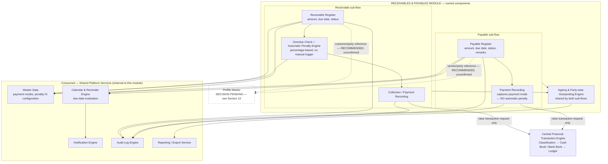
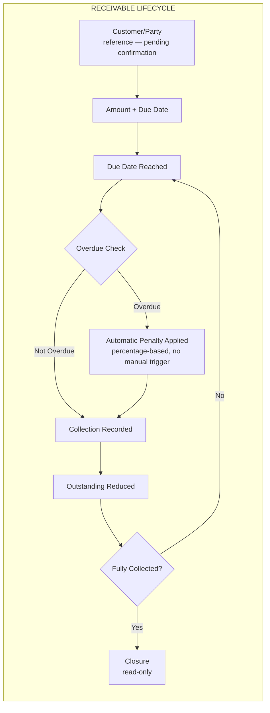
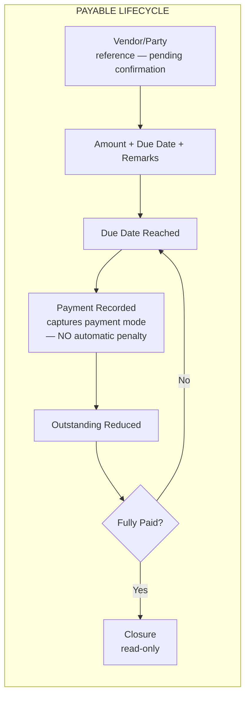

# SYSTEM ARCHITECTURE — RECEIVABLES & PAYABLES MODULE
## Personal Business Management System (PBMS)

**Scope of this document:** the Receivables & Payables module only. All shared platform capabilities (Authentication, RBAC, Profile identity, Master Data, Central Financial Transaction Engine, Calendar & Reminders, Notifications, Audit Logging, Reporting/Export) are treated as existing, external dependencies this module consumes — they are described only to the extent needed to show the module's boundary, never redesigned here.

---

## 1. Module Purpose & Scope

The Receivables & Payables module exists to track two independent money-owed flows that sit **outside** the platform's lending book (Finance module):

- **Receivables** — amounts owed *to* the business by a customer/party, each with an amount, due date, and status. Once overdue, an **automatic penalty** applies using a configured percentage, without any user action to trigger it. Recording a payment reduces the outstanding balance.
- **Payables** — amounts owed *by* the business to a vendor/party, each with an amount, due date, status, and remarks. Recording a payment captures the payment mode used. **No automatic penalty is documented for Payables.**

This Receivable-penalized / Payable-not-penalized asymmetry is **deliberate and confirmed** — it is not an oversight to be "fixed" by adding a symmetric payable penalty. Both sides support ageing analysis and party-wise outstanding reporting, but the two flows are architecturally independent siblings, not two views of one entity: a Receivable never becomes a Payable and vice versa.

**Explicitly out of scope for this module:** identity management, authentication/session handling, permission enforcement, financial posting/ledger logic, notification delivery, calendar-scheduling mechanics, audit-log storage, and reporting/export infrastructure. Every one of these is a shared platform capability the module calls, never something it builds.

**Explicitly unresolved and not assumed in this document:** whether a Receivable's customer/party or a Payable's vendor/party must reference the platform's shared Profile identity service, or may be recorded independently/as free text. A Profile-linked design is the **recommended** direction for consistency with the platform's single-identity principle, but it is **not confirmed**, and this document does not treat it as decided. See Section 10.

---

## 2. Component Architecture



**Reading notes:**

- Receivable and Payable are drawn as **siblings** sharing the same shape of dependency on Master Data, Calendar, Notification, Audit, and the Central Financial Transaction Engine — neither sub-flow is a special case or a variant of the other.
- The automatic penalty engine appears **only** inside the Receivable sub-flow. There is no equivalent box inside Payable — this asymmetry is drawn deliberately, not omitted by mistake.
- The Ageing & Party-wise Outstanding Engine is one owned component consumed by both sub-flows, avoiding a duplicated ageing implementation per side.
- Both dashed lines to Profile Master represent the **same pending decision** — Section 10 — applied consistently to both Receivable and Payable; this diagram does not resolve it and does not show one sub-flow committed to Profile while the other remains free-text.

---

## 3. Data Ownership

| Entity | Owned By | Key Attributes | Notes |
|---|---|---|---|
| **Receivable record** | Receivables & Payables Module | Customer/party reference **(pending confirmation — see Section 10)**, amount, due date, status, accrued automatic penalty amount, outstanding balance | Automatic penalty accrual is computed by this module's Overdue Check engine using a configured percentage from Master Data; the penalty amount becomes part of the Receivable's own outstanding figure. |
| **Payable record** | Receivables & Payables Module | Vendor/party reference **(pending confirmation — see Section 10)**, amount, due date, status, remarks, outstanding balance | No penalty field exists on this entity — its absence is intentional, mirroring the confirmed no-automatic-penalty behavior for Payables. |
| **Penalty configuration (percentage)** | Master Data (shared) | — | Receivables & Payables *references* this configured value; it does not own or edit the percentage itself. |
| **Payment mode value** | Master Data (shared) | — | Referenced by Payable payment recording (and by Receivable collection recording), not owned locally. |
| **Party / customer / vendor identity** | **Pending confirmation** — either Profile Master (shared) or free-text within the Receivable/Payable record itself | — | See Section 10. Neither this table nor any other section of this document assumes an outcome. |
| **Cash Book / Bank Book / Central Ledger entry** | Central Financial Transaction Engine (shared) | Amount, direction, classification, source module = "Receivables & Payables", source record reference, entered-by, timestamp | Receivable and Payable records hold references to the resulting ledger entries; they never hold the running cash/bank balance themselves. |
| **Due-date schedule state** | Calendar & Reminder Engine (shared) | Due-date evaluation, overdue trigger state | The module supplies the due date; the shared Calendar service owns evaluating it against the current date, which in turn is what allows the Overdue Check engine to know a Receivable has crossed into penalty territory. |
| **Audit trail of Receivable/Payable actions** | Audit Log Engine (shared) | Actor, action, entity, timestamp | The module raises the event; it does not store the log. |

---

## 4. Inputs & Outputs

### Inputs

| Input | Sub-flow | Source | Required? |
|---|---|---|---|
| Customer/party reference | Receivable | User — **shape unconfirmed** (Profile ID vs. free text) | Yes |
| Amount, due date | Receivable | User | Yes |
| Status | Receivable | Derived/updated by module (open, overdue, partially collected, closed) | System-managed |
| Vendor/party reference | Payable | User — **shape unconfirmed** | Yes |
| Amount, due date | Payable | User | Yes |
| Status, remarks | Payable | User (remarks); status system-managed | Remarks optional |
| Penalty percentage configuration | Receivable (consumed) | Master Data | Yes, for automatic penalty computation |
| Payment/collection amount and payment mode | Both | User | Yes, at time of collection/payment |

### Outputs

| Output | Destination |
|---|---|
| Transaction-raise request for a collection (Receivable) | Central Financial Transaction Engine |
| Transaction-raise request for a payment (Payable) | Central Financial Transaction Engine |
| Posting confirmation | Back to the user via the Collection / Payment Recording component |
| Due-date registration for overdue/penalty evaluation (Receivable) and for reminder purposes (both) | Calendar & Reminder Engine |
| Audit event (record raised, penalty applied, collection/payment recorded, closure) | Audit Log Engine |
| Ageing buckets and party-wise outstanding summaries, for both Receivables and Payables independently | Reporting/Export Service; Executive Dashboard |

---

## 5. Lifecycle Workflows — Receivable and Payable, Side by Side





**Key behavior called out explicitly:**

- The Receivable lifecycle has an extra decision node — the Overdue Check that can produce an Automatic Penalty — that has **no counterpart** in the Payable lifecycle. This is the single structural difference between the two diagrams, and it is intentional: it is the direct visual expression of the confirmed Receivable/Payable penalty asymmetry, not a simplification.
- Both lifecycles loop back from "outstanding reduced" to "due date reached" to support partial collections/payments over multiple instalments before final closure.
- Both lifecycles terminate in a read-only closure state, consistent with the platform-wide rule that closed financial records are not reopened or edited after the fact.

---

## 6. Financial Posting Sequence

```mermaid
sequenceDiagram
    participant User as Employee / Administrator
    participant RP as Receivables & Payables Module
    participant CFE as Central Financial Transaction Engine
    participant Book as Cash Book / Bank Book
    participant Led as Central Ledger
    participant Aud as Audit Log Engine
    participant Dash as Dashboard / Reports

    User->>RP: Record collection (Receivable) OR payment (Payable)
    RP->>RP: Validate mandatory fields; validate payment mode/bank account consistency
    RP->>CFE: Raise transaction request (amount, mode, classification context)
    CFE->>CFE: Classify Accounted / Non-Accounted
    CFE->>Book: Post to Cash Book or selected Bank Account
    Book->>Led: Write Central Ledger entry
    CFE->>Aud: Record actor, timestamp, entity reference
    Led->>Dash: Update ageing / party-wise outstanding figures
    CFE-->>RP: Posting confirmation
    RP-->>User: Confirmation; outstanding balance reduced, status updated
```

**Architectural guarantee:** the module never holds an intermediate, uncommitted financial state on either side. A submitted collection or payment either results in a fully posted, ledgered, audited entry, or is rejected at validation before ever reaching the CFE. The automatic Receivable penalty is computed and attached to the record's outstanding figure by the module itself, independent of this sequence — it does not, by itself, generate a CFE posting; only an actual money movement (collection or payment) does.

---

## 7. Dependencies

| Direction | Component | Nature of Dependency |
|---|---|---|
| **Upstream** (module depends on) | Master Data | Payment-mode values; penalty-percentage configuration |
| **Upstream** | Central Financial Transaction Engine | The sole path for classification and Cash Book/Bank Book/Ledger posting of collections and payments |
| **Upstream** | Calendar & Reminder Engine | Due-date evaluation for both sub-flows; overdue-state evaluation that feeds the Receivable penalty trigger |
| **Upstream** | Notification Engine | Delivery of due/overdue reminders (invoked by Calendar, not directly by this module) |
| **Upstream** | Audit Log Engine | Immutable recording of Receivable and Payable lifecycle events |
| **Upstream — pending** | Profile Master | Only if party/customer/vendor linkage is confirmed (Section 10) |
| **Downstream** (depends on module) | Executive Dashboard | Ageing summaries, party-wise outstanding figures for both Receivables and Payables |
| **Downstream** | Reports (via Reporting/Export) | Ageing reports, party-wise outstanding reports, independently for each sub-flow |

**What this module is never a dependency of:** Authentication, RBAC, Profile Master, Notification delivery mechanics, Calendar scheduling mechanics, Audit storage, or Reporting/Export infrastructure. These are one-directional dependencies — the module consumes them, never the reverse. Note also that this module has **no** dependency on, or relationship with, the Finance (lending) module — Receivables & Payables tracks money-owed flows outside the lending book by definition, and a Receivable or Payable is never converted into or from a loan.

---

## 8. RBAC Touchpoints

Receivables & Payables does not implement any permission logic. It only **declares** which of its actions are restricted, if any; the shared RBAC service performs the actual allow/deny check on every request, server-side, regardless of UI state.

| Action | Typical Role | Notes |
|---|---|---|
| Raise a new Receivable | Employee or Administrator | No approval workflow is documented. |
| Raise a new Payable | Employee or Administrator | No approval workflow is documented. |
| Record a collection against a Receivable | Employee or Administrator | No approval gate documented — posts immediately through the CFE. |
| Record a payment against a Payable | Employee or Administrator | No approval gate documented — posts immediately through the CFE. |
| View ageing / party-wise outstanding reports | Employee or Administrator | Read access; no restriction documented beyond general authenticated access. |
| Override or waive an automatically-applied Receivable penalty | **Unspecified** | Whether any role can waive a system-computed penalty, and if so which role, is not stated in source requirements — treated as an open item alongside Section 10, not assumed here. |
| Delete a Receivable or Payable record | **Not permitted** as a destructive operation | Consistent with the platform-wide rule that financial and business records are never hard-deleted. |

---

## 9. Ownership Boundary

| Receivables & Payables OWNS | Receivables & Payables MUST NOT OWN |
|---|---|
| The Receivable register (amount, due date, status, accrued penalty, outstanding) | Cash Book, Bank Book, or Central Ledger posting logic (Central Financial Transaction Engine's exclusive responsibility) |
| The Payable register (amount, due date, status, remarks, outstanding) | Payment-mode values and penalty-percentage configuration (Master Data owns the values; this module only references them) |
| The automatic overdue-penalty *computation* for Receivables (applying the configured percentage) | The overdue-*evaluation* mechanism itself (Calendar & Reminder Engine determines when a due date has passed) |
| Collection recording (Receivable) and payment recording (Payable), including payment mode capture | Notification delivery mechanics (Notification Engine) |
| Ageing computation and party-wise outstanding aggregation for both sub-flows | Authentication, session management, or the RBAC permission-check mechanism itself |
| Raising a transaction request with the correct amount and payment-mode context, for both collections and payments | Audit-log storage (this module raises audit events; it never maintains its own parallel history-of-changes store) |
| — | Party/customer/vendor identity data, if Profile linkage is confirmed (Section 10) — identity remains owned by Profile Master, never duplicated into this module's records |

---

## 10. Open Architecture Questions — Not Resolved Here

### Headline item: Party linkage for customer/vendor (Profile-linked vs. independent/free-text)

It is **unresolved** whether a Receivable's customer/party and a Payable's vendor/party must reference the platform's shared Profile identity service, or may be recorded as an independent/free-text field local to the Receivable or Payable record. A Profile-linked design is the **recommended** direction, for consistency with the platform's single-identity principle applied elsewhere (e.g., Finance's borrower, Rental's tenant, Chit Fund's member) — but recommendation is not confirmation, and this document treats the question as genuinely open. The consequence of each option, without picking one:

**Option A — Profile-linked.**
- The customer/vendor becomes a normal Profile-reference relationship, identical in shape to how Finance references a borrower.
- A party's Receivable/Payable history unifies automatically with any other role they hold elsewhere on the platform — e.g., a customer with an outstanding Receivable who is also a chit-fund member, or a vendor who is also a tenant, appears as one coherent Profile across modules, which is the platform's core single-identity guarantee in action.
- Requires that every customer/vendor be onboarded into Profile Master before a Receivable/Payable can be raised against them — this adds friction if the business deals with many one-off, casual, or short-lived parties who would otherwise never need a durable Profile record.
- Ageing and outstanding reports could, in principle, be rolled up per Profile across *both* Receivable and Payable simultaneously (net position with a party), though whether that cross-sub-flow rollup is actually wanted is itself unconfirmed and outside this module's stated scope.

**Option B — Independent / free-text party.**
- The Receivable or Payable record carries its own party name (and possibly contact detail) with no link to Profile Master.
- Zero onboarding friction — a Receivable or Payable can be raised against anyone immediately, with no dependency on Profile Master's state.
- The party's Receivable/Payable history sits entirely outside the Profile Master's guarantee; if the same party also appears as a borrower, tenant, or chit member elsewhere, no automatic unification occurs, and reconciling that they are "the same person" becomes a manual, error-prone exercise (e.g., matched by name only).
- Ageing and party-wise outstanding reporting still works *within* this module (grouping by the free-text party field), but cannot participate in any platform-wide, cross-module party view.

This decision affects the Receivable and Payable schemas directly (Section 3) and should be confirmed before those schemas are finalized. It is listed as the headline item because, of the six PBMS modules, this is the module where the platform's own architecture explicitly flags a *recommended* answer without committing to it — making it the most consequential unresolved decision in the entire module set to leave open.

### Additional open items

1. **Penalty override/waiver authority (unspecified).** Whether any role can waive or reduce an automatically-applied Receivable penalty, and if so under what conditions, is not stated.
2. **Partial collection/payment granularity (unspecified detail).** The lifecycle diagrams show a loop supporting multiple partial collections/payments before closure, but whether there is a minimum partial-amount rule, or whether each partial event is individually visible in ageing reports, is not stated.
3. **Cross-sub-flow netting (unspecified, and explicitly not assumed).** Whether a business is ever permitted to net a Receivable against a Payable with the same party (rather than settling each independently) is not documented; this document treats Receivable and Payable as fully independent flows with no netting capability, per Section 1, and does not introduce one.

---

*End of standalone Receivables & Payables module system architecture.*
